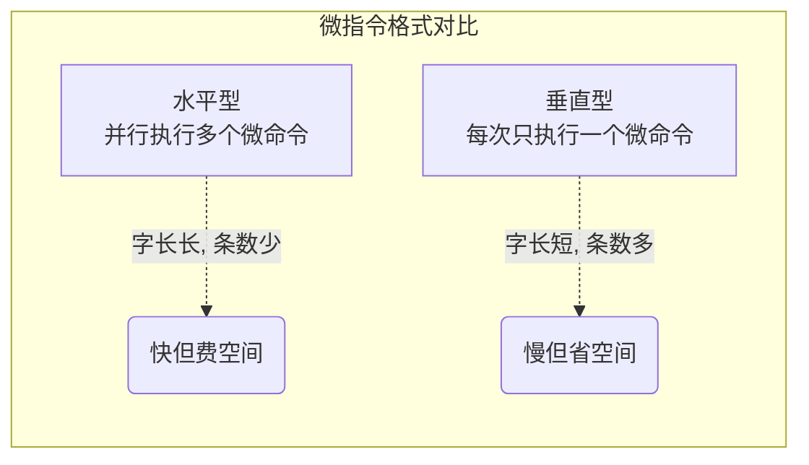

# 计算机组成原理：微指令的设计

> **导语**
> 各位同学大家好！在上一个小节中，我们理解了微程序控制器的基本工作流程。
> 本节课我们将目光聚焦到控制存储器 (CM) 内部那一条条具体的“微指令”上，重点探讨微指令的**格式设计**、**操作控制字段的编码方式**（如何用二进制位发出控制信号），以及**下地址的确定方式**（如何找到下一条微指令）。
> 掌握这三块内容，你就能彻底打通微程序控制器的设计原理，这也是历年 408 考研大题和选择题的高频出题点。

---

## 一、 微指令的格式分类

微指令的整体格式决定了微程序的“体型”和执行效率。主要分为三种类型，重点掌握前两种的区别。

### 1. 水平型微指令 (Horizontal Microinstruction)

- **格式特征**：一条微指令可以**同时定义并执行多个可并行的微操作**（例如同时发出 `PC_out` 和 `MAR_in`）。
- **体型特征**：指令字长较**长**（通常几十位甚至上百位），但整个微程序包含的微指令条数较**少**（又胖又矮）。
- **优缺点**：
  - **优点**：并行能力强，执行速度快。
  - **缺点**：微指令过长导致控存 (CM) 容量极大，且编写微程序较为困难。

### 2. 垂直型微指令 (Vertical Microinstruction)

- **格式特征**：格式类似于普通的机器指令。一条微指令**只能定义并执行一个微操作**。由微操作码字段负责指明具体操作。
- **体型特征**：指令字长较**短**，但完成同一个机器指令需要很多条微指令串行执行，导致微程序较**长**（又瘦又高）。
- **优缺点**：
  - **优点**：字长短，格式简单规整，便于程序员编写。
  - **缺点**：毫无并行能力，导致执行速度极慢。

### 3. 混合型微指令

- 结合了前两者的优点：在垂直型指令的基础上增加了一些简单的并行操作。既保证微指令不会太长，又提高了执行速度。

---

## 二、 操作控制字段的编码方式 (★ 核心重难点)

针对**水平型微指令**，我们必须解决一个问题：如何用操作控制字段的若干个比特位，来表达成百上千种控制信号（微命令）？
设计目标是：既要保证执行速度快，又要尽量缩短微指令的字长。

### 1. 直接编码方式 (直接控制法)

- **原理**：操作控制字段中的**每一个比特位，直接对应一个微命令**（一根物理控制线）。
  - 例如：第 1 位为 `1` 代表发出 `PC_out` 信号；第 2 位为 `1` 代表发出 `MAR_in` 信号。
- **优缺点**：
  - **优点**：简单直观，零译码延迟，执行速度极快；并行性极好。
  - **缺点**：**极其浪费空间！** 如果系统有 $N$ 个微命令，操作控制字段就需要 $N$ 个比特位。这会导致微指令极长，控存芯片（ROM）体积庞大，推高 CPU 制造成本。

### 2. 字段直接编码方式 (★ 最常考)

为了缩短微指令字长，我们将操作控制字段划分为若干个“段”。

- **核心原理与划分规则**：
  1.  **互斥的微操作分在同一段**：把永远不可能同时发生的微操作（如 `PC->MAR` 和 `PC+1`）归为一组。
  2.  **相容的微操作分在不同段**：允许并行的微操作必须分布在不同的段中。
- **执行机制**：每个段通过硬件的**译码器**将本段的二进制编码翻译为特定的互斥控制信号。
- **⚠️ 留空状态铁律**：每一个分段都必须留出一个特殊的二进制状态（通常是全 `0`），用来表示**本段不发出任何微命令**。
- **考点实战**：假设某个互斥类有 7 个微操作。
  - 加上 1 个留空状态，共需表示 8 种状态。
  - $2^3 = 8$，因此该互斥类所在的字段需要 **3 个比特位**。

### 3. 字段间接编码方式 (隐式编码)

- **原理**：一个字段发出的微命令，需要由另一个字段发出的微命令来协同“解释”。即需要经过两级甚至多级译码。
- **优缺点**：能进一步缩短字长，但多级译码会严重拖慢执行速度，并行能力下降。简单了解即可。

---

## 三、 微指令下地址的确定方式

当前微指令执行完后，如何找到下一条微指令在控制存储器 (CM) 中的地址？常见方法如下：

1.  **断定方式 (下地址字段法)**：(★ 最常用) 直接由本条微指令的**下地址字段**指明下一条微指令的物理地址。
2.  **增量计数器法**：类似于机器指令的 `PC+1`。如果微指令是顺序执行的，直接让当前地址加 1 即可 `(CMAR + 1 -> CMAR)`。
3.  **微地址形成部件 (操作码映射)**：(★ 关键步骤) 专门用于机器指令在**取指结束，转入执行周期时**使用。根据机器指令的**操作码 (Opcode)** 硬件映射出对应微程序的第一条微指令地址。
4.  **测试网络/硬件直接产生**：例如结合标志寄存器的状态进行条件分支跳转；或者硬件直接规定所有取指周期的首地址为 `0号` 地址。

> **🌟 考研经典命题实战：下地址字段位数计算**
> **题目**：某计算机有 32 条指令，公共取指微程序有 2 条微指令，每条指令的执行微程序平均有 4 条微指令。采用断定法确定下地址。问：微指令的下地址字段至少需要几位？
> **破题逻辑**：
>
> 1. 下地址字段的位数取决于**控存中微指令的总条数**。
> 2. 微指令总数 = 执行周期微指令数 + 公共取指周期微指令数。
> 3. 总条数 = $(32 	imes 4) + 2 = 130$ 条。
> 4. $2^7 = 128$ 不够，必须用到 $2^8 = 256$。因此下地址字段至少需要 **8 位**。

---

## 本节复习要点汇总

1.  **微指令格式**：死记“水平型 = 并行多、字长长、程序短”；“垂直型 = 串行、字长短、程序长”。
2.  **字段直接编码法的计算题**：牢记**“互斥同段，相容异段”**的原则，在计算所需比特数时，**绝对不能忘记加上 1 个全零的留空状态！**
3.  **寻址方式组合**：实际运行中，微指令序列的寻址是混合的。进入执行周期靠“微地址形成部件”根据操作码映射，顺着执行时主要靠“下地址字段断定法”或“增量计数器”。
