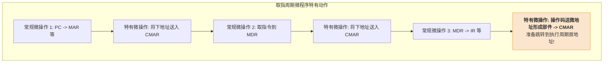

# 计算机组成原理：微程序控制单元的设计与对比

> **导语**
> 各位同学大家好，本节课是微程序控制器部分的最后一课，我们将动手“设计”一个微程序控制单元，了解从分析指令到烧录 ROM 的全过程。
> 此外，我们将对本章的两大核心 BOSS——**硬布线控制器**与**微程序控制器**——进行一次全方位的终极对决对比。这也是 408 考研选择题和综合大题极爱考查的硬核考点，请务必吃透这两种设计思想的优劣势及其适用场景。

---

## 一、 微程序控制单元的设计步骤

设计微程序控制器，本质上就是把一条条机器指令，翻译并编排成存放在 ROM 中的微指令序列。具体分为四大步骤：

### 1. 分析微操作序列

分析每条机器指令在取指、间址、执行、中断各个阶段所需执行的微操作序列。这与硬布线控制器的第一步是相同的。

### 2. 安排微操作节拍 (合并相容操作)

将可以并行的（相容的）微操作合并到同一个节拍（即同一条微指令）中。

> 🚨 **【微程序专属的特有微操作】**
> 与硬布线控制器不同，微程序控制器需要**靠执行指令来寻找下一条指令**。因此，必须在每个阶段额外插入特有的微操作：
>
> - **在每条微指令执行完毕后**：必须消耗一个节拍，将该微指令的“下地址字段”送入 `CMAR` (控存地址寄存器)，以指明下一条微指令的位置。
> - **在取指周期的最后**：必须消耗一个节拍，将机器指令的操作码送入“微地址形成部件”，算出执行周期首地址，并送入 `CMAR`。
> - _结论_：因为频繁穿插这些寻址微操作，**微程序控制器的执行节拍数必然多于硬布线控制器，导致其速度较慢**。

### 3. 确定微指令格式

- **确定编码方式**：选择直接编码、字段直接编码或间接编码，从而确定“操作控制字段”的位数。
- **确定下地址位数**：根据控存 (CM) 中需要存储的**微指令总条数**，计算“顺序控制字段 (下地址)”所需的位数（如 130 条需 8 位）。
- **确定字长**：操作控制字段 + 下地址字段 = 微指令总字长。

### 4. 编写微指令码点并写入控存

根据上述设计，写出每条微指令具体的 0/1 序列（码点），最后在 CPU 出厂前，将其烧录进控制器内部的 **ROM (控制存储器 CM)** 中。

---

## 二、 微程序设计的两类扩展概念 (了解即可)

### 1. 静态与动态微程序设计

- **静态微程序设计**：微程序固化在只读存储器 (ROM) 中，出厂后**不可更改**。
- **动态微程序设计**：控存采用**可擦写**的存储器（如 EEPROM、Flash 闪存）。允许在机器制造后，通过重写微程序来修改指令系统，甚至增加新的机器指令。（如现代 Intel x86 处理器的微码更新）。

### 2. 毫微程序设计 (Nano-programming)

- **概念**：一种更深层的“套娃”。
  - 机器指令由**微程序**解释执行；
  - 而一条微指令，再由底层的**毫微程序**来解释执行。
- _目的_：为了极度压缩微指令的长度，但在现代体系结构中已极少使用。

---

## 三、 终极对决：硬布线控制器 VS 微程序控制器 (★ 必考考点)

这是本章的核心结论表格，请务必结合它们各自的实现原理（**纯硬件门电路** vs **ROM 查表执行程序**）来理解其特性的差异。

| 对比维度              | 硬布线控制器 (Hardwired Control)                                                                | 微程序控制器 (Microprogrammed Control)                                                                                  |
| :-------------------- | :---------------------------------------------------------------------------------------------- | :---------------------------------------------------------------------------------------------------------------------- |
| **设计思想**          | **纯硬件**思想 (靠复杂的逻辑门电路组合产生控制信号)                                             | **软件**思想 (将控制信号编成微指令，存在 ROM 里查表执行)                                                                |
| **执行速度**          | **极快** (电信号通过逻辑门瞬间产生，0 延迟)                                                     | **较慢** (每发一次控制信号，都要去 ROM 中寻址、读取微指令，且夹杂大量寻址微操作)                                        |
| **电路规整度**        | **繁琐、极不规整** (指令越复杂，门电路越像一团乱麻)                                             | **高度规整** (主体就是一个存储微指令的 ROM 矩阵)                                                                        |
| **可扩充性 / 修改性** | **极差** (想增加一条新指令，必须把芯片回炉重造，重新布线)                                       | **极好** (只需在 ROM 中刷入新指令对应的微程序序列即可)                                                                  |
| **适用架构**          | 适用于 **RISC (精简指令集)**。  _因为 RISC 指令少且简单，硬布线设计难度可控，追求极致速度。_ | 适用于 **CISC (复杂指令集)** (如 x86 架构)。  _因为 CISC 指令多且极其复杂，硬布线根本画不出来，只能用微程序来兜底。_ |

### 【防坑备忘录】微程序四大共享段

在做控存容量计算题时，再次默念：
**“取指周期、间址周期、中断周期”** 这三个阶段的微程序，是所有机器指令**完全一样、公用共享**的！在 ROM 中绝对只存一份！
只有**执行周期**的微程序，才是百花齐放、各不相同的。

至此，中央处理器 (CPU) 控制器的所有知识已经学习完毕。下一章，我们将进入流水线的奇妙世界！
