# 计算机组成原理：指令流水线的基本概念与性能指标

> **导语**
> 各位同学大家好，从这个小节开始，我们将进入第五章极为重要的一环：**指令流水线**。
> 本节课我们将学习流水线的基本思想，对比不同的指令执行方式，并通过直观的图示（指令流程图与时空图）来感受流水线是如何提升 CPU 工作效率的。最后，我们将重点推导衡量流水线性能的三大核心指标：**吞吐率、加速比和效率**，这是历年考研大题和选择题的必考计算点。

---

## 一、 指令执行方式的演进

一条指令的执行通常可以被划分为多个独立的阶段（如：取指、分析/译码、执行等）。**关键前提**：在不同的阶段，指令所使用到的 CPU 硬件部件（如 PC、主存、指令译码器、ALU 等）通常是互不相同的。为了方便分析，我们假设每个阶段耗时均为 $\Delta t$。

### 1. 顺序执行方式 (串行执行)

- **机制**：前一条指令的所有阶段全部完成后，才开始下一条指令。
- **总耗时**：假设每条指令分 3 个阶段，耗时 $3\Delta t$，共 $n$ 条指令。总耗时 $T = n \times 3\Delta t = 3n\Delta t$。
- **优缺点**：硬件代价小，控制逻辑极简；但**各功能部件利用率极低**，整体执行速度慢。

### 2. 一次重叠执行方式

- **机制**：当前指令的“执行”阶段，与下一条指令的“取指”阶段在时间上发生重叠。
- **总耗时**：$T = 3\Delta t + (n-1) \times 2\Delta t$。
- **优缺点**：相比串行方式节省了约 $1/3$ 的时间；但需要增加一定的硬件投入以处理阶段重叠带来的冲突。

### 3. 两次重叠 / 流水线执行方式 (最理想状态)

- **机制**：将指令切分为 $k$ 个耗时均等的阶段（且各阶段硬件互不冲突），每个阶段均可独立、并行工作，犹如工厂的流水线。
- **总耗时**：第一条指令需要完整的 $k \times \Delta t$ 来完成“装入”（填满流水线）。之后每隔一个 $\Delta t$，就会有一条指令“排空”（执行完毕）。
  - **公式**：$$T_k = k \cdot \Delta t + (n-1) \cdot \Delta t = (k + n - 1) \cdot \Delta t$$
- **优缺点**：硬件部件利用率极高，理想情况下同一时刻有 $k$ 条指令在并行执行；但硬件开销大，控制极其复杂。

---

## 二、 描述流水线的核心图示：时空图

时空图是用于分析流水线性能最重要的工具。它的横坐标表示**时间**，纵坐标表示**不同的功能部件 (或执行阶段)**。

```mermaid
gantt
    title 最理想状态下的指令流水线时空图 (以 k=4 阶段为例)
    dateFormat  s
    axisFormat  %S

    section 硬件部件 1 (取指)
    指令 1 : 0, 1
    指令 2 : 1, 2
    指令 3 : 2, 3
    指令 4 : 3, 4

    section 硬件部件 2 (分析)
    指令 1 : 1, 2
    指令 2 : 2, 3
    指令 3 : 3, 4
    指令 4 : 4, 5

    section 硬件部件 3 (执行)
    指令 1 : 2, 3
    指令 2 : 3, 4
    指令 3 : 4, 5
    指令 4 : 5, 6

    section 硬件部件 4 (写回)
    指令 1 : 3, 4
    指令 2 : 4, 5
    指令 3 : 5, 6
    指令 4 : 6, 7
```

- **装入时间 (Fill Time)**：第一条指令从进入流水线到完全执行完毕所需的时间。这期间各个硬件部件陆续投入工作。
- **排空时间 (Drain Time)**：最后一条指令进入流水线后，到它完全执行完毕所需的时间。这期间硬件部件逐渐退出工作。

---

## 三、 评价流水线性能的三大核心指标 (★ 计算题考点)

在考研综合大题中，常要求计算这三大指标。以下公式均基于**最理想假设**：流水线被划分为 $k$ 段，每段耗时均为 $\Delta t$（通常取 1 个时钟周期）。

### 1. 吞吐率 (Throughput Rate, TP)

- **定义**：在单位时间内，流水线完成的任务（指令）数量。
- **计算公式**：
  $$TP = \frac{n}{T_k} = \frac{n}{(k + n - 1) \Delta t}$$
- **极限情况 (最大吞吐率)**：当任务数量 $n \rightarrow \infty$ 时，求极限可得：
  $$TP_{max} = \frac{1}{\Delta t}$$
  _(物理意义：流水线一旦满载，每经过一个时钟周期 $\Delta t$，就会稳定吐出一条执行完毕的指令！)_

### 2. 加速比 (Speedup, S)

- **定义**：完成同样一批任务，**不使用流水线 (顺序执行)** 所耗时间 $T_0$ 与**使用流水线**所耗时间 $T_k$ 之比。用来衡量流水线使速度提升了多少倍。
- **计算公式**：
  $$S = \frac{T_0}{T_k} = \frac{n \cdot k \cdot \Delta t}{(k + n - 1) \Delta t} = \frac{nk}{k + n - 1}$$
- **极限情况 (最大加速比)**：当任务数量 $n \rightarrow \infty$ 时，求极限可得：
  $$S_{max} = k$$
  _(物理意义：一条流水线如果分为 $k$ 段，理论上执行速度最多能提升 $k$ 倍！)_

### 3. 效率 (Efficiency, E)

- **定义**：流水线的设备利用率。即硬件部件处于“忙碌”的时间占整体“运行”时间的比例。
- **图形计算法 (面积法)**：在时空图中，效率 = **有效工作面积 / 总时空区矩形面积**。
  - 总矩形面积：$k$ 个部件 $\times$ 总耗时 $T_k$。
  - 有效占用面积：$n$ 条指令 $\times$ 每条指令需 $k$ 个阶段 $= n \cdot k \cdot \Delta t$。
- **计算公式**：
  $$E = \frac{有效工作面积}{总面积} = \frac{n \cdot k \cdot \Delta t}{k \cdot (k + n - 1) \Delta t} = \frac{n}{k + n - 1}$$
- **极限情况 (最高效率)**：当任务数量 $n \rightarrow \infty$ 时，求极限可得：
  $$E_{max} = 1$$
  _(物理意义：随着指令源源不断地输入，流水线的排空/装入所导致的“空白区”占比越来越小，设备几乎达到 100% 满载运转！)_

---

## 本节复习要点与下节预告

**知识串联**：
本节课给出的公式都是基于**最完美的理想假设**（各阶段时间绝对相等、硬件绝对独立、指令执行没有任何阻碍）。
但在实际的 CPU 运行中，各条指令之间往往存在着数据依赖，或者因为分支跳转打乱了执行流，导致指令被迫在流水线中“停顿”或“塞车”。这些破坏流水线完美运转的绊脚石，就是下一节的重头戏——**影响流水线的因素 (流水线冒险/冲突)**。
