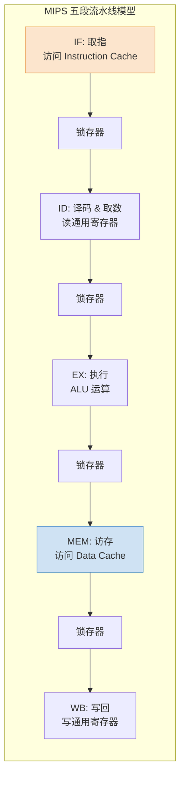
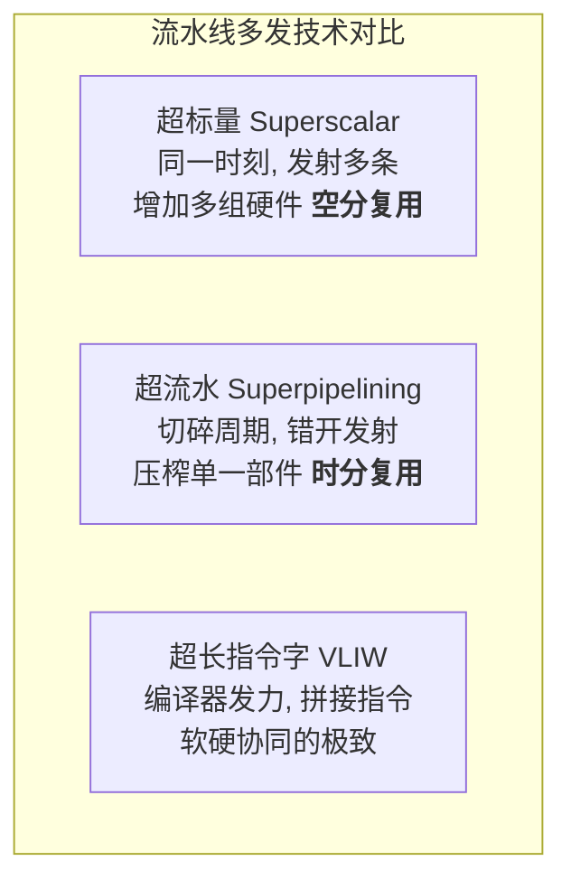

# 计算机组成原理：影响指令流水线的因素与多发技术

> **导语**
> 各位同学大家好，在上一小节中，我们探讨了最理想状态下的指令流水线模型。然而，现实往往是不完美的。在指令流水线高速运转时，经常会遇到各种“绊脚石”，导致流水线无法完美衔接，甚至发生断流。
> 本节课，我们将深入剖析这些影响流水线的核心因素（**结构相关、数据相关、控制相关**），并探讨如何通过软硬件手段解决这些冲突。最后，我们将了解现代 CPU 为了进一步压榨性能而采用的**流水线多发技术**。这也是 408 考研综合大题和选择题的重灾区。

---

## 一、 经典的五段式指令流水线 (MIPS 架构)

为了让问题探讨更具象，我们引入经典 RISC（精简指令集）架构——MIPS 提出的**五段式指令流水线**模型。在 MIPS 中，**所有指令**无论是否实际需要，都必须经历这 5 个机器周期，且每个周期耗时被强行统一（向最长耗时看齐，如统一定为 100ns）。

### 1. 五个标准阶段

1.  **IF (Instruction Fetch, 取指)**：根据 PC 从**指令 Cache** 中取出指令，放入锁存器。
2.  **ID (Instruction Decode, 译码与取数)**：对指令进行译码，**同时从通用寄存器中取出需要的操作数**，放入 A、B 锁存器。_(注意：RISC 架构下，运算操作数必须直接来自寄存器，不能直接来自主存)_。
3.  **EX (Execute, 执行)**：ALU 对操作数进行算术/逻辑运算，或计算有效地址，结果放入锁存器。
4.  **MEM (Memory, 访存)**：访问**数据 Cache** 以读写内存数据（如 `LOAD`/`STORE` 指令）。若不需访存，则此阶段空转。
5.  **WB (Write Back, 写回)**：将 ALU 的运算结果或从 Cache 读出的数据，写回到通用寄存器中。

### 2. 流水线段间寄存器 (锁存器)

为了让每个阶段严格对齐在 100ns，在每个功能段之间都必须设置**缓冲寄存器 (锁存器)**。它的作用是保存当前流水段的处理结果，并在下一个时钟边沿到来时，准时提供给下一段使用。



---

## 二、 影响流水线的核心因素 (流水线冒险/冲突)

流水线冲突主要分为三大类，它们分别对应着操作系统中的不同概念。

### 1. 结构相关 (资源冲突 / Structural Hazard)

- **本质**：多条指令在同一时刻争用同一个硬件资源（类似于操作系统的**互斥**问题）。
- **典型场景**：
  - **访存冲突**：第一条指令处于 MEM 段（访存），而第四条指令刚好处于 IF 段（取指），若两者使用同一个存储器，就会发生冲突。
  - **寄存器冲突**：第一条指令处于 WB 段（写寄存器），而第三条指令处于 ID 段（读同一个寄存器）。
- **解决办法**：
  1.  **等待 (气泡 Bubble)**：让后一条指令暂停一个周期。
  2.  **资源重复配置 (硬件分离)**：例如，将 Cache 分离为**独立的指令 Cache 和数据 Cache**；寄存器组采用独立读写端口。

### 2. 数据相关 (数据冲突 / Data Hazard) (★ 最常考)

- **本质**：下一条指令急需使用的数据，上一条指令还没来得及算完或写回（类似于操作系统的**同步**问题）。
- **典型场景 (写后读 RAW)**：
  ```assembly
  I1: ADD R1, R2, R3  ; R1 = R2 + R3 (结果在第 5 段 WB 才写回 R1)
  I2: SUB R4, R1, R3  ; R4 = R1 - R3 (急需在第 2 段 ID 就读出 R1)
  ```
  _I2 在 ID 阶段读取 `R1` 时，I1 还在 EX 或 MEM 阶段，导致 I2 读到的是旧数据！_
- **解决办法**：
  1.  **硬件阻塞 (Stall / 气泡)**：硬件检测到冲突，强行让后续指令暂停几个周期，直到数据写回。
  2.  **软件插入 NOP 指令**：编译器在存在冲突的指令间插入几条 `NOP` (空操作) 指令，人为拖延时间。
  3.  **数据旁路技术 (转发机制 / Forwarding)**：(★ 核心解法) 不等数据写回寄存器，直接把 ALU 的计算结果通过一条专用的“旁路导线”引回到下一条指令的 ALU 输入端。
  4.  **编译优化 (指令调度)**：编译器调整不相关指令的执行顺序，填补等待的空隙。

### 3. 控制相关 (控制冲突 / Control Hazard)

- **本质**：遇到转移指令 (如 `JMP`, `Jcc`)、函数调用或中断时，由于 PC 值被强行改变，导致流水线之前预先取入的后续指令全部作废，产生断流。
- **解决办法**：
  1.  **分支预测 (Branch Prediction)**：盲猜或根据历史动态预测分支是否发生。猜对血赚，猜错清空流水线重来。
  2.  **预取双向指令**：不管成不成功，把两条路上的指令都提前取出来（需增加硬件开销）。
  3.  **提前形成条件码**：优化硬件，尽早在 ID 或 EX 阶段算出跳转条件，减少错误指令进入流水线的数量。

---

## 三、 流水线的多发技术 (提升 IPC 的大招)

为了打破单个时钟周期只能完成 1 条指令（`IPC = 1`）的极限，现代 CPU 采用了以下多发技术：

### 1. 超标量技术 (Superscalar)

- **机制**：在**同一个时钟周期内，同时并发发射多条指令**。
- **硬件要求**：极高。必须配置多组取指、译码和 ALU 等功能部件（**空分复用**）。
- **软件要求**：程序指令按序执行，高度依赖编译器的指令调度优化，把没有冲突的指令捆绑在一起发射。

### 2. 超流水技术 (Superpipelining)

- **机制**：通过提高时钟频率，将一个普通的时钟周期**再细分为多个更短的子周期**，在不同的子周期时间点分别发射一条指令。
- **物理本质**：实际上是一种**时分复用**技术。流水线被切得极细极深。
- **要求**：同样依赖编译程序的优化调整。

### 3. 超长指令字技术 (VLIW)

- **机制**：编译器在编译阶段大显身手，寻找多条完全没有数据冲突、且使用不同执行部件的简单指令，将它们**拼接组合成一条几百比特的“超长指令字”**。
- **硬件要求**：CPU 取出这条超长指令后，直接分配给内部多个独立的处理部件同时执行。



---

## 本节复习要点总结

1.  **五段流水线的铁律**：牢记 `IF -> ID -> EX -> MEM -> WB` 的顺序，以及 RISC 架构中操作数只能在 `ID` 段从寄存器取出的特性。
2.  **冲突归类定性**：
    - 抢设备 $\rightarrow$ **结构相关** (解法：加设备/分离 Cache)
    - 抢数据 (没算完就要用) $\rightarrow$ **数据相关** (解法：旁路转发/气泡/重排)
    - PC 乱跳 $\rightarrow$ **控制相关** (解法：分支预测)
3.  **多发技术概念辨析**：超标量是“同一时刻多发”（并行/空分）；超流水是“一个大周期内错开发”（并发/时分）；VLIW 是“编译拼长指令”。
