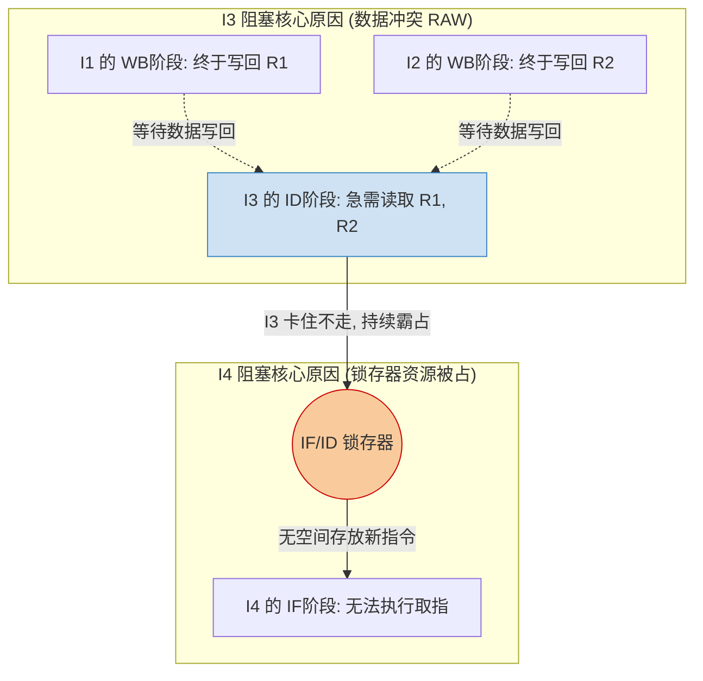

# 计算机组成原理：五段式指令流水线与典型指令执行分析

经典的 MIPS 五段式指令流水线是计算机组成原理的核心内容。在精简指令集 (RISC) 架构中，为了方便流水线的统一调度，所有指令的执行过程都会被强制划分为耗时相等的五个阶段，并在每个阶段之间插入缓冲寄存器（锁存器）来保存中间结果。

## 一、 五段式流水线的标准阶段划分

一条标准指令在 MIPS 架构下的生命周期固定为以下五个阶段（即使某些阶段对特定指令无实际作用，也必须消耗对应的时间即“空转”）：

1. **IF (Instruction Fetch) - 取指阶段**：根据程序计数器 PC 从指令 Cache 中取出指令，并存入 IF 段的锁存器。
2. **ID (Instruction Decode) - 译码与取数阶段**：对指令操作码进行译码，同时从通用寄存器组中取出所需的操作数（或从指令中提取立即数），放入 ID 段的锁存器。
3. **EX (Execute) - 执行阶段**：ALU (算术逻辑单元) 对操作数进行运算，或计算访存时的有效地址 (EA)，结果存入 EX 段的锁存器。
4. **MEM (Memory) - 访存阶段**：根据有效地址，从数据 Cache 中读取数据或将数据写入数据 Cache。
5. **WB (Write Back) - 写回阶段**：将 ALU 运算结果或从 Cache 读出的数据，写回到目的通用寄存器。

---

## 二、 五大类典型指令的流水线执行剖析

不同指令在各个流水段的实际“作为”是不一样的。以下详细拆解五大类常见指令在各个阶段的实际动作。

### 1. 运算类指令 (如 ADD, SHL)

**功能**：对寄存器或立即数进行算术/逻辑运算，结果存回寄存器。

- **IF**：取指令。
- **ID**：译码，并将源操作数读入 `A`、`B` 锁存器（若含立即数则放入 `imm` 锁存器）。
- **EX**：ALU 完成算术/逻辑运算。
- **MEM**：**空转**。运算类指令不需要访问主存，但必须在此阶段等待一个周期。
- **WB**：将 EX 阶段产生的运算结果写回目标寄存器。

### 2. LOAD 取数指令

**功能**：`LOAD Rd, offset(Rs)`，将主存中的数据读入目标寄存器。

- **IF**：取指令。
- **ID**：译码，将基址寄存器 `Rs` 读入 `A` 锁存器，将偏移量放入 `imm` 锁存器。
- **EX**：ALU 执行加法，基址与偏移量相加得到**有效地址 (EA)**。
- **MEM**：根据有效地址 EA 从**数据 Cache** 中读出目标数据。
- **WB**：将读出的数据写回目标通用寄存器 `Rd`。

### 3. STORE 存数指令

**功能**：`STORE Rs, offset(Rd)`，将寄存器的数据写入主存。

- **IF**：取指令。
- **ID**：译码，将基址寄存器 `Rd` 读入 `A` 锁存器，偏移量放入 `imm` 锁存器；同时将需要存入内存的源操作数 `Rs` 读入 `B` 锁存器。
- **EX**：ALU 计算有效地址 (EA)。同时源数据从 `B` 锁存器透传至下一级锁存器。
- **MEM**：将源数据写入**数据 Cache** 的对应地址。
- **WB**：**空转**。数据已存入主存，无需写回通用寄存器。

### 4. 条件转移指令 (如 BEQ, BNE)

**功能**：满足比较条件时，跳转到目标 PC 地址。采用相对寻址。

- **IF**：取指令。
- **ID**：读出需要比较的两个寄存器，提取偏移量。
- **EX**：ALU 比较两个寄存器的值，得出条件是否成立。
- **MEM**：**修改 PC 值**。若条件成立，将计算出的目标地址 (`PC + 指令字长 + 偏移量 * 指令字长`) 写入 PC 寄存器。（注：写 PC 是独立硬件动作，不在 WB 阶段进行）。
- **WB**：**空转**。

### 5. 无条件转移指令 (如 JMP)

**功能**：直接跳转到目标 PC 地址，无需条件比较。

- **IF**：取指令。
- **ID**：提取转移偏移量。
- **EX**：**提前修改 PC 值**。由于无需 ALU 进行条件比较，可直接计算目标地址并写入 PC。尽早修改 PC 有助于尽早发现并解决控制冲突。
- **MEM**：**空转**。
- **WB**：**空转**。

---

## 三、 历年真题实战：流水线阻塞（Bubble）深度分析

理解了上述指令的生命周期，就能轻松破解考试中最高频的大题考点——**流水线阻塞原因分析**。

**真题代码片段：**

```assembly
I1: LOAD R1, (A)    ; 从主存地址 A 读数据至 R1
I2: LOAD R2, (B)    ; 从主存地址 B 读数据至 R2
I3: ADD  R2, R1, R2 ; 计算 R1 + R2，存回 R2
I4: STORE R2, (X)   ; 将 R2 存入主存地址 X
```

### 1. I3 的 ID 段（译码取数）为何被阻塞推迟？

- **现象**：I3 是一条加法指令，本该在第 3 个周期进入 ID 阶段读操作数，但实际却被大幅推迟。
- **根本原因（数据相关 RAW）**：I3 在 ID 阶段急需读取 `R1` 和 `R2` 的最新值。但 `R1` 和 `R2` 的值是由前面的 I1 和 I2 (LOAD 指令) 负责装载的。根据 LOAD 指令的执行特征，数据直到 **WB (写回) 阶段结束** 才会真正落入通用寄存器。因此，I3 的 ID 阶段必须一直阻塞等待，直到 I1 和 I2 的 WB 阶段双双完成。

### 2. I4 的 IF 段（取指）为何被连环阻塞？

- **现象**：I4 本可以正常取指令，但其 IF 段也被推迟到了 I3 进入 ID 段之后。
- **根本原因（结构相关引发的连锁反应）**：由于 I3 在等待操作数，它一直“卡”在取指完成后、译码开始前的状态，导致 **IF/ID 段的锁存器被 I3 的指令数据持续占用**。如果此时放任 I4 强行执行 IF 段，取出的 I4 指令数据就会覆盖掉 IF/ID 锁存器中等待的 I3 指令。为了保护 I3 的指令不丢失，I4 必须暂停 IF 段的执行，等待 I3 顺利进入 ID 段腾出锁存器空间。


