# 计算机组成原理：五段式指令流水线冒险分析与处理

> **导语**
> 各位同学大家好，本节课我们将聚焦考研 408 组成原理的一大核心重难点题型：**五段式指令流水线中的各种“冒险”（冲突）分析**。
> 考研大纲要求我们掌握流水线的基本概念及结构冒险、数据冒险、控制冒险的处理方法。历年真题中最爱出的是给你一段 MIPS 指令序列，让你火眼金睛地挑出哪里发生了冒险，并要求你通过“硬件阻塞（插入气泡）”等方式来解决。掌握本节课的分析套路，你就能在考场上庖丁解牛般地拿捏这类大题。

---

## 一、 结构冒险 (资源冲突) 分析与处理

**结构冒险**是指多条指令在同一时钟周期内，争用同一个硬件资源而引发的冲突。

### 1. 冲突成因：取指与访存的碰撞

在经典的五段式流水线 (`IF-ID-EX-MEM-WB`) 中：

- 第 1 段 **IF (取指)**：需要访问 Cache 读取指令。
- 第 4 段 **MEM (访存)**：部分指令（如 Load/Store）需要访问 Cache 读写数据。

如果在 CPU 硬件中，指令和数据不加区分地存放在**同一个 Cache** 里，当第 1 条指令执行到第 4 段 (MEM) 时，第 4 条指令刚好进入第 1 段 (IF)。两者同时抢夺 Cache 资源，就会引发严重的**结构冒险**。

### 2. 解决方案：指令与数据 Cache 分离

- **方法一：硬件阻塞**。让后一条指令等待，直到前一条指令用完 Cache。这种方法极其拖慢速度。
- **方法二：资源重复配置 (分离 Cache) —— 考研标配**。将 Cache 在物理上拆分为两个独立的模块：**指令 Cache** (专供 IF 阶段使用) 和 **数据 Cache** (专供 MEM 阶段使用)。
  > **💡 破题心法**：在做 408 真题时，只要题目明确说是“五段式指令流水线”，你都可以**默认**它的指令 Cache 和数据 Cache 是分离的！即默认**不存在结构冒险**。

---

## 二、 数据冒险 (数据冲突) 分析与处理 (★ 核心考点)

**数据冒险**是指后面的指令急需使用的数据，前面的指令还没来得及算完或写回到寄存器中。

### 1. 识别数据冒险的三步法

在面对一段陌生的 MIPS 指令序列时，请严格按照以下三步进行“扫雷”：

1.  **锁定写寄存器的指令**：逐条检查指令，看它是否要修改某个通用寄存器。
    - _技巧_：看题目给的注释箭头 `->`，箭头所指如果是寄存器名（如 `r1`, `s2`），说明该指令会写这个寄存器。
    - _注意_：如果是 `Store` 指令写主存，或者转移指令改 PC，都不算写通用寄存器。
2.  **向后雷达扫描三条指令**：一旦确认某条指令写了寄存器 A，立即向后检查**紧邻的 3 条指令**。
    - _为什么只看后 3 条？_ 因为写寄存器动作永远在第 5 段 (**WB**)，读寄存器动作永远在第 2 段 (**ID**)。只有紧跟其后的 1、2、3 条指令的 ID 段，会在它 WB 写回之前发生。第 4 条指令读的时候，它早就写完了。
3.  **判定冲突**：如果这后续的 3 条指令中，有任何一条指令在其注释的源操作数里**包含了寄存器 A (即需要读寄存器 A)**，那么两者之间必然存在数据冒险！

### 2. 硬件阻塞解决数据冒险

若题目明确说明“无转发机制(数据旁路)”，则解决数据冒险的唯一方法就是**硬件阻塞 (插入气泡 Bubble)**。

- **阻塞法则**：必须强行把后一条指令的读动作 (**ID 段**)，向右推迟到前一条指令写动作 (**WB 段**) 的后面！
- **链式反应警告**：如果指令 A 被阻塞了 3 个时钟周期，由于它占据着 `IF/ID` 锁存器不走，它后方的所有指令的 `IF` 段也必须跟着被延后 3 个周期。

```mermaid
gantt
    title 数据冒险阻塞示意图 (I2 等待 I1 的结果)
    dateFormat  s
    axisFormat  %S

    section 无阻塞 (会发生RAW冲突)
    I1 (写R1) : IF, 0, 1
    I1 (写R1) : ID, 1, 2
    I1 (写R1) : EX, 2, 3
    I1 (写R1) : MEM, 3, 4
    I1 (写R1) : WB, 4, 5
    I2 (读R1) : IF, 1, 2
    I2 (读R1) : ID(冲突发生!), 2, 3

    section 硬件阻塞 3 个周期
    I1 (写R1) : IF, 0, 1
    I1 (写R1) : ID, 1, 2
    I1 (写R1) : EX, 2, 3
    I1 (写R1) : MEM, 3, 4
    I1 (写R1) : WB, 4, 5
    I2 (读R1) : IF, 1, 2
    I2 (气泡阻塞) : milestone, 2, 5
    I2 (读R1) : ID(安全读取), 5, 6
```

---

## 三、 控制冒险 (控制冲突) 分析与处理

**控制冒险**是由**转移类指令**（如条件分支 `BEQ/BNE`、函数调用 `CALL`、返回 `RET`）强行篡改程序计数器 (PC) 的值所引起的断流现象。

### 1. 冲突成因：PC 的意外篡改

正常情况下，流水线每过一个周期就会按顺序取入下一条指令（即 `PC+1`）。但如果是转移指令，它直到第 4 段 (**MEM 段**) 才会真正去修改 PC 的值。这意味着，在它计算转移目标地址的这 3 个周期内，流水线已经“自作聪明”地顺着老路错误地取入了 3 条后续指令！

### 2. 分析与处理手段

- **识别方法**：在指令序列中寻找条件转移指令（如 `BNE`, `BEQ`）或无条件跳转指令。找到它们，就等于找到了控制冒险。
- **简单粗暴的处理法 (硬件阻塞)**：
  只要遇到转移指令，就强行让紧跟在它后面的下一条指令**阻塞 3 个时钟周期**。
  _原理_：强制让下一条指令的取指段 (**IF 段**) 等到转移指令的 **MEM 段**执行完毕、PC 值被准确更新后再开始执行。这样就能 100% 保证取出来的指令是正确分支上的指令。

> **🌟 综合真题防坑预警：循环结尾的“回马枪”**
> 很多真题的最后一条指令是 `BNE` (条件转移跳转回循环开头)。这就意味着**最后一条转移指令，会和第一条指令产生时间上的衔接**！
>
> - 如果你发现第一条指令要读 `R2`，而倒数第二条指令正在写 `R2`。虽然它们跨越了头尾，但实际上构成了**数据冒险**。
> - 但是！由于最后一条指令是转移指令，它本身就会导致第一条指令在取指时**被控制冒险强行阻塞 3 个周期**。
> - 经过这 3 个周期的“控制阻塞拖延”，倒数第二条指令的 WB 写回段早就执行完了！因此，它们之间的“数据冒险”会**神奇地被控制冒险附带解决掉，不需要再因数据相关而发生额外的流水线阻塞。**
