# 计算机组成原理：流水线中的转发技术与 Load-Use 冒险

> **导语**
> 各位同学大家好！在解决指令流水线的“数据冒险”时，通常默认采用最保守的**“硬件阻塞”（插入气泡）**方式，这会造成较大的性能损耗。但在部分高阶考研真题（如 2023 年）中，会明确说明采用了**“转发技术（旁路技术）”**。
> 本节课我们将重点攻克：转发技术是如何消除绝大多数数据阻塞的？它为何唯独对 **Load-Use 冒险** 束手无策？最后，我们将以 2023 年真题为例，实战推演含有转发机制的流水线阻塞情况。

---

## 一、 转发技术 (旁路技术) 的降维打击

在没有转发技术时，后一条指令必须等待前一条指令将结果写回寄存器（经过完整的 `WB` 段）才能读取，通常需要硬件阻塞 **3 个时钟周期**。

### 1. 转发技术的核心思想

大部分运算指令（如加减法）的真实结果，在第 3 段 **`EX` (执行阶段)** 结束时就已经通过 ALU 计算出来了。
**转发技术**就是通过增加硬件数据通路（一根专用的内部旁路导线），不等数据走完 `MEM` 和 `WB` 阶段，一算出来就直接将其“截胡”，**直接输送给下一条指令的 ALU 输入端**。

### 2. 完美解决常规 RAW 冒险

当发生普通的“写后读”(RAW) 数据冒险时（例如 `I1` 算完存入 `s2`，`I2` 马上要读 `s2`），采用转发技术后：

- 虽然 `I2` 在 `ID` 段从寄存器读出的 `s2` 是旧的错误数据；
- 但在 `I2` 进入 `EX` 段准备真正开始运算时，旁路已经把 `I1` 刚刚算出的正确结果送到了 ALU 门口。
- **结论**：**绝大多数由普通算术/逻辑运算引发的数据冒险，在引入转发技术后，不需要任何流水线阻塞！**

```mermaid
graph TD
    subgraph 转发技术消除阻塞的物理真相
        REG[通用寄存器组] -.-> |读出旧值(被丢弃)| ALU_A(ALU 输入端)
        ALU_A --> ALU((ALU 算术逻辑单元))

        ALU --> EX_RES[上一条指令 EX段 的刚出炉结果]
        EX_RES -->|专用旁路线路 提前输送| ALU_A
    end

    style EX_RES fill:#d9ead3,stroke:#6aa84f
```

---

## 二、 转发技术的唯一死穴：Load-Use 冒险

转发技术虽然强大，但它不是时间机器。它唯一无法完美解决的场景，称为 **Load-Use 数据冒险**。

### 1. 什么是 Load-Use 冒险？

前一条指令是 **`LOAD` (从内存取数)**，紧接着的下一条指令马上就要 **使用 (`USE`)** 这个被取出的数据参与运算。

### 2. 为什么转发技术救不了？(时空错位)

- **`LOAD` 拿到数据的时刻**：必须在第 4 段 **`MEM` (访存)** 结束时，数据才真正从内存或 Cache 中被读出。
- **后一条指令需要数据的时刻**：在第 3 段 **`EX` (执行)** 刚开始时，ALU 就需要这个数据进行运算。
- **冲突本质**：在流水线中，后一条指令的 `EX` 段与前一条指令的 `MEM` 段是**同时进行**的！后一条指令张嘴要数据时，`LOAD` 指令还在慢吞吞地读内存，根本拿不出数据来转发。

### 3. Load-Use 的终极解法：阻塞 1 拍 + 转发

既然拿不到，后一条指令就必须在 `ID` 阶段后**强行阻塞（插入气泡）1 个时钟周期**。
推迟一拍后，`LOAD` 指令顺利度过 `MEM` 阶段拿到了真实数据，此时再通过转发技术送给后一条指令推迟后的 `EX` 段。

```mermaid
gantt
    title Load-Use 冒险必须阻塞 1 拍的时序真相
    dateFormat s
    axisFormat %S

    section LOAD 指令
    IF : 0, 1
    ID : 1, 2
    EX : 2, 3
    MEM (拿到内存数据!) : 3, 4
    WB : 4, 5

    section USE (后一条指令)
    IF : 1, 2
    ID : 2, 3
    气泡 (硬件阻塞 1 拍) : 3, 4
    EX (接收旁路转发数据) : 4, 5
    MEM : 5, 6
    WB : 6, 7
```



> **🔥 考研做题金律**：
> 在题目明确“采用转发技术”的前提下，只要看到 `LOAD` 指令后面紧跟着要用它读出的数据，**无脑判定：引发流水线阻塞，且必须阻塞 1 个时钟周期！**

---

## 三、 2023 年真题全流程推演实战

这是一道将数据冒险、转发技术与控制冒险融为一体的经典综合题。

**题目背景**：处理器采用五段式流水线，采用**转发技术**处理数据冒险，采用**硬件阻塞**处理控制冒险。
**指令序列**：

```assembly
I1: ADD  s2, s1, s0   ; s2 = s1 + s0
I2: LOAD s3, 0(s2)    ; 从内存地址 (s2+0) 读数据到 s3
I3: BEQ  s2, s3, L1   ; 比较 s2 和 s3，相等则跳转 (条件转移指令)
I4: ADD  s4, s3, s2   ; 若不跳转，顺序执行该指令
```

**问题**：在执行 I1 到 I4 的过程中，发生了流水线阻塞的指令有哪些？

### 【真题剥洋葱推演】

**1. 考察 I1 与 I2：**

- **冲突点**：`I1` 写 `s2`，`I2` 读 `s2`（用作地址基址）。
- **判定**：`I1` 是普通加法，结果在 `EX` 段产出。利用转发技术，可以直接将结果转发给 `I2` 的 `EX` 段（算地址时使用）。**不发生流水线阻塞。**

**2. 考察 I2 与 I3：**

- **冲突点**：`I2` 是 `LOAD` 读内存，写入 `s3`。`I3` 是 `BEQ`，需要立刻读取 `s3` 进行条件比较。
- **判定**：这是典型且致命的 **Load-Use 数据冒险**！转发技术无法跨越时空，`I3` 必须等待 `I2` 走完 `MEM` 段。因此，**指令 I3 必然发生流水线阻塞（阻塞 1 个时钟周期）**。

**3. 考察 I3 与 I4：**

- **冲突点**：`I3` 是一条条件转移指令 (`BEQ`)，引发**控制冒险**。
- **判定**：转移指令必须在 **`MEM` 阶段** 才能最终确定跳转目标并更新 `PC` 值。而 `I4` 取指必须依赖正确的 `PC`。根据题目条件“采用硬件阻塞处理控制冒险”，`I4` 的 `IF` 段必须被死死卡住，强行往后推延，直到 `I3` 完成 `MEM` 段。因此，**指令 I4 必然发生流水线阻塞**。

**【最终结论】**
在整个序列中，发生流水线阻塞的指令是 **I3**（因 Load-Use 数据冒险）和 **I4**（因转移指令引发的控制冒险）。

---

## 本节复习要点浓缩

1.  **无转发技术** $\rightarrow$ 数据冲突无脑阻塞 3 拍。
2.  **有转发技术** $\rightarrow$ 普通运算冲突 **不阻塞**！唯独遇到 **Load-Use 冲突**，后一条指令必阻塞 1 拍！
3.  **控制冒险** $\rightarrow$ 只要出现转移指令，必定导致下一条指令的取指段发生严重阻塞，静待 `PC` 更新完毕。
