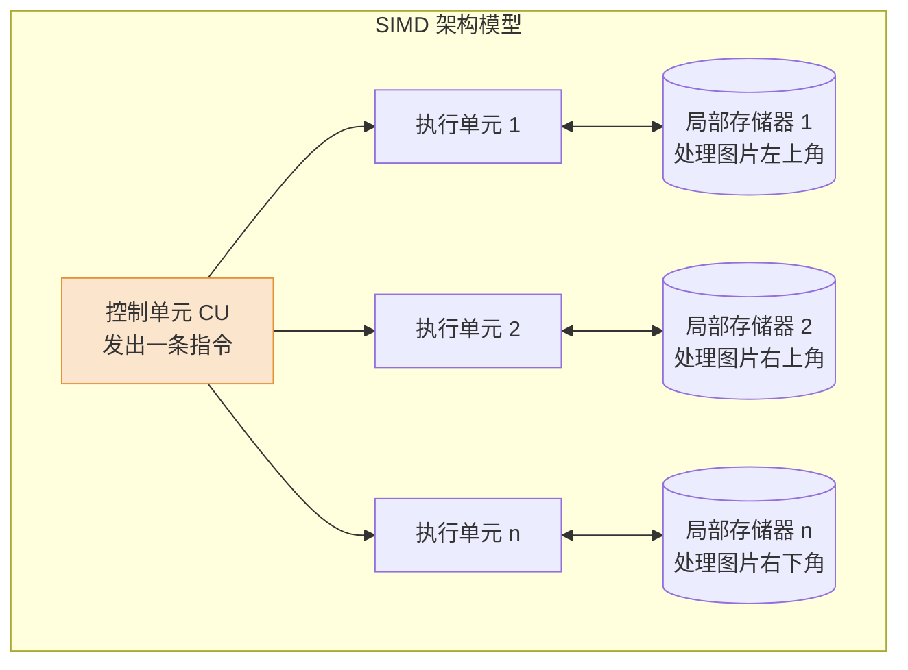

# 计算机组成原理：多处理器基本概念

> **导语**
> 各位同学大家好，本节课我们将学习计算机体系结构中关于**多处理器**的一些基本概念。
> 按照考研大纲要求，这部分内容属于“了解”范畴，**只考选择题，绝对不考大题**。因此，我们的学习策略是：**抓核心概念，明辨易混淆点，防范“张冠李戴”的命题陷阱**。在阅读教材的基础上，跟着本节课画出重点即可。

---

## 一、 四种计算机体系结构分类 (Flynn 分类法)

根据指令流和数据流的数量，计算机体系结构可划分为四种经典类型。这是选择题的高频考点，请务必分清它们的并行级别与核心特征。

### 1. SISD (Single Instruction Single Data) - 单指令流单数据流

- **概念**：我们传统学习的**单核 CPU** 就是典型的 SISD。
- **特征**：
  - **单指令流**：同一时刻只能处理一个指令序列（各指令序列只能并发，不能并行）。
  - **单数据流**：每一条指令只能处理特定的 1 到 2 个数据（如普通的加法指令 `ADD A, B`）。
- **优化手段**：为了提升效率，SISD 内部通常采用**指令流水线**和**多模块交叉存储器**。
- **并行级别**：指令级并行（通过流水线），但**不支持数据级并行**。

### 2. SIMD (Single Instruction Multiple Data) - 单指令流多数据流

- **概念**：**数据级并行**的核心代表。最典型的应用是图像处理（如早期显卡给所有像素加滤镜）。
- **特征**：
  - **单指令流**：同一时刻只有一条控制指令在发出。
  - **多数据流**：这条相同的指令控制信号，被同时发送给多个执行单元（ALU），每个执行单元拥有自己的**局部存储器**、地址寄存器和数据寄存器，同时对不同的数据块进行**完全相同**的运算。
- **适用场景**：极度擅长对结构类似的大量数据进行重复性、相同的处理（如矩阵运算、向量加法、图像渲染）。

### 3. MISD (Multiple Instruction Single Data) - 多指令流单数据流

- **概念**：多条不同指令同时处理同一个数据。
- **现实状况**：这是一种**理论模型**，在现实世界中**不存在**实际应用（大可不必花钱雇几个人干同一份活还得出不同结果）。

### 4. MIMD (Multiple Instruction Multiple Data) - 多指令流多数据流

- **概念**：我们现在用的**多核电脑、智能手机**都属于 MIMD 架构。
- **特征**：各处理器（核心）可以并行执行各自独立的指令序列，同时处理各自不同的数据。
- **并行级别**：**线程级并行，甚至进程级并行**。

---

## 二、 MIMD 的两大阵营：多处理器 VS 多计算机

MIMD 根据存储器的组织方式，又细分为两类，这是极其容易被“移花接木”出题的地方：

| 对比维度         | 多处理器系统 (共享内存)                                                                                   | 多计算机系统 (分布式)                                                        |
| :--------------- | :-------------------------------------------------------------------------------------------------------- | :--------------------------------------------------------------------------- |
| **物理形态**     | 一台计算机内部包含多个处理器 (多核)。                                                                     | 由多台独立的计算机通过网络连接组成。                                         |
| **存储器归属**   | 所有核心**共享同一个主存** (物理地址空间统一)。                                                           | 每台计算机拥有**私有独立的主存** (地址空间独立)。                            |
| **数据交互方式** | 核心间可以通过 **`LOAD/STORE`** 指令直接读写共享主存来交换数据。 _(通常还会共享最低一级的 L3 Cache)_。 | **不能**直接用 `LOAD/STORE` 访问对方主存！ 只能通过网络进行**消息传递**。 |
| **别名**         | 共享存储多处理器系统                                                                                      | 消息传递系统                                                                 |

> **⚠️ 命题陷阱预警**：
> 出题人最喜欢这么说：“在多计算机系统中，各节点可以通过 Load/Store 指令互相访问对方的内存。” —— **错！这是张冠李戴，多计算机系统只能用消息传递！**

---

## 三、 向量处理器 (Vector Processor)

- **技术渊源**：向量处理器是 **SIMD** 思想的进阶应用。
- **核心特征**：
  - **处理对象**：普通 CPU 的指令操作对象是标量（单一数值），而向量处理器的**一条指令的操作对象是一个一维数组（向量）**。
  - **运算效率**：例如进行两个含有 N 个元素的数组相加，普通处理器要循环 N 次执行 N 条加法指令；向量处理器只需执行**1 条向量加法指令**即可并行完成。
- **硬件需求**：
  - 拥有多个处理单元和多组大容量的**向量寄存器**。
  - 极其消耗数据带宽，因此要求主存必须是**大容量、集中式**的，且通常采用**多端口同时读取**的交叉存储技术。
- **适用场景**：超级计算机、科学研究（空气动力学、大规模矩阵运算等浮点密集型任务）。

---

## 四、 共享内存多处理器 (SMP) 与 多核处理器 (CMP)

在考研范畴内，你可以认为这两个词指的是**同一个东西的不同叫法**，它们都属于 MIMD。

1.  **共享内存多处理器 (SMP)**：侧重于逻辑架构描述，强调各个核心**共享同一个主存和统一的地址空间**。
2.  **多核处理器 / 片级多处理器 (CMP)**：侧重于物理形态描述，强调把多个计算核心（Core）**集成在同一块硅芯片（片内）**上。
    - _典型特征_：各个核除了共享主存外，通常还会**共享最低一级的 Cache（如 L3 Cache）**。

---

## 本节复习指南

备考本节内容，请重点关注我在笔记表格和红字预警中圈出的部分。做概念选择题时，看到“共享/私有”、“Load/Store/消息传递”、“数据级/线程级并行”等字眼，脑海中要立刻拉响警报，核对是否发生了**张冠李戴**的现象！
