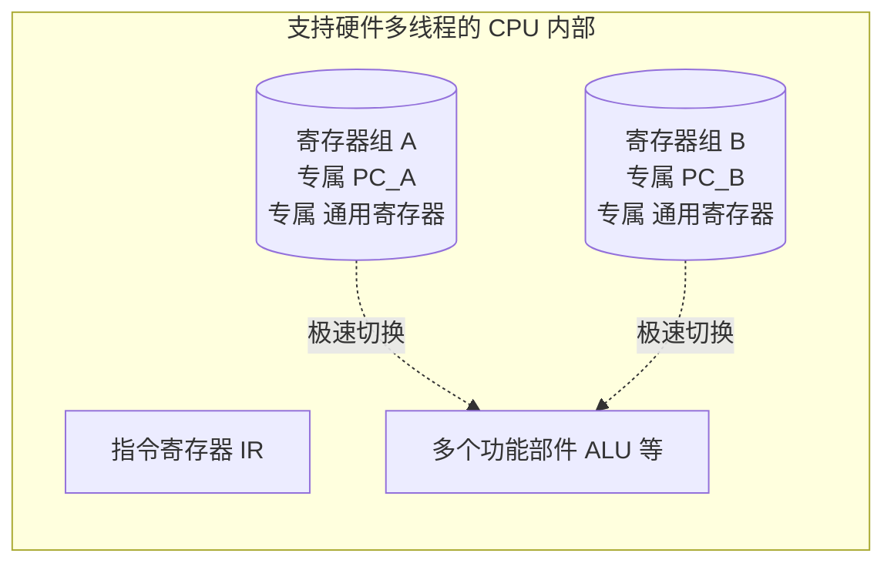

# 计算机组成原理：硬件多线程的基本概念

> **导语**
> 各位同学大家好，本节课我们将学习处理器架构中的一个前沿考点——**硬件多线程技术**。
> 按照考研大纲要求，这部分内容同样属于“了解基本概念”的范畴，**仅以选择题的形式进行考察**。因此，我们的学习重点是理解硬件多线程的物理本质，并精准辨析三种实现方式（细粒度、粗粒度、同时多线程 SMT）的核心特征，严防考试中“张冠李戴”的文字陷阱。

---

## 一、 为什么需要硬件多线程？

在探讨硬件多线程之前，我们需要先理解传统（软件）多线程切换的痛点。

### 1. 传统处理器的线程切换代价 (软件多线程)

普通的单核处理器内部只有**一组**寄存器（包含 PC 程序计数器和众多通用寄存器）。

- **痛点**：当 CPU 要从线程 A 切换到线程 B 时，必须把线程 A 所有的寄存器状态（运行环境）保存到主存中，然后再从主存中把线程 B 之前的状态恢复到寄存器里。
- **代价**：这种基于软件和主存交互的“保存与恢复”过程极其耗时，这就是**线程切换的高昂代价**。

### 2. 支持硬件多线程的处理器的物理改造

- **改造方案**：在 CPU 硬件内部，直接物理配置**多组独立的寄存器组**（每组包含各自的 PC 和通用寄存器）。
- **优势**：线程 A 的环境放在第 1 组，线程 B 的环境放在第 2 组。当需要在线程 A 和线程 B 之间切换时，只需在硬件逻辑上直接拨动开关，指向不同的寄存器组即可，**完全不需要访问主存进行保存和恢复**。这就实现了极低代价、甚至零代价的线程切换。

---

## 二、 三种硬件多线程的实现方式 (★ 核心考点矩阵)

这是本节课的核心，选择题通常会在这里“移花接木”。请牢记以下对比矩阵：

| 硬件多线程方式   | 英文缩写                                | 发射策略 / 切换时机                                                                     |    线程切换代价     | 线程级并行  | 指令级并行  |
| :--------------- | :-------------------------------------- | :-------------------------------------------------------------------------------------- | :-----------------: | :---------: | :---------: |
| **细粒度多线程** | Fine-grained                            | **每个时钟周期轮流切换**一次线程。 _(如 T1发A，T2发B，T3发A...)_                     |        极低         |  ❌ 不支持  |   ✅ 支持   |
| **粗粒度多线程** | Coarse-grained                          | 连续多个时钟周期执行同一线程。 **只有遇到流水线阻塞 (如 Cache 缺失) 时才切换线程。** | 较高 (需重载流水线) |  ❌ 不支持  |   ✅ 支持   |
| **同时多线程**   | SMT  _(Simultaneous Multithreading)_ | **在同一个时钟周期内，同时发射多个不同线程的指令！**                                    |     (无需深究)      | **✅ 支持** | **✅ 支持** |

### 概念深度辨析

1.  **细粒度多线程 (Fine-grained)**
    - **核心特征**：切换极其频繁，**每个时钟周期切一次**。
    - **并行性界定**：虽然在单个时钟周期内可能发射同一个线程的多条指令（实现了*指令级并行*），但**在任意一个特定的时钟周期内，只处理了一个特定的线程**。因此，它**不支持**真正的*线程级并行*。
2.  **粗粒度多线程 (Coarse-grained)**
    - **核心特征**：非必要不切换。只有当当前线程遭遇严重“卡顿”（如缺页、Cache 未命中引发的流水线阻塞）时，才会切给另一个线程执行。
    - **代价问题**：因为是在流水线半道上强行切换，可能需要清空或重载整条流水线，所以它的线程切换代价比细粒度要**高**。它同样**不支持**同一时刻的线程级并行。
3.  **同时多线程 (SMT)**
    - **核心特征**：这是最高级的形态。在**同一个时钟周期**（即同一时刻）内，同时把线程 A 的指令和线程 B 的指令取进来，分配给不同的空闲功能部件去执行。
    - **并行性界定**：既实现了*指令级并行*，又真正实现了同一时刻的*线程级并行*。现代 Intel 处理器的“超线程技术” (Hyper-Threading) 就是 SMT 的典型应用。

---

## 本节防坑总结

在做大纲关于这部分的考研选择题时，请注意识破以下经典错误选项套路：

- **套路 1：混淆并发与并行**。说“细粒度多线程实现了线程级并行” —— **错！** 它只是频繁交替（并发），同一时刻只能跑一个线程的指令。只有 **SMT (同时多线程)** 实现了真正的线程级并行。
- **套路 2：混淆切换时机**。说“粗粒度多线程每个时钟周期轮流发射指令” —— **错！** 那是细粒度。粗粒度是“遇到阻塞（如 Cache 缺失）才切换”。
- **套路 3：混淆切换代价**。说“细粒度切换代价比粗粒度高” —— **错！** 粗粒度在阻塞时切换，涉及到流水线状态的重载，代价相对更高。
