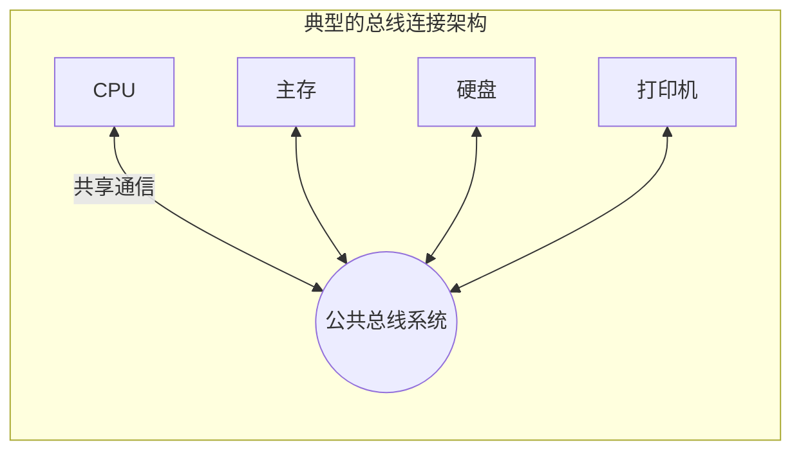

# 计算机组成原理：总线概述

> **导语**
> 各位同学大家好，从这个小节开始，我们将进入第六章——**总线 (Bus)** 的学习。
> 在之前的学习中，我们已经接触过 CPU 如何通过地址总线、数据总线和控制总线与主存及外部设备进行交互。本节课，我们将从物理实现、核心特性到分类标准，系统地建立起“总线”的知识框架，这是理解计算机底层模块间通信机制的基础。

---

## 一、 总线的物理实现与基本概念

### 1. 为什么需要总线？

早期的计算机采用**分散连接**的方式，即 CPU 与每个外部设备之间都有专门的连线。随着设备种类的增多，这种方式导致线路极其繁杂，难以扩展。
为了解决连接的灵活性问题，引入了**总线 (Bus)** 架构：只需在主板上预留插槽（如内存插槽、PCIe 插槽），将新增的硬件插入，即可通过公共的线路与系统内的其他部件进行通信。

### 2. 什么是总线？

**总线**是一组为多个部件**分时、共享**的公共信息传送线路。

- **共享性**：总线上挂载的所有硬件部件都可以通过这根总线来接收或发送数据。
- **分时性**：**同一时刻只允许有一个部件向总线发送信息**（防止信号冲突），但可以有**多个部件同时从总线上接收信息**。

### 3. 总线的物理本质

我们通常所说的一“根”总线（如一根 32 位的数据总线），在物理内部实际上是由**多根并行的细微信号线**组成的。若要在同一时刻并行传递 32 比特的数据，总线内部就需要包含 32 根信号线，每根线加上高低电平以表示二进制的 `1` 或 `0`。

---

## 二、 总线的分类体系

我们可以从不同的维度对总线进行分类。

### 1. 按数据传输格式分类

分为**串行总线**和**并行总线**。

- **串行总线 (Serial Bus)**
  - **机制**：数据一位一位地按顺序传输。
  - **优点**：只需一根/少量的信号线，**成本低**；线间无干扰，**抗干扰能力强**，适合**长距离**和**极高频率**传输；节省布线空间。
  - **缺点**：发送和接收时需要硬件进行数据的“拆卸”与“装配”（串/并转换电路）。
  - _示例_：USB (通用串行总线)。
- **并行总线 (Parallel Bus)**
  - **机制**：多位数据（如 8位、32位）在多根信号线上同时传输。
  - **优点**：逻辑上每个时钟周期可传输更多数据。
  - **缺点**：信号线多，成本高、占空间；**核心缺陷**是多根密集排列的信号线在高频下会产生严重的**线间电磁干扰 (串扰)**，导致并行总线的**工作频率无法做得很高**。
  - _🚨 避坑考点_：**并行总线的实际传输速度不一定比串行总线快！** 现代高速通信几乎全部转向了串行总线（通过极高的频率弥补单通道的劣势）。

### 2. 按连接的功能部件 (层级) 分类

根据总线连接设备的宏观层级，可分为片内总线、系统总线和通信总线三类：

- **片内总线 (Internal Bus)**：位于 **CPU 芯片内部**，连接 CPU 内部的 ALU、寄存器组等部件。
- **系统总线 (System Bus)**：位于计算机主板上，连接计算机系统内的**核心功能部件**（CPU、主存、各类 I/O 接口）。本章研究的重点。
- **通信总线 (External/Communication Bus)**：用于连接**不同的计算机系统**或计算机与外部网络（如网线连接）。

---

## 三、 系统总线的详细剖析 (★ 核心考点)

根据系统总线传输的信息内容，可以进一步细分为：**数据总线**、**地址总线** 和 **控制总线**。我们需要重点掌握这三者的**传输方向**和**位宽决定因素**。

### 1. 数据总线 (Data Bus, DB)

- **功能**：在各功能部件之间传递实际的数据信息（如取指令、读写操作数）。
- **传输方向**：**双向**（CPU 既能读入数据，也能写出数据）。
- **总线宽度 (位数)**：数据总线的宽度通常与**机器字长**或**存储字长**保持一致。如果数据总线宽度只有机器字长的一半，CPU 取一个完整数据就需要占用两次总线周期，严重影响效率。

### 2. 地址总线 (Address Bus, AB)

- **功能**：CPU 通过它发出地址信号，指明要访问的主存单元或 I/O 端口的地址。
- **传输方向**：**单向**（只能由 CPU 向外发出地址信号给主存或设备）。
- **总线宽度 (位数)**：地址总线的宽度决定了系统最大可寻址的物理空间。如果主存和 I/O 设备采用“统一编址”，地址总线的宽度必须能覆盖主存单元加上所有 I/O 端口的总数。

### 3. 控制总线 (Control Bus, CB)

- **功能**：传输控制信号和时序信号。
- **传输方向**：就**单根控制线**而言，其传输方向是**单向**的（例如读/写命令线是由 CPU 发出；中断请求线是由外设发给 CPU）。但就**整个控制总线集合**而言，它是**双向**的。

| 总线类型     | 英文缩写 | 传输内容                    |             传输方向              | 宽度决定因素            |
| :----------- | :------: | :-------------------------- | :-------------------------------: | :---------------------- |
| **数据总线** |    DB    | 指令、操作数等实际数据      |             **双向**              | 机器字长、存储字长      |
| **地址总线** |    AB    | 目标主存或端口的地址        | **单向** (CPU $\rightarrow$ 外设) | 最大寻址空间 (主存+I/O) |
| **控制总线** |    CB    | 读/写命令、中断请求、时钟等 |      **整体双向** (单线单向)      | 系统控制需求            |

> **辨析：数据通路 vs 数据总线**
>
> - **数据通路**：是一个逻辑概念，描述数据流经的路径及处理部件的集合。
> - **数据总线**：是承载数据流动的物理媒介。（注：地址总线在传送地址码时，物理上也充当了数据通路的媒介）。

---

## 本节复习要点总结

本章内容概念较多，主要考察选择题。请务必掌握：

1.  总线的**分时、共享**两大特性。
2.  理解为何**并行总线不一定比串行总线快**（受制于线间干扰频率受限）。
3.  牢记系统总线中**数据、地址、控制总线的传输方向**（特别是地址总线严格单向，而控制总线整体双向）。

下一节，我们将根据“时序控制方式”将总线分为**同步总线**和**异步总线**，探讨它们的数据传输协调机制。
