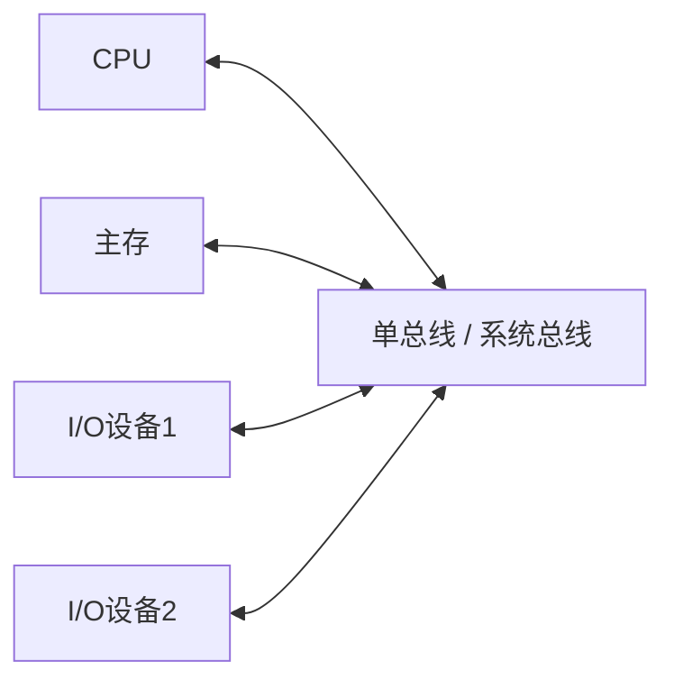
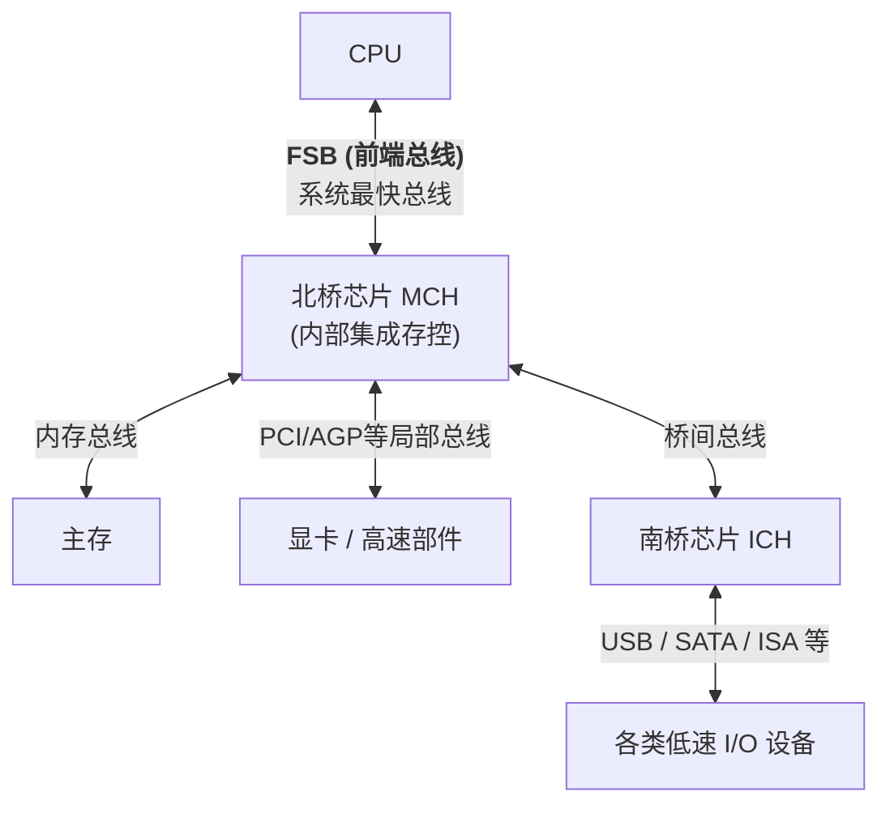

# 计算机组成原理：总线结构的演进与点对点互连技术

本节我们将详细探讨总线结构的演进历程。早期的总线多为**共享式总线**（如单总线、双总线、三总线）；随着技术发展，演变出了**分层式多总线结构**（经典的南北桥架构）；进入多核处理器时代后，为解决资源竞争瓶颈，全面走向了**集成化的点对点互连结构**。

---

## 一、 早期共享式总线结构

早期总线结构的核心特征是**分时竞争**与**互斥访问**，所有设备（无论快慢）通过共享的物理线路进行通信。同时，设备需要不断监听总线地址线，通过地址比较来决定是否接收数据。

### 1. 单总线结构 (60年代末 - 80年代早)

CPU、主存以及所有的 I/O 设备都挂载在唯一的一条系统总线上。

- **工作机制**：各部件分时共享总线，互斥访问。
- **缺点**：总线资源竞争极为激烈。CPU 与主存之间的高速数据交换常被慢速 I/O 设备打断或阻塞，系统总线成为整个计算机系统的性能瓶颈。

### 2. 双总线结构 (70年代 - 90年代)

为了解决单总线的瓶颈，分离了高速和慢速传输。

- **以 CPU 为中心的双总线**：
  - 一条为**内存总线**（连接 CPU 和主存，速度快）。
  - 一条为**I/O 总线**（连接 CPU 和慢速外设）。
  - **缺点**：I/O 设备与主存交换数据必须经过 CPU 中转，占用 CPU 资源。
- **以存储器为中心的双总线**：
  - 一条为**存储总线**（专门用于 CPU 与主存的高速通信）。
  - 一条为**系统总线**（连接 CPU、主存和 I/O 设备）。
  - **优点**：允许 I/O 设备直接与主存交换数据，同时提高了 CPU 与主存的传输效率。

### 3. 三总线结构 (80年代后期 - 90年代)

在双总线基础上，专门为**高速 I/O 设备**（如磁盘）增加了一条 **DMA 总线**。

- **结构**：系统总线（CPU、主存、I/O）、存储总线（CPU、主存）、DMA 总线（主存、高速 I/O）。
- **优点**：高速设备通过 DMA 总线直接与主存进行大批量数据交换，无需 CPU 过度干预；慢速设备仍通过 I/O 总线由 CPU 中转处理。

---

## 二、 分层式多总线结构 (南北桥架构)

90年代后期，随着 Intel 奔腾处理器的流行，按设备速度分层连接的**南北桥架构**成为主流。

- **北桥芯片 (MCH, 内存控制器集线器)**：管高速。连接 CPU、主存、显卡等吞吐量极大的部件。内部集成了内存控制器。
- **南桥芯片 (ICH, 输入输出控制器集线器)**：管低速。连接鼠标、键盘、USB、SATA 等低速 I/O 设备，并提供扩展槽。

### 核心总线：FSB 前端总线 (处理器总线)

- **地位**：连接 CPU 与北桥，是全系统最快、最关键的总线。
- **特性**：同步总线、并行传输、**半双工**（同一时刻只能单向传输，不能同时双向收发）。
- **四倍并发技术**：每个总线时钟周期内可以传输 4 次数据。

> **【真题实例解析】**
> **题目**：某处理器总线采用同步并行传输，总线宽度 64 位，每个时钟周期传输 4 次数据。总线工作频率为 1333 MHz，求总线带宽？
> **解析**：
>
> 1.  注意区分**时钟频率**与**工作频率**。题目明确指出“工作频率为 1333 MHz”，说明每秒已经包含了 1333M 次的数据传输（即已经乘过 4 了）。
> 2.  总线宽度 = 64 位 = 8 字节 (B)。
> 3.  带宽 = 工作频率 × 总线宽度 = 1333 MHz × 8 B = **10664 MB/s ≈ 10.66 GB/s**。

---

## 三、 集成化点对点互连结构 (多核时代)

随着显卡、内存性能飙升，所有数据汇聚在 FSB 前端总线导致其不堪重负。从 Intel Core i7 开始，架构全面转向**点对点互连 (Point-to-Point)**。

### 1. 架构演变特征

- **存控内移**：内存控制器从北桥芯片直接移入 CPU 内部，CPU 直连主存（支持多通道并行存取），大幅缩短访存路径，提升效率。
- **北桥演化**：北桥简化为 IOH（输入输出集线器），专管高速显卡等互连。
- **点对点取代共享**：采用专用的点对点通道，彻底消除多设备争抢同一条总线的竞争问题。

### 2. 高频考点：QPI 总线

- **特性**：Intel 提出的点对点、**全双工**、**串行**总线，基于**包传输**机制。
- **包结构**：每个数据包 80 位（含 64 位有效数据 + 16 位校验/控制信息），分两次时钟周期传完（每个周期传两次，共 4 次）。
- **带宽计算注意点**：**只要是全双工总线，计算带宽时必须将上下行（发送和接收）的速率相加（通常是单向带宽乘以 2）**。

### 3. 高频考点：PCIe 总线

- **特性**：点对点、全双工、串行总线。采用**自同步机制**（无专门时钟线），通过编码实现。
- **链路与通路**：设备间以**链路 (Link)** 相连，一条链路可包含多个**通路 (Lane)**。例如 PCIe x16 表示有 16 条独立通路，每条通路可同时全双工收发，各通路数据独立不排队。
- **编码开销**：为实现自同步，通常将 8 比特的有效字节编码为 10 比特信息进行物理传输（8b/10b 编码）。

> **【真题模拟解析：PCIe 带宽计算】**
> **题目**：PCIe 1.0 规范中，单条通路单向发送/接收速率为 2.5 Gbps。求采用 PCIe 1.0 x8 接口的总线（有效字节）带宽是多少？
> **解析**：
>
> 1.  单条通路单向速率 = 2.5 Gbps。**全双工单通路带宽** = 2.5 Gbps × 2 = 5 Gbps。
> 2.  考虑编码开销（10位物理信息对应 1个有效字节 1B）：单通路有效字节带宽 = 5 Gbps ÷ 10 bits/B = 0.5 GB/s。
> 3.  采用 x8 接口（8 条通路）：总有效带宽 = 0.5 GB/s × 8 = **4 GB/s**。

---

## 四、 计算机总线的发展趋势与大纲演变

1.  **架构单芯片化 (SoC)**：
    - 双芯片 (CPU + PCH) 逐渐取代了传统的三芯片 (CPU + 北桥 + 南桥)。
    - 现代智能手机 (如高通 Snapdragon) 和苹果 M 系列电脑，进一步将所有外设控制器、内存甚至图形核心集成在单一芯片内部 (System on Chip)，共享总线越来越少见。
2.  **串行取代并行**：
    - 由于并行总线在高频下的信号干扰（串扰）与对齐难题，现代高速互连（QPI, PCIe, SATA, USB）已全面转向高频串行传输。
3.  **考研大纲的与时俱进**：
    - 因为点对点互连的普及，**总线仲裁 (解决多设备争抢)** 的概念在实际应用中被弱化，408 大纲已将其删除。
    - **具体总线标准 (如 ISA, PCI 规范细节)** 变为纯记忆性考点，大纲也已删减。考题若涉及，会在题干中直接给出计算所需的所有特征条件（如包大小、全双工、通路数等），本质上依然是考察**总线性能指标的计算**。
