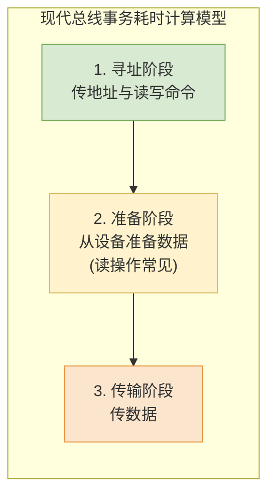
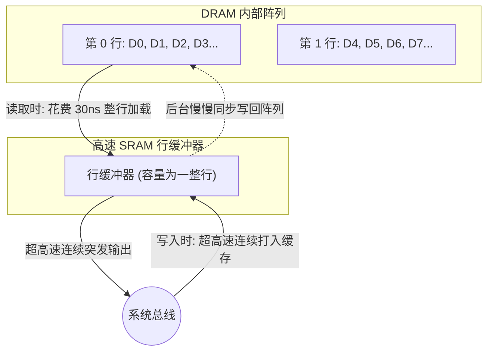

# 计算机组成原理：总线事务与突发传输

> **导语**
> 各位同学大家好，本节课我们将深入学习**总线事务 (Bus Transaction)**。
> 在考研大纲中，这个考点曾被称为“总线操作和定时”。一次总线事务，就是主设备与从设备之间完成一次完整信息交换的过程。本节课我们将从共享总线与点对点总线的区别切入，详细拆解总线事务的各个阶段，并结合历年真题，重点攻克**突发传输 (Burst Transfer)** 的耗时计算技巧，最后从 DRAM 底层原理揭示突发传输的物理奥秘。

---

## 一、 总线事务的基本概念与流程

**总线事务**（即总线操作、一次总线传输）是指在总线上，**主设备 (Master)** 和 **从设备 (Slave)** 之间完成一次完整信息交换的过程。

- **主设备**：主动获取总线控制权，发起寻址和读写操作的一方（如 CPU、DMA 控制器）。
- **从设备**：被动响应主设备操作的一方（如主存、I/O 接口）。
- _典型事务包括_：存储器读/写、I/O 设备读/写、中断响应等。

### 1. 共享型总线的事务流程 (传统四步法)

在传统的共享总线中，由于多设备竞争，一次完整的总线事务包含四个阶段：

1.  **申请分配阶段**：总线仲裁，决定将总线使用权分配给哪个主设备。
2.  **寻址阶段**：主设备发出要访问的从设备地址及读/写控制命令。
3.  **传输阶段**：主从设备之间进行实际的数据交换。
4.  **释放阶段**：主设备交出总线控制权。

### 2. 点对点总线的事务流程 (408 考研简化版)

随着现代计算机全面转向点对点总线（如 CPU 直连主存），**不再存在总线竞争问题**，因此“申请”和“释放”阶段通常被省略。在 408 考研计算题中，我们主要关注以下三个细化阶段的耗时：

_(注：如果题目未提及“从设备准备数据的时间”，则在计算时直接忽略此阶段。)_

---

## 二、 突发传输 vs 非突发传输 (★ 核心考点)

根据**给一次地址能传多少次数据**，总线传输方式分为两类。假设要向主存连续写入 4 个数据（地址 0, 1, 2, 3）。

### 1. 非突发传输 (Non-Burst Transfer)

- **规则**：**给一次地址，只能传一次数据**。
- **流程**：
  - 发地址 0 $\rightarrow$ 传数据 0
  - 发地址 1 $\rightarrow$ 传数据 1
  - 发地址 2 $\rightarrow$ 传数据 2
  - 发地址 3 $\rightarrow$ 传数据 3
- **缺点**：每次都要重新发送地址，地址传送开销大，效率极低。

### 2. 突发传输 (Burst Transfer)

利用程序的**空间局部性**原理，优化连续数据的读写效率（如 Cache 行的传送、DMA 数据块传送）。

- **规则**：**给一次首地址，连续传送多个数据**。后续数据的地址由硬件自动递增生成。
- **流程**：
  - 发首地址 0 $\rightarrow$ 连续传数据 0, 1, 2, 3。
- **优点**：大幅削减了寻址阶段的时间开销，显著提升总线吞吐量。

---

## 三、 真题演练与耗时计算极速拆解

### 题型 1：突发传输 + 主存写 (2012年统考 第19题)

**【条件】**

- 时钟频率 100MHz。总线宽度 32 位。
- **地址线和数据线复用**（即：传地址和传数据共用物理线路，不能同时进行）。
- 传 1 个地址或 1 个数据需 **1 个时钟周期**。支持突发传输。
- **问题**：一次主存写的总线事务，传输 **128 位**数据，至少需多少时间？

**【解析推演】**

1.  传 128 位数据，每次传 32 位，需分 $128 / 32 = 4$ 次传数据。
2.  因为支持**突发传输**，只需传 **1 次地址**。
3.  因为是**地址数据复用**，且主存写不需要考虑准备时间：
    - 第 1 周期：传首地址及写命令。
    - 第 2~5 周期：连续传 4 次数据。
    - 总共耗费 $1 + 4 = 5$ 个时钟周期。
4.  时钟周期 $T = 1 / 100\text{MHz} = 10\text{ns}$。总耗时 = $5 \times 10\text{ns} = \mathbf{50\text{ns}}$。（选 C）

> 💡 **防坑变体 A：如果地址线和数据线不复用？**
> 不复用意味着地址和数据可以在不同线路上**并行**。第 1 周期可以在传首地址的同时，顺便把第 1 个数据也传过去。
> 耗时变为：第 1 周期（首地址 + 数据1）+ 后 3 周期（数据 2~4）= **4 个时钟周期** ($40\text{ns}$)。

> 💡 **防坑变体 B：如果是“非突发传输”？**
> 非突发意味着每个数据都要搭售一个地址。由于是复用线：
> 1 次总线事务 = 1周期传地址 + 1周期传数据 = 2 个时钟周期。
> 传 4 个数据总耗时 = $4 \times 2 = \mathbf{8}$ 个时钟周期 ($80\text{ns}$)。

### 题型 2：突发传输 + 主存读 + 双沿传输 (改编题)

**【条件】**

- 地址线/数据线复用，32 位宽。
- **时钟的双沿（上升沿和下降沿）各传 1 次数据**（即 1 个时钟周期传 2 次）。
- 传 1 次地址需 1 个时钟周期。主存**准备数据需要 30ns**。支持突发传输。
- **问题**：主存读 128 位数据，需多少时间？（假设时钟周期为 $15\text{ns}$）

**【解析推演】**

1.  **寻址阶段**：传 1 次首地址，耗时 **1 个时钟** = $15\text{ns}$。
2.  **准备阶段**：主存读需要准备时间，耗时 **$30\text{ns}$**。
3.  **传输阶段**：传 128 位，每次 32 位，需 4 次。由于双沿传输，1 个时钟可传 2 次，故 4 次传输仅需 $4 / 2 =$ **2 个时钟** = $30\text{ns}$。
4.  **总耗时** = $15\text{ns} + 30\text{ns} + 30\text{ns} = \mathbf{75\text{ns}}$。

---

## 四、 硬件底层拓展：DRAM 的行缓冲与突发传输

为什么突发传输能够如此快速地连续读写？为什么真题中主存“读”常要求算准备时间，而“写”往往忽略？这背后的物理真相在于 **DRAM 的行缓冲机制 (Row Buffer)**。

1.  **读操作的“准备时间”**：当 CPU 发出地址请求读数据 D0 时，主存并不仅仅取 D0，而是花费一定时间（如 30ns）将 D0 所在的**整行数据 (D0~D3)** 全部加载到高速的 SRAM 行缓冲器中。准备好后，CPU 即可从极速缓冲器中连续“突发”读出 D0, D1, D2, D3。
2.  **写操作的“无需准备”**：当 CPU 突发写连续数据时，可以直接高速打入到行缓冲器中，随后主存再在后台慢慢将这整行数据同步回慢速的 DRAM 阵列中，因此前端表现为“无需等待准备”。
3.  **突发边界限制**：**一次突发传输绝对不能跨越 DRAM 的行边界！** 如果 CPU 要连续读 D3(0行末) 和 D4(1行首)，读完 D3 后，必须重新发起一次总线事务，花时间将第 1 行加载到行缓冲中，才能继续读 D4。

---

## 本节复习要点总结

1.  掌握考研总线事务计算的“三段论”：**寻址 $\rightarrow$ 准备 (视题目定) $\rightarrow$ 传输**。
2.  牢记**突发传输**只传一次首地址的巨大优势，并清楚非突发传输的耗时对比。
3.  做题时必须像雷达一样扫描题干中的三个关键词：**复用/不复用**、**单沿/双沿传输**、**读/写操作是否包含准备时间**。
