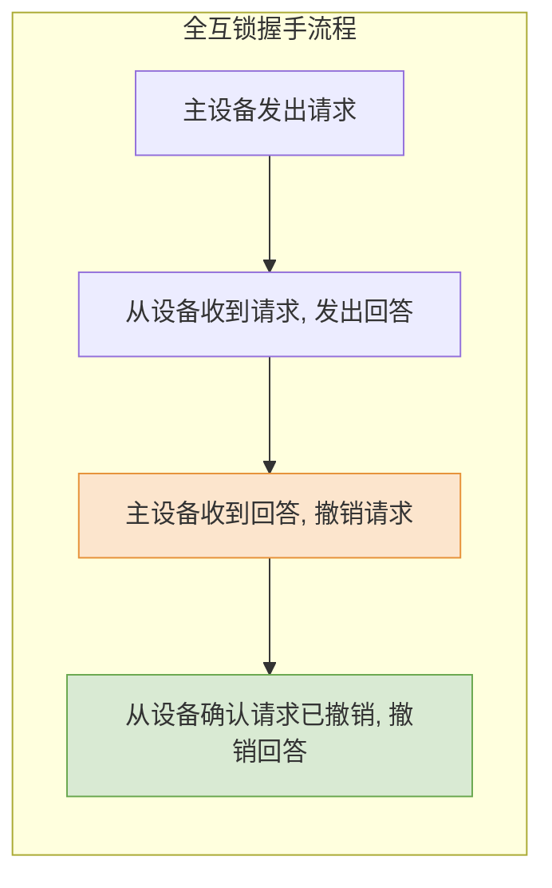

# 计算机组成原理：总线定时方式

> **导语**
> 各位同学大家好，本节课我们将深入学习**总线定时 (Bus Timing)**。
> 在总线事务中，主设备获取控制权后，需要与从设备进行寻址和数据传输。但由于双方处理速度可能存在巨大差异，如何保证发送方和接收方在时间上“有条不紊、不乱套”？这就需要制定一套通信协议，即**总线定时方式**。本节课我们将详细探讨四种核心的定时方案：同步通信、异步通信、半同步通信以及分离式通信。

---

## 一、 总线周期的四个阶段回顾

在了解定时方式之前，我们先复习一下一次完整的总线周期（完成一次数据传输）所必须经历的四个阶段：

1.  **申请分配阶段**：主设备提出申请，总线仲裁器进行分配。
2.  **寻址阶段**：主设备向总线发出目标从设备的地址和读/写命令。
3.  **传输阶段**：主从设备之间进行实质性的数据交换。
4.  **结束阶段**：主设备撤销相关信号，释放总线控制权。

> **总线定时的核心任务**，就是规定在“寻址”和“传输”阶段，主从双方如何根据时间信号或相互握手来配合动作。

---

## 二、 同步定时方式 (Synchronous Timing)

### 1. 核心机制

系统提供一个**统一的时钟信号**作为全局的“指挥棒”。主从设备的所有动作都必须严格按照时钟节拍（如 $T_1, T_2, T_3, T_4$）来执行。

```mermaid
gantt
    title 同步定时方式 (以读操作为例)
    dateFormat  X
    axisFormat %s

    section 时钟信号
    统一时钟节拍 :active, c1, 0, 4

    section 动作安排
    T1 (上升沿): 主设备发地址 :a1, 0, 1
    T2 (上升沿): 主设备发读命令 :a2, 1, 2
    T2-T3 (期间): 从设备火速准备数据 :a3, 1, 3
    T3 (上升沿): 从设备放数据到总线 :a4, 2, 3
    T4 (上升沿): 主设备取数据并撤销命令 :a5, 3, 4
```

### 2. 特点与优缺点

- **强制同步**：不考虑设备的实际快慢，到了点必须交货（如上述 $T_3$ 时刻从设备必须把数据准备好）。
- **优点**：规则明确，控制逻辑实现极简单；在设备速度匹配且总线较短的情况下，**传输速度极快**。
- **缺点**：
  - **缺乏宽容度**：如果从设备是个慢速设备，到了 $T_3$ 还没准备好数据，就会导致传输错误。
  - **木桶效应**：时钟周期的长度必须按系统中最慢的设备来设定，导致快速设备的性能被白白浪费。
  - **可靠性较差**：缺乏数据有效性检验的时间窗口。

---

## 三、 异步定时方式 (Asynchronous Timing)

### 1. 核心机制

**废除全局统一时钟**。主从设备通过各自的**请求信号 (Request)** 和**回答信号 (Acknowledge)** 进行“握手”协商，自动适应对方的工作节奏。

### 2. 握手的三种互锁机制 (★ 核心考点)

根据请求信号和回答信号的**撤销条件**是否相互制约，异步通信分为三种互锁方式：

| 方式       | 撤销请求信号的条件 (主设备)        | 撤销回答信号的条件 (从设备)                | 特点对比                                         |
| :--------- | :--------------------------------- | :----------------------------------------- | :----------------------------------------------- |
| **不互锁** | 发出请求后，过段时间**主动撤销**   | 发出回答后，过段时间**主动撤销**           | 双方都不管对方是否收到，最快但**最不可靠**。     |
| **半互锁** | 必须**收到回答信号后**，才撤销请求 | 发出回答后，过段时间**主动撤销**           | 主设备放心了，但从设备不管主设备有没有收到回答。 |
| **全互锁** | 必须**收到回答信号后**，才撤销请求 | 必须确认**主设备已撤销请求**后，才撤销回答 | 极致安全。双方互相确认，**最可靠但速度最慢**。   |

- **异步定时的优缺点**：允许速度悬殊的设备可靠通信，但控制逻辑复杂，整体速度偏慢。

---

## 四、 进阶定时方式：半同步与分离式

为了结合同步和异步的优点，又演化出了以下两种方式。

### 1. 半同步通信 (同步 + 异步等待)

- **核心思想**：依然保留统一的时钟节拍，但在协议中增加一根**等待信号线 (Wait)**。
- **机制**：如果慢速从设备在规定的节拍（如 $T_3$）到来前还未准备好数据，它可以向总线发出一个 `Wait` 低电平信号。总线控制器收到后，会在当前时钟周期后强行插入几个等待周期 ($T_W$)。一旦从设备准备好，撤销 `Wait` 信号，时钟节拍继续向下推进。
- **优势**：既保留了同步通信控制简单的优点，又通过“可动态延长的时钟周期”包容了慢速设备。

### 2. 分离式通信 (挖掘总线极限潜力)

- **痛点分析**：在前三种方式中，当从设备在吭哧吭哧准备数据时（如寻址后的读取延迟），**整根总线其实处于闲置状态**，但此时这对主从设备依然“霸占”着总线控制权，造成极大的带宽浪费。
- **分离式机制**：将一个完整的总线传输周期**狠心切分为两个独立的子周期**：
  - **子周期 1**：主设备申请总线 $\rightarrow$ 发送地址和命令 $\rightarrow$ **立刻放弃总线控制权**。
  - **（期间）**：从设备在后台慢慢准备数据；此时总线完全空出，可供其他设备通信。
  - **子周期 2**：从设备准备好数据后，**从设备主动申请总线控制权** $\rightarrow$ 将数据送到总线上发给主设备。
- **优势**：彻底榨干总线的空闲时间，总线利用率极高。
- **代价**：要求从设备也必须具备申请总线控制权的能力（即从模块需升级具备主模块部分功能），硬件成本和控制复杂度极高。

---

## 本节复习要点总结

1.  **同步通信**：统一时钟，强制同步。快，但只适合速度接近的设备，有木桶效应。
2.  **异步通信**：无统一时钟，靠握手。重点区分**全互锁**（互相死等对方撤销，最慢最安全）和**不互锁**（发完就撤，最快最不安全）。
3.  **半同步通信**：同步框架 + Wait 动态等待信号。
4.  **分离式通信**：切分周期，从设备准备数据时主动让出总线，准备好后再由从设备申请总线发数据，将总线利用率推向极致。
