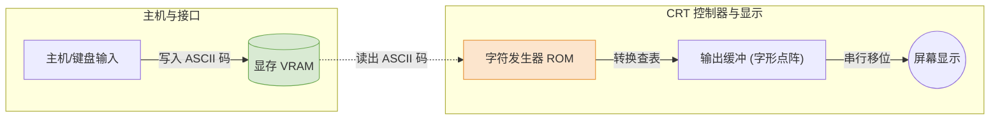

# 计算机组成原理：外部设备 (输入/输出设备)

> **导语**
> 各位同学大家好，在这个小节我们会详细介绍计算机的**外部设备**。外部设备大致上可以分为：**输入设备**、**输出设备**以及**外存储器**三大类。本节课我们将重点介绍输入设备和输出设备。这个小节的内容偏向常识和概念，大家结合讲义通读理解即可，但在**显示器参数计算**和**字符显示原理**方面，需要掌握一些核心的考点。

---

## 一、 输入设备 (Input Devices)

最基础且我们最熟悉的输入设备就是键盘和鼠标。

### 1. 键盘的工作原理

键盘的核心功能是将物理按键动作转化为计算机能理解的数字编码（通常是 ASCII 码）。

- **物理触发**：按下按键，触发开关接通电信号。
- **按键识别**：硬件电路检测并确定具体是哪个按键被按下。
- **编码转换**：将该按键的电信号翻译成对应的编码（如 ASCII 码）。
- **数据传送**：通过 I/O 接口或 I/O 控制器，将编码数据传送给主机。

### 2. 鼠标的工作原理

鼠标用于输入位置和位移信息。

- **机械式鼠标**：依靠底部的滚球摩擦桌面，带动内部的滚轴转动，从而检测鼠标在X/Y轴方向的移动距离和速度。（已淘汰）
- **光电式鼠标**：利用光传感器检测鼠标在接触面上的移动，进而计算位移和速度，将这些信息发送给主机，主机据此更新屏幕上的光标位置。（目前主流）

---

## 二、 输出设备之“显示器” (Monitors)

显示器是我们每天都在使用的输出设备。

### 1. 显示器的分类

- **按显示器件分类**：
  - **CRT (阴极射线管显示器)**：老式大屁股电视机，通过电子枪发射电子打在荧光屏上发光。体积大、笨重。
  - **LCD (液晶显示器)**：利用液晶的光电效应控制光线穿透。
  - **LED (发光二极管显示器)**：由密集的红绿蓝微型发光二极管组成像素点，通过调整电流控制亮度混色。
- **按显示内容分类**：字符显示器、图形显示器、图像显示器。

### 2. 显示器的核心性能指标 (★ 重点)

- **屏幕大小**：以屏幕**对角线的长度**（英寸）来表示。长宽比不同，即使英寸数相同，实际面积也会有区别。
- **分辨率**：屏幕上所能显示的像素点总数。通常用 `宽 × 高` 表示（如 `1920 × 1080`）。
- **灰度级与颜色深度**：
  - 表示一个像素点亮暗程度或颜色的等级。
  - 由**表示每个像素点信息的比特位数 ($n$)** 决定，可表示 $2^n$ 种不同的灰度或颜色。
  - 例如：24位真彩色（RGB各占8位），每个像素需要 $3	ext{B} (24	ext{bits})$，可显示 $2^{24}$ 种颜色。
- **刷新率**：每秒钟屏幕重绘图像的次数，单位为赫兹 (Hz)。如 60Hz 表示每秒刷新 60 帧图像。刷新率过低人眼会感到闪烁。

---

## 三、 显存的容量与带宽计算 (★★ 高频考点)

**显存 (vRAM, Video RAM)** 又称刷新存储器，用于存放要在显示器上播放的每一帧图像的数字信息。

### 1. 显存的最小容量计算

显存至少需要能够存放**一整帧图像**的信息。

> **公式： 最小显存容量 = 分辨率 $ imes$ 每个像素点占据的存储位 (颜色深度)**

- _示例_：分辨率为 `1440 × 900`，24 位真彩色（即每个像素 3 Byte）。
  最小容量 = $1440 	imes 900 	imes 3	ext{B}  pprox 3.7 	ext{ MB}$。
- _注_：现代显卡实际容量远大于此，因为还要存放 3D 模型、纹理贴图以及预渲染缓冲等数据。对于集成显卡，显存是从主存 (内存) 中划分出来的一块区域。

### 2. 显存的带宽 (写入速度) 计算

要保证显示器流畅运行不卡顿，显存必须有足够的写入速度，以支撑每秒多帧画面的刷新。

> **公式： 显存带宽 (字节/秒) = 一帧图像的数据量 $ imes$ 刷新率 (帧/秒)**

- _示例_：若一帧大小为 $3.7	ext{MB}$，刷新率为 $60	ext{Hz}$。
  最低显存带宽 = $3.7	ext{MB} 	imes 60 = 222 	ext{ MB/s}$。

---

## 四、 字符显示器的工作原理 (★ 考点)

字符显示器仅用于显示字符（如旧式终端、电梯楼层显示）。它的工作原理有其特殊性。

1.  **显存中存的是什么？** 字符显示器的显存中存放的是字符的**内部编码**（如英文的 ASCII 码或汉字的机内码），而**不是**直接的图像点阵。这大大节省了显存空间。
2.  **字符发生器 (Character Generator)**：这是一个只读存储器 (**ROM**)。里面预先烧录了每个字符对应的**字形码（点阵信息）**。
    - 如果一个字符的点阵是 $m 	imes n$，那么它在 ROM 中占据的字形码大小就是 $m 	imes n$ 个比特。
3.  **显示过程**：CRT 控制器从显存读出 ASCII 码 $\rightarrow$ 用该码作为地址去访问字符发生器 ROM $\rightarrow$ 查出对应的字形点阵信息 $\rightarrow$ 将点阵信息打到屏幕上的对应像素点。

---

## 五、 输出设备之“打印机” (Printers)

打印机是将计算机的输出结果印在纸质介质上的设备。

- **按印字原理分类**：
  - **击打式打印机 (针式打印机)**：利用机械撞针打击色带在纸上留下印记。
    - _特点_：噪声大、速度慢。
    - _不可替代的优势_：具有物理冲击力，可以复写，**防伪性极强**，因此至今仍广泛用于银行票据、发票等专用凭证的打印。
  - **非击打式打印机**：如喷墨打印机、激光打印机。速度快、成本较低，适合日常办公。
    - _喷墨式_：通过控制墨滴偏转喷射成像，防水性较差。
    - _激光式_：利用激光束在感光鼓上静电成像并吸附墨粉加热固化。速度快，质量高。
- **按工作方式分类**：串行打印机（逐字打印）、行式打印机（逐行打印）。

---

## 本节复习要点总结

虽然本节内容多为常识，但在考研备考中，请务必吃透以下两点：

1.  **熟练掌握显存容量与带宽的计算公式。** 注意区分单位（位 bit 与 字节 Byte 的转换）。
2.  **深刻理解字符显示的转化过程。** 牢记：**显存中存的是 ASCII 码，字库 ROM 中存的是字形点阵码**。
