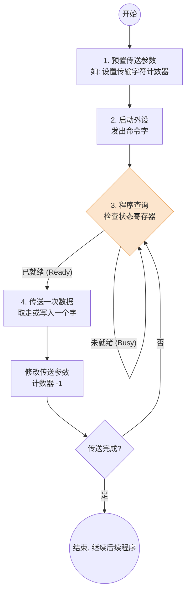

# 计算机组成原理：I/O 控制方式之“程序查询方式”

> **导语**
> 各位同学大家好，从这个小节开始，我们将详细学习主机与外部设备进行数据交互的几种核心 I/O 控制方式。机组这门课重点探讨三种方式：**程序查询方式**、**程序中断方式** 和 **DMA 方式**。
> 本节课我们聚焦最基础的**程序查询方式 (Programmed I/O)**。我们将通过底层 x86 的 `IN/OUT` 指令推演 CPU 控制打印机的全过程，并结合考研真题计算，带你深刻体会程序查询方式为什么容易让 CPU “原地踏步”甚至导致“系统崩溃”。

---

## 一、 程序查询方式的核心原理

程序查询方式的核心思想是：**CPU 必须通过不断执行程序（循环轮询），去主动检查 I/O 设备的状态**。

### 1. 独占查询 (忙等) 的工作流程

当 CPU 启动一次 I/O 操作后，如果采用“独占查询”，CPU 会**暂停手中所有其他工作**，死死盯住 I/O 接口的状态寄存器，直到外设准备好数据。

> 🚨 **缺陷暴露**：在这个流程中，如果外设速度很慢，CPU 就会一直卡在 `LOOP_CHECK` 这个死循环里**原地踏步 (忙等)**，导致 CPU 资源利用率极低。而且 CPU 和 I/O 设备只能**串行工作**。

---

## 二、 x86 汇编视角的底层推演：打印三个字符 "ABC"

为了让抽象的流程具象化，我们用 x86 架构的 I/O 指令 `IN` (输入) 和 `OUT` (输出) 来推演打印机的控制过程。
假设打印机**数据端口**地址为 `n`，**状态/控制端口**地址为 `n+1`。

### 步骤拆解：

1.  **启动打印机**
    - CPU 将“启动打印”的命令字（如 `000100`）存入通用寄存器 `R1`。
    - 执行 `OUT n+1, R1`。通过地址总线选中控制端口 `n+1`，将命令字打入，控制逻辑进而启动打印机。
    - _注：控制指令一旦发出，该端口即可被复用为状态寄存器。_
2.  **轮询等待就绪**
    - CPU 执行 `IN R0, n+1`。从状态端口读取打印机当前状态到寄存器 `R0`。
    - CPU 测试 `R0` 中的标志位。如果发现是 "Busy"，则重复执行 `IN` 指令继续等；如果发现是 "Ready"，则跳出循环。
3.  **发送数据 (传送字符 'A')**
    - 打印机就绪后，CPU 执行 `OUT n, R2` (假设 'A' 存在 `R2` 中)。将字符 'A' 写入数据缓冲端口 `n`。
    - I/O 接口将 'A' 送给打印机进行物理打印。打印机再次进入 "Busy" 状态。
4.  **循环直至结束**
    - CPU 再次进入 `IN` 轮询等待打印 'A' 结束... 随后发送 'B'、'C'。
    - 三个字符发送完毕，CPU 发出停机命令字，I/O 操作结束。

---

## 三、 定时查询与真题计算验证

虽然“独占查询”会让 CPU 死等，但在实际应用中，程序查询方式还可以优化为**“定时查询”**：CPU 每隔一段固定的时间去检查一次 I/O 状态，检查完没就绪就先去干点别的，过会儿再来查。

> ⚠️ **数据丢失风险**：定时查询的间隔必须足够短，必须保证外设产生新数据之前，上一次的数据已经被 CPU 查到并取走。否则新数据会覆盖旧数据，导致**数据丢失**！

### 【硬核真题演练】时间开销占比计算

**已知条件**：

- 时钟频率：$50	ext{MHz}$ $\rightarrow$ 时钟周期 = $1 / 50	ext{MHz} = 20	ext{ns}$。
- 查询一次的开销：需要 $100$ 个时钟周期 $\rightarrow$ 耗时 $100 \times 20	ext{ns} = \mathbf{2000	ext{ns}} = 2\mu s$。

#### 场景 1：慢速外设 (鼠标)

- **要求**：每秒必须查询鼠标 $30$ 次。
- **计算**：每秒查询总耗时 = $30 \times 2000	ext{ns} = 60000	ext{ns} = 60\mu s$。
- **CPU 占比**：$60\mu s / 1	ext{s} = \mathbf{0.006\%}$。
- **结论**：对于慢速设备，程序查询方式占用的 CPU 时间微乎其微，完全可行。

#### 场景 2：高速外设 (硬盘)

- **要求**：硬盘每次传送 32位(4字节)，需要达到的传输率为 $2^{19}	ext{B/s} = 512	ext{KB/s}$。
- **计算每秒查询次数**：为了不丢失数据，每传 32位 (4字节) 就要查询一次。
  每秒查询次数 = $\frac{2^{19}	ext{B}}{4	ext{B}} = 2^{17}$ 次 $= 131072$ 次。
- **计算**：每秒查询总耗时 = $131072 \times 2000	ext{ns} \approx 262	ext{ms} = 0.262	ext{s}$。
- **CPU 占比**：$0.262	ext{s} / 1	ext{s} = \mathbf{26.2\%}$。
  _(如果题目中的传输率被要求到 $2	ext{MB/s}$ (即 $2^{21}	ext{B/s}$)，算出查询次数为 $2^{19}$ 次，占用时间将高达 $1.05	ext{s}$，即占比超 **100%**！这意味着 CPU 就算把命搭上，不干别的纯轮询，也跟不上硬盘的速度！)_
- **结论**：**高速外设绝不能使用程序查询方式**，必须引入中断机制或 DMA 机制。

---

## 本节总结

1.  **工作特点**：CPU 与外设串行工作，CPU 存在原地踏步（踏步等待）现象。
2.  **两类变体**：
    - **独占查询**：100% 时间用于死等，不干其他事。
    - **定时查询**：CPU 与 I/O 穿插执行，但必须保证查询频率足以防止数据丢失。
3.  **适用场景**：只适用于鼠标、键盘等低速设备。遇到高速设备会直接耗尽 CPU 性能。
