# 计算机组成原理：多重中断与中断屏蔽技术

> **导语**
> 各位同学大家好，本节课我们将深入探讨中断系统中的一个进阶话题：**多重中断**。
> 当 CPU 正在执行某个中断服务程序时，如果又来了一个更紧急的中断请求，能否像“套娃”一样暂停当前的中断程序，去执行更深层的新中断程序？为了实现这种灵活的优先级控制，硬件系统引入了**“开中断”指令**与**中断屏蔽字**机制。本节课我们将详细解析这些底层原理，并拆解考研中极为经典的中断处理轨迹画图题。

---

## 一、 什么是多重中断？

- **单重中断**：CPU 在执行中断服务程序的过程中，始终处于“关中断”状态。即使有新的中断请求到来，也绝对不予理睬，直到当前中断服务程序彻底执行完毕并开启中断。
- **多重中断 (中断嵌套)**：当 CPU 正在执行某个中断服务程序时，允许被**优先级更高**的新中断请求再次打断，转而去执行新的中断服务程序，形成“套娃”式的执行结构。

### 1. 支持多重中断的硬件指令要求

为了实现多重中断，中断服务程序的执行流程必须在**单重中断**的基础上增加两条指令：

> 🚨 **核心易错点：为什么“开中断”必须放在“保护现场”之后？**
> 保护现场（如将主程序的寄存器值压入堆栈）本身是由一系列机器指令完成的。如果在此之前就开启中断，那么一旦新中断瞬间降临，主程序的现场可能才保存了一半，导致永远无法正确恢复。因此，**保护现场（以及后续的恢复现场）必须“一气呵成”！**

---

## 二、 中断屏蔽字 (Interrupt Masking)

### 1. 为什么需要中断屏蔽字？

虽然多重中断允许被新信号打断，但**并非所有新信号都有资格打断当前程序**。
比如：CPU 正在处理高优先级的 DMA 中断，此时来了一个低优先级的键盘中断，显然不应该去理会它。为了动态、灵活地控制“谁有资格打断谁”，系统引入了**中断屏蔽字**。

- **本质**：它是每个中断源专属的一串二进制编码。通过设置屏蔽字，可以**动态重塑中断源之间的实际响应优先级**，打破了固定硬件排队器死板的先后顺序。
- **规则**：
  - 屏蔽字中的某个比特位设置为 `1` $\rightarrow$ 表示**屏蔽**（无视）对应的中断源。
  - 屏蔽字中的某个比特位设置为 `0` $\rightarrow$ 表示**开放**（允许被它打断）。
  - **铁律：每个中断源的屏蔽字中，对应自身的那个比特位必须为 `1`（即至少要屏蔽自己，防止自己打断自己）。**

### 2. 真题演练：中断处理次序的动态改造

**【题目】**已知有四个中断源 A, B, C, D。

- **硬件排队器固定的优先次序**：`A > B > C > D`。
- **目标要求**：通过配置屏蔽字，将它们实际的**中断处理次序改造为**：`D > A > C > B`。
- _请写出 A, B, C, D 的中断屏蔽字（假设 1 表示屏蔽，0 表示开放）。_

**【解析推导】**
目标次序 `D > A > C > B` 意味着：

- 处理 **D** 时：D 的级别最高，谁都不理。屏蔽自己 (D) 且屏蔽剩下的 (A,B,C)。
- 处理 **A** 时：A 只能被更高级的 D 打断。屏蔽自己 (A) 和低级的 (C,B)，开放高级的 (D)。
- 处理 **C** 时：C 能被 D 和 A 打断。屏蔽自己 (C) 和低级的 (B)，开放高级的 (D, A)。
- 处理 **B** 时：B 处于食物链底端，谁都能欺负它。只屏蔽自己 (B)，开放所有人 (A,C,D)。

**【最终答案】** (假设屏蔽字顺序也为 ABCD)

- **A 的屏蔽字**：`1 1 1 0` （只对 D 开放 0）
- **B 的屏蔽字**：`0 1 0 0` （只对自己封闭，全 0 开放）
- **C 的屏蔽字**：`0 1 1 0` （对 D,A 开放 0）
- **D 的屏蔽字**：`1 1 1 1` （全 1 无敌防御）

---

## 三、 经典题型：绘制 CPU 执行程序轨迹图

基于上述配置好的优先级 `D > A > C > B`。假设它们各自的中断服务程序都需要执行 **20$\mu s$**。

- $t=5$ 时，**B** 发出请求。
- $t=10$ 时，**D** 发出请求。
- $t=35$ 时，**A** 发出请求。
- $t=60$ 时，**C** 发出请求。
- _请画出 CPU 的执行轨迹。_

```mermaid
gantt
    title CPU 执行轨迹 (多重中断套娃)
    dateFormat X
    axisFormat %S

    section 原始执行
    执行主程序 :active, m0, 0, 5s

    section B 级 (最低)
    B 运行 (被D打断) :crit, b1, 5, 5s
    B 运行 (被A打断) :crit, b2, 30, 5s
    B 运行 (被C打断) :crit, b3, 55, 5s
    B 运行 (最终跑完) :crit, b4, 80, 5s

    section D 级 (最高)
    D 完整运行 20us :done, d1, 10, 20s

    section A 级
    A 完整运行 20us :active, a1, 35, 20s

    section C 级
    C 完整运行 20us :active, c1, 60, 20s
```

**【轨迹推演详解】**：

1.  **5$\mu s$**：主程序被 **B** 打断。B 开始执行。
2.  **10$\mu s$**：B 才跑了 5$\mu s$，最强王者 **D** 来袭！由于 D > B，B 被立刻挂起（套娃开始）。D 占用 CPU 跑满 20$\mu s$。
3.  **30$\mu s$**：D 跑完了，CPU 退回到刚才被挂起的 **B**，B 继续跑。
4.  **35$\mu s$**：B 又跑了 5$\mu s$（累计跑了 10$\mu s$），**A** 请求到来！因为 A > B，可怜的 B 再次被挂起。A 开始跑。
5.  **55$\mu s$**：A 跑满 20$\mu s$ 结束，退回到 **B** 继续跑。
6.  **60$\mu s$**：B 刚跑了 5$\mu s$（累计 15$\mu s$），**C** 来了！C > B，B 第三次被挂起。C 开始跑满 20$\mu s$。
7.  **80$\mu s$**：C 结束，终于退回 **B**。B 只需要跑完最后剩下的 5$\mu s$。
8.  **85$\mu s$**：B 彻底跑满 20$\mu s$ 结束。返回主程序。

---

## 四、 本节小结与硬核拓展 (选读)

1.  **中断服务程序两套动作的区别**：单重中断中途不准打断；多重中断通过巧妙放置“开中断”和“关中断”指令，在确保现场安全的前提下允许被高优先级打断。
2.  **屏蔽字的暴力解题法**：牢记“屏蔽谁填 1，开放谁填 0，必须屏蔽自己”。
3.  **轨迹图画法**：一定要随时记录那个被反复打断的底层程序（如例子中的 B），记录它**累计已经跑了多久，还剩多久没跑完**。

> **💡 硬件拓展：8086 CPU 的真实管脚与中断控制器 (8259A)**
>
> - **INTR 管脚**：可屏蔽中断输入引脚。受 CPU 内部的 `IF` (Interrupt Flag) 标志位控制。`IF=1` 就是“开中断”，`IF=0` 就是“关中断”。
> - **NMI 管脚**：非屏蔽中断引脚（如断电报警）。不管你是否关了中断，只要它来信号，CPU 必须立刻放下一切去响应！
> - **中断控制器 (8259A)**：它外接鼠标、键盘等设备。当收到多个中断信号时，它内部会有硬件排队电路决定把谁先发给 CPU，并通过数据总线把该设备的“中断类型号”一并传给 CPU，CPU 拿着这个号去内存查“中断向量表”以找到对应服务程序的入口。
