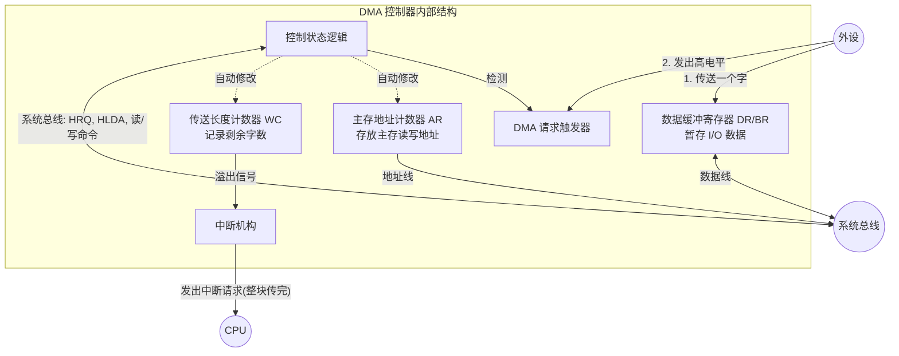
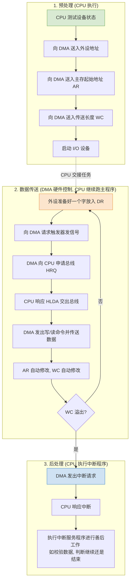

# 计算机组成原理：DMA 控制方式

> **导语**
> 各位同学大家好，在这个小节中，我们将学习最后一种 I/O 控制方式——**DMA (Direct Memory Access，直接存储器访问) 方式**。
> 对于程序中断方式来说，外设每准备好一个字的数据，CPU 就需要运行一次中断服务程序来转存数据。对于高速块设备（如磁盘）而言，这种方式会导致 CPU 执行中断服务程序的时间开销极大，效率极低。因此，提出了 DMA 方式。DMA 控制器作为一种功能更强大的 I/O 接口，能够直接控制数据在设备与主存之间的传输，彻底解放 CPU。

---

## 一、 DMA 控制器的宏观工作原理

DMA 控制器通常用于控制**块设备**（以块为单位进行读写的设备，如磁盘）。假设 CPU 想要从磁盘读入一整块（例如 1KB）的数据到主存中，工作流程如下：

1. **CPU 交代任务**：CPU 向 DMA 控制器指明以下信息：
   - **操作类型**：输入（从外设到主存）还是输出（从主存到外设）。
   - **传送数据量**：要传输多少个字的数据。
   - **主存地址**：数据在主存中的起始读写地址。
   - **外存地址**：数据在磁盘中的存放位置（如块号）。
2. **DMA 控制器接管**：DMA 控制器内部有**计数器**（记录剩余字数）和**地址指针**（记录主存和外设的当前地址），以及**数据缓冲寄存器**（暂存外设传来的数据）。
3. **逐字传送**：
   - 磁盘将一个字的数据传给 DMA 控制器。
   - DMA 控制器根据内部保存的主存地址，通过系统总线将这一个字写入主存。
   - 传送完一个字后，**计数器减 1**，**主存/外设读写地址自动后移**。
   - 重复此过程，直到计数器减为 0。
4. **传送结束报告**：当一整块数据传输完毕（计数器归零）后，DMA 控制器向 CPU 发出**中断请求**，报告工作完成。

---

## 二、 DMA 控制器的内部结构细化

DMA 控制器 (DMAC) 的内部构造非常复杂，主要包含以下核心部件：

- **控制状态逻辑**：控制数据传送的整体时序和逻辑，向 CPU 申请总线权，发出读/写命令。
- **DMA 请求触发器**：接收外设发来的高电平信号，表示外设已准备好一个字的数据。
- **主存地址计数器 (AR)**：存放当前要进行读写的主存地址。每传送一个字，地址自动加（或减）。
- **传送长度计数器 (WC)**：记录需要传送的总字数。每传送一个字，计数器加 1（如果采用负数补码计数）或减 1。**当计数器溢出（或减至 0）时，触发中断机构**。
- **数据缓冲寄存器 (DR/BR)**：作为外设与主存之间数据交换的临时中转站。
- **中断机构**：当一整块数据传送完毕（WC 溢出）时，向 CPU 发出**中断请求信号**。

---

## 三、 DMA 数据传送过程的三个阶段

一次完整的 DMA 传送过程分为三个阶段：**预处理**、**数据传送** 和 **后处理**。

> **🚨 重要辨析：DMA 请求 vs DMA 中断请求**
>
> - **DMA 请求**：外设每准备好**一个字**，就向 DMA 控制器发出请求，DMA 控制器进而向 CPU 申请总线控制权。这是为了传输一个字。
> - **DMA 中断请求**：当**一整块数据**传送完毕后，DMA 控制器向 CPU 发出中断请求，要求 CPU 进行后处理。

---

## 四、 解决 CPU 与 DMA 的访存冲突 (DMA 传送方式)

在多总线（如三总线）结构中，DMA 控制器和 CPU 可能同时需要访问主存。由于单端口主存同一时刻只能响应一个访存请求，这就产生了访存冲突。常见的解决策略有三种：

### 1. 停止 CPU 访存

- **机制**：DMA 传送一整块数据的过程中，**完全独占**主存的使用权。CPU 的运行完全停滞。
- **优缺点**：控制极其简单粗暴；但严重违背了引入 DMA 以解放 CPU 的初衷，未能充分发挥 CPU 的性能。

### 2. DMA 与 CPU 交替访存

- **机制**：将一个总线周期（或主存工作周期）平分为两段，前半段固定分给 CPU 访存，后半段固定分给 DMA 访存。
- **优缺点**：不需要申请总线控制权，控制简单；但主存利用率不高，因为无论 CPU 还是 DMA 都不一定每个周期都需要访存。

### 3. 周期挪用 (周期窃取) - 最常用

- **机制**：平时主存归 CPU 使用。当 DMA 需要访存时，根据当前 CPU 的状态分三种情况处理：
  1.  **CPU 不访存**：未冲突，DMA 直接访存。
  2.  **CPU 正在访存**：冲突，DMA 等待当前 CPU 存取周期结束。
  3.  **CPU 和 DMA 同时请求访存**：冲突，**优先满足 DMA 控制器**（因为外设数据如果不及时取走可能会丢失），即 DMA “窃取”或“挪用”了一个或几个主存周期。
- **特点**：既保证了 I/O 数据的及时传送，又最大限度地减少了对 CPU 的干扰。

---

## 五、 DMA 方式与中断方式的终极对比 (高频考点)

理解 DMA 与中断的差异，是掌握 I/O 控制方式演进的关键：

| 对比维度           | 程序中断方式                   | DMA 方式                                           |
| :----------------- | :----------------------------- | :------------------------------------------------- |
| **数据传送控制者** | **软件** (执行中断服务程序)    | **硬件** (DMA 控制器专门控制)                      |
| **响应时机**       | 每条**指令执行周期末尾**响应   | 每个**机器周期 / 存取周期末尾**响应 (只要总线空闲) |
| **中断发生频率**   | 每传送**一个字**就触发一次中断 | 传送完**一整块数据**才触发一次中断                 |
| **保护现场与恢复** | **需要** (有程序流的切换)      | **不需要** (仅占用总线，不切换程序)                |
| **适用场景**       | 慢速、中速设备，及处理异常情况 | **高速块设备** (如磁盘数据读写)                    |
| **优先级**         | 相对较低                       | **DMA 优先级 > 中断优先级** (高速设备等不起)       |
| **异常处理能力**   | 强 (可处理各种外设异常)        | 弱 (仅专注于大批量数据传送)                        |

> **总结归纳**：
> DMA 方式的核心就是找了一个“硬件小弟（DMA 控制器）”来替 CPU 搬运大块数据。CPU 只需在开头下达命令（**预处理**），并在结尾检查验收（**后处理**），中间的数据搬运过程完全由小弟代劳，从而极大地提高了 CPU 和 I/O 设备的并行工作效率。

好的，以上就是计算机组成原理这门课关于 DMA 控制方式的全部内容！祝大家逢考必过！
