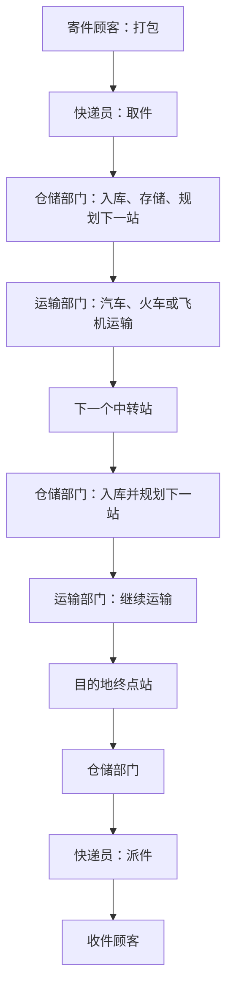
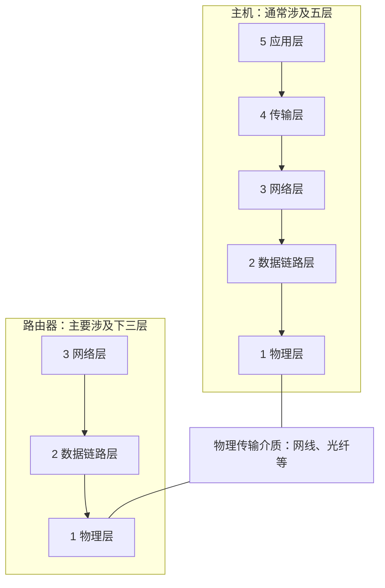
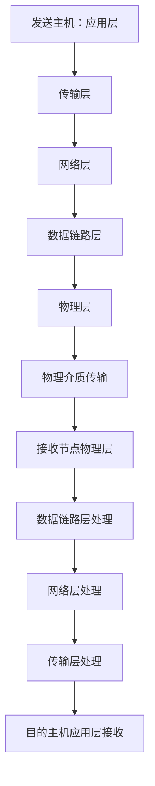
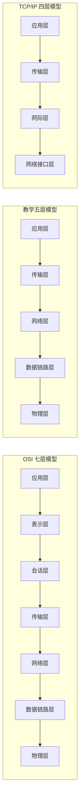
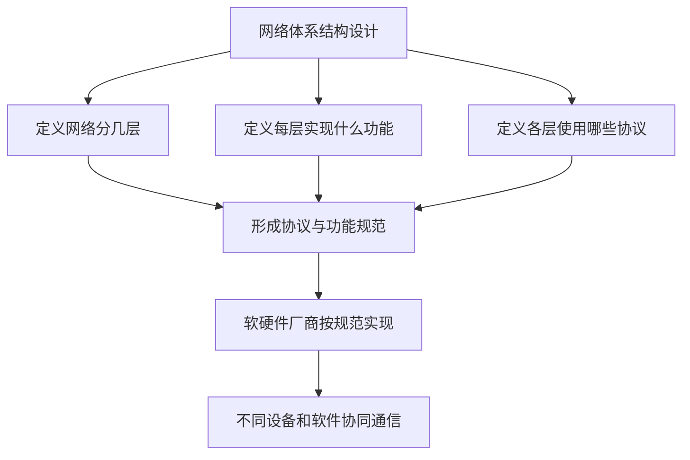
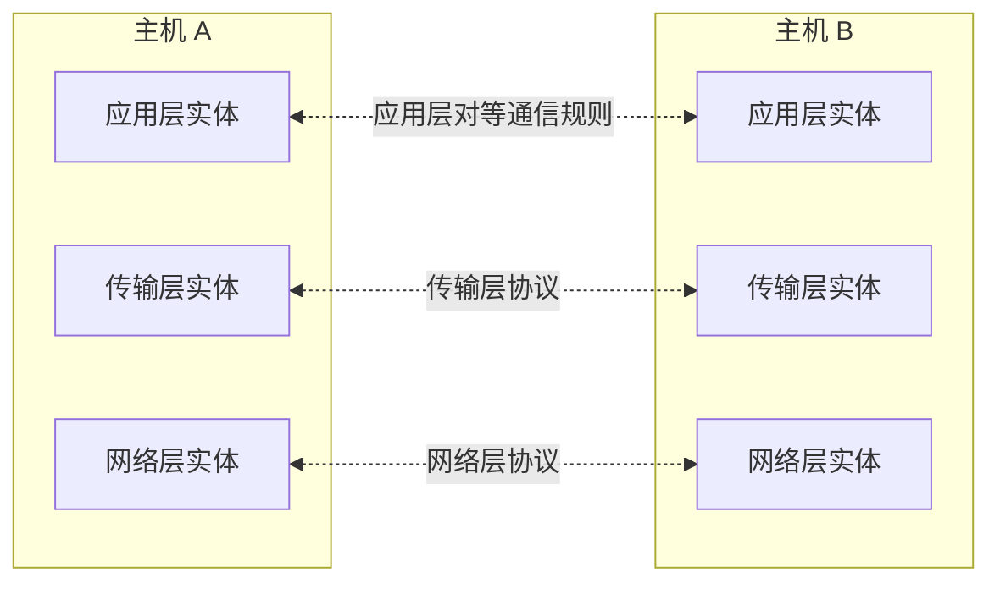
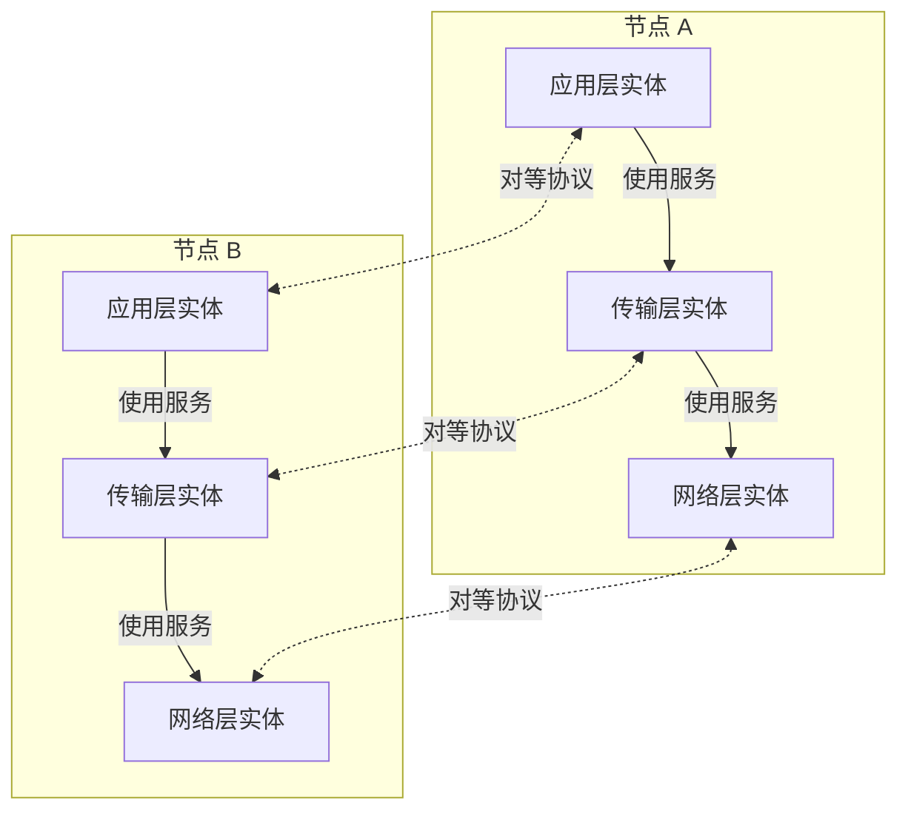
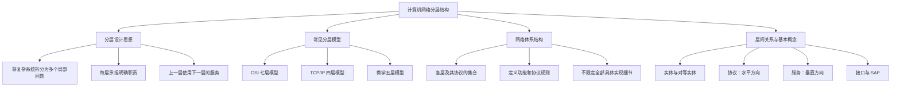

# 计算机网络的分层结构与体系结构

> 本节主要学习计算机网络为什么采用分层设计、常见的三种分层模型，以及网络体系结构、实体、对等实体、协议、接口和服务等基本概念。

---

## 一、为什么需要分层设计？

### 1. 计算机网络是一个复杂系统

计算机网络需要实现许多功能，例如：

- 差错控制；
- 流量控制；
- 数据分段与重组；
- 复用与分用；
- 连接的建立与释放；
- 数据路由与转发；
- 数据在物理介质上的传输。

这些功能涉及不同的问题。如果将所有功能都放在一起设计和实现，系统就会变得非常复杂，不利于设计、开发、维护和理解。

因此，计算机网络采用**分层设计思想**，把庞大而复杂的问题拆分成多个较小的局部问题，再让不同层次负责不同的功能。

### 2. 用快递网络理解分层设计

可以先从熟悉的快递网络理解分层设计。

#### 快递网络需要哪些功能？

快递网络需要完成很多工作，例如：

- **货物打包：** 寄件人把货物包装好。
- **取件与派件：** 快递员上门取件，再将包裹送到收件人手中。
- **仓储：** 包裹到达中转站后入库、暂存。
- **特殊货物存储：** 例如冷链存储。
- **路由：** 根据目的地决定包裹下一站应该去哪里。
- **运输：** 通过汽车、火车、飞机等方式，把包裹从一个站点运往另一个站点。

一个包裹从寄件人到收件人，中间可能经过很多中转站，也可能存在多条可选的转运路径。如何选择下一站，与计算机网络中的路由问题有相似之处。

#### 把快递网络拆分为四层

视频用一个简化的四层快递网络说明分层思想：

| 层次 | 部门或角色 | 主要职责 |
|---|---|---|
| 第四层 | 顾客 | 负责货物打包等与寄件人、收件人直接相关的工作 |
| 第三层 | 快递员 | 负责取件、派件等工作 |
| 第二层 | 仓储部门 | 负责入库、存储、冷链存储，并决定包裹的下一站 |
| 第一层 | 运输部门 | 使用汽车、火车、飞机等方式运输包裹 |

每个快递终点站都需要实现这四层的功能；而中间的快递中转站，可能只需要实现仓储和运输这两层的功能。

不同类型的节点不一定需要实现完全相同的层次，这一点与计算机网络类似。

#### 快递包裹如何逐层传递？

寄件端的流程大致如下：

1. 顾客先把货物打包。
2. 顾客请求下一层快递员提供取件服务。
3. 快递员取件后，将包裹交给仓储部门。
4. 仓储部门完成入库、暂存等工作，并决定包裹的下一站。
5. 仓储部门请求运输部门提供运输服务。
6. 运输部门通过合适的运输方式，将包裹运送到下一个站点。
7. 在中转站，包裹由运输部门交给仓储部门，再根据下一站继续运输。
8. 包裹到达目的地终点站后，依次交给仓储部门、快递员，最后交给收件人。

可以看到，复杂的快递网络被拆分成多个层次，每层负责一项或多项相关功能。上一层使用下一层提供的服务，而不必了解下一层内部的所有实现细节。

### 3. 分层设计不是唯一的

快递网络不一定只能划分为四层。例如，也可以在顾客和快递员之间增加一层“快递驿站”：

- 寄件时，顾客先把包裹交给驿站，再由驿站转交快递员。
- 收件时，快递员先把包裹送到驿站，再由驿站交给顾客。

这样就形成了五层快递网络。

这说明：**分层方案并不是唯一的，关键是要把功能合理地分配到各层。**

如果把派件功能交给运输部门的卡车司机实现，就可能让运输部门承担与其主要职责不匹配的工作，这就是一种不够合理的设计。

另外，同一个功能也可以在不同层次重复出现。例如，可以由顾客打包，也可以设计成由驿站提供某种包装服务。因此，某项功能是否只出现一次，并不是分层设计的硬性要求；重要的是各层的职责和协作关系是否合理。

---

## 二、计算机网络的分层思想

### 1. 计算机网络需要完成哪些功能？

计算机网络同样是一个复杂系统。网络边缘有主机，网络核心有许多路由器。主机上还会运行多个应用程序或进程。

计算机网络要实现的功能包括：

- 差错控制；
- 流量控制；
- 分段与重组；
- 复用与分用；
- 连接的建立与释放；
- 路由与转发；
- 数据的物理传输。

如果将所有功能都放在一起，就很难清晰地描述整个网络如何工作。因此，计算机网络也采用分层设计，将功能安排到多个层次中。

### 2. 常见的五层模型

教学中常用的五层模型依次为：

1. 物理层
2. 数据链路层
3. 网络层
4. 传输层
5. 应用层

在本节刚开始学习时，可以先记住每层的名称，具体功能会在后续章节逐步展开。

| 层次编号 | 层名称 | 本节学习定位 |
|---:|---|---|
| 5 | 应用层 | 面向应用程序，提供网络应用所需的功能 |
| 4 | 传输层 | 为端到端的数据传输提供相应功能 |
| 3 | 网络层 | 处理网络层面的寻址与路由等功能 |
| 2 | 数据链路层 | 处理相邻网络节点之间的数据传送等功能 |
| 1 | 物理层 | 处理比特在物理介质上的传输 |

> 具体每一层的协议和功能，后续会进一步学习。此处先建立整体结构的印象。

### 3. 主机、路由器与物理传输介质

在五层模型的教学示意中：

- **主机**通常需要实现第 1 层到第 5 层的功能。
- **路由器**主要涉及第 1 层到第 3 层的功能，因为它需要接收链路上的数据、处理网络层信息，并将数据转发到合适的下一跳。
- **物理传输介质**包括网线、光纤等。在概念示意中，有时会把物理传输介质看作五层模型下方的“第 0 层”，但它不是五层模型正式的组成层次。

### 4. 数据在网络中如何传输？

数据从发送主机发出时，会从上到下经过各层：

1. 发送应用程序产生数据，将数据交给应用层。
2. 应用层处理后，将数据交给传输层。
3. 传输层添加本层需要的信息，再交给网络层。
4. 网络层继续处理，再交给数据链路层。
5. 数据链路层交给物理层。
6. 物理层将数据转换成适合在物理介质上传输的信号。
7. 数据经过链路到达下一个节点。
8. 接收节点根据自身实现的层次逐层处理数据；在目的主机上，数据最终逐层向上递交给相应的应用程序。

形式上，这与快递网络的包裹逐层交接类似。每一层负责自己的工作，完成后再将数据交给相邻层次。

---

## 三、三种常见的计算机网络分层模型

计算机网络中常见的分层模型有三种：

1. **OSI 七层参考模型**
2. **TCP/IP 四层模型**
3. **教学常用的五层模型**

分为几层并不是唯一选择，不同模型的设计目标、功能划分和使用背景有所不同。

### 1. OSI 七层参考模型

OSI 参考模型由国际标准化组织（ISO）提出，名称中的 OSI 是 Open Systems Interconnection 的缩写。

OSI 参考模型将网络功能划分为七层：

| 层次编号 | 层名称（自上而下） |
|---:|---|
| 7 | 应用层 |
| 6 | 表示层 |
| 5 | 会话层 |
| 4 | 传输层 |
| 3 | 网络层 |
| 2 | 数据链路层 |
| 1 | 物理层 |

OSI 模型对上层功能作了更细的划分，尤其将应用层、表示层、会话层分别描述。

视频提到，OSI 参考模型在课程语境中常被称为**法律上的标准**：它是由标准化组织提出的参考体系结构，但现实互联网并没有完全按照该模型来组织所有协议实现。

### 2. TCP/IP 四层模型

TCP/IP 模型与互联网的发展密切相关。视频介绍，它是在早期 ARPANET 网络研究与发展的背景下逐步形成的模型。

TCP/IP 四层模型一般划分为：

| 层次编号 | 层名称（自上而下） |
|---:|---|
| 4 | 应用层 |
| 3 | 传输层 |
| 2 | 网际层（互联网层） |
| 1 | 网络接口层（网络访问层） |

TCP/IP 模型将 OSI 模型中的一些功能合并到较少的层次中。视频强调，TCP/IP 模型总体上更简单，且与实际互联网协议体系的关系更密切。

在课程常用表述中，TCP/IP 模型被称为**事实上的标准**，因为互联网实际采用的协议体系以 TCP/IP 为核心。

### 3. 五层模型

五层模型常用于计算机网络教学。它吸收了 OSI 七层模型的分层思想，同时保留 TCP/IP 模型与实际网络协议体系之间的联系。

| 层次编号 | 五层模型 | 说明 |
|---:|---|---|
| 5 | 应用层 | 对应应用所需的网络功能 |
| 4 | 传输层 | 提供传输层功能 |
| 3 | 网络层 | 对应 IP 网络中的网络层功能 |
| 2 | 数据链路层 | 描述相邻节点间的数据链路功能 |
| 1 | 物理层 | 描述比特在物理介质上的传输 |

大多数计算机网络教材在讲解网络原理时，会使用五层模型逐层展开。课程和计算机考研相关内容也通常按这五层组织。

### 4. 三种模型对照表

| 对比项 | OSI 七层模型 | TCP/IP 四层模型 | 教学五层模型 |
|---|---|---|---|
| 层数 | 7 层 | 4 层 | 5 层 |
| 主要用途 | 标准化参考模型 | 与互联网协议体系密切相关的模型 | 便于学习和讲解网络原理 |
| 典型层次 | 应用、表示、会话、传输、网络、数据链路、物理 | 应用、传输、网际、网络接口 | 应用、传输、网络、数据链路、物理 |
| 视频中的定位 | 法律上的标准（课程中的常见说法） | 事实上的标准（课程中的常见说法） | 教学与考研中常用的讲解框架 |

可用下面的图记忆三个模型的层次关系：

### 5. 各模型的功能如何对应？

为了帮助记忆，可以用以下方式理解大致对应关系：

| OSI 七层模型 | 五层模型 | TCP/IP 四层模型 |
|---|---|---|
| 应用层、表示层、会话层 | 应用层 | 应用层 |
| 传输层 | 传输层 | 传输层 |
| 网络层 | 网络层 | 网际层 |
| 数据链路层、物理层 | 数据链路层、物理层 | 网络接口层 |

这是教学中常见的概括性对照。不同教材对 TCP/IP 层次名称或功能归属的描述可能略有区别，应以课程指定的模型为准。

### 6. 为什么模型的层数和功能划分会不同？

层数多一些，可以把功能划分得更细；层数少一些，结构则可能更简洁。模型的设计需要考虑：

- 如何把复杂功能合理地划分到各层；
- 各层的职责是否明确；
- 各层之间如何协作；
- 功能是否在不同层次重复；
- 是否便于实现、维护以及不同设备和软件之间的互操作。

同一个功能是否只能放在某一层并非绝对。例如，在不同体系结构中，某些相近的功能可能以不同方式划分。重要的是每个模型内部的定义清晰，并能让遵循相应规则的设备和软件协同工作。

---

## 四、什么是网络体系结构？

### 1. 网络体系结构的定义

**计算机网络的体系结构，是计算机网络各层及其协议的集合。**

体系结构需要说明：

- 网络划分为多少层；
- 每一层需要完成什么功能；
- 各层需要哪些协议来实现这些功能；
- 各层之间如何协作。

协议的作用是规定通信规则，从而实现相应功能。

网络体系结构主要是一个**抽象的设计概念**。它规定“需要实现什么功能、分为哪些层、采用什么协议规则”，但并不直接规定所有具体的软硬件实现细节。

### 2. 体系结构与具体实现

可以区分为两个层面：

| 层面 | 主要内容 |
|---|---|
| 网络体系结构 | 定义层次、功能、协议规则，以及各层之间的关系 |
| 具体实现 | 由软件、硬件及相关产品实现这些功能和规则 |

设备厂商和软件开发者按照体系结构及相关协议规范进行实现，就可以使不同设备和软件在满足相应条件时相互通信。

---

## 五、实体、对等实体、协议、接口与服务

理解各层如何合作，需要认识以下几个基本概念。

### 1. 实体（Entity）

**实体**是指在某一层中能够发送和接收信息的活动元素。

为了实现某一层的功能，可能会有软件模块、硬件模块或软硬件组合参与工作。属于同一层、用于实现该层功能的活动元素，可以称为该层的实体。

例如：

- 实现应用层功能的相关软件模块，可以视为应用层实体。
- 实现网络层功能的相关软件或硬件模块，可以视为网络层实体。

每个网络节点可能包含多个层次，每一层都可能对应相应的实体。

### 2. 对等实体（Peer Entity）

位于**不同节点的同一层**、负责对应层次功能的实体，称为对等实体。

例如，在主机 A 和主机 B 上：

- 主机 A 的应用层实体与主机 B 的应用层实体互为对等实体。
- 两台主机上的传输层实体互为对等实体。
- 两台主机上的网络层实体也互为对等实体。

图中的虚线表示概念上的对等通信关系。实际数据通常还要经过下层提供的服务和物理网络进行传递，并不是一根独立的物理线路直接连接两个对等实体。

### 3. 网络协议（Protocol）

**网络协议是控制对等实体之间通信的一组规则。**

对等实体之间进行通信时，需要遵循相应协议规定的规则。协议用于约束通信双方如何交换信息，从而确保双方能够按照约定理解和处理数据。

协议关注的是不同节点上同一层实体之间的通信规则，因此通常把协议关系理解为**水平方向的关系**。

可以简单记忆为：

- **同层、不同节点：** 对等实体之间遵循协议。
- **协议：** 规定对等实体如何通信。

### 4. 服务（Service）

从垂直方向来看，一层会向它的上一层提供相应的功能服务。

例如：

- 应用层需要传输层提供传输服务。
- 传输层使用网络层提供的服务。
- 网络层使用数据链路层提供的服务。
- 数据链路层使用物理层提供的服务。

上一层不必了解下一层所有内部实现细节，只需要通过规定的方式请求服务。

因此，**服务是相邻层之间的关系，通常称为垂直关系**：

- 下一层向上一层提供服务；
- 上一层通过相邻层提供的接口使用服务。

### 5. 接口与服务访问点（SAP）

相邻层之间需要通过明确的接口进行交互。

接口可以类比为函数调用接口：使用者按照接口规定提供参数、调用相应功能，不必了解函数内部所有实现细节。

**服务访问点（Service Access Point，SAP）**是相邻层之间提供服务、使用服务的逻辑访问点。

例如，应用层需要传输层提供某种服务时，可以通过传输层向上提供的服务访问点请求该服务。

需要记住：

- **接口：** 规定相邻层如何交互。
- **服务：** 下一层向上一层提供的功能。
- **SAP：** 相邻层之间访问服务的逻辑位置或接口点。

### 6. 协议与服务的区别

| 对比项 | 协议 | 服务 |
|---|---|---|
| 关系方向 | 不同节点上对等实体之间，概念上是水平方向 | 相邻层之间，概念上是垂直方向 |
| 主要回答的问题 | 对等实体之间按照什么规则通信？ | 下一层向上一层提供什么功能？ |
| 依赖的概念 | 对等实体、通信规则 | 相邻层、服务接口、SAP |
| 示例 | 两台主机的传输层实体遵循传输层协议 | 应用层通过接口使用传输层提供的服务 |

图示帮助区分两种关系：

- 实体向相邻下层请求服务，是垂直方向。
- 不同节点上的对等实体按照协议通信，是水平方向的概念关系。

### 7. 本节概念关系速记

| 概念 | 一句话记忆 |
|---|---|
| 实体 | 某一层中实现该层功能的活动元素 |
| 对等实体 | 位于不同节点、处于同一层的实体 |
| 协议 | 控制对等实体之间通信的规则集合 |
| 服务 | 下一层向相邻上一层提供的功能 |
| 接口 | 相邻层之间交互的规则或约定 |
| 服务访问点（SAP） | 相邻层访问服务的逻辑点 |

---

## 六、本节整体知识框架

---

## 七、复习要点

1. **分层的目的：** 把复杂系统分解为多个相对独立、职责明确的层次，降低设计和理解的复杂度。
2. **每层承担功能：** 层次之间相互协作，但每层只需要负责分配给自己的功能。
3. **分层方式不是唯一的：** 可以采用不同层数和功能划分；关键是职责分配合理。
4. **节点实现的层次可以不同：** 教学模型中，主机通常涉及五层，路由器主要涉及下三层。
5. **三种常见模型：** OSI 七层模型、TCP/IP 四层模型、教学五层模型。
6. **网络体系结构的定义：** 计算机网络各层及各层协议的集合。
7. **实体：** 某层中实现该层功能的活动元素。
8. **对等实体：** 不同节点上处于同一层的实体。
9. **协议：** 对等实体之间通信的规则，概念上是水平方向。
10. **服务：** 下一层向上一层提供的功能，概念上是垂直方向。
11. **接口与 SAP：** 相邻层之间通过接口访问服务，SAP 是服务访问点。

---

## 八、本节总结

本视频先借助快递网络说明分层设计的思想：复杂系统可以被拆分成多个层次，各层承担不同职责，并通过服务协作完成整体任务。

在计算机网络中，常见的分层模型有：

- **OSI 七层参考模型：** 应用层、表示层、会话层、传输层、网络层、数据链路层、物理层。
- **TCP/IP 四层模型：** 应用层、传输层、网际层、网络接口层。
- **教学五层模型：** 应用层、传输层、网络层、数据链路层、物理层。

计算机网络的体系结构是各层及各层协议的集合，主要用于定义网络分层、功能与协议规则。实体是各层中实现功能的活动元素；不同节点中处于同一层的实体称为对等实体；协议约束对等实体之间的通信；服务体现相邻层之间的功能提供关系；接口和服务访问点用于支持相邻层之间的交互。

后续学习五层模型时，应逐层理解各层承担的功能，以及层与层之间如何协作。
