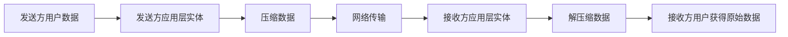
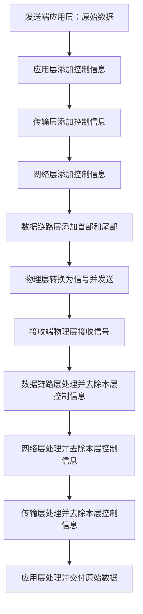
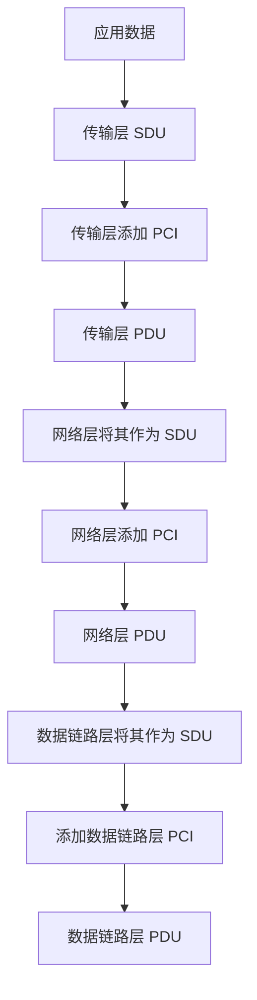
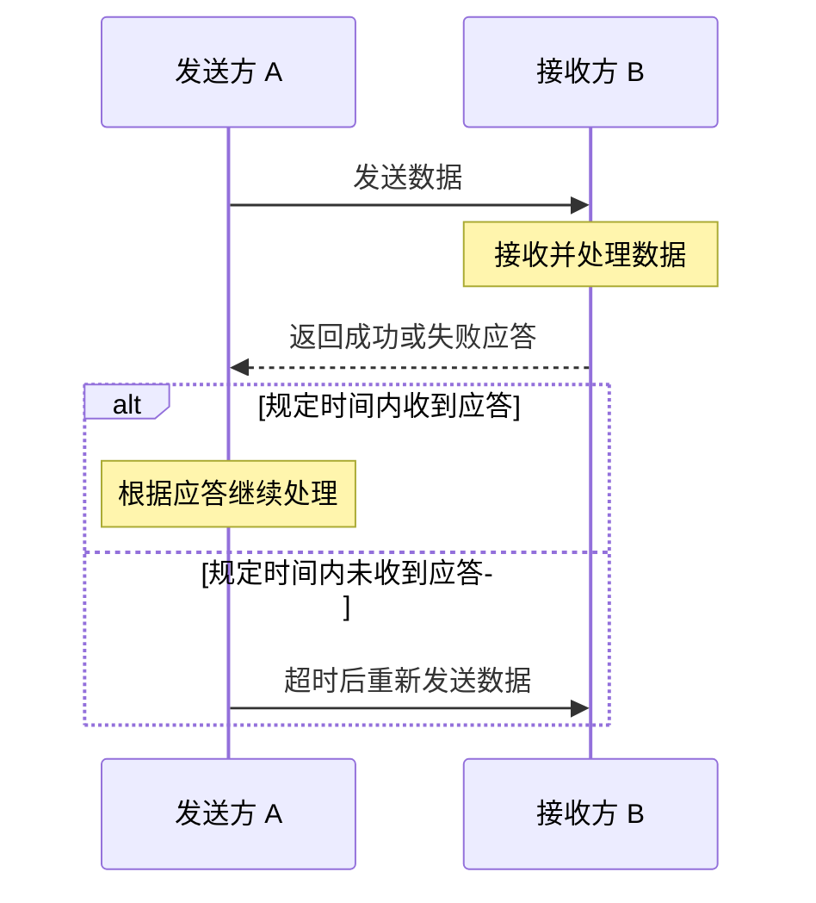
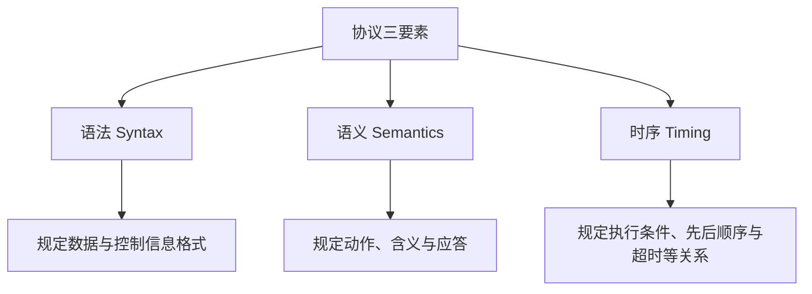
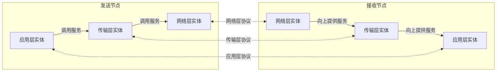

# 计算机网络的分层结构（二）：协议、数据单元与协议三要素

> 本节承接“计算机网络的分层结构与体系结构”，从对等实体之间的通信出发，进一步说明协议的作用、数据逐层封装与解封装的过程，以及协议数据单元（PDU）、服务数据单元（SDU）、协议控制信息（PCI）和协议三要素等概念。

---

## 一、为什么需要网络协议？

### 1. 实体与协议

在计算机网络中，工作在某一层的软件和硬件模块称为该层的**实体（Entity）**。

为了实现某一层的功能，同一层、不同节点上的实体需要遵循一定的通信规则。这些规则由**网络协议（Protocol）**规定。

- **实体：** 实现某一层功能的活动元素。
- **对等实体：** 位于不同节点、处于同一层的实体。
- **协议：** 约束对等实体之间如何通信的一组规则。

因此，协议主要描述不同节点上对等实体之间的通信规则。在分层结构中，这是一种概念上的**水平方向关系**。

### 2. 从水平视角理解协议的作用

假设发送方和接收方的应用层需要实现功能 `L`、`M`、`N`，其中功能 `N` 是压缩传输：

- 发送方的应用层实体在发送数据前，先按照某种算法压缩数据。
- 接收方的应用层对等实体收到数据后，采用对应的算法解压缩。
- 解压缩完成后，再将原始数据交给接收方用户。

对用户来说，数据似乎仍然是原样传输的；但在两个应用层实体内部，实际发生了压缩和解压缩操作。



这个例子说明：两个对等实体为了实现某项功能，需要约定一套通信规则。

### 3. 示例协议：压缩传输协议

为了支持压缩传输，可以假设设计一个示例协议，称为 **YSCS 协议**（视频中使用的示例名称，取自“压缩传输”相关字样）。

协议可以规定：

1. 发送方应用层实体先使用某一种压缩算法压缩数据。
2. 发送方在数据前添加一段控制信息，说明使用了哪一种压缩算法。
3. 接收方读取这段控制信息，识别压缩算法。
4. 接收方使用对应的解压算法还原数据，再交给上层用户。

这段控制信息可以放在数据的**首部（Header）**。有些协议还会在数据末尾添加控制信息，即**尾部（Trailer）**。

```text
发送的数据：
+----------------------+-------------------------+
| 首部：压缩算法等信息 | 压缩后的数据             |
+----------------------+-------------------------+

接收方处理：
读取首部 -> 确定解压算法 -> 解压数据 -> 交给用户
```

首部和尾部都属于协议控制信息的一部分。它们的长度、每个字段的含义、编码方式等，都需要在协议中规定清楚。

> YSCS 是为了讲解而设定的示例协议名称，用来说明协议如何支持压缩传输，并非本节要求掌握的标准互联网协议。

### 4. 协议存在的意义

计算机网络需要实现许多功能。设计网络时，通常要先识别需要支持哪些功能，再将这些功能合理地分配到不同层次。

同一层的对等实体需要配合完成该层的功能，因此必须遵循相应协议。协议通过规定对等实体之间的通信规则，使各层的功能能够被正确实现。

可以概括为：

1. **分层：** 把复杂系统拆分成职责相对明确的层次。
2. **功能分配：** 将不同功能安排到合适的层。
3. **制定协议：** 规定同一层对等实体之间的通信规则。
4. **添加控制信息：** 通过首部或尾部等信息，帮助接收方理解数据并执行相应操作。

---

## 二、从垂直视角理解数据传输：封装与解封装

### 1. 发送方如何逐层处理数据？

以教学使用的五层模型为例，发送方将数据交给应用层后，数据会依次经过：

1. 应用层；
2. 传输层；
3. 网络层；
4. 数据链路层；
5. 物理层。

每一层会根据本层协议处理数据，并可能添加本层需要的协议控制信息，然后将结果交给下一层。

在这个过程中，上一层交给下一层的数据整体，会成为下一层处理的内容。

### 2. 各层如何添加控制信息？

假设应用层原始数据为 `DATA`，每层可能添加本层的首部：

```text
应用层：
+---------------------------+
| H5 | DATA                 |
+---------------------------+

传输层：
+---------------------------+
| H4 | H5 | DATA            |
+---------------------------+

网络层：
+---------------------------+
| H3 | H4 | H5 | DATA       |
+---------------------------+

数据链路层：
+-----------------------------------+
| H2 | H3 | H4 | H5 | DATA | T2     |
+-----------------------------------+

物理层：
将数据链路层形成的比特序列转换为适合在物理介质上传输的信号
```

其中：

- `H5`：应用层协议控制信息的简化表示；
- `H4`：传输层协议控制信息的简化表示；
- `H3`：网络层协议控制信息的简化表示；
- `H2`：数据链路层首部的简化表示；
- `T2`：数据链路层尾部的简化表示。

这是帮助理解的示意图。实际协议的字段、封装格式和是否包含尾部，需要以具体协议为准。

在教学模型中，物理层主要负责把比特转换为信号并通过传输介质发送，本身通常不再像上面几层那样添加独立的协议首部。

### 3. 数据到达接收方后如何处理？

接收方按照相反的方向进行处理：

1. 物理层接收信号并恢复比特。
2. 数据链路层根据本层协议检查相应控制信息，并根据协议完成本层操作。
3. 数据链路层去除本层的控制信息，再将内容交给网络层。
4. 网络层处理自己的控制信息，完成本层相关工作后向上传递。
5. 传输层继续处理并去除相应控制信息。
6. 应用层处理本层协议相关信息，最终将数据交付给目标应用程序或用户。

这两个过程分别称为：

- **封装（Encapsulation）：** 发送方数据逐层向下处理，各层添加本层需要的控制信息。
- **解封装（Decapsulation）：** 接收方数据逐层向上处理，各层识别并处理本层控制信息，再将上层数据递交给上一层。



### 4. 每一层主要关注本层协议的信息

接收方的每一层主要根据本层协议，解释本层对应的控制信息，并完成本层应做的事情。

例如：

- 数据链路层可能利用本层控制信息进行差错检测等操作。
- 网络层根据网络层控制信息（例如 IP 地址等）完成寻址与转发相关处理。
- 传输层根据传输层控制信息完成相应的传输功能。
- 应用层根据应用协议处理应用数据。

每一层处理完成后，会把交给上一层的数据递交上去。最终，应用程序得到不再包含下层封装信息的应用数据。

> 注意：这里使用 `H5`、`H4`、`H3`、`H2` 等符号说明逐层封装的原理。实际协议中的首部结构和处理方式会因协议不同而变化；路由器也可能只处理到网络层及其下层，并不会像目的主机一样将数据一直递交到应用层。

### 5. 路由器在传输过程中的处理

在五层模型的教学示意中，路由器通常处理网络层及以下的内容：

- 网络层根据 IP 地址等信息进行路由与转发判断；
- 数据链路层按照当前链路的要求，封装适用于下一段链路的数据帧；
- 物理层将数据转换为适合下一段链路传输的信号。

因此，一个数据分组经过路由器时，网络层信息可能被读取并用于选择下一跳；之后，路由器再通过输出接口上的数据链路层和物理层，将数据发往下一个节点。

不同链路使用的数据链路层封装可以不同，所以路由器在输出链路上可能重新封装数据链路层首部和尾部。

---

## 三、PDU、SDU 与 PCI

这三个概念经常一起出现，需要结合分层封装示意图理解。

### 1. 协议数据单元（PDU）

**协议数据单元（Protocol Data Unit，PDU）**是指对等层次之间按照该层协议交换的数据单位。

例如，在本节的简化示意中：

- 应用层对等实体之间交换的数据，可以看作应用层 PDU；
- 网络层对等实体之间交换的内容，可以看作网络层 PDU；
- 数据链路层对等实体之间交换的内容，可以看作数据链路层 PDU。

不同层的 PDU 可能具有不同名称。常见的教学表述包括：传输层的报文段或数据报、网络层的数据报（分组）、数据链路层的帧、物理层的比特等；具体名称取决于协议与教材的术语约定。

### 2. 服务数据单元（SDU）

**服务数据单元（Service Data Unit，SDU）**是为了完成上一层实体所要求的功能，而由相邻层之间传递的数据。

从某一层的角度看，上一层交下来、需要由本层协议处理的数据部分，可以视作该层的 SDU。

例如：

- 应用层交给传输层的数据，对传输层而言是 SDU。
- 传输层处理后形成的传输层 PDU，向下交给网络层时，会成为网络层的 SDU。
- 网络层形成的网络层 PDU，向下交给数据链路层时，会成为数据链路层的 SDU。

因此，同一段数据在不同层次中观察时，可能使用不同的概念名称。

### 3. 协议控制信息（PCI）

**协议控制信息（Protocol Control Information，PCI）**是用于控制协议操作的信息。

它通常以首部的形式出现；在某些协议中，也可能包含尾部信息。例如：

- 应用层协议可以在首部中标记数据使用的压缩算法。
- 网络层首部可以包含源 IP 地址、目的 IP 地址等字段。
- 数据链路层可以使用首部和尾部中的相关字段支持本层功能。

在本节的简化模型中，`H5`、`H4`、`H3`、`H2` 和 `T2` 都是协议控制信息的示意符号。

### 4. PDU、SDU 与 PCI 的关系

一个层的 PDU 通常由该层的 SDU 与该层的 PCI 组成：

\[
\boxed{\text{PDU}=\text{SDU}+\text{PCI}}
\]

如果某层协议的控制信息同时包含首部和尾部，那么可以将其理解为：

\[
\text{PCI}=\text{首部}+\text{尾部}
\]

例如，数据链路层的简化示意：

```text
数据链路层 PDU
+--------------------------------------------------+
| 数据链路层首部 H2 | 本层 SDU | 数据链路层尾部 T2 |
+--------------------------------------------------+
             ↑
      首部和尾部属于 PCI
```

结合五层结构可以看到，某一层的 PDU 向下交给下一层后，通常会作为下一层的 SDU。下一层再添加自己的 PCI，形成更低一层的 PDU。



更准确地说，上一层交付给下一层的服务数据部分，是下一层 SDU；下一层再依据自己的协议添加控制信息，形成该层 PDU。

### 5. 三个概念的对比

| 概念 | 英文全称 | 英文缩写 | 核心含义 |
|---|---|---|---|
| 协议数据单元 | Protocol Data Unit | PDU | 对等层实体之间按照本层协议交换的数据单位 |
| 服务数据单元 | Service Data Unit | SDU | 为实现上一层所请求的功能而交给本层处理的数据 |
| 协议控制信息 | Protocol Control Information | PCI | 控制本层协议操作的信息，通常体现为首部，也可能包含尾部 |

**快速记忆：**

- `PDU = SDU + PCI`
- SDU 是本层需要传递或处理的数据部分。
- PCI 是本层协议附加的控制信息。
- PDU 是加入本层控制信息之后，按本层协议形成的数据单元。

---

## 四、协议的三要素

一个完整的网络协议通常需要规定三个基本要素：

1. **语法（Syntax）**
2. **语义（Semantics）**
3. **时序（Timing）**，也常称为同步关系。

三要素共同规定通信双方交换什么格式的信息、这些信息表示什么，以及双方在什么条件和顺序下执行操作。

### 1. 语法：数据与控制信息的格式

**语法**规定数据和控制信息的格式。

协议需要明确，例如：

- 控制信息（如首部）有多少个字节；
- 每个字段位于什么位置；
- 每个字段的长度是多少；
- 字段的编码方式和格式是什么；
- 数据部分的长度范围或格式如何规定。

例如，在压缩传输协议中，发送方需要在首部中指出采用哪一种压缩算法。协议就必须规定该字段的位置、长度以及每个取值代表的含义。

因此，语法回答的是：

> **信息应该按照什么格式组织？**

### 2. 语义：需要做什么操作

**语义**规定通信双方应该发出何种控制信息、完成何种动作，以及做出何种应答。

例如，压缩传输协议可以规定：

- 发送方压缩数据后发送；
- 接收方读取首部中的算法标识；
- 接收方使用对应算法解压缩；
- 接收方在成功处理后返回“传输成功”应答；
- 如果无法正确处理，则返回“传输失败”应答。

语义主要回答：

> **通信双方需要做什么，以及信息代表什么含义？**

### 3. 时序：操作何时发生、按什么顺序发生

协议的第三个要素是**时序（Timing）**，也常称为同步关系。

时序规定通信双方执行各种操作的条件、先后顺序以及相关时间关系。

例如，压缩传输协议可以规定：

1. 发送方先发送数据。
2. 接收方收到数据并完成处理。
3. 接收方返回传输成功或失败的应答。
4. 如果发送方在规定时间（例如 10 秒）内没有收到应答，就再次发送数据。

这里的 10 秒只是帮助理解时序概念的示例值，不代表所有协议都采用该时间。



时序主要回答：

> **什么时候执行操作，以及各操作的先后顺序是什么？**

### 4. 语义与时序的区别

二者容易混淆，可以这样区分：

- **语义：** 规定通信双方可能需要做哪些动作、信息代表什么意义。
- **时序：** 规定这些动作在什么条件下发生、先后顺序如何、何时需要重试。

例如：

- “接收方收到数据后应返回确认”属于动作与应答规则，主要体现语义。
- “发送方发送后等待 10 秒；如果超时仍未收到确认，就重发”体现操作条件和先后关系，主要体现时序。

### 5. 协议三要素对比表

| 要素 | 英文 | 主要规定什么 | 记忆关键词 |
|---|---|---|---|
| 语法 | Syntax | 数据与控制信息的格式 | 格式、字段、长度 |
| 语义 | Semantics | 控制信息的含义、要执行的动作和应答 | 做什么、含义 |
| 时序 | Timing | 执行操作的条件、先后顺序和时间关系 | 什么时候、顺序 |



---

## 五、从本节概念看分层设计

### 1. 为什么分层后还需要协议？

分层只是把功能划分到不同层次，并不能自动保证不同节点之间的同层实体能够互相理解。

要让同一层的实体正确通信，还需要协议明确规定：

- 需要交换什么信息；
- 信息按照什么格式组织；
- 收到信息后应该做什么；
- 各个动作在什么条件和顺序下发生。

因此，分层与协议相互配合：

1. 分层决定功能如何分工。
2. 协议定义同层对等实体之间的通信规则。
3. 首部、尾部等控制信息承载协议所需的信息。
4. 各层通过接口使用下一层提供的服务。
5. 数据在发送端逐层封装，在接收端逐层解封装。

### 2. 水平关系与垂直关系

| 观察角度 | 关系 | 相关概念 | 核心问题 |
|---|---|---|---|
| 水平方向 | 不同节点上同一层的实体之间 | 对等实体、协议、PDU | 如何按照约定交换信息？ |
| 垂直方向 | 同一节点中相邻层之间 | 服务、接口、SAP、SDU | 上一层如何请求下一层提供功能？ |



图中的水平虚线代表概念上的对等协议关系；垂直箭头代表相邻层之间使用服务的关系。真实数据仍然由发送节点逐层向下传递，经由实际网络到达接收节点，再逐层向上处理。

### 3. 体系结构与实现的关系

网络体系结构需要精确定义：

- 网络划分为哪些层；
- 每层负责哪些功能；
- 各层使用什么协议；
- 层次之间如何进行交互。

体系结构设计者主要定义功能框架和规则，而具体的软硬件实现由开发者和设备厂商完成。

只要各个实现符合相应的协议和接口约定，就可以在符合条件的网络环境中互相通信。

---

## 六、本节重点概念总表

| 概念 | 定义或作用 | 易混淆点 |
|---|---|---|
| 实体 | 实现某层功能的活动元素 | 实体可以由软件、硬件或二者共同实现 |
| 对等实体 | 不同节点上、处于同一层的实体 | 同层对等关系是概念上的水平关系 |
| 协议 | 约束对等实体之间通信的规则集合 | 协议的作用是实现相关功能 |
| 首部 | 常用于承载协议控制信息 | 字段格式和含义由协议规定 |
| 尾部 | 某些协议在数据末尾添加的控制信息 | 不是每一层、每一种协议都一定有尾部 |
| PDU | 对等层实体之间按本层协议交换的数据单位 | 本层 SDU 与本层 PCI 组成 PDU |
| SDU | 交给本层处理或传递的数据部分 | 同一段数据在不同层可能以不同名称出现 |
| PCI | 用于控制协议操作的信息 | 常以首部呈现，也可能包含尾部 |
| 语法 | 规定数据和控制信息的格式 | 格式、字段、长度 |
| 语义 | 规定信息的含义、动作和应答 | 做什么、信息代表什么 |
| 时序 | 规定操作的条件、先后顺序和时间关系 | 什么时候做、何时重试 |

---

## 七、复习要点

1. **协议约束水平方向的通信：** 同一层、不同节点上的对等实体之间，需要遵循协议。
2. **分层解决功能分工：** 将复杂网络功能合理划分到不同层。
3. **协议首部和尾部：** 用于承载协议控制信息，具体格式、字段长度和含义由协议规定。
4. **封装：** 数据从上到下逐层传递，各层添加本层需要的控制信息。
5. **解封装：** 数据到达接收端后逐层向上处理，各层根据本层协议识别和处理控制信息。
6. **PDU = SDU + PCI：** PDU 是本层协议数据单元，SDU 是本层承载的数据部分，PCI 是本层协议控制信息。
7. **上一层 PDU 可成为下一层 SDU：** 向下传递时，下一层再添加自己的协议控制信息。
8. **协议三要素：**
   - 语法：数据与控制信息的格式；
   - 语义：通信双方要做的动作、信息含义和应答；
   - 时序：动作的触发条件、先后顺序和时间关系。
9. **协议与服务不同：** 协议是对等实体之间的通信规则；服务是相邻层之间的功能提供关系。
10. **具体协议会帮助理解抽象概念：** 随着后续学习不同网络协议，PDU、SDU、PCI 以及语法、语义、时序的含义会更加直观。

---

## 八、本节总结

本节进一步解释了计算机网络为什么需要协议，以及协议如何支持分层功能的实现。

- 对等实体之间通过协议进行通信，协议规定的是概念上的水平方向通信规则。
- 发送端的数据逐层向下处理，每层可能添加本层协议控制信息；接收端再逐层处理和移除相应控制信息。
- 协议数据单元（PDU）由服务数据单元（SDU）与协议控制信息（PCI）组成，即：

\[
\boxed{\text{PDU}=\text{SDU}+\text{PCI}}
\]

- 某一层形成的 PDU 向下递交后，通常会成为下一层的 SDU；下一层再添加本层的控制信息，形成下一层的 PDU。
- 协议的三要素是**语法、语义和时序**：语法规定格式，语义规定动作和含义，时序规定执行条件和顺序。
- 网络体系结构定义层次、功能和协议规则；具体软硬件实现由开发者与设备厂商完成。

结合上一节内容，可以形成一套完整的理解框架：**分层负责功能划分，协议负责同层通信规则，服务和接口负责相邻层协作，封装与解封装负责数据在各层之间的递交与处理。**
