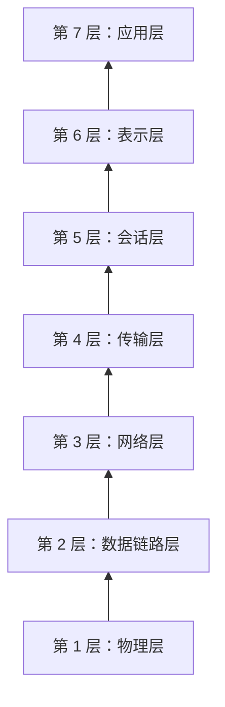
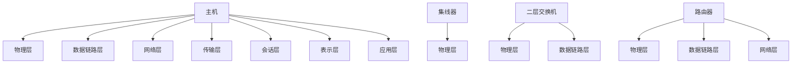
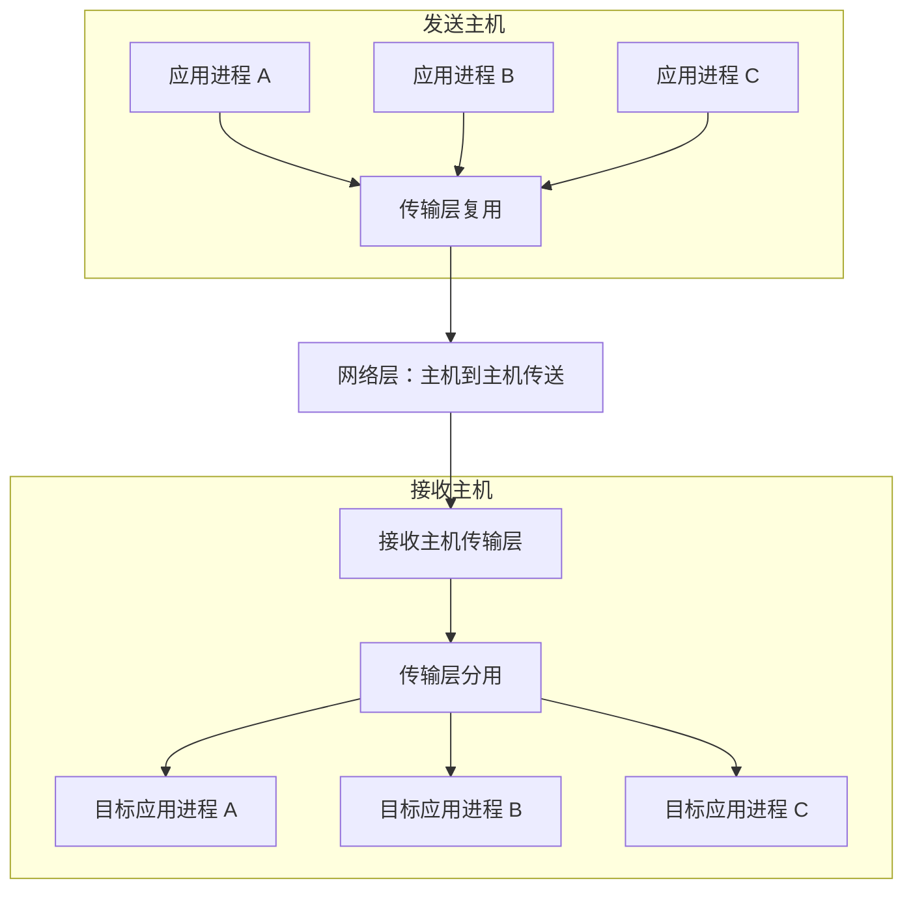
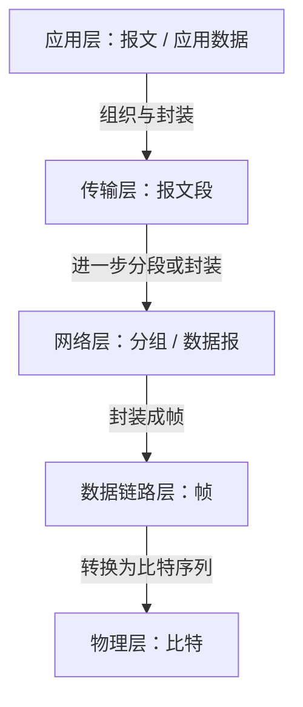

# OSI 参考模型：各层功能、网络设备与数据传输单位

> 本节梳理 OSI 参考模型的七个层次，重点掌握层次名称与顺序、常见网络设备涉及的层次、各层主要功能，以及不同层次的数据传输单位。视频还介绍了数据链路层、网络层和传输层在差错控制、流量控制等功能上的区别。

---

## 一、OSI 参考模型与 TCP/IP 模型的术语说明

OSI 参考模型有七层，TCP/IP 模型通常按四层讲解。不同教材对部分层次的中文翻译可能存在差异。

| OSI 参考模型 | 英文名称        | TCP/IP 模型中的常见名称 | 本笔记统一使用的名称 |
| ------------ | --------------- | ----------------------- | -------------------- |
| OSI 第 4 层  | Transport Layer | Transport Layer         | 传输层               |
| OSI 第 3 层  | Network Layer   | Internet Layer          | 网络层               |

说明：

- OSI 第 4 层的英文是 **Transport Layer**。部分教材翻译为“运输层”，也有教材翻译为“传输层”。考研中更常见“传输层”这一说法，因此本笔记统一使用“传输层”。
- OSI 第 3 层英文是 **Network Layer**，通常翻译为“网络层”。TCP/IP 四层模型中的对应层常称为“网际层”或“互联网层”。为了和考研常用术语保持一致，本笔记统一使用“网络层”。

本节主要按照 OSI 七层参考模型介绍各层功能。

---

## 二、OSI 七层的名称与顺序

OSI 参考模型自下而上依次为：

1. 物理层
2. 数据链路层
3. 网络层
4. 传输层
5. 会话层
6. 表示层
7. 应用层

### 1. 记忆口诀：物联网书会使用

视频采用的口诀是：

> **物联网书会使用**

七个字分别对应 OSI 七层：

| 层次（自下而上） | 层名称     | 口诀对应           |
| ---------------: | ---------- | ------------------ |
|          第 1 层 | 物理层     | 物                 |
|          第 2 层 | 数据链路层 | 联（谐音提示“链”） |
|          第 3 层 | 网络层     | 网                 |
|          第 4 层 | 传输层     | 书（谐音）         |
|          第 5 层 | 会话层     | 会                 |
|          第 6 层 | 表示层     | 使（谐音）         |
|          第 7 层 | 应用层     | 用                 |

可以把口诀想象成一个小故事：“物联网很发达，但是有人不会使用物联网，于是有人问‘物联网谁会使用？’”

这个口诀主要用于记忆层次名称和顺序。层次名称的顺序是考研基础题中可能考查的内容，例如题目可能询问 OSI 第五层是哪一层。

> 口诀的原创归属按视频说明为王道的楼楼老师。这里仅用于课程复习记忆。

### 2. 七层结构图

---

## 三、常见网络设备工作在哪些层次？

网络节点之间通过物理传输介质连接，例如网线、光纤等。视频将物理传输介质在示意图中看作“第 0 层”，以便和网络设备的层次区分；它不是 OSI 七层参考模型中的正式层次。

### 1. 四种常见设备的功能层次

| 设备                           | 涉及的 OSI 层次                        | 主要理解                                             |
| ------------------------------ | -------------------------------------- | ---------------------------------------------------- |
| 主机                           | 第 1～7 层                             | 通常需要完整的网络协议栈，从物理传输到应用功能都涉及 |
| 集线器（Hub）                  | 第 1 层：物理层                        | 主要处理物理信号，不理解数据链路层帧的地址信息       |
| 交换机（此处指常见二层交换机） | 第 1～2 层：物理层、数据链路层         | 根据数据链路层信息转发帧                             |
| 路由器                         | 第 1～3 层：物理层、数据链路层、网络层 | 根据网络层信息进行路由与分组转发                     |

**注意：** 这里按课程中的典型设备功能进行概括。现实设备可能集成多种功能，例如三层交换机可以具备部分网络层转发能力；但入门题中通常按照“集线器一层、二层交换机两层、路由器三层、主机七层”记忆。

### 2. 物理传输介质

网线、光纤等属于物理传输介质，用于承载电信号、光信号等。节点和节点之间通过这些介质建立物理连接。

在示意图中，可以把物理介质画在物理层下面，但不要把它误认为 OSI 模型正式的第八层或第零层。

---

## 四、第一层：物理层

### 1. 物理层的主要任务

物理层首先要解决的问题是：

> **如何在两个相邻节点之间传输比特（0 和 1）？**

为了实现比特传输，物理层需要规定物理接口和信号相关的参数。

### 2. 物理层需要规定的内容

- **接口形状与参数：** 例如接口的外形、针脚数量及连接方式。
- **信号的含义：** 某种电压、电平或其他信号状态分别代表二进制的 0 还是 1。
- **电气特性：** 规定信号在电气层面的特征。
- **比特持续时间或信号时序：** 规定信号如何对应到比特，以及接收方如何确定比特的边界。
- **传输介质相关特性：** 与网线、光纤等传输方式相匹配的物理要求。

视频用一个简化例子说明信号与比特的对应关系：

- 如果接收到约 5 V 的高电平信号，可以约定它代表二进制 `1`。
- 如果接收到约 1 V 的低电平信号，可以约定它代表二进制 `0`。
- 如果规定每个比特对应 0.1 ms 的信号时间，那么接收方就需要按照这一规则判断比特值。

以上电压和时间仅为说明原理的示例，实际接口与信号编码会依照具体物理层标准规定。

### 3. 物理层的局限

物理层主要负责通过物理介质传送比特。传输过程中可能出现噪声干扰，导致信号发生变化。

例如，发送方原本发送代表 `1` 的高电平信号，受到干扰后，接收方却把它识别成代表 `0` 的低电平信号。单纯从物理层收到的比特流来看，接收方可能无法直接判断这个比特是否正确。

因此，需要更高一层的数据链路层加入相应控制机制，检测或处理传输错误。

---

## 五、第二层：数据链路层

数据链路层简称**链路层**。

### 1. 数据链路层的主要任务

数据链路层的一个重要目标是，让两个相邻节点之间在逻辑上实现相对可靠的数据传输。

数据链路层以**帧（Frame）**为单位进行数据传输。一个帧通常包含多个比特。

### 2. 差错控制

物理层传输可能受到噪声影响，因此数据链路层需要使用合适的校验编码等方法，检测帧在传输过程中是否发生错误。

视频用一个简化例子说明这一点：

- 原始数据有 8 bit。
- 数据链路层额外增加 2 bit 校验信息。
- 一共 10 bit 被交给物理层传输。
- 接收方的数据链路层收到这些比特后，利用校验信息检测是否存在错误。

如果检测到错误，具体如何处理取决于采用的协议，例如可以丢弃该帧，并在协议允许的情况下要求发送方重传。如果没有检测出错误，则按协议处理并把有效数据交给上层。

这里的“8 bit 数据加 2 bit 校验信息”只是概念示例，并不是所有数据链路协议都采用固定的两位校验信息。

### 3. 流量控制

数据链路层还可以实现**流量控制**，协调相邻节点的数据发送速率，避免发送方发送得过快，导致接收方来不及接收或处理。

例如：

- 节点 A 每秒可以发送 10 个帧。
- 节点 B 每秒最多只能接收并处理 5 个帧。

在这种情况下，数据链路层协议需要采取适当的流量控制方法，让 A 不要持续以超过 B 处理能力的速率发送数据。

### 4. 数据链路层的重点

- **传输单位：** 帧。
- **主要功能：** 差错控制、流量控制。
- **工作范围：** 通常关注相邻节点之间的链路传输。

> 数据链路层能够处理帧级别的问题，但它不能仅凭单个帧的正确性，就保证更高层的整个分组或报文段一定完整、正确。

---

## 六、第三层：网络层

### 1. 网络层的主要任务

当源主机与目的主机并不直接相连时，数据通常需要经过多个路由器转发。为了实现跨多个网络节点的数据传送，需要网络层。

网络层的主要任务是：

> **将分组从源节点转发到目的节点。**

网络层以**分组（Packet）**为单位进行传输。在一些教材或语境中，网络层分组也称为**数据报（Datagram）**；具体术语使用应以题目和教材为准。

### 2. 路由选择

源节点到目的节点之间可能存在多条路径。网络层需要通过路由选择决定数据分组应沿哪条路径或下一跳转发。

例如，A 到 D 之间可能存在多条路由。路由选择功能根据网络信息和路由规则选定适合的路径。

### 3. 分组转发

选择路径之后，还需要把分组从当前节点实际转发到下一跳，这就是**分组转发**。

可以区分：

- **路由选择：** 决定分组应该走哪条路径。
- **分组转发：** 根据转发决定，将分组从当前节点送到下一跳。

### 4. 拥塞控制

当网络中某些节点或链路负载过高时，分组可能排队等待，造成时延增大，甚至发生丢包。

网络需要通过相应机制发现或缓解拥塞。视频用城市交通作类比：如果某个区域堵车，交通管理系统可以引导车辆避开拥堵区域，从而减轻局部压力。

网络层中的拥塞控制需要依据具体网络机制实现，不能简单理解为所有路由器都会用完全相同的方式处理。

### 5. 网际互联

不同网络内部可能采用不同的数据链路技术。例如，有的网络采用以太网，有的网络可能使用其他链路技术。

网络层通过统一的网络层机制（例如 IP）实现不同网络之间的互联，并在一定程度上屏蔽底层网络的差异，让数据分组能够跨越多个网络转发。

### 6. 其他网络层功能

按照视频的课程归纳，网络层还可能涉及：

- 差错控制；
- 流量控制；
- 连接的建立与释放；
- 可靠传输管理。

这些功能的实现方式与具体的网络层协议、服务模型有关。需要注意的是，现代互联网 IP 层本身提供的是尽力而为的数据报服务，不保证每个分组都一定可靠到达；在某些面向连接的网络层服务模型中，连接管理等功能会更明显。因此，复习时应区分“课程对网络层功能的归纳”和“具体 IP 协议所保证的能力”。

视频用虚电路帮助理解面向连接的网络层服务：建立连接后，分组可以沿选定的逻辑路径转发；具体是否能够保证按序、无重复或可靠到达，要看相应服务和协议的规定，不能对所有网络层协议一概而论。

### 7. 网络层的重点

- **传输单位：** 分组（或在相关语境中称数据报）。
- **核心功能：** 路由选择、分组转发、拥塞控制、网际互联。
- **工作范围：** 负责跨多个节点、多个网络的主机到主机数据分组传送。

---

## 七、第四层：传输层

### 1. 为什么有了网络层，还需要传输层？

网络层可以将分组从源主机转发到目的主机，但一台主机上可能同时运行很多应用程序或进程。

仅仅把数据送到目的主机还不够，还需要确定：

- 数据来自哪个进程；
- 数据应该交给目的主机上的哪个进程。

传输层主要实现**端到端的进程到进程通信**。

### 2. 端口号与进程的对应关系

传输层可以使用端口号标识通信端点，并依据端口号等信息，将收到的数据交给相应的应用进程。

视频使用端口号举例说明这一映射关系，例如假设某应用使用端口 `8899`，另一个应用使用端口 `6537`。这只是讲解映射关系的示例值，并不意味着某个具体应用在所有设备上都固定使用该端口。

### 3. 复用与分用

传输层的两个重要功能是**复用**和**分用**。

- **复用（Multiplexing）：** 发送端多个应用进程可以利用传输层服务发送数据，传输层依据端口等信息进行组织与处理。
- **分用（Demultiplexing）：** 接收端传输层根据端口等信息，将收到的数据交给相应的应用进程。

### 4. 传输层的数据单位

传输层通常以**报文段（Segment）**为单位组织和传输数据。不同传输协议对数据单位的具体称呼可能有所不同，例如 TCP 使用“报文段”这一术语。

一个较大的传输层数据单位，可以在网络层处理中进一步拆分成多个分组；目的主机网络层接收到分组后，会将相应数据交给传输层处理。

### 5. 传输层的功能

按照视频的课程归纳，传输层涉及：

- 复用与分用；
- 差错控制；
- 流量控制；
- 连接的建立与释放；
- 可靠传输管理。

传输层针对的是**进程之间的端到端传输**，这些控制功能作用于传输层的数据单位（例如 TCP 报文段）及其传输过程。

实际网络中，不同传输协议提供的能力不同。例如，TCP 提供可靠、有序的字节流服务；UDP 则不提供 TCP 式的可靠、有序传输保证。因此，以上列表表示课程中的主要功能类别，不意味着每一种传输层协议都实现所有这些功能。

### 6. 网络层与传输层的区别

| 对比项                             | 网络层                                 | 传输层                           |
| ---------------------------------- | -------------------------------------- | -------------------------------- |
| 主要通信范围                       | 主机到主机                             | 进程到进程                       |
| 典型数据单位                       | 分组 / 数据报                          | 报文段（具体名称依协议而定）     |
| 地址或标识                         | IP 地址等网络层信息                    | 端口号等传输层信息               |
| 典型功能                           | 路由选择、分组转发、拥塞控制、网际互联 | 复用与分用、端到端传输控制       |
| 差错控制、流量控制等功能的作用范围 | 按网络层服务及分组层面讨论             | 按传输层服务及端到端数据传输讨论 |

**易错点：** 网络层和传输层可能都涉及差错控制、流量控制、连接管理或可靠传输等概念，但二者作用的对象、范围和协议保证并不相同。

---

## 八、第五层：会话层

### 1. 主要任务

会话层负责管理进程之间的会话。视频强调的主要功能是**会话管理**。

### 2. 检查点机制

视频用检查点机制来帮助理解会话层的概念：

- 两个进程正在传输一个较大的文件。
- 传输到一部分时，通信突然中断。
- 系统记录已经完成到哪里。
- 当通信恢复后，可以尝试从检查点继续，而不是从头开始。

例如，两个应用要传输一个 1 GB 的视频，已经传输 500 MB 时网络中断。如果相关机制记录了检查点，恢复后就可以从已有进度继续传输，类似文件断点续传。

这只是帮助理解会话管理和检查点概念的示例。现代互联网中的断点续传通常由应用、传输协议或其他机制协同实现，不能认为所有文件传输都由独立的 OSI 会话层完成。

---

## 九、第六层：表示层

### 1. 主要任务

表示层要处理不同主机之间**信息表示方式不一致**的问题。

例如，两台主机可能使用不同的字符编码方式：

- 一台使用 GBK 编码；
- 另一台使用 UTF-8 编码。

如果不进行适当处理，同一个字符可能会对应不同的字节序列。因此，需要约定或转换数据表示格式。

### 2. 表示层的常见功能

视频列出的表示层功能包括：

- **数据格式转换：** 例如不同编码格式之间的转换。
- **压缩与解压缩：** 减少数据量，或在接收端恢复数据。
- **加密与解密：** 按照相应规则转换数据，以满足安全通信需求。

表示层的核心目标是让通信双方能够理解所交换数据的表示形式。

---

## 十、第七层：应用层

### 1. 主要任务

应用层为具体的网络应用提供所需的网络功能。应用层的功能很多，会根据应用程序的需求而有所不同。

### 2. 示例：HTTP

HTTP 是常见的应用层协议。浏览网页时，客户端与 Web 服务之间通常会使用 HTTP 或 HTTPS 相关机制交换应用数据。

应用层协议会规定应用消息的格式、含义以及通信过程中的相关规则。

---

## 十一、OSI 七层功能总表

|    层次 | 名称       | 数据传输单位（课程常用说法） | 主要功能                                       |
| ------: | ---------- | ---------------------------- | ---------------------------------------------- |
| 第 7 层 | 应用层     | 报文 / 应用数据              | 为具体网络应用提供功能，例如 Web 访问相关协议  |
| 第 6 层 | 表示层     | 通常仍是报文数据             | 数据表示与格式转换、压缩/解压缩、加密/解密     |
| 第 5 层 | 会话层     | 通常仍是报文数据             | 会话管理、检查点等                             |
| 第 4 层 | 传输层     | 报文段（依协议而定）         | 进程到进程通信、复用与分用、端到端传输控制     |
| 第 3 层 | 网络层     | 分组 / 数据报                | 路由选择、分组转发、拥塞控制、网际互联等       |
| 第 2 层 | 数据链路层 | 帧                           | 相邻节点间传输、差错控制、流量控制等           |
| 第 1 层 | 物理层     | 比特                         | 定义接口、信号、电气特性及时序等，实现比特传输 |

> 表中功能是课程常用的概括。具体协议或实际互联网协议栈的功能划分，可能与 OSI 参考模型的理论分层不完全相同。

---

## 十二、各层数据传输单位与分段、重装

### 1. 数据单位从上到下的变化

在教学使用的 OSI 分层示意中，应用层产生较大的应用数据，经过不同层处理后，逐渐封装成各层的数据单位：

1. 应用层数据通常称为报文或应用数据。
2. 会话层、表示层在本示意中通常不把整个报文进一步切分。
3. 传输层将数据按需要组织为报文段。
4. 网络层将传输层数据组织或拆分为分组。
5. 数据链路层将网络层分组封装进帧。
6. 物理层将帧表示为比特序列，并通过物理介质传输。

接收端则执行相反过程，将底层收到的数据逐层处理并重新组装，最终恢复应用层所需的数据。

### 2. 分段与重装

- **分段：** 将较大数据单位拆分为多个较小数据单位。
- **重装：** 接收端根据相应规则，将来自下层的较小数据单位恢复或组合成上层所需要的数据单位。

视频强调，传输层、网络层和数据链路层都可能涉及数据的分段与重装，但处理对象不同：

- 传输层处理报文段及端到端数据；
- 网络层处理分组；
- 数据链路层处理帧。

更严格地说，各层是否负责分段、分片、重组或重新组装，要以具体协议的定义为准。在教学层次图中，主要目的是理解数据单位逐层变化的关系。

### 3. 数据单位与功能作用范围对照

| 层次       | 数据单位      | 该层控制功能针对的对象       |
| ---------- | ------------- | ---------------------------- |
| 传输层     | 报文段        | 端到端、进程到进程的数据传输 |
| 网络层     | 分组 / 数据报 | 网络层分组的路由与转发       |
| 数据链路层 | 帧            | 相邻节点之间的链路传输       |

---

## 十三、数据链路层、网络层、传输层的功能为什么相似？

视频特别提醒：数据链路层、网络层和传输层都可能涉及差错控制、流量控制等功能，但作用范围不同。

### 1. 数据链路层：帧级别

数据链路层以帧为单位进行传输，并根据本层协议完成相应的差错控制与流量控制。

它主要关注相邻节点之间的链路。例如，某个帧在一条链路上传输时发生错误，链路层机制可以根据协议检测或处理该问题。

### 2. 网络层：分组级别

网络层以分组为单位进行处理和转发。一个分组可能需要经过多条链路与多个路由器。

某一条链路上某个帧的传输情况，并不等于整个分组一定完整、正确地到达目的节点。例如，一个分组在链路上传输时，底层需要把数据放入帧中传送；如果传输过程中发生丢失，仅仅在其他帧上检测到正确，并不能证明整个分组完整到达。

因此，课程会从分组层面讨论网络层的相关控制功能。但这些功能是否由具体网络层协议提供，取决于相应的网络层服务与协议设计。

### 3. 传输层：报文段与端到端级别

传输层面向进程到进程的端到端通信。它关注的是传输层数据（例如 TCP 报文段）在源端与目的端之间的传输。

网络层分组在每条链路上成功传输，并不自动意味着整个应用数据一定可靠、有序地交付。可靠传输等能力通常需要由传输层协议（例如 TCP）提供。

### 4. 三层控制功能的对照

| 层次       | 典型数据单位  | 主要范围            | 理解重点                                     |
| ---------- | ------------- | ------------------- | -------------------------------------------- |
| 数据链路层 | 帧            | 相邻节点 / 单条链路 | 帧在当前链路上的差错与流量控制               |
| 网络层     | 分组 / 数据报 | 跨多个节点与网络    | 路由、转发，以及具体网络层服务支持的其他功能 |
| 传输层     | 报文段        | 端到端、进程到进程  | 复用与分用，以及传输协议提供的端到端控制     |

**考试记忆：** 若题目问“差错控制、流量控制针对的对象是什么”，不要只看功能名称，还要看所在层次和数据传输单位。

---

## 十四、复习要点

1. 记住 OSI 七层从下到上的顺序：物理层、数据链路层、网络层、传输层、会话层、表示层、应用层。
2. 记忆口诀：**物联网书会使用**。
3. 典型设备涉及的层次：主机七层、集线器一层、二层交换机两层、路由器三层。
4. 物理层负责通过物理介质传输比特，规定接口和信号等相关特性。
5. 数据链路层以帧为单位，主要关注相邻节点间传输、差错控制和流量控制。
6. 网络层以分组为单位，重要功能包括路由选择、分组转发、拥塞控制和网际互联。
7. 传输层实现端到端、进程到进程通信，重要功能包括复用与分用。
8. 会话层管理进程之间的会话；表示层处理数据表示、转换、压缩和加密等；应用层支持具体网络应用。
9. 主机、集线器、交换机和路由器的典型层次范围不同，注意题目中的设备类型和功能假设。
10. 传输层、网络层和数据链路层可能都涉及控制功能，但对应的数据单位、范围与协议保证不同。
11. 数据传输单位的常见对应：报文/应用数据、报文段、分组/数据报、帧、比特。
12. **越靠上的层次，课程示意中的数据单位通常越大；越靠下的层次，数据单位通常越小。**

---

## 十五、本节总结

本节重点是理解 OSI 七层模型的名称、顺序、主要功能及数据传输单位：

- **物理层：** 以比特为单位，通过物理介质传输信号。
- **数据链路层：** 以帧为单位，实现相邻节点之间的数据链路功能，包含差错控制与流量控制等。
- **网络层：** 以分组为单位，负责路由选择、分组转发、拥塞控制和网际互联等。
- **传输层：** 实现进程到进程的端到端通信，负责复用与分用，并可根据协议提供相应传输控制能力。
- **会话层：** 管理进程之间的会话。
- **表示层：** 处理表示格式、数据转换、压缩/解压缩、加密/解密等。
- **应用层：** 为具体网络应用提供功能。

常见设备的典型层次范围为：主机涉及七层，集线器涉及物理层，二层交换机涉及物理层和数据链路层，路由器涉及物理层、数据链路层和网络层。

还要注意：网络层、传输层和数据链路层都可能涉及某些相似的控制功能，但三者处理的数据单位不同，作用范围也不同。把“层次—功能—数据单位—作用范围”联系起来，是复习本节的关键。
