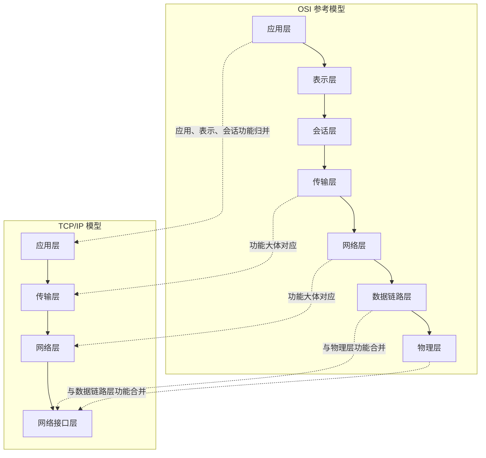
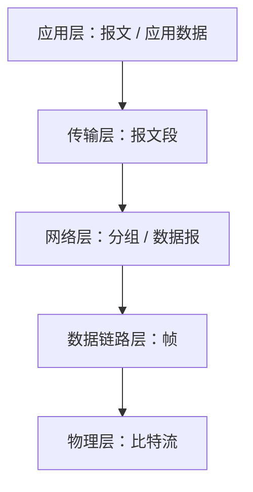
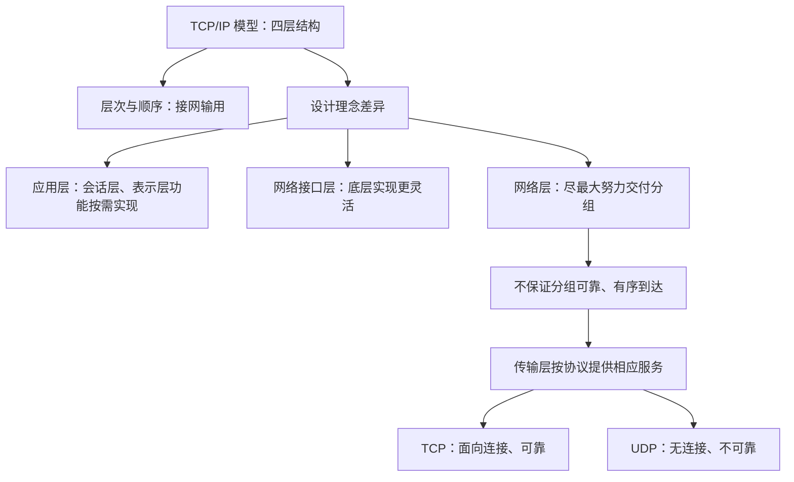

# TCP/IP 模型与 OSI 参考模型

> **学习目标**
>
> 1. 记住 TCP/IP 模型各层的名称和顺序。
> 2. 理解 TCP/IP 模型与 OSI 参考模型在设计理念上的区别。
> 3. 理解两种模型在应用层、网络接口层、网络层和传输层的功能差异。
> 4. 掌握网络层与传输层提供的服务类型，以及 TCP、UDP 的基本区别。

---

## 一、TCP/IP 模型的层次结构

### 1. 四层模型

TCP/IP 模型一共分为四层，从下到上依次为：

| 顺序    | TCP/IP 层次 | 主要作用                         | 与 OSI 参考模型的对应关系                   |
| ------- | ----------- | -------------------------------- | ------------------------------------------- |
| 第 1 层 | 网络接口层  | 实现相邻节点之间的数据传输       | 大体对应 OSI 的物理层、数据链路层           |
| 第 2 层 | 网络层      | 负责将分组从源主机传送到目的主机 | 对应 OSI 的网络层                           |
| 第 3 层 | 传输层      | 为应用进程之间的通信提供传输服务 | 对应 OSI 的传输层                           |
| 第 4 层 | 应用层      | 为网络应用提供协议和服务         | 大体包含 OSI 的会话层、表示层、应用层的功能 |

### 2. 记忆口诀：接网输用

从第一层到第四层，分别记住每层名称中的一个字：

- **接**：网络接口层
- **网**：网络层
- **输**：传输层
- **用**：应用层

口诀：**接网输用**。

可以用下面的小故事帮助记忆：

> 一个年轻人问：“物联网谁会使用？”
>
> 一位大叔回答：“物联网，书会使用。”
>
> 年轻人接着问：“书怎么用？”
>
> 大叔回答：“接网输用。”
>
> 这里的“接网输用”就是：接上网络，书就可以使用物联网。

这只是用于记忆四层名称顺序的谐音故事。

### 3. 层次对应关系图

> **注意：** 这里强调的是层次和功能的对应关系，不代表两种模型的每项功能都能严格一一对应。

---

## 二、TCP/IP 与 OSI 的设计理念区别

两种模型层次数量不同，主要与它们对功能划分、协议选择和底层网络技术的设计理念有关。

### 1. 应用层：TCP/IP 将会话层和表示层的功能合并

#### 1.1 回顾 OSI 的应用层、表示层和会话层

在分层网络结构中，上层会使用下层提供的服务或已经实现的功能。

在 OSI 参考模型中：

- **应用层**会使用表示层提供的功能。
- **表示层**主要负责数据格式转换等功能。
- **会话层**主要负责会话管理等功能。

会话管理的效果可以类比为文件传输中断后，恢复网络时从中断的位置继续传输，也就是断点续传。

#### 1.2 为什么表示层和会话层不一定需要独立存在？

**数据格式转换并不是每个应用都需要的。**

例如，两个应用之间传输文件时，如果发送方和接收方使用的数据编码格式完全相同，就没有必要进行额外的数据格式转换。

**会话管理也不是每个应用都必须使用的。**

例如，文件传输过程中网络中断后，恢复时可以选择从中断位置继续传输，也可以选择重新传输整个文件。并不是所有应用都必须实现断点续传。

因此，数据格式转换和会话管理并不是所有网络应用都必需的功能。

#### 1.3 TCP/IP 的处理方式

TCP/IP 模型没有将会话层、表示层单独设置为两个层次，而是把相关功能放到应用层协议中灵活实现。

这样做的好处是：

1. **减少不必要的层次。** 模型结构更加简洁。
2. **功能选择更灵活。** 应用程序可以根据需要决定是否实现数据格式转换、会话管理等功能。
3. **便于应用协议按需设计。** 如果某个应用需要会话管理，就使用包含相应功能的协议；如果不需要，就不必强制经过这类处理。

例如，两个微信应用在通信时，如果确实需要某种会话管理功能，可以由它们所使用的应用层协议实现；不需要时，也不必强制支持。

相比之下，按照 OSI 参考模型的分层结构，应用层的数据会经过表示层和会话层。TCP/IP 模型则把这些功能交给应用层协议按需实现，因此在实际应用中更灵活。

#### 1.4 这一设计理念的总结

| 对比点             | OSI 参考模型                 | TCP/IP 模型                    |
| ------------------ | ---------------------------- | ------------------------------ |
| 会话层、表示层     | 分别设置独立层次             | 不单独设置这两个层次           |
| 相关功能的实现位置 | 在对应的会话层、表示层中描述 | 由应用层协议按需实现           |
| 功能选择           | 分层结构相对固定             | 应用可以更灵活地选择需要的功能 |
| 设计结果           | 层次划分更细                 | 层次更少，结构更简洁           |

**核心结论：** TCP/IP 模型认为，并非所有网络应用都需要会话管理和数据格式转换，因此不必把会话层和表示层设置为所有应用都必须经过的独立层次。

---

### 2. 网络接口层：不严格限定底层网络技术的实现方式

#### 2.1 OSI 对物理层和数据链路层的划分

OSI 参考模型将底层划分为物理层和数据链路层。

**物理层**需要规定物理接口和比特传输相关的参数，例如：

- 网线接口、光纤接口的形状和尺寸；
- 电信号、光信号分别代表什么含义；
- 如何在物理介质上传输比特流。

**数据链路层**需要完成相邻节点之间的数据链路传输，并可涉及：

- 差错控制；
- 流量控制；
- 帧的传输等功能。

OSI 参考模型对各层需要承担的功能有较明确的划分。这有利于统一理解和设计，但如果把底层功能与实现方式规定得过于固定，也可能限制网络硬件厂商的设计自由度。

#### 2.2 TCP/IP 的处理方式

TCP/IP 模型将网络层以下的功能归入一个**网络接口层**。

网络接口层最基本的任务是：

> 实现相邻节点之间的数据传输，并为网络层传输分组提供底层支持。

TCP/IP 模型并不详细规定网络接口层必须使用哪一种具体的底层通信技术，也不要求所有网络设备都采用完全相同的实现方式。

只要具体的网络接口技术能够与网络层正确交互、完成相邻节点之间的数据传输，就可以采用不同的实现方案。

#### 2.3 这种设计的影响

网络技术和网络硬件的种类很多，通信技术也在不断发展。TCP/IP 模型把具体底层实现留给不同的技术和设备，有利于：

- 适应不同种类的网络硬件和通信技术；
- 让设备厂商根据实际需求研发和改进底层技术；
- 减少对具体底层实现方式的限制；
- 提高整个体系结构的灵活性和适应性。

| 对比点   | OSI 参考模型                     | TCP/IP 模型                      |
| -------- | -------------------------------- | -------------------------------- |
| 底层划分 | 物理层、数据链路层               | 网络接口层                       |
| 功能划分 | 对两层的职责和相关功能作较细划分 | 将底层功能归入网络接口层         |
| 具体实现 | 按相应层次的规定设计             | 对具体底层技术的限制较少         |
| 设计效果 | 分层定义更细致                   | 适应不同底层网络技术的灵活性更强 |

**核心结论：** TCP/IP 模型的网络接口层在功能上大体对应 OSI 的物理层和数据链路层，但不对具体底层实现方式作过多限制。

---

## 三、网络层与传输层：两种模型的重要区别

网络层和传输层是考试中经常放在一起比较的部分。理解两者的区别，需要先理解不同层次传输的数据单位，以及“局部正确”和“全局正确”的关系。

### 1. 各层的数据传输单位

在分层结构中，数据从上层向下层传递时，每一层可能会添加自己的控制信息，并按照本层的处理方式组织数据。

常见的数据单位如下：

| 层次       | 常见的数据单位                      |
| ---------- | ----------------------------------- |
| 应用层     | 报文或应用数据                      |
| 传输层     | 报文段（通常用于描述 TCP 数据单位） |
| 网络层     | 分组或数据报                        |
| 数据链路层 | 帧                                  |
| 物理层     | 比特流                              |

数据较长时，上层数据可能被拆分成多个较小的数据单位，再交给下层传输。例如：

1. 应用层产生报文。
2. 传输层可以将报文拆分成多个报文段；如果数据较小，也可能不需要拆分。
3. 网络层可以将传输层的数据进一步组织为一个或多个分组。
4. 数据链路层将网络层分组封装成帧。
5. 物理层通过物理介质传输比特。

不同层次的数据单位示意图：

从上到下，数据会被逐层封装，并可能被划分为本层需要处理的数据单位。越靠下的层次，处理的数据单位通常越局部；越靠上的层次，越关注端到端的整体数据。

### 2. 为什么“局部正确”不能保证“全局正确”？

假设一段较长的数据被拆分成多个分组，而每个分组又被封装成帧后逐段传输。

即使数据链路层能够检查某一帧在当前链路上的传输是否正确，也不能直接推出整个分组在端到端传输时一定正确。原因包括：

- 某一段链路上的帧可能传输正确，但后续链路仍可能发生错误；
- 分组可能在传输过程中丢失；
- 多个分组可能以不同顺序到达；
- 某些分组可能重复到达。

因此：

> **局部数据传输正确，不代表端到端的整体数据传输一定正确。**

OSI 参考模型的设计思路是：不同层次分别针对本层的数据单位提供相应的差错控制、流量控制、连接管理或可靠传输等功能。

TCP/IP 模型则采用另一种思路：网络层尽力转发分组，端到端的可靠传输主要交给传输层处理。

---

### 3. OSI 参考模型的网络层与传输层

按照本课程所讲解的比较思路，OSI 参考模型中的网络层和传输层都可能涉及以下功能：

- **差错控制**：检测或处理传输过程中出现的数据错误；
- **流量控制**：协调发送方与接收方的数据发送速度；
- **连接管理**：管理通信连接的建立、使用和释放；
- **可靠传输管理**：处理丢失、重复、顺序等问题，以提供可靠传输服务。

两层的区别主要在于所处理的数据单位不同：

| 层次   | 主要处理的数据单位 | 功能保障的范围     |
| ------ | ------------------ | ------------------ |
| 网络层 | 分组               | 分组层面的传输     |
| 传输层 | 报文段             | 端到端的报文段传输 |

在这个设计思路下，网络层即使保证了分组层面的传输，也不能直接保证更高层的报文段整体正确。因此，传输层还需要针对报文段再次提供相关的控制和可靠传输功能。

数据链路层也可能进行差错控制和流量控制，但它主要关注帧；网络层关注分组；传输层关注端到端的报文段。不同层次面向不同的数据单位和范围。

---

### 4. TCP/IP 模型的网络层：尽最大努力交付

TCP/IP 模型采用不同的设计思路：

> 网络层不负责提供端到端的可靠传输保证，而是尽最大努力将分组转发到目的地。

网络层的基本任务是转发分组。分组从一个节点传到相邻节点，再经过多个中间节点，最终到达目的主机。在这个过程中，网络层不保证每个分组一定正确、一定到达，也不保证所有分组按顺序到达。

例如：

1. 传输层把一个报文段交给网络层。
2. 网络层把数据组织为一个或多个分组，并交给网络接口层传输。
3. 分组经过多个节点和链路到达目的主机。
4. 在传输过程中，分组可能出现差错、丢失、重复或乱序。
5. 网络层仍然尽最大努力转发分组，并不负责对端到端可靠性作出保证。
6. 目的主机的传输层再根据所使用的传输协议处理可靠传输问题。

因此，TCP/IP 模型的网络层相对简单，不必承担全部端到端的差错控制、流量控制、连接管理和可靠传输管理任务。

### 5. 为什么把可靠性主要交给传输层？

TCP/IP 模型把端到端的可靠性保障主要放在网络边缘，也就是通信主机的传输层，而不是要求网络核心中的每台路由器都实现完整的可靠传输控制。

这种设计可以：

- 简化网络层的功能；
- 降低网络核心设备的处理负担；
- 使路由器专注于分组转发；
- 将端到端的可靠传输需求交给通信双方的主机处理。

这并不表示 TCP/IP 模型完全不关心数据传输的可靠性，而是把相关任务放在更合适的层次上：**网络层尽力交付，传输层按所使用的协议提供相应服务。**

---

## 四、网络层与传输层的服务类型

### 1. 网络层：数据报服务与虚电路服务

按照课程对 OSI 与 TCP/IP 的比较：

#### 1.1 数据报服务

数据报服务属于**无连接、不可靠**的服务。

其特点是：

- 不需要先建立固定的逻辑连接；
- 不保证分组一定到达；
- 不保证分组按顺序到达；
- 不保证分组在传输过程中绝对没有差错。

因此，数据报服务强调尽力交付，而不保证端到端可靠性。

#### 1.2 虚电路服务

虚电路服务属于**面向连接**的服务。按照课程中的对比口径，如果网络层启用了相应的连接管理、差错控制、流量控制和可靠传输功能，就可以向上层提供有连接、可靠的服务，也就是课程中所说的虚电路服务。

其特点可以概括为：

- 通信前建立逻辑连接；
- 通过连接管理组织数据传输；
- 可提供有序、可靠的分组传输服务。

#### 1.3 OSI 与 TCP/IP 网络层对比

| 对比点                     | OSI 参考模型（按课程比较口径） | TCP/IP 模型                                  |
| -------------------------- | ------------------------------ | -------------------------------------------- |
| 网络层是否承担可靠传输功能 | 可以支持相应功能               | 不提供端到端可靠传输保证                     |
| 可提供的服务类型           | 可讨论数据报服务和虚电路服务   | 网络层提供无连接、尽最大努力交付的数据报服务 |
| 是否保证分组按序到达       | 取决于所提供的服务             | 不保证                                       |
| 是否保证分组不丢失         | 取决于所提供的服务             | 不保证                                       |

**考试记忆点：** TCP/IP 模型的网络层只提供无连接、不可靠的数据报服务；它不在网络层保证分组传输的正确性和有序性。

---

### 2. 传输层：TCP 与 UDP

TCP/IP 模型的传输层可以向上层应用提供不同类型的传输服务。

#### 2.1 TCP

TCP 提供**面向连接、可靠**的传输服务。

在 TCP 的机制作用下，可以对数据传输中的差错、丢失、重复和顺序等问题进行处理，从而向应用提供可靠、有序的字节流传输服务。

#### 2.2 UDP

UDP 提供**无连接、不可靠**的数据传输服务。

UDP 不提供 TCP 那样的端到端可靠传输保证，但它在某些对实时性要求较高、能够容忍少量数据丢失的应用场景中很有价值。

例如，观看直播时，用户往往更看重画面的连续性和播放流畅性。如果直播画面偶尔丢失几个帧，或者声音短暂停顿，有时比为了补齐所有数据而增加延迟更容易接受。因此，一些实时应用可以采用不提供可靠传输保证的服务。

#### 2.3 TCP 与 UDP 对比

| 对比点   | TCP                      | UDP                                    |
| -------- | ------------------------ | -------------------------------------- |
| 连接类型 | 面向连接                 | 无连接                                 |
| 可靠性   | 提供可靠传输服务         | 不提供 TCP 那样的可靠传输保证          |
| 顺序保障 | 提供有序的字节流传输     | 不保证数据按序到达                     |
| 适用考虑 | 需要可靠、有序传输的应用 | 某些更看重时效性、可容忍部分丢失的应用 |

**注意：** “无连接、不可靠”不等于“完全不能使用”或“没有价值”。对于一些实时应用，降低传输延迟可能比重传所有丢失数据更重要。

---

## 五、OSI 与 TCP/IP 的重点差异总结

### 1. 四层对应关系

| TCP/IP 层次 | 对应的 OSI 层次        | 重点理解                                                    |
| ----------- | ---------------------- | ----------------------------------------------------------- |
| 应用层      | 应用层、表示层、会话层 | TCP/IP 将会话管理、数据格式转换等功能交由应用层协议按需实现 |
| 传输层      | 传输层                 | TCP 可提供可靠传输，UDP 可提供无连接、不可靠的传输服务      |
| 网络层      | 网络层                 | TCP/IP 网络层采用尽最大努力交付的方式，不保证端到端可靠性   |
| 网络接口层  | 数据链路层、物理层     | 将底层功能合并，具体底层通信技术的实现较灵活                |

### 2. 设计理念总表

| 比较方面               | OSI 参考模型                                             | TCP/IP 模型                                                  |
| ---------------------- | -------------------------------------------------------- | ------------------------------------------------------------ |
| 层次数量               | 七层                                                     | 四层                                                         |
| 会话管理、数据格式转换 | 分别设置会话层、表示层                                   | 相关功能由应用层协议按需提供                                 |
| 底层网络功能           | 物理层、数据链路层分层描述                               | 归入网络接口层，具体实现较灵活                               |
| 网络层可靠性           | 按课程比较口径，可以讨论有连接可靠服务与无连接不可靠服务 | 网络层采用无连接、尽最大努力交付的数据报服务                 |
| 端到端可靠性           | 网络层和传输层分别针对不同数据单位承担相应功能           | 主要由传输层按协议提供，例如 TCP                             |
| 传输层提供的服务       | 课程对比中强调以可靠、有连接服务为主要设计假设           | 可以提供 TCP 的可靠服务，也可以提供 UDP 的无连接、不可靠服务 |

### 3. 考试重点速记

#### 必须记住的内容

1. **TCP/IP 四层顺序：** 网络接口层 → 网络层 → 传输层 → 应用层。
2. **记忆口诀：** 接网输用。
3. **层次对应：**
   - TCP/IP 应用层 ≈ OSI 应用层 + 表示层 + 会话层；
   - TCP/IP 传输层 ≈ OSI 传输层；
   - TCP/IP 网络层 ≈ OSI 网络层；
   - TCP/IP 网络接口层 ≈ OSI 数据链路层 + 物理层。
4. **应用层的区别：** TCP/IP 不单独设置会话层和表示层，相关功能由应用层协议按需实现。
5. **网络接口层的区别：** TCP/IP 将物理层和数据链路层的相关功能归入网络接口层，对具体底层技术的实现限制较少。
6. **网络层的区别：** TCP/IP 网络层尽最大努力转发分组，不保证分组无差错、不丢失或按序到达。
7. **TCP 与 UDP：** TCP 提供面向连接、可靠的传输服务；UDP 提供无连接、不可靠的传输服务。

#### 容易混淆的内容

- **网络接口层不等于只负责物理信号。** 它概括了 OSI 物理层和数据链路层相关的底层网络功能。
- **TCP/IP 并不是完全没有会话管理和数据格式转换。** 这些功能可以由应用层协议按需实现，只是不设置独立的会话层和表示层。
- **TCP/IP 网络层不保证可靠，不等于整个 TCP/IP 通信都不可靠。** 当应用使用 TCP 时，传输层可以提供可靠传输。
- **UDP 不保证可靠，不代表它没有用途。** 对某些实时应用而言，低延迟可能比重传丢失的数据更重要。
- **不要把网络层和传输层的功能混在一起。** 网络层主要负责分组转发；传输层面向主机上的应用进程提供传输服务。

---

## 六、本节内容的整体逻辑

## 七、一句话总结

**TCP/IP 模型以四层结构组织网络功能：应用层按需实现应用相关功能，网络接口层适应不同的底层网络技术，网络层以尽最大努力的方式转发分组，而端到端的数据传输服务由传输层根据所使用的协议提供。**
