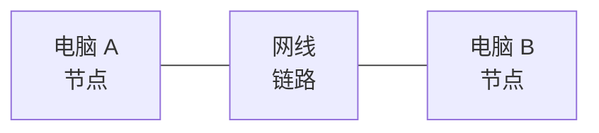
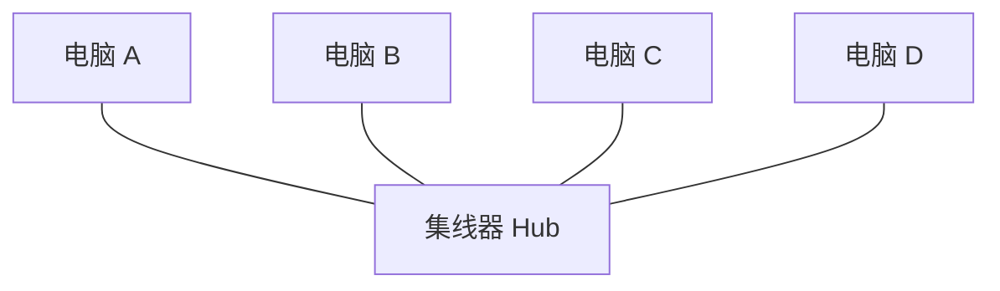
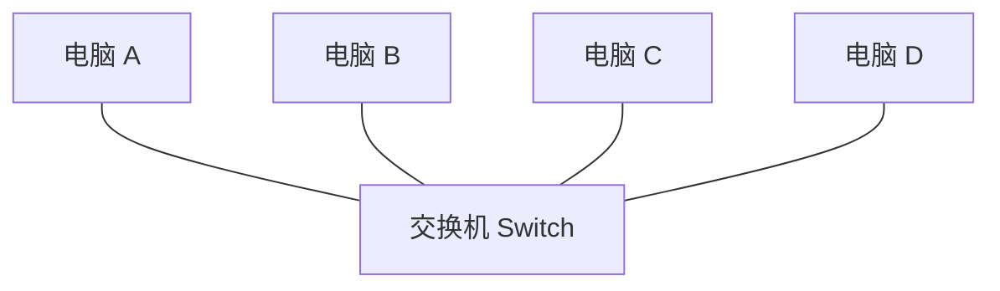
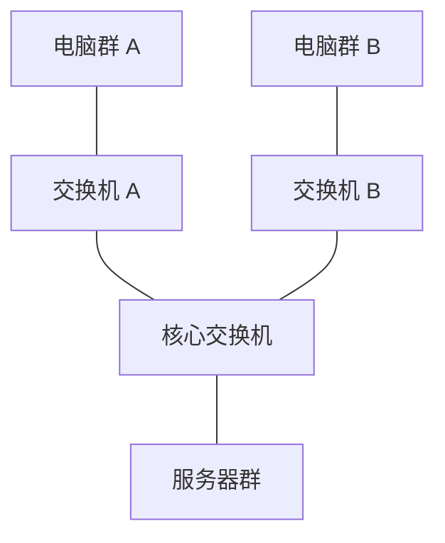
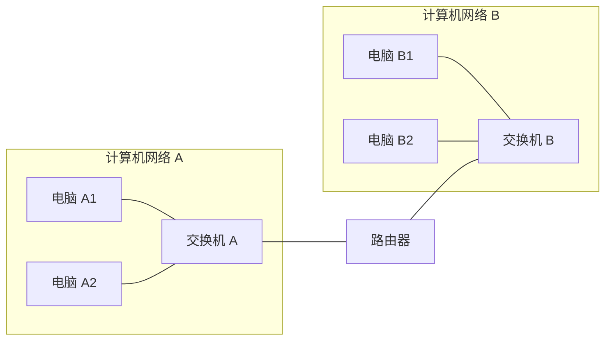
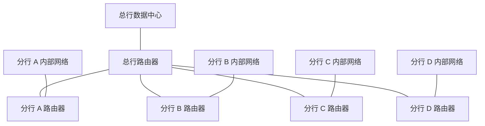
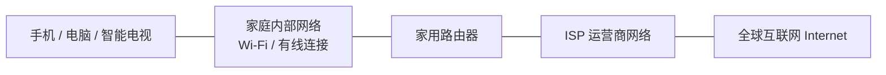
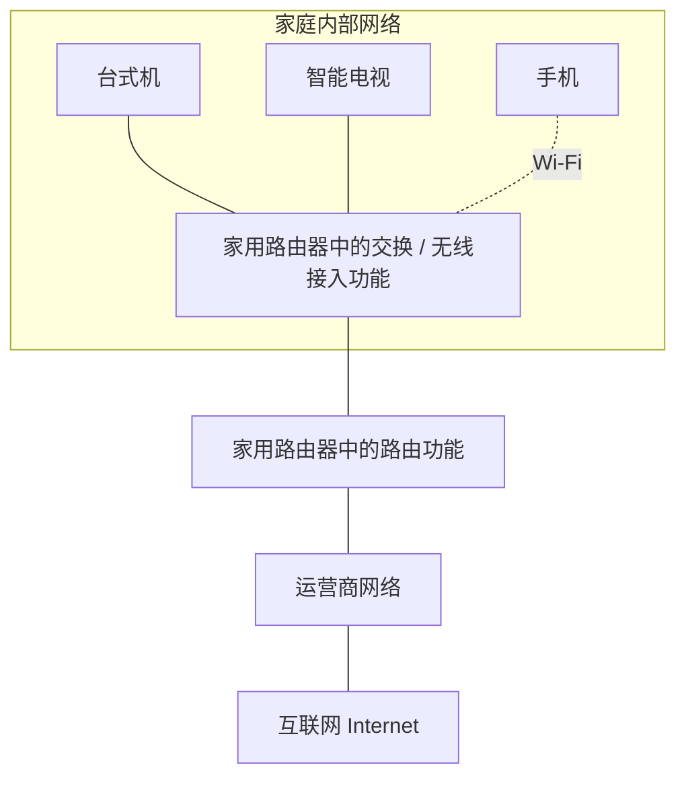
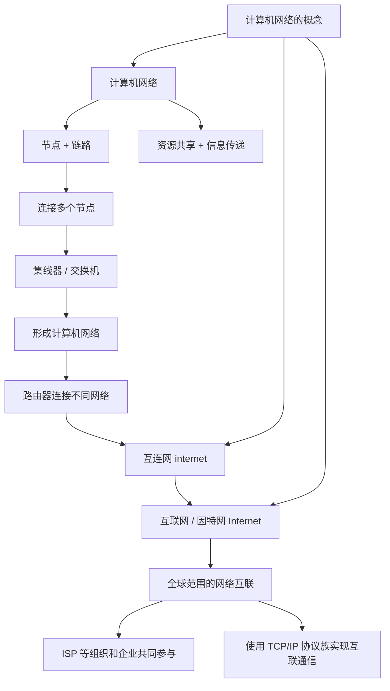

# 计算机网络的概念：计算机网络、互连网与互联网

> **本节学习目标**
>
> 1. 理解计算机网络的基本概念和定义。
> 2. 区分“计算机网络”“互连网（internet）”和“互联网/因特网（Internet）”。
> 3. 理解节点、链路、集线器、交换机和路由器的基本作用。
> 4. 了解 ISP（互联网服务提供商）的含义。
> 5. 理解全球互联网为什么需要统一的通信协议。

---

## 一、第一章的学习说明

第一章主要学习**计算机网络体系结构**。通过本章学习，我们会认识计算机网络课程中的许多基本概念，并建立起整门课程的知识框架。

考试中，本章主要考查选择题和简单计算题。

本章涉及的部分概念第一次学习时可能比较抽象，但后续章节会继续深入讲解。因此，初学时有些概念理解得不够透彻是正常的。随着后续章节的学习，再回头复习本章，通常会更容易理解。

本节先学习计算机网络的概念，并区分以下三个术语：

- **计算机网络**
- **互连网（internet，小写 i）**
- **互联网/因特网（Internet，大写 I）**

> **注意：** “互连网”和“互联网”在这里是两个不同层次的概念，英文写法也有区别。

---

## 二、什么是计算机网络？

### 1. 计算机网络的定义

不同教材对计算机网络的表述可能有所不同。本课程采用的定义可以概括为：

> **计算机网络是一个将众多分散的、自治的计算机系统，通过通信设备和线路连接起来，并由功能完善的软件实现资源共享和信息传递的系统。**

理解这个定义，需要抓住以下关键词：

| 关键词         | 含义                                                                   | 生活中的例子                    |
| -------------- | ---------------------------------------------------------------------- | ------------------------------- |
| 分散的         | 计算机系统分布在不同位置，并非集中在同一台设备中                       | 家里的手机、笔记本电脑、台式机  |
| 自治的         | 各计算机系统相互独立，一台设备发生故障通常不会直接导致其他设备停止运行 | 手机坏了，家里的电脑仍可以工作  |
| 通信设备和线路 | 负责把不同的计算机系统连接起来                                         | 路由器、5G 基站、网线、无线链路 |
| 资源共享       | 不同设备之间可以共享数据或服务                                         | 使用百度网盘共享文件            |
| 信息传递       | 不同设备之间可以交换信息                                               | 使用微信聊天、传输文件          |

### 2. 哪些设备可以接入计算机网络？

日常生活中，很多计算机系统都可以接入计算机网络，例如：

- 手机；
- 笔记本电脑；
- 台式机；
- 智能手表；
- 智能电视。

这些设备接入网络的方式可能不同：

- **笔记本电脑：** 可以通过 Wi-Fi 连接路由器。
- **台式机：** 可以通过网线连接路由器。
- **手机：** 可以通过 Wi-Fi 接入家庭网络，也可以通过 5G 等移动通信技术连接基站，从而接入网络。
- **智能电视、智能手表：** 可以根据设备支持的功能，通过 Wi-Fi 或其他网络连接方式接入网络。

设备接入网络后，可以使用不同的软件完成资源共享和信息传递。例如，使用百度网盘共享文件，使用微信聊天或传输文件。

### 3. 计算机网络是怎样组成的？

计算机网络由多个相互连接的节点和连接节点的链路组成。

- **节点（node）：** 网络中的设备或连接点，例如计算机、集线器、交换机、路由器等。
- **链路（link）：** 连接节点的通信线路，可以是有线线路，也可以是无线链路。

例如，两台电脑通过一根网线直接连接，就可以形成一个非常简单的计算机网络。

这张图中包含：

- **2 个节点：** 电脑 A 和电脑 B；
- **1 条链路：** 连接两台电脑的网线。

通过通信线路把不同的计算机系统连接起来，并配合相应的软件，就可以进行信息传递和资源共享。

---

## 三、从简单网络到更大的网络

### 1. 两台电脑直接连接

过去和同学一起玩《红色警戒》《帝国时代》《极品飞车》或《我的世界》等支持局域网联机的游戏时，可以把两台电脑通过网线连接起来。

即使宿舍的外部网络断开，只要两台电脑之间的局域网连接仍然正常，在游戏支持的情况下，仍然可以进行局域网联机。

这种情况下，网络只包含两台电脑和连接它们的链路。

### 2. 使用集线器连接多台电脑

如果有更多电脑需要连接，可以使用集线器（Hub）。

例如，将四台电脑分别通过网线连接到同一个集线器上：

这个网络一共包含：

- **5 个节点：** 4 台电脑和 1 个集线器；
- **4 条链路：** 连接各台电脑和集线器的网线。

有了集线器，多个同学就可以把电脑接入同一个局域网，进行局域网联机。

#### 集线器的特点

传统集线器无法像交换机那样有效地隔离不同端口之间的数据冲突。

如果多台电脑同时发送数据，可能会发生冲突，造成数据无法正常发送，需要重新发送等问题，因此效率较低。

集线器的具体工作原理会在后续章节中详细学习。本节只需先记住：

> **集线器可以连接多个节点，但传统集线器存在共享传输介质上的冲突问题，效率较低。**

### 3. 使用交换机连接多台电脑

现在组建家庭、公司或学校内部网络时，通常会使用交换机（Switch）等设备。

交换机通常有多个网口，多台电脑可以通过网线接入同一个交换机：

交换机同样可以把多个节点连接起来，组成一个计算机网络。

与传统集线器相比，交换机能够根据其工作机制转发数据，避免传统集线器那种所有端口共享同一冲突域的方式所带来的冲突问题。在典型的交换式以太网中，不同端口上的设备可以同时进行通信。

关于交换机如何学习地址、转发数据，以及它为什么能够提高网络效率，会在后续章节详细学习。

#### 集线器与交换机对比

| 对比点       | 集线器（Hub）                                | 交换机（Switch）                         |
| ------------ | -------------------------------------------- | ---------------------------------------- |
| 基本作用     | 连接多个节点                                 | 连接多个节点                             |
| 数据处理方式 | 通常将收到的信号向其他端口转发               | 根据转发表等信息转发数据帧               |
| 冲突问题     | 传统集线器的端口共享同一冲突域，容易发生冲突 | 典型交换式以太网可以隔离不同端口的冲突域 |
| 使用情况     | 现在较少使用                                 | 常用于家庭、公司、学校等内部网络         |
| 本节要点     | 能组成网络，但效率较低                       | 能组成网络，通常更适合现代局域网         |

> **记忆要点：** 集线器和交换机都可以连接多个节点，组成一个计算机网络；交换机是现代局域网中更常见的设备。

### 4. 使用交换机组成更大的内部网络

一个交换机还可以连接另一个交换机。因此，公司或学校可以使用多台交换机，把不同房间、楼层或建筑中的设备连接起来。

例如，校园网内部可以部署多台交换机，把大量计算机和其他网络设备连接起来。

无论是使用集线器还是交换机，都可以在相应条件下把多个节点连接起来，构建计算机网络。

在网络示意图中，计算机网络经常使用**云朵**来表示，以便隐藏网络内部的具体实现细节。

---

## 四、互连网（internet）：把多个计算机网络连接起来

### 1. 为什么需要路由器？

交换机可以把多个节点连接起来，形成一个计算机网络。

如果要把两个或多个**不同的计算机网络**连接起来，就需要使用路由器（Router）等网络层设备来实现网络之间的互联。

> **路由器的基本作用：连接不同的计算机网络，并在网络之间转发分组。**

通过路由器，可以把多个计算机网络互相连接，形成更大规模的网络。

### 2. 从多个计算机网络到互连网

通过路由器连接两个或多个计算机网络后，就形成了一个更大的网络。教材常用**互连网（internet，小写 i）**来表示由多个网络互连形成的网络。

图中：

- 网络 A 内部通过交换机连接设备；
- 网络 B 内部通过交换机连接设备；
- 路由器把网络 A 和网络 B 连接起来；
- 多个计算机网络互相连接后，形成更大的互连网。

路由器还可以继续连接其他路由器，从而连接更多计算机网络，使互连网的规模不断扩大。

### 3. 银行内部网络的例子

银行内部网络可以用来理解互连网的概念。

假设某大型银行有一个总行、四个分行，以及部署在总行的数据中心。每个分行都有自己的内部网络，各个分行通过路由器与总行的数据中心互联。

例如：

1. 客户在 A 分行存入 1000 元。
2. 存款信息通过分行网络和路由器传送到总行数据中心。
3. 数据中心更新客户的账户余额。
4. 客户之后即使到 D 分行取款，D 分行也可以通过内部网络查询相关账户信息。

这说明多个相互独立的计算机网络可以通过路由器连接起来，实现网络之间的通信和信息共享。

银行的数据通常具有较高的安全要求，所以银行可能会建设专用的内部网络，并采用访问控制等措施保护数据。家庭网络如果没有相应的连接、授权和安全条件，通常无法直接访问银行内部网络。

> **本例的重点：** 路由器连接不同的计算机网络，使多个网络能够互相通信；互连网并不一定向所有公众开放，也可以是专用的内部网络。

---

## 五、互联网/因特网（Internet）：全球范围的公共互联网

### 1. 互连网与互联网的区别

中文教材中常用以下两个术语来区分不同概念：

| 中文术语        | 英文写法             | 含义                                               |
| --------------- | -------------------- | -------------------------------------------------- |
| 互连网          | `internet`（小写 i） | 泛指由多个计算机网络互相连接形成的网络             |
| 互联网 / 因特网 | `Internet`（大写 I） | 特指全球范围内广泛互联、向公众提供接入服务的互联网 |

二者的关键区别在于：

- **互连网（internet）：** 是一般性概念，可以是一个组织内部的网络互连，也可以是更大范围的网络互连。
- **互联网/因特网（Internet）：** 是全球范围内规模最大的、互联互通的特定互联网。

> **注意拼写：** `internet` 的首字母是小写 `i`；`Internet` 的首字母是大写 `I`。在本节采用的教材术语中，两者对应“互连网”和“互联网/因特网”的区别。

### 2. 谁构建了全球互联网？

全球互联网并不是由一家公司单独建成的，而是由许多企业、组织和网络共同互联形成的。

其中，**互联网服务提供商**发挥着重要作用。

- 英文：Internet Service Provider
- 缩写：**ISP**
- 中文：互联网服务提供商

常见例子包括中国电信、中国移动、中国联通等运营商。

这些服务提供商通过网络设备、通信链路和互联设施连接不同地区、不同组织的网络，共同组成覆盖全球的互联网。

### 3. 家庭宽带如何接入互联网？

申请家庭宽带时，运营商会为家庭提供相应的接入线路。

从逻辑上看，可以把家庭内部网络通过家用路由器与运营商网络连接，再通过运营商的网络接入更大范围的互联网。

> **说明：** 这是一张简化的逻辑图。现实中的家庭接入线路可能经过光猫、接入网、汇聚设备和多个运营商路由器等，不一定由家用路由器直接连接到运营商的某一台路由器。

日常生活中说“上网”，通常指接入并使用互联网（Internet）。办理宽带并完成接入配置后，家庭设备就可以通过运营商网络访问互联网上的服务。

---

## 六、家用路由器与课程中的路由器有什么区别？

日常说的“家用路由器”与计算机网络课程中严格讨论的“路由器”并不完全相同。

### 1. 家用路由器通常集成多种功能

家用路由器通常会把多种功能集成在同一台设备里。为了方便理解，可以先把它简化为：

- **交换机功能：** 把家庭内部的多台设备连接起来；
- **路由器功能：** 把家庭内部网络与外部网络连接起来，并在不同网络之间转发数据。

有些家用设备还集成了 Wi-Fi 无线接入、地址转换、DHCP 地址分配、防火墙等功能。初学阶段可以先不深入研究这些附加功能。

### 2. 家庭网络示意图

图中可以这样理解：

- 台式机可以通过网线连接家庭设备的交换部分；
- 智能电视可以通过网线连接家庭网络；
- 手机可以通过 Wi-Fi 接入家庭网络；
- 家庭内部设备接入同一个局域网后，可以在满足相应条件时使用电视投屏等局域网功能；
- 路由功能负责连接家庭内部网络与外部网络。

### 3. 交换机与路由器的核心区别

| 设备       | 基本作用                                   | 可以怎样理解                   |
| ---------- | ------------------------------------------ | ------------------------------ |
| 集线器     | 将多个节点连接起来，并转发接收到的信号     | 简单地把多个设备接到共享介质上 |
| 交换机     | 连接同一个局域网中的多个设备，并转发数据帧 | 让多个设备组成一个内部网络     |
| 路由器     | 连接不同的 IP 网络，并在网络之间转发分组   | 让不同网络互相通信             |
| 家用路由器 | 集成路由、交换、Wi-Fi 等多种功能           | 家庭联网的一体化设备           |

**记忆方法：**

- **集线器、交换机：** 主要用于连接多个节点，构建同一个网络。
- **路由器：** 主要用于连接不同网络。
- **家用路由器：** 是集成了路由、交换、无线接入等功能的设备，不能简单地与课程中单独讨论的路由器完全画等号。

---

## 七、为什么全球互联网需要统一的通信协议？

### 1. 什么是通信协议？

通信协议可以理解为通信双方共同遵守的一组规则。只有双方遵循相互兼容的规则，才能正确理解和处理接收到的数据。

可以用文字规则作类比：

- 如果两个人使用相同的语言和约定，就更容易交流；
- 如果两个人使用完全不同、互不兼容的规则，就可能无法理解对方传递的信息。

通信协议的作用与此类似：它规定通信双方应如何组织、发送、接收和解释数据。

### 2. 用“书同文”理解协议统一

秦始皇统一六国后，推行“书同文”等措施，统一文字规范，使不同地区的人能够使用共同的文字规则。

可以把这个例子类比为通信协议：

- 如果不同网络完全采用不兼容的通信规则，网络之间就难以直接通信；
- 如果各个网络遵循共同的协议规范，就更容易实现互联互通。

这个例子只是帮助理解“统一规则”的作用，并不是说文字规范与网络通信协议完全相同。

### 3. 为什么 Internet 要使用 TCP/IP 协议族？

全球范围的互联网由许多不同的网络共同组成。为了使这些网络中的设备能够相互通信，需要一组各方都遵循的通用协议。

在互联网中，TCP/IP 协议族是实现网络互联与通信的核心协议体系。网络设备和终端按照相应协议进行通信，才能实现跨网络的数据传输。

相比之下，一个专用的内部互连网，如果不需要与外部互联网互通，就可以根据自身需求选择内部通信技术与协议。但如果它需要直接与全球互联网互通，就必须遵循相应的互联网协议规范，或通过能够进行协议衔接的设备和机制实现互通。

> **核心结论：** 全球互联网需要共同遵循的协议体系；TCP/IP 协议族是互联网实现互联互通的重要基础。

---

## 八、本节知识框架

---

## 九、考试重点与速记

### 1. 必须掌握的定义

**计算机网络：**

将众多分散的、自治的计算机系统，通过通信设备和线路连接起来，并由功能完善的软件实现资源共享和信息传递的系统。

**节点与链路：**

- 节点：网络中的设备或连接点。
- 链路：连接节点的通信线路，可以是有线或无线的。

**互连网（internet）：**

由多个计算机网络互相连接形成的网络，是一般性概念。

**互联网/因特网（Internet）：**

特指全球范围内广泛互联的互联网，是人们日常所说的全球互联网。

**ISP：**

Internet Service Provider，互联网服务提供商，例如中国电信、中国移动、中国联通等。

### 2. 设备功能速记

| 设备       | 记忆要点                                             |
| ---------- | ---------------------------------------------------- |
| 集线器     | 连接多个节点；传统集线器存在共享介质上的数据冲突问题 |
| 交换机     | 连接多个节点，组成局域网；根据数据帧信息转发数据     |
| 路由器     | 连接不同网络，在网络之间转发分组                     |
| 家用路由器 | 通常集成路由、交换和无线接入等功能                   |

### 3. 三个网络术语的区别

| 术语                      | 范围                         | 关键点                                   |
| ------------------------- | ---------------------------- | ---------------------------------------- |
| 计算机网络                | 一个由节点和链路组成的网络   | 实现资源共享和信息传递                   |
| 互连网（internet）        | 多个计算机网络互连形成的网络 | 一般性概念，可以是专用网络               |
| 互联网/因特网（Internet） | 全球范围的公共互联网         | 使用 TCP/IP 协议族作为互联通信的重要基础 |

### 4. 本节容易混淆的内容

1. **交换机和路由器的作用不同。** 交换机主要连接同一个网络中的多个设备；路由器主要连接不同的网络。
2. **家用路由器不等于单一的路由器功能。** 家用设备通常还集成交换、Wi-Fi 等功能。
3. **互连网不一定是全球互联网。** 一个银行的专用内部网络，也可以由多个计算机网络互连形成。
4. **互联网与互连网是本节采用的不同术语。** `internet` 的 i 小写，对应一般性的互连网；`Internet` 的 I 大写，对应全球互联网/因特网。
5. **全球互联网的互联通信依赖共同协议。** TCP/IP 协议族是互联网通信的核心协议体系。
6. **网络设备的示意图通常会省略细节。** 例如家庭网络连接运营商网络的实际路径会比简化图更复杂。

---

## 十、一句话总结

**计算机网络由节点和链路组成；集线器和交换机可以连接多个节点形成网络，路由器可以连接不同网络；多个网络互连形成互连网，而全球范围内的互联网（Internet）通过 ISP 等组织和企业共同连接起来，并依靠 TCP/IP 协议族实现广泛的互联通信。**
