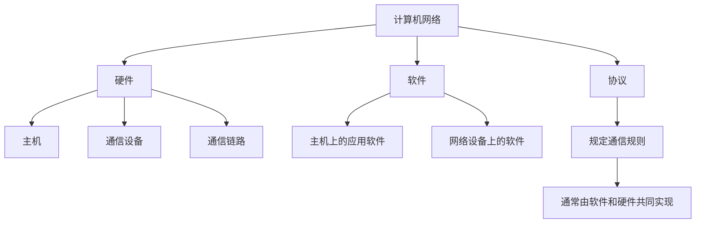
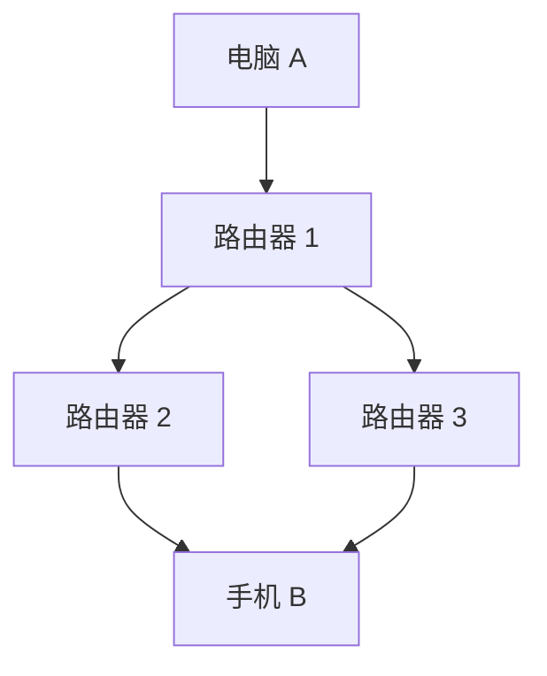
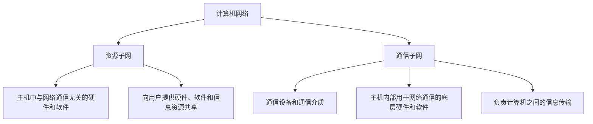
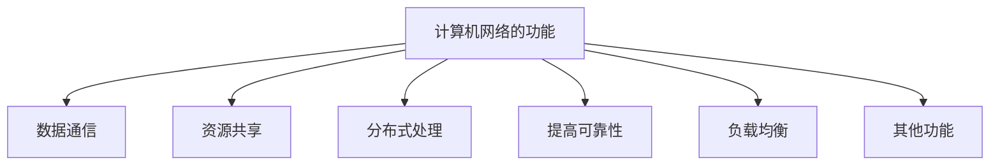
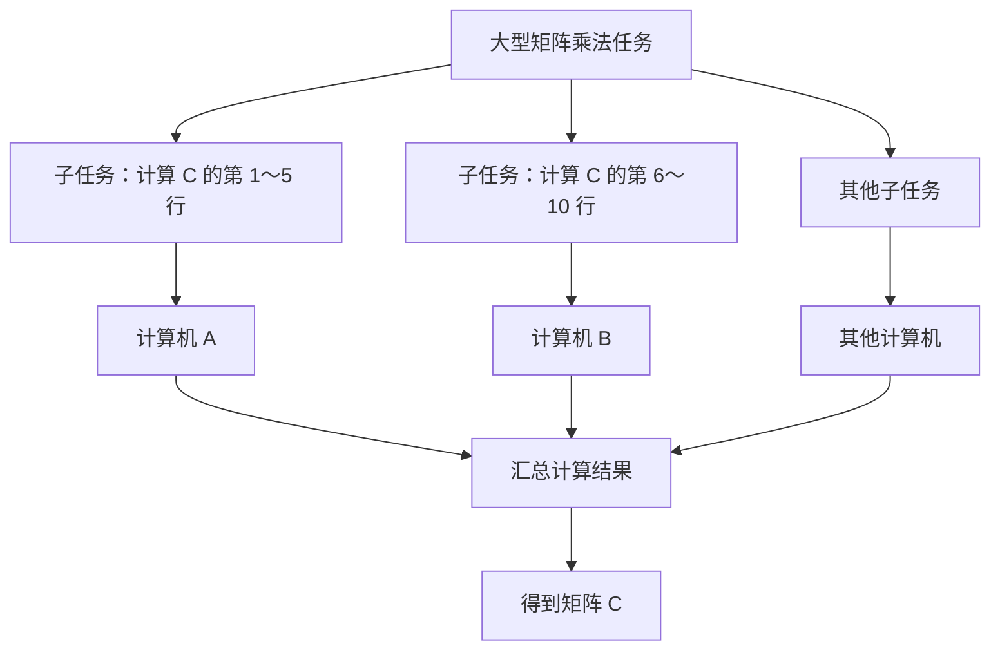
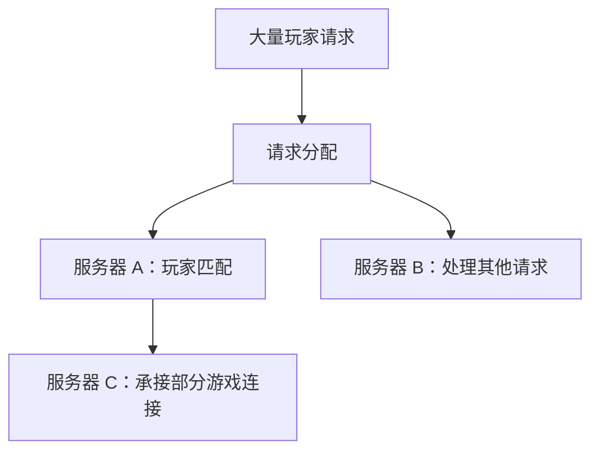

# 计算机网络的组成和功能

## 一、计算机网络的组成

计算机网络可以看作由**硬件、软件和协议**共同组成的庞大而复杂的系统。

### 1. 从组成部件看：硬件、软件和协议

#### 1.1 硬件

计算机网络的硬件主要包括：

- **主机**
- **通信设备**
- **通信链路**

##### （1）主机（端系统）

家庭网络、公司网络和移动网络中连接的各种终端，都属于主机，例如：

- 家庭网络：电脑、手机、电视等。
- 公司网络：监控摄像头、个人电脑、服务器等。
- 移动网络：手机、智能汽车、智能机器人等。

主机也称为**端系统（End System）**。这些设备位于网络的边缘，需要通过通信设备和通信链路进行数据传输。

##### （2）通信设备

通信设备用于连接网络、转发数据，典型设备是**路由器**。此外，还有集线器、交换机、调制解调器等设备。

路由器本身也是一台微型计算机，可以安装软件，但其软件通常主要用于实现网络通信。

##### （3）通信链路

连接网络设备、用于传输数据的线路称为**通信链路**。

> 简单理解：硬件就是计算机网络中看得见、摸得着的设备和线路。

#### 1.2 软件

网络中的硬件设备可以安装软件，例如：

- 电脑、手机：聊天软件、视频播放器等。
- 路由器：用于实现网络通信的软件。

电脑和手机上的软件种类通常更丰富；路由器上的软件则通常侧重于网络通信功能。

#### 1.3 协议

计算机网络中的节点要实现互联互通，必须遵守一定的**通信规则**，这些规则称为**网络协议**。

- 网络协议规定节点之间如何进行通信。
- 网络中的节点需要实现相应的协议。
- 网络协议通常由软件和硬件共同实现。

##### 网络适配器（网卡）与固件

联网设备内部通常有网络适配器，民间常称为**网卡**。它负责将主机上的数据发送到网络，并接收来自网络的数据。

有线网络适配器通常具有网线接口，可以通过网线发送和接收数据。手机、电脑等设备要联网，离不开相应的网络适配功能。

在 Windows 中，可以通过以下路径查看网络适配器：

1. 打开“控制面板”。
2. 进入“网络和共享中心”。
3. 选择“更改适配器设置”。
4. 右键单击相应的网络适配器，选择“属性”，查看适配器信息及其支持的协议。

网络适配器出厂时，厂家通常会在其中安装**固件（Firmware）**。固件是一种特殊的软件，可以存储在网络适配器的 ROM 等存储芯片中。固件与网络适配器硬件协同工作，可以实现某些网络协议相关的功能。

例如，网络适配器可能支持 TCP/IP 协议族中的 IPv4。

因此，网络协议通常需要软件和硬件共同配合实现。

### 2. 从工作方式看：边缘部分和核心部分

从工作方式看，计算机网络由**边缘部分**和**核心部分**组成。

#### 2.1 边缘部分

边缘部分主要由主机以及安装在主机上的软件组成，**直接为用户服务**。

例如，电脑、手机和服务器等都属于网络边缘部分的主机。

#### 2.2 核心部分

核心部分主要为网络边缘部分的主机提供：

- **连通性**：使网络中的主机能够相互连接并交换数据，例如主机 A 可以向主机 B 发送数据。
- **交换服务**：数据从网络中的 A 点传送到 B 点时，网络核心会选择合适的路径转发数据。

##### 交换服务示例

假设电脑 A 要向手机 B 发送一个数据包，数据包可以经过不同的路由器和链路到达目的地。网络会根据实际情况选择合适的传输路径。

例如，某条路径上的路由器负载较高时，数据包可能改走另一条路径。

**交换服务**就是根据网络状况选择数据传输路径的过程，其目的是合理利用网络内部资源，避免部分线路负载过重。实现网络交换功能的核心设备之一是路由器。

### 3. 从逻辑功能看：资源子网和通信子网

从逻辑功能看，计算机网络可以分为**资源子网**和**通信子网**。

这种划分与“边缘部分和核心部分”的划分比较相似，但关注点不同。

#### 3.1 通信子网

通信子网是计算机网络中负责计算机之间**信息传输**的部分，主要包括：

- 各种通信设备。
- 各种通信介质。
- 主机内部用于实现网络通信的底层硬件，例如网络适配器。
- 主机内部用于实现网络通信的底层软件和协议。

这些硬件和软件的主要作用是实现计算机之间的信息传输。

#### 3.2 资源子网

资源子网主要由连接到网络的主机及其相关资源组成。

主机内部与网络通信无关的其他硬件和软件，属于资源子网的范畴。资源子网向用户提供：

- 硬件资源共享。
- 软件资源共享。
- 信息资源共享。

## 二、计算机网络的功能

计算机网络的主要功能包括：

1. 数据通信
2. 资源共享
3. 分布式处理
4. 提高可靠性
5. 负载均衡
6. 其他功能

### 1. 数据通信

**数据通信是计算机网络最基本、最重要的功能。**

如果计算机网络不支持数据通信，其他网络功能也就无法实现。

数据通信使网络中的设备能够相互发送和接收数据。

### 2. 资源共享

计算机网络可以实现**硬件资源、软件资源和数据资源**的共享。

#### 2.1 硬件资源共享

例如智能音箱：

1. 用户向智能音箱发送语音指令。
2. 智能音箱将指令发送到云端服务器。
3. 云端服务器利用自身的计算能力处理指令。
4. 服务器将处理结果返回给智能音箱。

许多智能音箱都可以通过网络使用云端服务器的计算能力。这体现了多个终端对服务器硬件资源的共享。

#### 2.2 软件资源共享

手机通常提供应用商店，用户可以通过网络下载应用软件。这体现了软件资源的共享。

#### 2.3 数据资源共享

例如，用户拍摄的视频可以通过计算机网络分享给其他人。这体现了数据资源的共享。

### 3. 分布式处理

**分布式处理**是指将一个复杂任务拆分成多个子任务，再通过计算机网络分派给多台计算机分别处理，以减少任务的整体处理时间。

#### 示例：矩阵乘法

假设有两个 \(n \times n\) 矩阵 \(A\) 和 \(B\)，相乘得到矩阵 \(C\)，则 \(C\) 也是一个 \(n \times n\) 矩阵。

要计算 \(C\) 中第 \(i\) 行、第 \(j\) 列的元素，需要将矩阵 \(A\) 的第 \(i\) 行与矩阵 \(B\) 的第 \(j\) 列对应元素相乘后求和：

\[
C*{ij}=\sum*{k=1}^{n} A*{ik}B*{kj}
\]

因此，可以将矩阵乘法拆分成多个子任务：

- 计算机 A：计算矩阵 \(C\) 的第 1～5 行。
- 计算机 B：计算矩阵 \(C\) 的第 6～10 行。
- 其他计算机：计算矩阵 \(C\) 的其他行。

各台计算机分别完成自己的子任务，最后组合结果，从而完成整个矩阵乘法运算。

分布式处理适用于计算量较大的复杂任务。典型例子包括 **MapReduce** 等分布式计算框架。

### 4. 提高可靠性

计算机网络可以让多台计算机互为替代，或通过数据备份提高系统的可靠性。

例如，网盘服务可能由多台服务器组成。用户上传文件后，服务器 A 可以将文件备份到服务器 B。

- 如果服务器 A 损坏，仍可能从服务器 B 恢复或下载文件。
- 多份冗余备份可以降低单台设备故障导致数据丢失的风险。

因此，在具有合理备份机制的情况下，网盘中的文件可能比只存储在单台个人电脑上的文件更不容易因单点故障而丢失。

### 5. 负载均衡

**负载均衡**是指让网络中的多台计算机共同分担繁重的任务，避免某一台计算机负载过高。

#### 示例：网络游戏服务器

假设某款网络游戏有数百万名玩家。如果所有玩家都连接到同一台服务器，服务器可能无法及时处理所有请求。

此时，可以部署多台服务器，分别承担不同的任务：

- 服务器 A：负责玩家匹配。
- 服务器 C：在负载较低时，负责承接匹配成功玩家的后续游戏连接。

这样可以将请求分配给不同服务器，使各台服务器共同承担工作，从而实现负载均衡。

### 6. 其他功能

计算机网络还可以满足社会和生活中的多种需求，例如：

- 远程办公。
- 远程教育。
- 娱乐活动。

## 三、知识总结

### 1. 计算机网络的三种组成视角

| 观察视角 | 组成               | 核心含义                                   |
| -------- | ------------------ | ------------------------------------------ |
| 组成部件 | 硬件、软件、协议   | 网络由哪些基本部分构成                     |
| 工作方式 | 边缘部分、核心部分 | 边缘主机使用核心网络提供的连通性和交换服务 |
| 逻辑功能 | 资源子网、通信子网 | 分别关注资源共享与信息传输                 |

### 2. 计算机网络的主要功能

| 功能       | 含义                               | 示例                           |
| ---------- | ---------------------------------- | ------------------------------ |
| 数据通信   | 在网络设备之间发送和接收数据       | 电脑向手机发送数据             |
| 资源共享   | 共享硬件、软件和数据资源           | 云端服务器、应用商店、视频分享 |
| 分布式处理 | 将复杂任务拆分后交给多台计算机处理 | 多台计算机并行计算矩阵         |
| 提高可靠性 | 通过备份或替代设备降低故障影响     | 网盘文件多副本备份             |
| 负载均衡   | 将任务分配给多台计算机共同处理     | 多台游戏服务器分担玩家请求     |
| 其他功能   | 满足社会和生活需求                 | 远程办公、远程教育、娱乐活动   |

### 3. 复习重点

- 计算机网络的组成可从三个视角理解：**硬件、软件和协议；边缘部分和核心部分；资源子网和通信子网**。
- **数据通信**是计算机网络最基本、最重要的功能。
- 资源共享包括硬件资源、软件资源和数据资源共享。
- 分布式处理强调将任务拆分并交由多台计算机处理。
- 提高可靠性可以通过备份和替代设备实现。
- 负载均衡强调由多台计算机共同分担任务。
- 本节内容以理解术语和基本概念为主，示例用于帮助理解。
