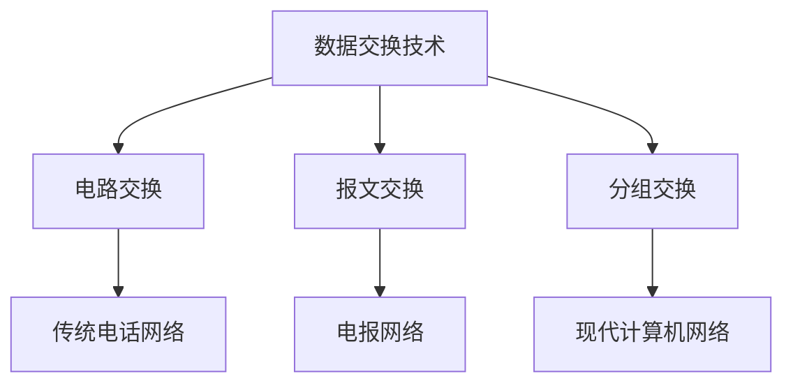
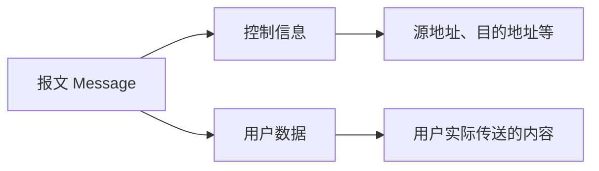
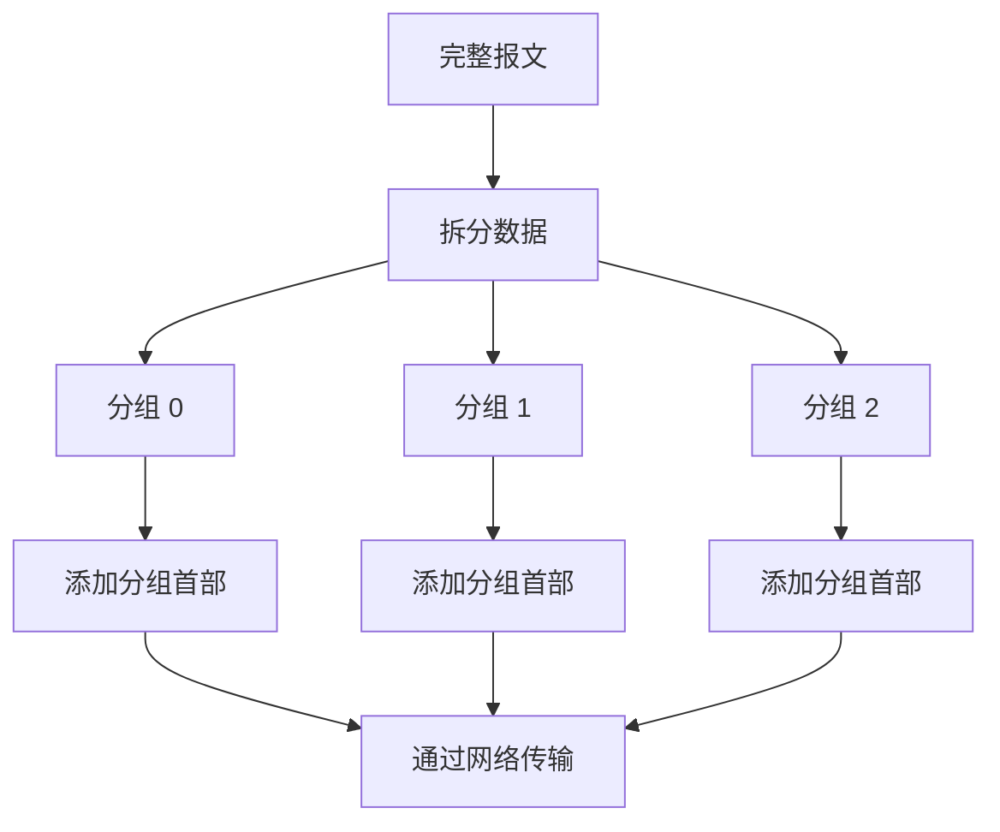
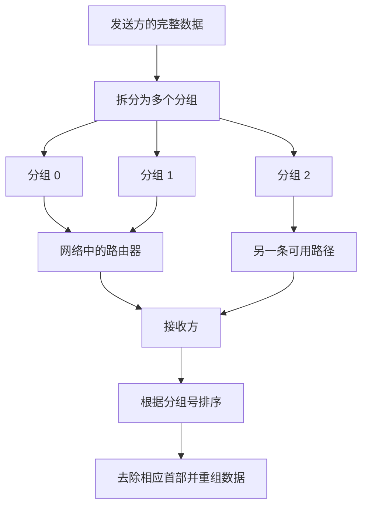
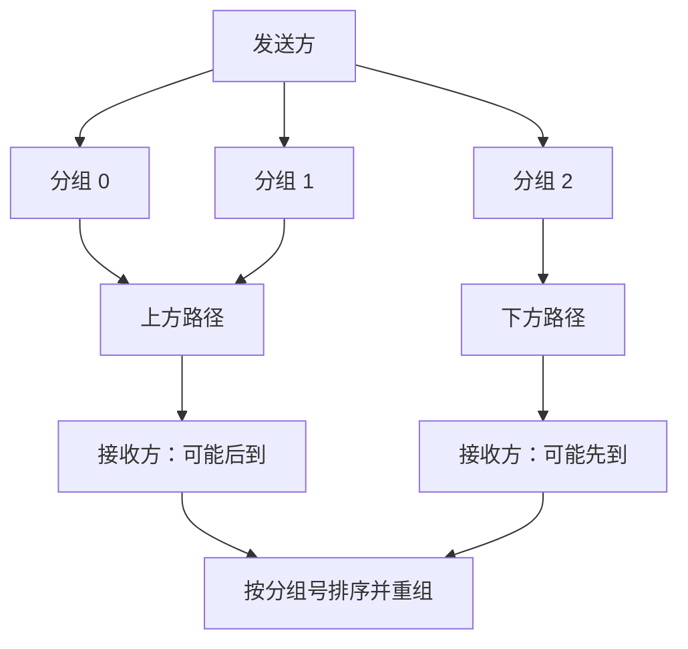
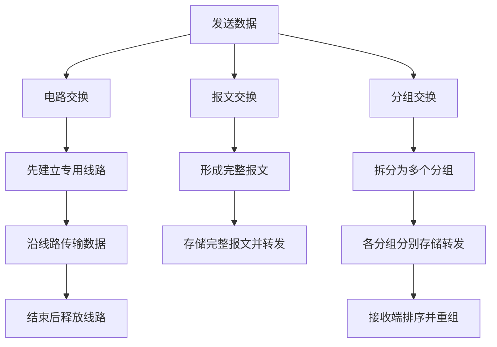
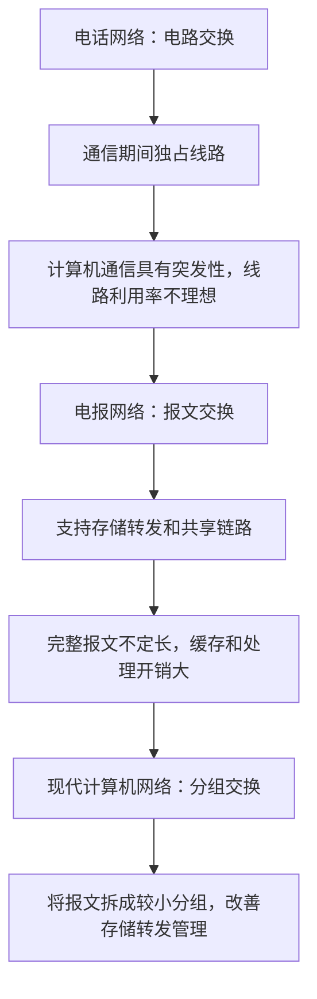

# 数据交换技术：电路交换、报文交换与分组交换

## 一、数据交换技术概述

本节学习三种数据交换技术：

- **电路交换（Circuit Switching）**
- **报文交换（Message Switching）**
- **分组交换（Packet Switching）**

这三种技术分别应用于传统电话网络、电报网络以及现代计算机网络。

现代计算机网络的前身是 20 世纪 60 年代美国国防部推动的 **ARPANET（阿帕网）**。当时参与项目的科学家需要解决的问题是：如何让分散在各地的计算机互联互通，实现相互通信。

在计算机网络出现之前，人类已经建立了其他类型的通信网络：

| 网络类型       | 数据交换方式         | 基本方式                   |
| -------------- | -------------------- | -------------------------- |
| 邮政网络       | 通过邮递员和信件传递 | 在不同节点之间传送信件     |
| 电报网络       | 报文交换             | 以完整报文为单位存储、转发 |
| 电话网络       | 电路交换             | 建立专用通信线路后通话     |
| 现代计算机网络 | 分组交换             | 将数据拆分为分组后传输     |

构建计算机网络时，科学家们曾参考电话网络和电报网络的交换方式，但这两种方式各有局限。经过改进，最终形成了现代计算机网络广泛采用的分组交换技术。

## 二、电路交换

### 1. 电路交换的基本原理

传统电话网络采用**电路交换**技术，通过电话交换机实现不同电话之间的通信。

电话交换机可以连接多部电话，也可以连接其他电话交换机。早期电话交换机通过人工接线完成线路连接：工作人员将两部电话对应的插线孔连接起来，就可以建立通信线路。

后来，随着技术发展，电路交换逐渐实现了电气化和自动化，不再需要人工接线，交换效率大幅提升。

**电路交换的核心思想：** 在通信双方之间建立一条专用的物理通信线路，并在通信期间由双方独占相关线路资源。

### 2. 电路交换的工作过程

电路交换通常分为三个阶段：

1. **建立连接**：通信双方请求建立连接，交换机为双方分配通信资源，并接通物理线路。
2. **通信**：连接建立后，双方通过已建立的线路传输数据，并持续占用相关通信资源。
3. **释放连接**：通信结束后挂断电话，释放线路资源，供其他用户使用。

#### 示例一：小帅给小丑打电话

1. 小帅通过电话 H1 拨打小丑的电话 H2。
2. 中间的交换机收到连接请求后，为双方分配通信资源并接通线路。
3. H2 电话响铃，小丑接听并回应。
4. 双方开始通话。
5. 通话结束后挂断电话，释放连接和通信资源。

#### 示例二：长途电话占用更多线路

假设小红给小美打电话，通信路径需要经过三台电话交换机，那么这次通信需要占用多段线路资源。

相比之下，如果小帅和小丑之间的通话只需要经过较少的交换机，那么所占用的线路资源也会较少。

这可以解释传统电话网络中长途电话通常比本地电话更贵的原因之一：长途通信往往需要占用更多的线路和交换资源。

#### 示例三：电话占线

假设小红和小美正在通话，小扁随后通过电话 H6 呼叫小美的电话 H5。

- 当前交换机可能先为小扁分配一段线路。
- 但如果下一段通往 H5 的线路正被小红和小美占用，就无法建立新的完整连接。
- 由于线路资源不足，小扁会听到“对不起，您呼叫的用户正在通话中，请稍后再拨”等提示。

这就是常见的**电话占线**现象。

### 3. 电路交换为什么不适合现代计算机网络？

如果计算机网络采用电路交换，那么 H1 和 H2 通信时，需要分配一条专用物理线路；H3 和 H5 通信时，也需要分配另一条专用物理线路。

在通信结束之前，这些线路一直被相应的通信双方独占。如果 H6 此时想向 H5 发送数据，而所需线路资源已被占用，就可能无法建立连接。

例如，小红和小美正在通过网络聊天，即使双方暂时没有发送消息，只要连接还没有释放，相关线路资源仍可能被占用。其他用户就无法共享这些线路。

计算机之间的数据传输通常具有**突发性**：用户可能花较长时间输入文字，但真正发送文字只需要很短时间。也就是说，通信可能发生得很频繁，但每次传输的数据量通常不大。

电路交换需要先建立连接、再传输数据、最后释放连接，因此并不适合这种高频次、少量数据的通信模式。

### 4. 电路交换的优缺点

#### 优点

- **数据传输速率较高**：连接建立后，数据可以通过已经接通的线路直接传输。
- **通信过程相对直接**：通信双方在连接期间使用已分配的线路资源。

#### 缺点

1. **建立和释放连接需要时间开销**  
   通信前需要建立连接，通信结束后需要释放连接。如果等待建立连接的时间很长，而实际传输的数据很少，用户体验就会较差。

2. **线路利用率较低**  
   通信双方在连接期间独占相关线路。即使暂时没有传输数据，其他用户也无法使用被占用的线路资源。

3. **线路分配不够灵活**  
   如果通信过程中某个节点或线路发生故障，通常需要重新建立连接，才能继续通信。

4. **中间交换节点不负责差错控制**  
   传统电路交换节点主要负责接通线路，让数据沿线路通过，并不在每个节点执行完整的差错检查和纠正过程。

例如，原始数据为 `0100`，传输时受到电磁干扰后可能变成 `0101`。如果中间节点不检查数据是否出错，就可能无法及时发现这种错误。经过的链路越多，发生传输错误的机会也可能增加。

> 电路交换更适合建立连接后持续、大量传输数据的场景；而计算机网络通信往往具有突发性，因此电路交换不适合作为现代计算机网络的主要交换方式。

## 三、报文交换

### 1. 报文交换的基本原理

电报网络采用**报文交换（Message Switching）**技术。

用户通过电报机向其他用户发送电报。一个报文通常由两部分组成：

- **控制信息**：说明报文从哪里发出、要发送到哪里等。
- **用户数据**：用户实际要传送的内容。

控制信息和用户数据共同组成一个 **Message**。在计算机网络课程中，Message 通常称为**报文**。

例如，小帅给小美发电报时，报文既要包含发送方和接收方等控制信息，也要包含小帅想传达的内容。

### 2. 报文交换的工作过程

报文交换采用**存储转发（Store-and-Forward）**机制：

1. 发送方将完整报文发送到相邻交换机。
2. 交换机先把报文存储起来。
3. 交换机分析报文中的控制信息，判断报文的目的地。
4. 交换机查询转发表，选择合适的下一跳路径。
5. 报文被转发到下一个交换节点。
6. 后续交换节点重复存储、分析和转发过程，直到报文到达目的地。

交换机可以维护**转发表**，记录到达不同目的地时应选择的转发方向。

如果存在多条可用路径，可以根据网络负载等情况选择合适路径。例如，某条线路比较空闲时，可以优先通过该线路转发报文。

### 3. 报文交换的优点

#### 3.1 无需预先建立专用连接

发送方只需要将包含必要控制信息的报文发送到网络中，中间节点就可以根据控制信息逐跳转发，不需要像电路交换那样事先建立端到端的专用物理连接。

#### 3.2 线路利用率较高

报文交换采用存储转发机制，通信双方不需要独占整条物理线路。多个用户的报文可以共享同一条链路。

例如，报文一和报文二可以先后通过同一条线路传输，分别服务于不同用户的通信。

#### 3.3 路径选择较灵活

如果某条线路或某个节点出现故障，中间节点可以根据网络情况选择其他可用路径转发报文。

#### 3.4 可以进行差错控制

由于交换节点会接收并存储完整报文，因此可以通过奇偶校验等校验技术检查报文是否发生错误。在适当条件下，还可以检测或纠正某些错误。

这有助于提高长距离传输的可靠性。

### 4. 报文交换的缺点

报文交换的主要问题来自**报文长度不固定**。

#### 4.1 报文长度不固定，存储管理复杂

有的报文只有几个字节，有的报文可能很大，甚至达到数 GB。中间交换节点需要先存储完整报文再转发。

如果一个报文大小为 8 GB，那么交换节点就需要有足够的缓存空间来存储它。报文越大，对交换节点缓存容量的要求越高。

不同大小的报文也会增加内存分配和管理的复杂度。相比之下，固定大小的数据块通常更容易管理。

#### 4.2 缓存开销较大

交换节点需要缓存完整报文，因此长报文会占用大量存储空间。

#### 4.3 处理时间开销较大

交换节点需要存储、分析并转发报文。如果还要进行差错检查，报文越长，需要处理的数据就越多，处理时间开销通常也越大。

#### 4.4 长报文出错后的代价较高

传输的数据越多，出现至少一个比特错误的机会通常也会增加。如果校验技术无法修复错误，可能需要发送方重新传送整个报文。

因此，报文越长，发生错误后重传所付出的代价也可能越高。

### 5. 报文交换小结

| 优点                 | 缺点                               |
| -------------------- | ---------------------------------- |
| 无需预先建立专用连接 | 报文长度不固定                     |
| 多个用户可以共享链路 | 缓存需求可能很大                   |
| 转发路径比较灵活     | 存储管理复杂                       |
| 可以进行差错检查     | 长报文处理时间和出错后重传代价较高 |

报文交换具有许多优点，但不定长报文带来的存储、管理和处理开销，使其不适合直接作为现代计算机网络的主要交换方式。

## 四、分组交换

### 1. 分组交换的基本原理

分组交换是在报文交换思想基础上发展起来的技术。它的关键改进是：

**把较长的报文拆分成多个较小、长度受限制的数据块，再分别进行存储转发。**

每个数据块还需要加入必要的控制信息，例如源地址、目的地址和分组号。控制信息与数据部分共同构成一个**分组（Packet）**。

### 2. 分组的组成

一个分组通常包括：

- **首部（Header）**：控制信息，用于控制分组在网络中的传输。
- **数据部分**：当前分组所携带的用户数据。

有些教材将 Header 翻译为“首部”，也有教材称为“头信息”。它们指的都是控制信息。

常见的首部信息包括：

- 源地址。
- 目的地址。
- 分组号等用于标识分组的信息。

其中，**分组号**非常重要。发送方把一张图片或一个长报文拆分成多个分组后，接收方需要根据分组号等信息确定正确的顺序，才能恢复原始数据。

### 3. 分组交换的工作过程

假设小帅要向小美发送一份数据：

1. 发送方将数据拆分为多个分组。
2. 每个分组都带有自己的首部信息。
3. 分组在网络中由路由器等设备逐跳存储转发。
4. 不同分组可以根据网络状况选择不同路径。
5. 接收方根据分组号等信息对分组进行排序。
6. 接收方去除不再需要的协议首部，并将数据重新组合，恢复用户数据。

#### 示例：分组可能不按顺序到达

假设一份数据被拆分为分组 0、分组 1 和分组 2。

- 分组 0 和分组 1 走上方路径。
- 当分组 2 到达某个中间节点时，上方路径较拥堵，因此它改走下方路径。
- 由于下方路径更通畅，分组 2 可能最先到达接收方。
- 随后分组 0 和分组 1 到达。

因此，接收方实际收到的顺序可能是 **2、0、1**。接收方可以根据分组号将它们重新排列为 **0、1、2**，再恢复原始数据。

现代计算机网络中的路由器是典型的分组交换设备。路由器通常根据 IP 地址等信息判断分组的目的地，并依据转发表选择下一跳。路由器的具体工作原理将在后续章节中进一步学习。

### 4. 分组交换的优点

分组交换继承了报文交换的大部分优点，并改进了不定长报文带来的问题。

#### 4.1 无需为每次通信建立专用物理线路

与报文交换类似，分组交换一般不需要在发送数据之前建立端到端的专用物理线路。

#### 4.2 链路利用率较高

多个用户的分组可以共享同一条通信链路，不需要由某一对通信用户独占整条线路。

#### 4.3 转发路径灵活

网络中的分组可以根据路由和网络状况进行转发。如果某条路径出现拥堵或故障，网络可能选择其他可用路径。

#### 4.4 存储和转发更方便

分组的大小受到限制，通常比完整报文小，因此交换节点更容易管理缓存和存储空间。

#### 4.5 存储转发开销更低

由于单个分组较小，交换节点处理单个分组所需的缓存空间和处理时间通常低于存储转发一个很大的完整报文的情况。

#### 4.6 出错后重传代价较低

如果某个分组发生错误且无法修复，通常只需要针对相关分组进行重传，而不必重传整个很长的报文。具体的差错检测、确认和重传机制取决于所采用的协议。

### 5. 分组交换的缺点

#### 5.1 控制信息的占比增加

在报文交换中，完整报文通常只需要携带一份相应的控制信息。

在分组交换中，一个报文被拆分成多个分组后，每个分组都需要自己的首部。因此，整个数据传输过程中控制信息的总量通常会增加。

这意味着网络需要消耗更多资源来传输控制信息。不过，这一开销通常是为了换取更方便的存储转发和更高的灵活性。

#### 5.2 存在存储转发时延

电路交换建立连接后，中间节点主要让数据沿已建立的线路通过。

分组交换和报文交换则需要中间节点接收数据、存储数据、分析控制信息，再转发数据。这一过程会产生**存储转发时延**。

因此，在其他条件相同的情况下，分组交换的传输过程会受到存储转发处理的影响。

#### 5.3 可能出现分组失序或丢失

分组可能经过不同路径，因此到达接收方时不一定保持原来的顺序。此外，设备或线路出现问题时，分组也可能丢失。

接收方和相关协议需要处理分组失序、丢失等情况，这会增加通信处理的复杂度。

### 6. 分组交换小结

| 优点                         | 缺点                                 |
| ---------------------------- | ------------------------------------ |
| 无需建立端到端专用物理线路   | 每个分组都需要首部，控制信息占比增加 |
| 多用户可以共享链路           | 存在存储转发时延                     |
| 转发路径灵活                 | 可能出现分组失序                     |
| 分组长度受限制，便于存储管理 | 可能出现分组丢失                     |
| 单个分组的缓存和处理开销较小 | 需要处理失序、丢失等问题             |
| 出错后通常只需重传相关分组   | 相关处理机制会增加系统复杂度         |

## 五、虚电路交换

### 1. 虚电路交换的基本思想

为了解决分组交换中可能出现的分组失序等问题，有人提出了**虚电路交换**。

虚电路交换本质上仍然属于分组交换，只是吸收了电路交换的部分思想：通信双方在传输数据之前，需要先建立连接；传输完成后，再释放连接。

其连接是**虚拟电路**，并不是像传统电路交换那样，为通信双方独占分配一条专用物理线路。

### 2. 虚电路交换的工作过程

1. **建立虚拟连接**：发送方先向接收方发起连接请求，网络建立相应的虚拟电路。
2. **传输分组**：数据被拆分为多个分组，分组通常沿着建立好的虚拟电路传输。
3. **接收并重组**：接收方按相应顺序接收分组，并恢复用户数据。
4. **释放连接**：通信结束后，释放虚拟连接相关状态。

在虚电路交换中，分组可以按照统一的路径和顺序逐一传送；与此同时，其他用户仍然可以共享这些链路。因此，虚拟电路并不意味着通信双方独占物理线路。

### 3. 为什么现代计算机网络主要采用分组交换？

现代计算机网络主要采用分组交换，而不是普遍采用虚电路交换。

一种重要的设计考虑是：连接到网络的计算机终端具有较强的处理能力。采用分组交换，可以让网络边缘的终端和相关协议处理分组失序、丢失等问题，而不必把所有相关处理都集中交给网络核心。

如果采用虚电路交换，网络核心需要维护虚拟连接等状态，并承担相应的管理工作。这可能增加核心网络的处理负担。

因此，现代计算机网络广泛采用分组交换，通过网络协议和终端处理来应对分组传输过程中可能出现的问题。

> 虚电路交换的细节将在后续章节学习。本节的重点仍是电路交换、报文交换和分组交换。

## 六、三种交换技术对比

### 1. 核心区别

| 对比维度         | 电路交换                           | 报文交换                       | 分组交换                     |
| ---------------- | ---------------------------------- | ------------------------------ | ---------------------------- |
| 基本单位         | 专用线路上的连续数据流             | 完整报文                       | 较小的分组                   |
| 是否预先建立连接 | 需要                               | 不需要                         | 一般不需要端到端专用连接     |
| 转发方式         | 通过已建立的线路传输               | 存储完整报文后转发             | 存储并转发分组               |
| 数据单位长度     | 不按报文切分                       | 不定长                         | 长度受限制                   |
| 线路是否独占     | 连接期间独占相关线路资源           | 多用户可以共享链路             | 多用户可以共享链路           |
| 路径灵活性       | 相对较差                           | 较灵活                         | 较灵活                       |
| 缓存需求         | 交换节点通常不需缓存完整报文       | 可能需要缓存很大的完整报文     | 通常按分组缓存，管理更方便   |
| 主要时延特点     | 建立连接有时间开销                 | 存储转发时延                   | 存储转发时延                 |
| 典型问题         | 线路利用率低、故障后需重新建立连接 | 不定长报文导致缓存和管理开销大 | 控制信息增加，可能失序或丢失 |
| 典型应用背景     | 传统电话网络                       | 电报网络                       | 现代计算机网络               |

### 2. 数据传输过程示意

### 3. 发展思路

## 七、复习重点

1. **电路交换**：先建立连接，再传输数据，最后释放连接；通信期间独占相关线路资源。
2. 电路交换的主要问题是连接建立与释放需要开销、线路利用率较低、路径调整不够灵活，而且传统交换节点不负责完整的差错控制。
3. **报文交换**：以完整报文为单位，采用存储转发；无需预先建立专用连接，链路利用率较高、路径较灵活。
4. 报文交换的主要问题是报文长度不固定，长报文会带来较大的缓存、存储管理和处理开销。
5. **分组交换**：将报文拆分成多个较小分组，每个分组都带有首部；接收方根据分组号等信息对分组排序并重组。
6. 分组交换继承了报文交换的许多优点，并改善了不定长报文造成的存储管理问题。
7. 分组交换的代价包括控制信息占比增加、存储转发时延，以及可能出现分组失序或丢失。
8. **虚电路交换**：本质上仍是分组交换，但传输前建立虚拟连接，分组通常沿建立好的虚拟路径传输。
9. 本节重点掌握电路交换、报文交换和分组交换的**原理、工作过程、优缺点及相互区别**；虚电路交换作为补充了解即可。
