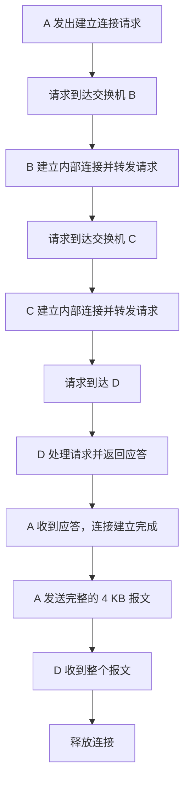
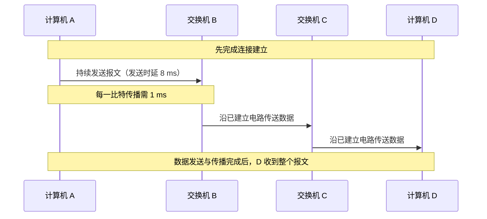
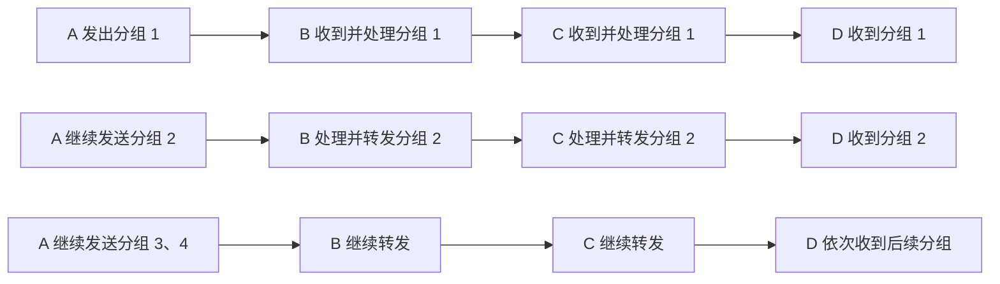

# 电路交换、报文交换与分组交换的传输性能分析

> 本文根据视频讲解整理，主要通过“时间—结点”图分析三种交换方式的数据传输过程。保留原讲解中的假设、分析顺序和视频给出的结论，并使用表格、公式与 Mermaid 示意图辅助复习。

---

## 一、分析图示的读法

计算机网络课程中，经常使用类似的时序图分析数据交换过程。这类图示既有助于理解每个时刻发生的事情，也常用于分析真题和课后习题。

### 1. 图示的基本含义

- **纵轴：** 表示时间 \(t\) 增加的方向。
- **横向的竖线：** 表示不同结点或设备，例如计算机 A、交换机 B、交换机 C、计算机 D。
- **小格子：** 为了便于分析，假设每个小格子代表 **1 ms（毫秒）**。
- **斜向箭头：** 表示信号或数据在结点之间传播。箭头纵向跨过几个小格子，就表示经过了相应的时间。
- **横向延伸的矩形或带状区域：** 可以用来表示数据在链路上的发送过程。

### 2. 分析时需要区分的时间

| 时间类型     | 含义                                                 |
| ------------ | ---------------------------------------------------- |
| 发送时延     | 将全部数据发送到传输线路上所需的时间                 |
| 传播时延     | 信号从一端传播到另一端所需的时间                     |
| 存储转发时延 | 中间结点接收数据后，检查、处理并决定下一跳所需的时间 |
| 建立连接时间 | 电路交换开始传送数据之前，建立通信连接所花费的时间   |
| 释放连接时间 | 数据传输完成后，拆除通信连接所花费的时间             |

**注意：** 发送时延和传播时延不是同一个概念。发送时延关注“把数据推上线路需要多久”，传播时延关注“信号从线路一端到达另一端需要多久”。

---

## 二、统一的分析条件

为了公平比较三种交换方式，视频采用相同的基本条件。

| 项目                                   |               假设 |
| -------------------------------------- | -----------------: |
| 发送端                                 |           计算机 A |
| 中间结点                               | 交换机 B、交换机 C |
| 接收端                                 |           计算机 D |
| 传输路径                               |      A → B → C → D |
| 整个报文大小                           |               4 KB |
| 数据传输率                             |          0.5 KB/ms |
| 每一跳的传播时延                       |               1 ms |
| 报文交换时，每个中间结点的存储转发时延 |               2 ms |
| 分组交换时，每个分组的存储转发时延     |             0.5 ms |
| 分组交换时的分组大小                   |  1 KB，共 4 个分组 |

### 1. 发送一个完整报文需要多久？

数据传输率为 0.5 KB/ms，整个报文大小为 4 KB，因此：

\[
\text{发送时延}=\frac{\text{数据大小}}{\text{数据传输率}}
=\frac{4\text{ KB}}{0.5\text{ KB/ms}}=8\text{ ms}
\]

也就是说，A 将整个 4 KB 报文发送到链路上，需要 **8 ms**。

### 2. 发送一个分组需要多久？

分组交换将 4 KB 报文拆分成 4 个 1 KB 的分组：

\[
\text{单个分组发送时延}
=\frac{1\text{ KB}}{0.5\text{ KB/ms}}
=2\text{ ms}
\]

因此，每个 1 KB 分组需要 **2 ms** 才能发送到线路上。

---

## 三、电路交换的传输性能

### 1. 电路交换的基本过程

假设计算机 A 需要通过交换机 B、交换机 C 与计算机 D 通信。

电路交换首先建立连接。连接建立之后，A 才开始发送 4 KB 的报文；数据传送完成后，再释放连接。

整个流程可以概括为：

### 2. 建立连接阶段

根据视频中的假设：

1. A 向 B 发送建立连接请求，信号传播需要 1 ms。
2. B 收到请求后，需要 1 ms 在交换机内部建立连接，然后才能继续向 C 发送请求。
3. 请求从 B 传播到 C，需要 1 ms。
4. C 收到请求后，同样需要 1 ms 建立内部连接，然后向 D 发送请求。
5. 请求从 C 传播到 D，需要 1 ms。
6. D 收到请求后，需要 2 ms 处理连接请求，再向 A 返回应答。
7. 由于连接已经建立，应答信号可以沿着已建立的电路返回 A。每一跳的传播时延为 1 ms，因此 D → C → B → A 共需要 3 ms。

当 A 收到应答后，说明连接已经建立，可以开始发送数据。

> 建立连接阶段有额外的时间开销。视频后面对三种方式的数据传输时间进行比较时，讨论的是从开始传送数据到 D 接收完数据所需的时间，不把建链和释放连接所需的时间计入该对比值。

### 3. 传输数据阶段

整个报文大小为 4 KB，发送速率为 0.5 KB/ms：

\[
\text{发送时延}=4\div0.5=8\text{ ms}
\]

A 将报文持续发送 8 ms。报文中的第一个比特从 A 传播到 B 需要 1 ms，再从 B 传播到 C 需要 1 ms，从 C 传播到 D 需要 1 ms。

因此，数据从 A 到 D 的传播时延为：

\[
1+1+1=3\text{ ms}
\]

从 A 开始发送数据算起，到 D 收到整个报文为止：

\[
T\_{\text{电路}}=8+3=11\text{ ms}
\]

### 4. 释放连接阶段

A 发送完报文的最后一个比特后，可以发出释放连接的信号。释放连接的过程与建立连接过程类似：释放信号沿着相关结点逐步传递，各结点断开相应的线路。

视频中的图示为了避免箭头重叠，特意把释放连接的箭头与报文底部隔开绘制；这只是作图上的处理，并不表示必须等待额外的一段时间才可以发出释放信号。

### 5. 电路交换的时序示意图

下面只突出数据传输阶段，不绘制建立和释放连接的全部细节。

### 6. 电路交换的特点

- 传输数据之前需要建立连接。
- 连接建立后，数据沿已建立的电路传输。
- 按视频所采用的模型，数据传输阶段不需要中间结点对完整报文进行存储转发处理。
- 按本例的计算，从 A 开始发送数据到 D 收到整个报文，共需 **11 ms**。
- 数据传输完成后，还需要释放连接。

---

## 四、报文交换的传输性能

### 1. 报文交换的基本过程

报文交换不需要像电路交换那样预先建立端到端的专用连接。A 将完整报文发送给 B，B 接收整个报文并进行处理，再决定下一跳并转发给 C；C 同样接收完整报文、处理后再转发给 D。

这种方式采用**存储转发**：中间结点需要先接收完整报文，再转发整个报文。

### 2. A → B：发送第一个完整报文

报文大小仍然是 4 KB，传输率仍为 0.5 KB/ms，所以 A 发送整个报文需要：

\[
4\div0.5=8\text{ ms}
\]

报文第一个比特从 A 传播到 B 需要 1 ms。由于报文需要整体接收，B 接收到最后一个比特、也就是接收到完整报文的时刻，是开始发送后约 9 ms。

### 3. B：存储转发处理

B 接收到完整报文后，需要检查报文中的控制信息，以确定下一跳应该发送到哪个结点。

视频假设 B 的存储转发时延为 2 ms。因此，B 收到完整报文后，还要经过 2 ms 的处理时间，才能开始向 C 转发。

### 4. B → C → D：重复存储转发过程

后续过程类似：

1. B 将完整报文发送给 C，发送时延为 8 ms，每个比特的传播时延为 1 ms。
2. C 接收到完整报文后，需要 2 ms 的存储转发处理时间。
3. C 再将完整报文发送给 D，发送时延为 8 ms，每个比特的传播时延为 1 ms。
4. D 最终接收到整个报文。

视频讲解根据对应时序图数格子，给出的报文交换总耗时为 **29 ms**。

### 5. 报文交换的特点

- 不必预先建立端到端的专用连接。
- 中间结点采用存储转发方式。
- 中间结点需要先接收完整报文，再进行处理和转发。
- 完整报文较大，传输与存储转发处理所需的时间也相对较长。
- 视频给出的本例总耗时为 **29 ms**。

---

## 五、分组交换的传输性能

### 1. 将报文拆分成分组

分组交换把一个 4 KB 的报文拆分成 4 个 1 KB 的小分组：

- 分组 1：1 KB
- 分组 2：1 KB
- 分组 3：1 KB
- 分组 4：1 KB

每个分组都可以单独进行存储转发。由于单个分组比完整报文小，因此中间结点处理单个分组所需的时间也更短。

在本例中：

- 每个分组的发送时延：2 ms。
- 每一跳的传播时延：1 ms。
- 每个分组的存储转发时延：0.5 ms。

### 2. 分组的发送与存储转发

A 把分组 1 发送到 A—B 链路上，需要 2 ms。分组中的比特从 A 传播到 B，需要 1 ms。

B 收到分组 1 后，需要 0.5 ms 进行存储转发处理，然后就可以把分组 1 发送到下一跳 C。

与此同时，A 可以继续向 B 发送后续分组。只要前一个分组已经处理完成，后续分组就可以继续发送。这样，各个分组在 A—B、B—C、C—D 等链路上形成流水式传输，而不必等整个 4 KB 报文先到达 B 后才开始向 C 发送。

### 3. 分组交换的流水线传输示意图

下图展示的是分组在不同链路上逐步推进的概念示意，并非精确到每个时间格子的比例图。

### 4. 分组交换的时间分析

每个 1 KB 分组的发送时延为：

\[
1\div0.5=2\text{ ms}
\]

对每个分组，视频假设中间结点的存储转发时延为 0.5 ms。A、B、C 可以在不同链路上交错处理不同分组，从而形成流水线效果。

根据视频中的时序图，4 个分组全部传送完成，总耗时为 **17.5 ms**。

### 5. 分组交换的特点

- 将较大的报文划分为多个较小的分组。
- 每个分组可以单独存储转发。
- 由于分组较小，单个分组的存储转发处理时间较短。
- 不同链路可以同时处理不同分组，因此能够形成流水式传输。
- 视频给出的本例总耗时为 **17.5 ms**。

---

## 六、三种交换方式的性能对比

### 1. 视频中的本例结论

| 交换方式 | 视频给出的数据传输耗时 | 视频中的分析重点                                               |
| -------- | ---------------------: | -------------------------------------------------------------- |
| 电路交换 |                  11 ms | 连接建立后沿已建立的电路传输；本模型不计中间结点的存储转发时延 |
| 报文交换 |                  29 ms | 每个中间结点接收完整报文后，进行存储转发处理                   |
| 分组交换 |                17.5 ms | 报文拆分成较小分组，逐个存储转发，形成流水线传输               |

按视频给出的数值，完成数据传输所需的时间：

\[
\boxed{T*{\text{电路交换}} < T*{\text{分组交换}} < T\_{\text{报文交换}}}
\]

也就是说：

1. **电路交换耗时最少。**
2. **报文交换耗时最多。**
3. **分组交换比报文交换更快，但比电路交换更慢。**

### 2. 三种交换方式为什么会有不同的耗时？

| 对比维度                 | 电路交换                       | 报文交换                     | 分组交换                       |
| ------------------------ | ------------------------------ | ---------------------------- | ------------------------------ |
| 发送数据前是否建立连接   | 需要                           | 不需要预先建立端到端专用连接 | 不需要预先建立端到端专用连接   |
| 中间结点的处理方式       | 本例中沿已建立的电路传送       | 完整报文的存储转发           | 单个分组的存储转发             |
| 存储转发处理对象         | 本模型中不进行报文存储转发     | 整个报文                     | 单个分组                       |
| 单次处理的数据量         | 沿电路连续传送                 | 较大（整个 4 KB 报文）       | 较小（每组 1 KB）              |
| 是否便于流水传输         | 按本例模型，不依靠分组流水传输 | 必须先接收完整报文才能转发   | 可在不同链路上交错传送不同分组 |
| 本例传输耗时（视频结论） | 11 ms                          | 29 ms                        | 17.5 ms                        |

### 3. 记忆要点

- **电路交换：** 先建立连接，再传输数据，最后释放连接。
- **报文交换：** 以完整报文为单位进行存储转发。
- **分组交换：** 把报文拆分成多个分组，以分组为单位存储转发；不同链路上的传输能够形成流水线。
- 分析时序图时，必须分清发送时延、传播时延和存储转发时延。
- 比较总耗时前，要确认题目要求是否把建立连接、释放连接等时间计入。

---

## 七、作图题与计算题的分析步骤

遇到类似的计算机网络时序图，可以按以下顺序分析：

1. **标出结点和链路：** 确认数据经过几个结点、几段链路。
2. **确认时间单位：** 看清图中每个小格代表多少时间。
3. **计算发送时延：** 用数据大小除以数据传输率。
4. **计算传播时延：** 根据每一跳的传播时间，确定首比特和末比特到达的时刻。
5. **判断是否需要存储转发：** 报文交换需要先接收完整报文；分组交换则以单个分组为单位处理。
6. **加入结点处理时延：** 依题目给出的存储转发时延，确定中间结点何时可以继续转发。
7. **考虑流水线：** 分组交换中，多个分组可以处于不同链路的传输或处理阶段，不能简单地把每个分组的全部路径时延重复相加。
8. **核对计时起点和终点：** 例如，是从开始建立连接算起，还是从开始发送数据算起；结束点是首比特到达，还是整个报文到达。
9. **对照时序图检查结果：** 将计算结果与图中的时间格子核对。

---

## 八、计算结果的复核提醒

> **以下是复核提示，不替换视频中给出的结论。**

视频给出的三个数据传输耗时是：电路交换 **11 ms**、报文交换 **29 ms**、分组交换 **17.5 ms**。整理笔记时保留了这些原结论。

但如果把报文交换的文字假设直接按以下方式求和：

- 3 段链路，每段完整报文发送时延 8 ms；
- 3 段链路，每段传播时延 1 ms；
- B、C 两个中间结点，各有 2 ms 存储转发时延；

则会得到：

\[
3\times(8+1)+2\times2=31\text{ ms}
\]

这与视频口述给出的 **29 ms** 不一致。建议做题或复习时对照视频原图，确认原图中的计时起点、终点及时间格子的具体画法；不要在未核对原图前，把 29 ms 和上述按文字假设计算得到的 31 ms 当成同一个结果。

---

## 九、本节总结

本视频通过带时间刻度的时序图，比较了电路交换、报文交换和分组交换的传输性能。

- **电路交换：** 建立连接后，沿已建立的电路传送数据；本例数据传输耗时为 11 ms。
- **报文交换：** 中间结点接收完整报文后，再存储转发；视频给出的耗时为 29 ms。
- **分组交换：** 把 4 KB 报文划分成 4 个 1 KB 分组，采用分组存储转发并形成流水线；视频给出的耗时为 17.5 ms。

理解这类时序图的关键，是看懂每个时间格子、斜向箭头以及结点等待处理的时间，并准确区分发送时延、传播时延和存储转发时延。这种分析方法也可用于解决相关真题和课后习题。
