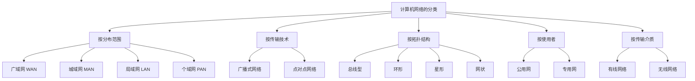
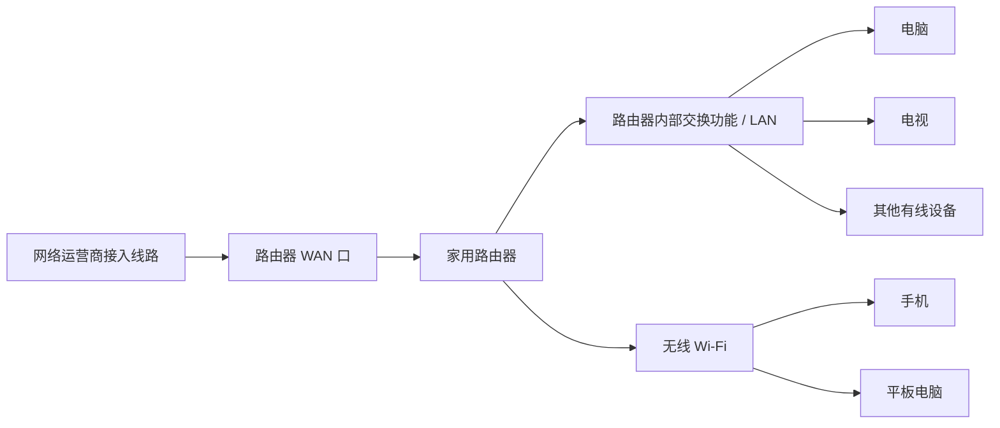
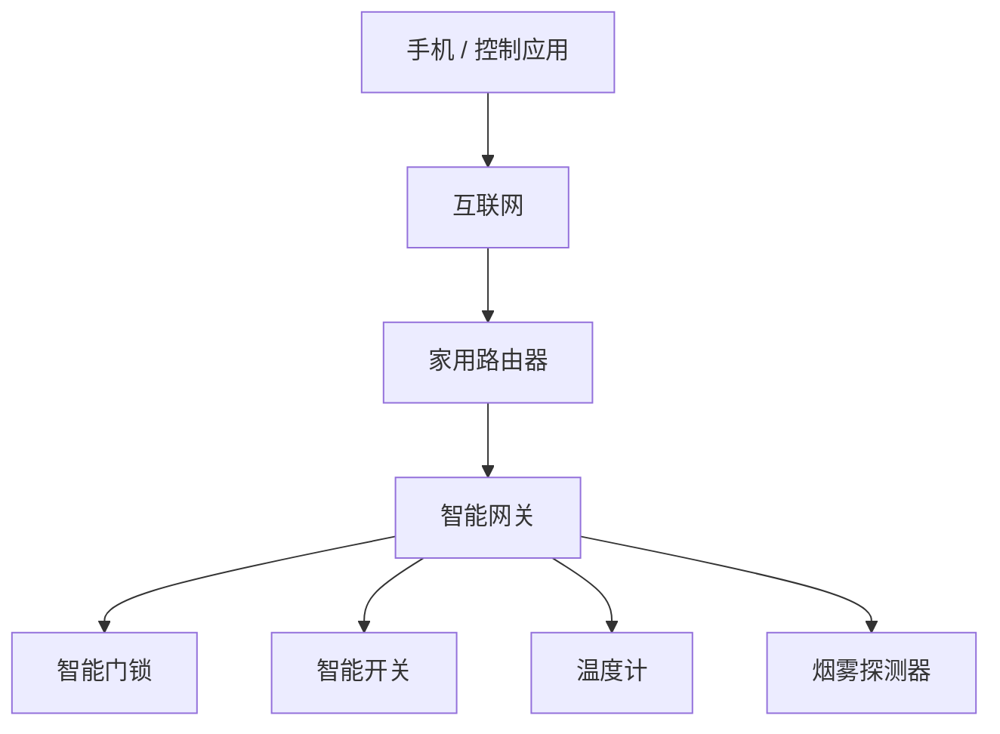
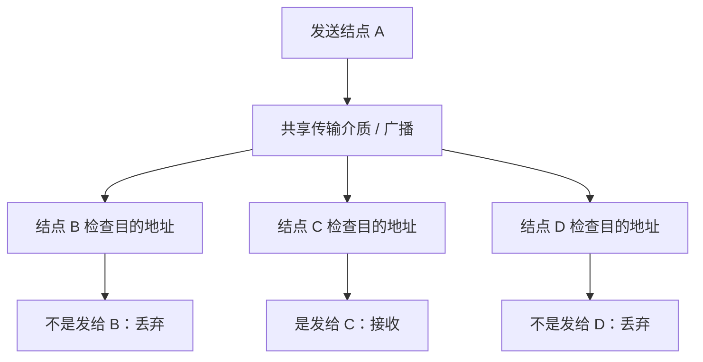
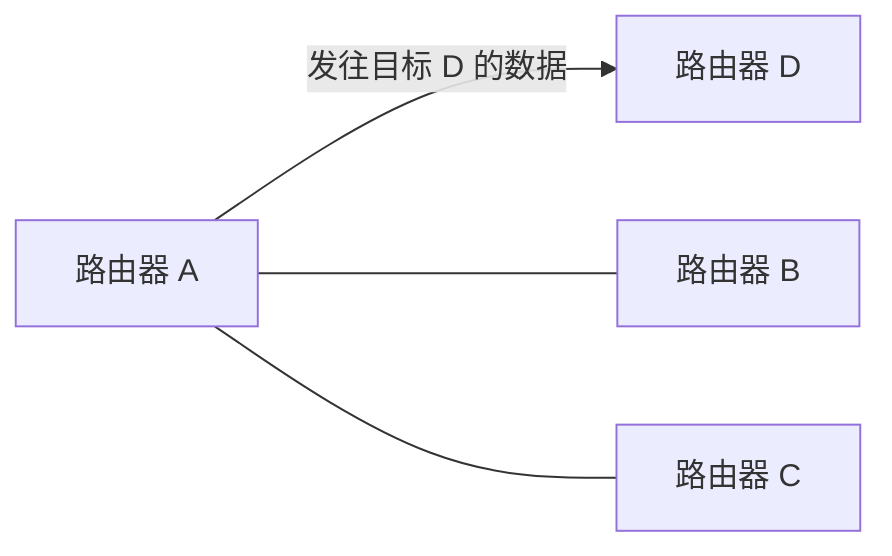
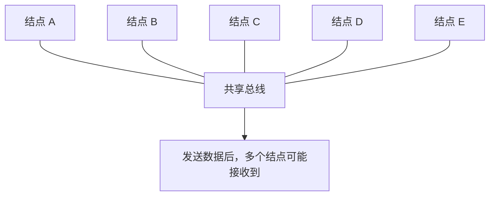
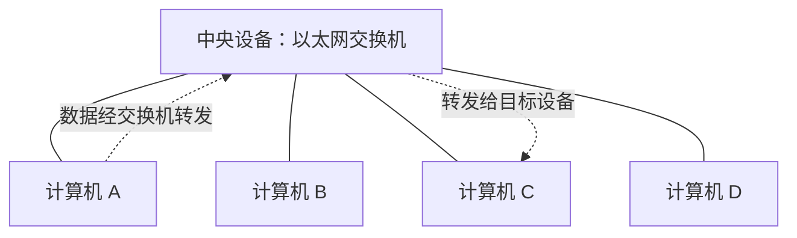
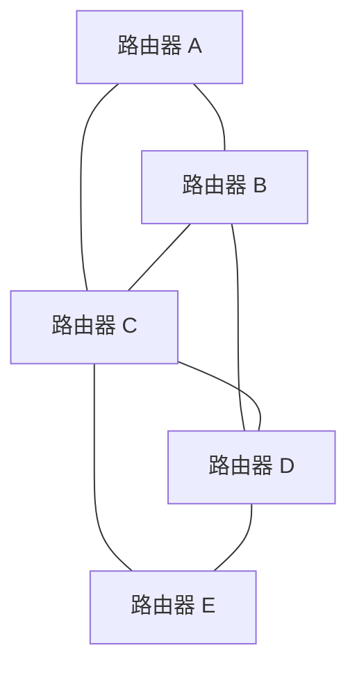
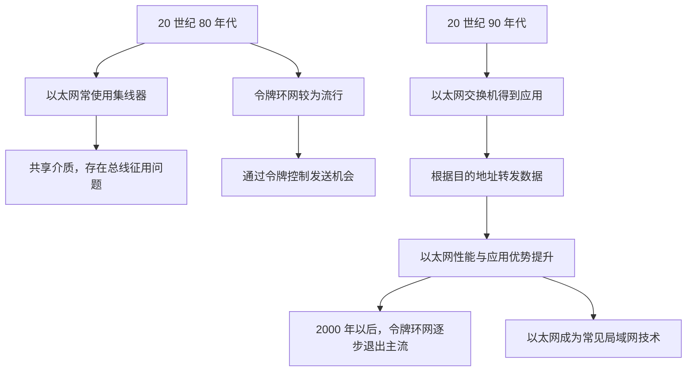

# 计算机网络的分类

> 本文根据课程视频内容整理，按照分布范围、传输技术、拓扑结构、使用者和传输介质五个维度，对计算机网络进行分类。保留视频中的主要概念、案例和历史背景，并通过表格与 Mermaid 图示辅助理解。

---

## 一、计算机网络的五种分类维度

从不同角度出发，可以对计算机网络进行不同的分类：

1. **按照分布范围分类：** 广域网、城域网、局域网、个域网。
2. **按照传输技术分类：** 广播式网络、点对点网络。
3. **按照拓扑结构分类：** 总线型、环形、星形、网状。
4. **按照使用者分类：** 公用网、专用网。
5. **按照传输介质分类：** 有线网络、无线网络。

课程中需要重点理解后续章节会继续讨论的概念；其余分类先形成整体印象即可。

---

## 二、按照分布范围分类

按照网络的覆盖范围，可以分为广域网、城域网、局域网和个域网。需要记住它们的英文名称与缩写：**WAN、MAN、LAN、PAN**。

### 1. 四种网络的区别

| 类型   | 英文名称                  | 缩写 | 典型覆盖范围                             | 常见例子                                        |
| ------ | ------------------------- | ---- | ---------------------------------------- | ----------------------------------------------- |
| 广域网 | Wide Area Network         | WAN  | 跨省、跨国甚至跨大洲，可达几十到几千公里 | 连接远距离城市、地区或国家的网络                |
| 城域网 | Metropolitan Area Network | MAN  | 一个或几个相邻城市，约几千米到几十千米   | 覆盖城市范围的网络                              |
| 局域网 | Local Area Network        | LAN  | 几十米到几千米                           | 家庭网络、企业内网、校园网中的局部网络          |
| 个域网 | Personal Area Network     | PAN  | 个人周围的较小范围                       | 通过蓝牙、Zigbee 等连接个人或智能家居设备的网络 |

从通常的覆盖范围来看，可以记成：

\[
\text{广域网} > \text{城域网} > \text{局域网} > \text{个域网}
\]

这里的“大于”表示覆盖范围通常更大。

### 2. 广域网（WAN）

- 广域网覆盖范围较大，可以跨省、跨国甚至跨大洲。
- 由于网络结点之间的距离较远，广域网所采用的通信技术与局域网存在一些区别。
- 后续课程会进一步讨论广域网中的通信技术和通信协议。

### 3. 城域网（MAN）

- 城域网通常覆盖一个或几个相邻的城市。
- 现在的城域网通常也会采用以太网技术实现结点之间的通信。
- 由于城域网与局域网的某些通信原理类似，有些讨论会将城域网放在与局域网相关的技术背景下一并理解；但二者的分类名称和覆盖范围仍应区分。

### 4. 局域网（LAN）

局域网是日常生活中非常常见的网络，例如：

- 学校的校园网中可以包含若干个局域网。
- 企业的内部网络可能属于局域网。
- 工作单位内部的网络可能是局域网。
- 家庭内部的电脑、电视、手机等设备可以组成家庭局域网。

现在的局域网常使用**以太网（Ethernet）技术**实现结点之间的通信。因此，在日常语境中，以太网技术经常与局域网联系在一起。

局域网内部经常使用**以太网交换机（Ethernet Switch）**连接不同设备。日常所说的“交换机”，在这种家庭或办公网络场景下，通常指以太网交换机。

### 5. 通过家用路由器理解 LAN 和 WAN

家用路由器通常可以理解为集成了路由器和交换机等功能的设备。家庭内部的电脑、电视等设备逻辑上连接到设备内部的交换功能，从而组成一个家庭局域网；路由功能则帮助家庭网络连接外部网络。

常见家用路由器背面可能有以下接口：

| 接口标识                   | 含义                           | 典型连接对象             |
| -------------------------- | ------------------------------ | ------------------------ |
| WAN                        | Wide Area Network，广域网接口  | 网络运营商接入家庭的线路 |
| LAN 1、LAN 2、LAN 3、LAN 4 | Local Area Network，局域网接口 | 家庭电脑、电视等有线设备 |

可以用下面的图理解家庭网络的连接关系：

**理解要点：**

- WAN 口通常连接运营商提供的外部网络线路。
- LAN 口用于连接家庭内部的有线设备。
- 家庭设备组成局域网，再通过路由器接入外部网络。
- 看到路由器上的 WAN 和 LAN 标识时，应能区分它们分别对应外部网络接入与家庭内部网络。

### 6. 个域网（PAN）与无线个域网（WPAN）

个域网通常通过无线技术把个人设备或个人周围的设备连接起来。常见的无线通信技术包括：

- **蓝牙（Bluetooth）**
- **Zigbee**

由于个域网经常采用无线技术，有时也称为**无线个域网**，英文为 Wireless Personal Area Network，缩写为 **WPAN**。

#### 智能家居的例子

一些智能家居设备，例如智能门锁、智能开关、温度计和烟雾探测器，可以通过蓝牙或 Zigbee 与智能网关直接通信。

- **智能网关：** 可以作为个域网中的主设备或协调设备。
- **智能门锁、开关、温度计等：** 是接入个域网的设备。
- **家用路由器：** 可以通过网线与智能网关连接，让家庭内的智能设备经由家庭网络接入互联网。
- **手机：** 在网络连接和相应应用的支持下，可以远程控制智能家居设备。

蓝牙和 Zigbee 等低功耗无线技术适合一些需要长时间运行的智能家居设备。例如，温度计或烟雾探测器可能需要较长时间不更换电池、不充电地工作，因此低功耗是重要考虑因素。

本课程对个域网相关通信技术不作深入探讨，对 PAN、WPAN 及相关技术有基本印象即可。

---

## 三、按照传输技术分类

按照传输技术，可以将计算机网络分为：

1. **广播式网络（Broadcast Network）**
2. **点对点网络（Point-to-Point Network）**

### 1. 广播式网络

在广播式网络中，一个结点发送数据时，发送的数据会被网络中的其他相关结点接收到。接收结点再检查数据分组中的目的地址：

- 如果目的地址是自己，就接收并处理数据。
- 如果目的地址不是自己，就丢弃该数据。

可以把它类比为群聊：群内成员都能看到消息，但只有被指定的对象才需要针对该消息作出响应。

视频用 Wi-Fi 作为帮助理解的例子：无线介质具有共享特征，一次无线发送可能被周围多个设备接收到，但设备会根据目的地址等信息判断是否需要接收和处理该数据。

### 2. 点对点网络

在点对点网络中，数据沿着发送方与接收方之间的点对点链路传输，不会像广播式传输那样无差别地发送给网络中的所有结点。

可以把它类比为一对一私信：消息是发给特定对象的。

例如，路由器 A 需要把发往路由器 D 的数据分组转发出去时，会根据目的地址和转发表等信息选择下一跳。假设选择的下一跳是 D，那么数据就会沿对应链路发给 D，而不是同时广播给其他无关路由器 B、C。

图中的 A—B、A—C 表示 A 还可能有其他相邻路由器；这不表示发往 D 的数据必须同时发送给 B 和 C。

### 3. 广播式网络与点对点网络对比

| 对比项         | 广播式网络                               | 点对点网络                             |
| -------------- | ---------------------------------------- | -------------------------------------- |
| 数据发送方式   | 发送后，多个结点可能接收到同一份传输内容 | 数据沿选定的点对点链路传输             |
| 接收方如何判断 | 根据目的地址等信息判断是否接收           | 通过链路和转发过程，将数据送向目标方向 |
| 类比           | 群聊、群消息                             | 一对一私信                             |
| 视频中的例子   | 具有共享介质特征的无线网络               | 路由器之间转发数据分组                 |

**注意：** 这里的分类关注数据在网络中的传输方式。现实网络可能同时包含共享介质和点对点链路，不能只凭“无线”或“有线”两个字就对所有场景作绝对判断。

---

## 四、按照拓扑结构分类

网络拓扑结构描述网络结点与链路之间的连接关系。需要区分：

- **物理拓扑：** 从实际线路和设备连接方式来看，网络呈现什么形状。
- **逻辑拓扑：** 从数据传输方式来看，数据在网络中如何传播。

课程中的一个重要提醒是：**物理拓扑与逻辑拓扑不一定相同。**

常见的网络拓扑结构有四种：总线型、环形、星形和网状。

### 1. 总线型拓扑结构

总线型网络中的多个结点连接到同一条共享总线上。发送结点把数据发送到总线上后，其他结点也可能接收到数据，再根据目的地址判断是否接收。

例如，A 要给 C 发送数据：

- A 将数据发送到总线上。
- B、C、D、E 等结点可能都能接收到该数据。
- 只有目的地址对应的 C 接收并处理，其他结点丢弃该数据。

#### 总线征用问题

因为多个结点共享同一条传输介质，如果 A 正在发送数据，此时 B 也想发送数据，就可能发生介质访问冲突，导致数据传输受到影响。这类共享总线上的竞争称为**总线征用**。

#### 集线器为什么是典型例子？

一台集线器（Hub）可以连接多台设备。从物理连接形式看，所有设备分别连接到集线器，外观上类似星形；但根据集线器的工作原理，当 A 给 C 发送数据时，集线器会把信号发送到其他端口，使其他设备也可能接收到。

因此：

- **物理拓扑：** 星形。
- **逻辑拓扑：** 总线型。
- **传输特征：** 具有广播特性，多个设备共享介质，存在总线征用问题。

这个例子说明，分析拓扑结构时，不能只看设备摆放或线缆连接的外形，还需要理解设备的工作原理。

### 2. 环形拓扑结构

环形网络中的结点沿环状链路连接，数据按照环上的传递关系从一个结点传向下一个结点。

视频以曾经流行的**令牌环网（Token Ring）**为典型例子。这种局域网技术在 2000 年以前比较常见。

#### 数字令牌机制

令牌环网使用一个称为**令牌（Token）**的控制标记：

1. 环形网络中按照规则传递令牌。
2. 通常只有当前持有令牌的设备才可以发送数据。
3. 设备发送完毕后，将令牌传递给下一个设备。
4. 下一个设备取得令牌后，才可以发送自己的数据。

可以把它理解为击鼓传花：令牌传到谁手中，谁就获得发送机会。

令牌机制让设备按规则轮流发送数据，可以避免多个设备同时争用共享传输机会的问题。

### 3. 星形拓扑结构

星形网络中，一个中央设备连接多台计算机或其他网络结点。

当 A 需要向 C 发送数据时，中央设备会根据数据的目的地址决定将数据转发到哪个设备。如果中央设备是以太网交换机，那么它可以将数据转发到与目标设备对应的端口，而不是无差别地发送给所有设备。

由于每台设备与中央设备之间有各自的链路，因此不会像传统共享总线那样让所有设备共同争用同一条总线。

典型例子是**以太网交换机（Ethernet Switch）**连接多台计算机。

以太网交换机连接的设备通常具有星形的物理拓扑；从交换机根据目标地址选择相应端口的转发行为来看，也体现了点对点的转发特征。

**注意区分：**

| 设备                | 物理拓扑（常见连接形式） | 逻辑传输特征（按视频介绍）         |
| ------------------- | ------------------------ | ---------------------------------- |
| 集线器 Hub          | 星形                     | 类似总线型，信号会被扩散到多个端口 |
| 以太网交换机 Switch | 星形                     | 根据目标地址选择相应端口转发       |

### 4. 网状拓扑结构

网状网络中的结点之间存在多条互相连接的链路。典型例子是由众多路由器构建的广域网。

#### 网状网络的特点

- 结点之间可能存在多条可选择的传输路径。
- 某些中间结点或链路出现故障时，网络可能通过其他路径继续传输数据。
- 路径选择较为灵活，网络可靠性通常较高。
- 连接链路较多，会增加线路建设和网络管理的成本。
- 路径选择、路由控制和网络管理也会更复杂。

网状拓扑常见于广域网。视频强调，网状结构的灵活性和较高可靠性，也伴随着控制复杂、线路成本高等问题。

### 5. 四种拓扑结构对比

| 拓扑结构 | 典型结构特征                 | 视频中的典型例子         | 需要记住的特点                               |
| -------- | ---------------------------- | ------------------------ | -------------------------------------------- |
| 总线型   | 多个结点共享一条总线         | 集线器网络的逻辑拓扑     | 具有广播特征，存在总线征用                   |
| 环形     | 结点按环状连接               | 令牌环网                 | 使用令牌机制控制设备发送机会                 |
| 星形     | 多个结点连接到中央设备       | 以太网交换机连接多台设备 | 交换机可根据目标地址转发数据                 |
| 网状     | 结点之间有多条相互连接的链路 | 路由器构建的广域网       | 路径灵活、可靠性较高，但成本和控制复杂度较高 |

在课程的常见例子中，前三种拓扑（总线型、环形、星形）常与局域网联系起来，网状拓扑则常见于广域网。

---

## 五、按照使用者分类

按照使用者，可以把计算机网络分为**公用网**和**专用网**。

### 1. 公用网

公用网是面向公众开放使用的网络。符合网络的使用条件并按照相应规则付费后，公众通常就可以使用相关服务。

### 2. 专用网

专用网是供特定组织或特定范围内部使用的网络，例如：

- 政府内部网络。
- 军队内部网络。
- 电力系统内部网络。
- 银行系统内部网络。

视频用一句便于记忆的说法区分二者：

> 公用网：符合条件并付费，就可以使用。
>
> 专用网：即使愿意付费，也不代表就有权限使用；它受到组织和访问权限的限制。

---

## 六、按照传输介质分类

按照传输介质，可以把计算机网络分为：

| 类型     | 含义                 | 常见例子                           |
| -------- | -------------------- | ---------------------------------- |
| 有线网络 | 通过有线介质传输数据 | 通过网线连接的以太网               |
| 无线网络 | 通过无线信号传输数据 | Wi-Fi、蓝牙、Zigbee 等无线通信场景 |

这一分类主要关注数据通过什么介质传输，了解基本概念即可。

---

## 七、五种分类维度汇总

| 分类维度 | 分类结果                 | 重点理解                                           |
| -------- | ------------------------ | -------------------------------------------------- |
| 分布范围 | WAN、MAN、LAN、PAN       | 覆盖范围由大到小；区分局域网和广域网               |
| 传输技术 | 广播式网络、点对点网络   | 多个结点可能接收到同一传输内容，或沿选定链路转发   |
| 拓扑结构 | 总线型、环形、星形、网状 | 区分物理拓扑与逻辑拓扑，理解共享介质和数据转发方式 |
| 使用者   | 公用网、专用网           | 是否面向公众开放，以及相应的访问权限               |
| 传输介质 | 有线网络、无线网络       | 数据通过有线介质还是无线信号传输                   |

---

## 八、以太网与令牌环网的发展小故事

本节视频最后介绍了一段局域网技术发展的历史，帮助理解以太网交换机为什么重要。

### 1. 20 世纪 80 年代：令牌环网曾经较为流行

在 20 世纪 80 年代，令牌环网和以太网都是用于连接局域网设备的技术。视频介绍，当时令牌环网技术较为流行。

令牌环网通过令牌机制控制设备发送数据的机会：只有持有令牌的设备才可以发送数据，因此能解决多个设备同时争用共享传输机会的问题。

当时以太网常使用集线器连接设备。集线器的逻辑拓扑类似总线型，多个设备共享传输介质，容易出现总线征用问题。

### 2. 20 世纪 90 年代：以太网交换机带来转变

后来，以太网交换机得到应用。交换机可以根据接收到的数据及其目的地址，决定应将数据转发到哪个端口。

与共享式集线器不同，交换机能够让不同端口之间进行相互独立的通信。在适当条件下，多台设备可以同时进行不同链路上的数据传输，而不必像令牌环网那样依靠单一令牌轮流取得发送机会。

因此，以太网交换机的出现明显改善了以太网的转发能力和网络性能，以太网技术逐渐在局域网领域占据主导地位。

### 3. 2000 年以后：令牌环网逐渐退出主流

视频介绍，进入 2000 年以后，令牌环网技术逐步退出主流。如今常见的局域网大多使用以太网技术实现设备通信。

这段历史的关键是：**集线器的逻辑特征类似共享总线，而以太网交换机能够根据目标地址转发数据，减少共享介质带来的竞争。**

---

## 九、复习要点

### 1. 必须记住的缩写

| 缩写 | 英文全称                       | 中文名称   |
| ---- | ------------------------------ | ---------- |
| WAN  | Wide Area Network              | 广域网     |
| MAN  | Metropolitan Area Network      | 城域网     |
| LAN  | Local Area Network             | 局域网     |
| PAN  | Personal Area Network          | 个域网     |
| WPAN | Wireless Personal Area Network | 无线个域网 |

### 2. 容易混淆的概念

- **WAN 与 LAN：** WAN 覆盖范围大，LAN 覆盖范围小。家用路由器的 WAN 口通常连接运营商线路，LAN 口用于连接家庭内部设备。
- **广播式与点对点：** 广播式发送可能被多个结点接收到，再根据目的地址判断是否接收；点对点传输则沿选定的链路传送。
- **物理拓扑与逻辑拓扑：** 集线器连接的网络，物理上看似星形，但逻辑上具有总线型特征。
- **集线器与交换机：** 集线器会把信号扩散到多个端口；以太网交换机根据目的地址选择相应端口转发。
- **总线型与环形：** 两者都需要考虑多个设备如何获得发送机会；令牌环网通过令牌机制控制发送。
- **星形与网状：** 星形通过中央设备连接各结点；网状结构结点之间有多条连接路径，灵活性和可靠性较高，但成本和控制复杂度也较高。
- **公用网与专用网：** 区别在于服务对象和访问权限。
- **有线网与无线网：** 区别在于传输介质。

### 3. 本节总结

计算机网络可以从五个维度进行分类：

1. **分布范围：** 广域网、城域网、局域网、个域网。
2. **传输技术：** 广播式网络、点对点网络。
3. **拓扑结构：** 总线型、环形、星形、网状。
4. **使用者：** 公用网、专用网。
5. **传输介质：** 有线网络、无线网络。

其中，尤其要理解局域网和广域网的区别、广播式传输与点对点传输的区别，以及物理拓扑与逻辑拓扑的区别。总线型结构可能存在总线征用；令牌环网通过令牌机制控制发送机会；交换机则能够根据目的地址转发数据；网状网络的路径灵活、可靠性较高，但也会带来更高的线路成本和管理复杂度。
