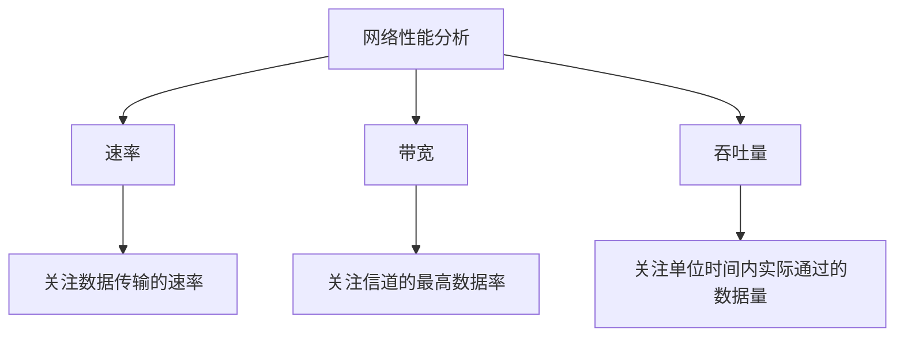

# 计算机网络的性能指标（一）：速率、带宽与吞吐量

> 本节介绍计算机网络的七个常见性能指标：速率、带宽、吞吐量、时延、时延带宽积、往返时延和信道利用率。视频先讲解前三个指标，其中速率和带宽是考研中更常见的考点，吞吐量了解其基本含义即可。

---

## 一、计算机网络的七个性能指标

计算机网络可以从多个角度衡量性能。本课程主要掌握以下七个指标：

| 序号 | 性能指标        | 本节学习安排                 |
| ---: | --------------- | ---------------------------- |
|    1 | 速率            | 本节重点                     |
|    2 | 带宽            | 本节重点                     |
|    3 | 吞吐量          | 本节介绍，考研中涉及相对较少 |
|    4 | 时延            | 后续学习                     |
|    5 | 时延带宽积      | 后续学习                     |
|    6 | 往返时延（RTT） | 后续学习                     |
|    7 | 信道利用率      | 后续学习                     |

本节先学习速率、带宽和吞吐量。理解它们时，需要特别注意：**速率关注数据传输的速度，带宽描述信道的能力上限，而吞吐量关注实际通过的数据量。**

---

## 二、第一个性能指标：速率

### 1. 速率的定义

**速率**是指连接到网络上的结点在信道上传输数据的速率，也称为**数据率**或**比特率**。

在计算机网络题目中，常见的表述是“数据传输速率”。

速率最常见的单位是：

- 比特每秒（bit per second）
- 简写为 `bit/s`、`b/s` 或 `bps`

其中 `bps` 是 _bits per second_ 的缩写，表示每秒传输多少个比特。

> 注意：在计算机网络中，**小写 b 表示 bit（比特），大写 B 表示 Byte（字节）**。二者不能混淆。

### 2. 从电脑的网络活动监视器理解速率

可以在操作系统中查看电脑当前的网络传输情况：

- **macOS：** 打开“活动监视器”，找到“网络”页签。
- **Windows：** 打开“任务管理器”，进入“性能”页签，查看网络相关信息。

视频中举例：

- 一台 Mac 台式机通过网线与家用路由器连接。
- 电脑此时向路由器发送数据，速率约为 **1.8 MB/s**。
- 电脑此时从路由器接收数据，速率约为 **93.3 MB/s**。

这说明，同一条连接上的发送速率和接收速率可以不相同。

视频还举了一个通过 Wi-Fi 连接路由器的 Windows 电脑示例：

- 发送速率约为 **120 kbps**。
- 接收速率约为 **1.3 Mbps**。

这些数值反映的是当时观察到的网络传输情况，不代表设备始终保持这些速率。

### 3. 什么是信道？

**信道**可以理解为信息传送的通道。

通常情况下，一条通信线路在逻辑上可以对应一条发送信道和一条接收信道。也就是说，**通信线路和信道不是完全相同的概念**。

例如，电脑与路由器之间使用一根网线连接：

- 这根网线可以用于电脑向路由器发送数据。
- 这根网线也可以用于电脑接收路由器发来的数据。
- 从逻辑上看，可以分别讨论发送信道和接收信道的速率。

Wi-Fi 链路也可以分别观察发送和接收方向的传输速率。

因此，分析网络速率时，应该留意题目讨论的是发送方向、接收方向，还是整个网络连接的整体情况。

### 4. 比特与字节的换算

计算机网络中常见的单位有 `bps`、`kbps`、`Mbps`、`Gbps` 等。

| 单位 | 含义                    |
| ---- | ----------------------- |
| bit  | 比特，常用小写 `b` 表示 |
| Byte | 字节，常用大写 `B` 表示 |
| bps  | 比特每秒                |
| B/s  | 字节每秒                |

基本关系：

\[
1\text{ Byte}=8\text{ bit}
\]

因此：

\[
1\text{ B/s}=8\text{ bit/s}
\]

\[
1\text{ MB/s}=8\text{ Mbps}
\]

反过来：

\[
1\text{ Mbps}=\frac{1}{8}\text{ MB/s}=0.125\text{ MB/s}
\]

例如，视频中 Mac 的发送速率是 **1.8 MB/s**。若按十进制单位换算成比特每秒：

\[
1.8\text{ MB/s}\times 8=14.4\text{ Mbps}
\]

因此，`1.8 MB/s` 和 `14.4 Mbps` 在该换算前提下表示相同的数据率，只是单位写法不同。

### 5. 数量前缀：K、M、G、T

在计算机网络题目中，数据率的数量前缀通常按十进制换算：

| 前缀   | 名称 |        数值 | 例子                                 |
| ------ | ---- | ----------: | ------------------------------------ |
| K（k） | 千   |    \(10^3\) | \(1\text{ kbps}=10^3\text{ bps}\)    |
| M      | 兆   |    \(10^6\) | \(1\text{ Mbps}=10^6\text{ bps}\)    |
| G      | 吉   |    \(10^9\) | \(1\text{ Gbps}=10^9\text{ bps}\)    |
| T      | 太   | \(10^{12}\) | \(1\text{ Tbps}=10^{12}\text{ bps}\) |

相邻的十进制数量前缀相差 \(10^3\)：

\[
1\text{ M}=10^3\text{ K},\qquad
1\text{ G}=10^3\text{ M},\qquad
1\text{ T}=10^3\text{ G}
\]

例如：

\[
120\text{ kbps}=120\times10^3\text{ bps}
\]

\[
1.3\text{ Mbps}=1.3\times10^6\text{ bps}
\]

将视频中 Mac 的接收速率 `93.3 MB/s` 换算为 `Mbps`：

\[
93.3\text{ MB/s}\times8=746.4\text{ Mbps}
\]

#### 与计算机组成原理、操作系统中的单位区别

视频提醒：在计算机组成原理、操作系统等课程中，题目有时会使用以 \(2^{10}\) 为进位基础的容量单位换算方式。

| 前缀写法（课程中常见的写法） | 十进制（计算机网络速率题常用） | 二进制进位方式（部分组成原理/操作系统题目） |
| ---------------------------- | -----------------------------: | ------------------------------------------: |
| K                            |                       \(10^3\) |                             \(2^{10}=1024\) |
| M                            |                       \(10^6\) |                                  \(2^{20}\) |
| G                            |                       \(10^9\) |                                  \(2^{30}\) |
| T                            |                    \(10^{12}\) |                                  \(2^{40}\) |

例如，同样看到 `8 MB/s`：

- 如果按照计算机网络中常用的十进制换算，可写为 \(8\times10^6\text{ B/s}\)。
- 如果题目要求采用二进制进位方式，则可写为 \(8\times2^{20}\text{ B/s}\)。

实际做题必须以题目给定的单位约定和课程语境为准。**不要混用十进制和二进制换算方式。**

### 6. 速率计算的检查步骤

计算网络速率时，建议依次检查：

1. **区分 b 和 B：** `b` 是比特，`B` 是字节。
2. **统一数量前缀：** 确认使用十进制还是二进制进位。
3. **统一时间单位：** 例如秒与毫秒不要直接混算。
4. **明确方向：** 是发送速率、接收速率，还是双向数据量。
5. **再进行计算：** 先统一单位，再代入公式。

---

## 三、第二个性能指标：带宽

### 1. 计算机网络中的带宽

在计算机网络中，**带宽通常指某个信道所能传送的最高数据率**。

在这种含义下，带宽可以理解为信道的数据传输能力上限，常见单位为 `bps`、`Mbps`、`Gbps` 等。

例如，家庭宽带套餐可能标称“1000M 宽带”。在视频举例中，这里的 `1000M` 指下行带宽最高可以达到约 **1000 Mbps**。

### 2. 上行带宽与下行带宽

视频中的宽带套餐举例：

| 方向 | 套餐中给出的带宽 | 含义                             |
| ---- | ---------------: | -------------------------------- |
| 下行 |        1000 Mbps | 网络向家庭侧传送数据的最高数据率 |
| 上行 |          30 Mbps | 家庭侧向网络发送数据的最高数据率 |

下载电影等操作通常主要使用下行方向。如果下行带宽是 `1000 Mbps`，换算成字节每秒：

\[
1000\text{ Mbps}\div8=125\text{ MB/s}
\]

因此，按单位换算得到的理论数据率约为 **125 MB/s**。

上传文件时则会受到上行带宽限制。例如，上行带宽只有 `30 Mbps`，那么上传方向的理论数据率上限就不能超过这一数值。

> 实际下载或上传速度还会受到服务器性能、网络拥塞、协议开销、终端性能、无线信号质量和设备接口能力等因素影响，所以实际应用速度不一定达到理论换算值。

### 3. 实际通信速率还受端点设备性能限制

视频通过一个例题说明：即使链路带宽很高，实际通信速率也可能受到端点设备能力的限制。

已知：

- 主机 A 与主机 B 之间的链路带宽为 **100 Mbps**。
- 主机 A 的网卡速率为 **1 Gbps**。
- 主机 B 的网卡速率为 **10 Mbps**。

主机 A 向主机 B 发送数据时，最高理论速率不能超过主机 B 的网卡能力，即 **10 Mbps**。

原因是：主机 A 的发送能力和链路带宽都比较高，但主机 B 的网卡最多只能按 `10 Mbps` 的速率接收数据。因此，端到端的实际最高速率受到最弱环节限制。

在本题条件下可以概括为：

\[
R\_{\max}\leq \min(100\text{ Mbps},1000\text{ Mbps},10\text{ Mbps})
\]

\[
\boxed{R\_{\max}\leq10\text{ Mbps}}
\]

这道题想说明：**端到端通信的最高速率会受到链路带宽和两端设备性能共同限制。**

### 4. 家庭网络中的带宽瓶颈

如果家庭购买了千兆宽带，但实际网速明显达不到预期，可能需要检查家庭网络中的各个环节。

#### （1）光猫

网络运营商可能通过光纤将网络接入家庭。光猫（调制解调器/光网络终端等设备，具体功能取决于设备类型）负责相应的线路接入和信号转换功能，再通过网线与家用路由器连接。

#### （2）网线

视频用网线类型举例说明网线可能成为瓶颈：

- 视频举例中的五类网线，其支持能力可能限制在 `100 Mbps` 场景。
- 六类网线常用于支持千兆以太网的场景。
- 如果家庭购买的是千兆宽带，但光猫与路由器之间的线路只支持较低速率，那么该链路可能限制实际可用带宽。

选择网线时，应查看具体线缆类别、标准、长度和设备协商速率，确保它们与家庭网络的目标速率相匹配。并不需要在所有情况下都购买规格最高、价格最贵的网线。

#### （3）路由器的 WAN 口

路由器通过 WAN 口连接光猫或外部网络线路。如果路由器 WAN 口的最高速率只有 `100 Mbps`，即使办理了 `300 Mbps` 的宽带，家庭网络的可用速率也可能被这个接口限制。

视频中的例子是：一台较老的路由器 WAN 口最高只能达到 `100 Mbps`，但家庭办理了 `300 Mbps` 宽带，因此路由器可能成为网络性能瓶颈。

#### （4）整条路径中的最弱环节

检查家庭网络时，可以依次查看：

- 套餐的上行、下行带宽；
- 光猫的接口与性能；
- 光猫到路由器之间的网线；
- 路由器 WAN/LAN 口的最高速率；
- 路由器的转发能力；
- 终端网卡以及 Wi-Fi 的连接速率。

这样可以定位网络链路中的性能瓶颈，避免在其他环节能力不足时，只升级某一个部件却无法获得预期效果。

### 5. 带宽在通信原理中的另一种含义

除了“信道所能传送的最高数据率”之外，在通信原理中，**带宽还可以表示某个信道允许通过的信号频带范围**，单位是赫兹（Hz）。

这两种含义的侧重点不同：

| 使用场景   | 带宽的含义                 | 常见单位        |
| ---------- | -------------------------- | --------------- |
| 计算机网络 | 信道所能传送的最高数据率   | bps、Mbps、Gbps |
| 通信原理   | 信道允许通过的信号频带范围 | Hz、kHz、MHz    |

在计算机网络课程中，大多数情况下遇到“带宽”时，指的是第一种含义；在后续学习香农定理、奈奎斯特准则等内容时，会讨论频带范围与数据传输能力之间的关系。

### 6. 用可见光理解频带范围

视频用人眼能够看到的可见光作为类比：

- 不同颜色的光具有不同的波长和频率。
- 视频中以约 `400 THz` 到 `750 THz` 作为可见光频率范围的示意。
- 低于这一范围的红外线通常不能被人眼直接看见；高于这一范围的紫外线也通常不能被人眼直接看见。

把人眼类比成一条“视觉信道”，可以把它允许感知的频率范围理解为一个有限的频带。按照视频中的简化示例，频带宽度为：

\[
750\text{ THz}-400\text{ THz}=350\text{ THz}
\]

这个类比旨在帮助理解“频带范围”这一概念：如果某个系统允许通过或感知的频率范围更宽，它所能处理的信号范围也可能更丰富。这里的人眼例子是帮助理解带宽概念的类比，并不意味着人眼是实际的通信信道。

### 7. 带宽与数据传输能力

视频举例：

- 光纤实现的信道带宽可用较大的频带范围来描述。
- 电话线的频带范围相对较窄，传统电话语音信道常用约 `3 kHz` 的带宽作示意。

当信道允许通过的频带范围更大时，在相应条件下通常可以支持更高的数据率。关于带宽与数据率之间的定量关系，后续将通过香农定理、奈奎斯特准则等内容进一步讨论。

**复习时要注意：** 计算机网络中的“带宽”和通信原理中的“带宽”，单位和直接定义不同，但都与信道的数据传输能力有关。看到题目时，应根据章节背景和单位判断它采用的是哪一种含义。

---

## 四、第三个性能指标：吞吐量

### 1. 吞吐量的定义

**吞吐量**是指单位时间内通过某个网络、某条信道或某个网络接口的实际数据量。

吞吐量描述的是实际传送情况，可以用来反映某个信道、网络接口或网络当前承载的数据量和负载情况。

吞吐量的单位常用 `bit/s`、`bps`、`B/s` 等，具体应以统计数据使用的单位为准。

### 2. 信道吞吐量的例子

回到前面 Mac 台式机连接家用路由器的例子：

- 发送方向的速率约为 `1.8 MB/s`。
- 接收方向的速率约为 `93.3 MB/s`。

如果要描述这条连接在当时双向合计的数据传输量，可以把两个方向的数值相加：

\[
1.8+93.3=95.1\text{ MB/s}
\]

因此，按视频这个例子的统计方式，这条连接的双向合计吞吐量约为 **95.1 MB/s**。

如果需要把它换算为 `Mbps`，应先统一单位：

\[
95.1\text{ MB/s}\times8=760.8\text{ Mbps}
\]

> 这里的数值是视频中的示例。实际统计吞吐量时，需要明确统计时间、统计方向、统计对象以及采用的是字节还是比特单位。

### 3. 网卡吞吐量的例子

网络接口卡（网卡）负责电脑与网络之间的数据通信。

当描述网卡一段时间内的实际数据吞吐情况时，可以综合考虑：

- 网卡发送了多少数据；
- 网卡接收了多少数据。

按照视频示例中的合计方法，网卡的发送速率约为 `1.8 MB/s`，接收速率约为 `93.3 MB/s`，则双向合计为：

\[
1.8+93.3=95.1\text{ MB/s}
\]

因此，按照该示例的统计口径，网卡双向合计吞吐量约为 `95.1 MB/s`。

### 4. 家庭内网吞吐量的例子

假设家庭路由器连接了多台设备：

- 电脑与路由器之间的某一方向数据传输速率为 `93.3 MB/s`；
- 电脑向路由器发送数据的速率为 `1.8 MB/s`；
- 手机与路由器之间的某一方向数据传输速率为 `10 MB/s`；
- iPad 向路由器发送数据的速率为 `8 MB/s`。

按照视频所采用的简化示例，将这些数据速率相加：

\[
93.3+1.8+10+8=113.1\text{ MB/s}
\]

则可以用 `113.1 MB/s` 作为该示例所统计的家庭内网整体数据吞吐量。

需要注意，现实中统计一个网络的吞吐量时，应当明确所统计的流量范围，避免把同一份数据在多个链路上的转发重复计入，或者把不同时间段的数据直接相加。视频中的例子主要用于说明吞吐量可以从单条信道、网络接口和整个网络等不同层级来描述。

### 5. 吞吐量的特点与用途

- 吞吐量关注实际通过的数据量，而不仅仅是理论能力上限。
- 可以用吞吐量描述一条信道、一个网络接口或某个网络。
- 对网络工程师来说，吞吐量可以帮助判断某个节点或网络当前的负载情况。
- 在本课程的考研题目中，吞吐量涉及相对较少，掌握基本定义和单位即可。

---

## 五、速率、带宽、吞吐量的对比

| 对比维度         | 速率                                  | 带宽（计算机网络含义）                   | 吞吐量                                     |
| ---------------- | ------------------------------------- | ---------------------------------------- | ------------------------------------------ |
| 核心含义         | 数据传输速率                          | 信道可支持的最高数据率                   | 单位时间内实际通过的数据量                 |
| 强调重点         | 传输速度                              | 能力上限                                 | 实际传输情况                               |
| 常见单位         | bps、Mbps、Gbps，也可能看到 B/s、MB/s | bps、Mbps、Gbps                          | bps、Mbps、B/s、MB/s 等                    |
| 是否表示实际情况 | 可用于描述实时或给定的传输速率        | 通常用于描述最高能力                     | 是对实际通过数据量的统计                   |
| 视频中的例子     | Mac 发送 `1.8 MB/s`、接收 `93.3 MB/s` | 家庭宽带下行 `1000 Mbps`、上行 `30 Mbps` | 计算机、网卡或家庭网络某一时段的实际数据量 |

一句话记忆：

- **速率：** 数据传得多快。
- **带宽：** 信道最高能支持多快。
- **吞吐量：** 实际有多少数据通过。

---

## 六、本节常见计算汇总

| 题目或场景                                   | 计算过程                       | 结果                       |
| -------------------------------------------- | ------------------------------ | -------------------------- |
| 1 Byte 等于多少 bit                          | \(1\text{ Byte}=8\text{ bit}\) | 8 bit                      |
| `1.8 MB/s` 换算为 `Mbps`                     | \(1.8\times8\)                 | 14.4 Mbps                  |
| `93.3 MB/s` 换算为 `Mbps`                    | \(93.3\times8\)                | 746.4 Mbps                 |
| `1000 Mbps` 换算为 `MB/s`                    | \(1000\div8\)                  | 125 MB/s                   |
| 链路 100 Mbps，A 网卡 1 Gbps，B 网卡 10 Mbps | 取链路及端点能力中的最小值     | 最高理论速率不超过 10 Mbps |
| 发送 `1.8 MB/s`、接收 `93.3 MB/s` 的双向合计 | \(1.8+93.3\)                   | 95.1 MB/s                  |
| 家庭网络示例中的速率合计                     | \(93.3+1.8+10+8\)              | 113.1 MB/s                 |

---

## 七、本节复习要点

1. 计算机网络中，速率也称为数据率或比特率，常用单位是 `bps`。
2. 小写 `b` 表示 bit（比特），大写 `B` 表示 Byte（字节），两者的换算关系是 \(1\text{ Byte}=8\text{ bit}\)。
3. 计算机网络速率题通常按十进制数量前缀换算：K、M、G、T 相邻一级相差 \(10^3\)。
4. 计算机网络中的带宽通常表示信道所能传送的最高数据率。
5. 通信原理中的带宽还可以表示信道允许通过的信号频带范围，单位为 Hz。
6. 端到端通信的最高理论速率会受到链路带宽、发送端网卡、接收端网卡和其他网络设备能力的共同限制。
7. 家庭网络的性能可能受光猫、网线、路由器 WAN/LAN 口、路由器转发能力、终端网卡及 Wi-Fi 状况限制。
8. 吞吐量表示单位时间内通过某个信道、网络接口或网络的实际数据量，可以反映其实际负载。
9. 进行计算前应统一数据单位、数量前缀、时间单位和统计方向。
10. 本节中，速率和带宽是更常见的考点；吞吐量掌握基本定义和计算方式即可。

---

## 八、本节总结

本视频介绍了三个计算机网络性能指标：

- **速率：** 连接到网络上的结点在信道上传输数据的速率，常用单位为 `bps`。做题时要区分比特与字节，并统一数量前缀。
- **带宽：** 在计算机网络中通常指信道能传送的最高数据率；在通信原理中也表示信道允许通过的信号频带范围，单位为赫兹。
- **吞吐量：** 单位时间内通过某个信道、网络接口或网络的实际数据量，反映实际传输情况。

带宽较高并不保证端到端实际速率一定达到该上限。网络链路中的网卡、网线、路由器接口及其他环节，都可能形成性能瓶颈。理解这三个指标的定义和区别，是后续学习时延、时延带宽积、往返时延和信道利用率的基础。
