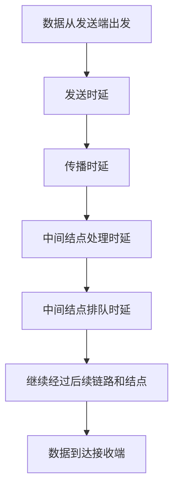
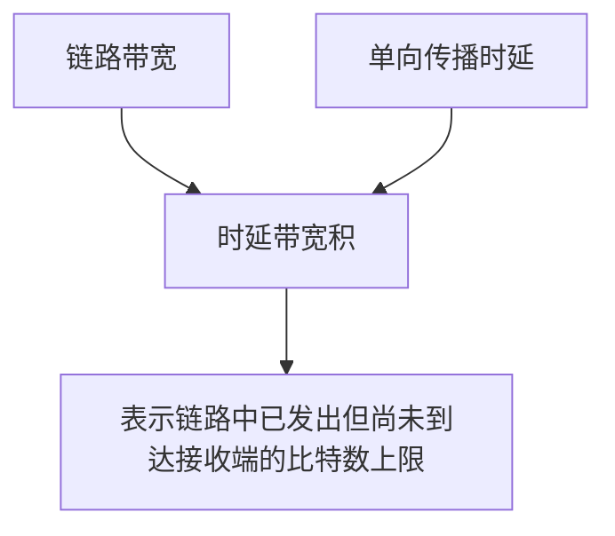
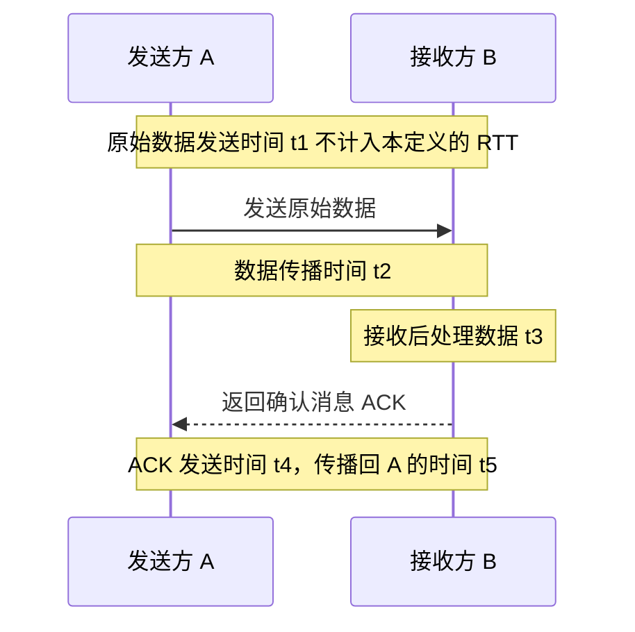
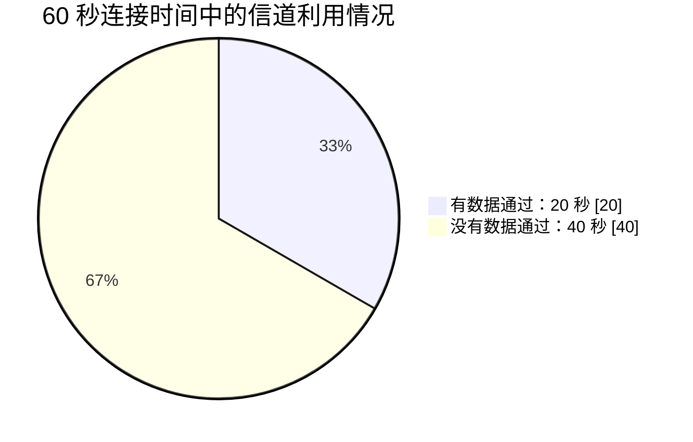

# 计算机网络的性能指标（二）：时延、时延带宽积、往返时延与信道利用率

> 本节继续学习计算机网络的性能指标，重点包括时延、时延带宽积、往返时延（RTT）和信道利用率。结合上一节的速率、带宽与吞吐量，至此便覆盖了课程中常见的七个性能指标。

---

## 一、时延（Delay）

### 1. 时延的定义

**时延（Delay）**，有些教材也称为“延迟”，是指数据从网络中的一个结点传送到另一个结点所需要的时间。

实际网络的结构可能比较复杂。数据从 A 点到达 B 点，中间可能经过多台路由器和多条通信链路。在整个数据传输过程中，每经过一段链路或一个中间结点，都可能产生额外的时间开销。

因此，通常把总时延分为四个部分：

1. **发送时延（Transmission Delay）**，也称传输时延。
2. **传播时延（Propagation Delay）**。
3. **处理时延（Processing Delay）**。
4. **排队时延（Queuing Delay）**。

**注意：** 发送时延和传播时延是两个不同的概念，在计算题中尤其容易混淆。

### 2. 发送时延

发送时延是指**结点把数据推向信道所花费的时间**，也称为传输时延。

它主要取决于：

- 数据的长度；
- 数据的发送速率。

计算公式：

\[
\boxed{\text{发送时延}=\frac{\text{数据长度（bit）}}{\text{发送速率（bit/s）}}}
\]

也可以记为：

\[
t\_{\text{发送}}=\frac{L}{R}
\]

其中：

- \(L\)：数据长度，单位为 bit；
- \(R\)：发送速率，单位为 bit/s；
- \(t\_{\text{发送}}\)：发送时延，单位为 s。

例如，发送一个分组时，发送端需要按照一定的速率，逐比特地将数据放到链路上。发送速率越高，发送相同长度的数据所需的时间就越短；数据长度越大，发送所需的时间就越长。

### 3. 传播时延

数据在信道上以电磁波等信号形式传播。信号在不同传输介质中的传播速度不同。

**传播时延**是指信号从信道的一端传播到另一端所需要的时间。

计算公式：

\[
\boxed{\text{传播时延}=\frac{\text{信道长度}}{\text{信号在信道中的传播速度}}}
\]

也可以记为：

\[
t\_{\text{传播}}=\frac{D}{V}
\]

其中：

- \(D\)：信道长度，单位为 m；
- \(V\)：信号在该信道中的传播速度，单位为 m/s；
- \(t\_{\text{传播}}\)：传播时延，单位为 s。

传播时延取决于信道长度和信号传播速度，而不是由待发送的数据有多大直接决定。

### 4. 发送时延与传播时延的区别

可以用高速公路上的车辆来理解这两个概念。

假设城市 A 与城市 B 之间有一段高速公路，中间有一个收费站：

- 车辆需要依次通过收费站才能进入高速公路。收费站每分钟允许多少辆车通过，决定了所有车辆排队进入高速公路需要多久。这类似于**发送时延**。
- 车辆上高速后，以一定速度沿道路行驶。道路长度除以行驶速度，决定车辆从道路一端到另一端需要多久。这类似于**传播时延**。

把网络中的比特类比为车辆：

- 结点按发送速率将比特逐个送入信道，这一过程产生发送时延。
- 比特进入信道后，沿信道传播到另一端，这一过程产生传播时延。

| 对比项     | 发送时延                                     | 传播时延                           |
| ---------- | -------------------------------------------- | ---------------------------------- |
| 关注什么   | 把数据发送到信道上需要多久                   | 信号从链路一端到另一端需要多久     |
| 主要取决于 | 数据长度、发送速率                           | 信道长度、信号传播速度             |
| 计算公式   | 数据长度 ÷ 发送速率                          | 信道长度 ÷ 信号传播速度            |
| 常见误区   | 把字节数直接除以 bit/s，忘记将 Byte 转成 bit | 把数据发送所需时间当作信号传播时间 |

### 5. 处理时延

在分组交换网络中，路由器收到数据分组后，需要对分组进行处理，例如：

- 检查分组是否发生错误；
- 分析分组中的相关控制信息；
- 根据目的地址和转发表等信息，确定下一跳；
- 为后续的转发做准备。

路由器处理分组所花费的时间，就是**处理时延**。

处理时延受路由器性能、当前处理任务等因素影响。设备处理能力越强，在其他条件相近时，处理时延可能越低。

### 6. 排队时延

路由器可能同时接收到许多结点发送的数据分组。如果需要处理或发送的分组过多，这些分组就可能需要等待。

路由器通常会使用缓存空间暂存等待处理或等待发送的分组。分组排队等待处理、等待输出链路可用所花费的时间，构成**排队时延**。

排队时延受到网络负载等因素影响：

- 路由器需要处理的分组越多，排队时延可能越高。
- 网络负载较低时，分组可能很快就能得到处理与转发。
- 网络负载很高时，分组可能需要等待更长时间。

### 7. 总时延的组成

在常见的简化模型中，数据经过一段链路时会产生发送时延和传播时延；数据经过中间结点时，还可能产生处理时延和排队时延。

\[
\boxed{
\text{总时延}
=\text{发送时延}
+\text{传播时延}
+\text{处理时延}
+\text{排队时延}
}
\]

如果数据经过多段链路和多个中间结点，就需要将沿途相应的时延逐段累加。

在考试计算题中，如果题目没有特别说明，通常重点计算发送时延和传播时延；处理时延和排队时延若未给出，通常按题目要求忽略。

---

## 二、时延计算例题：一个分组经过两段链路

### 1. 题目条件

主机 H1 要向主机 H2 发送一个数据分组，中间经过一台路由器。已知：

| 参数                          |      数值 |
| ----------------------------- | --------: |
| 分组大小                      | 1000 Byte |
| H1 向链路 A 发送数据的速率    |  100 Mbps |
| 路由器向链路 B 发送数据的速率 |   80 Mbps |
| 链路 A 的传播时延             |   0.01 ms |
| 链路 B 的传播时延             |   0.05 ms |
| 路由器处理时延和排队时延      |    先忽略 |

求整个分组从 H1 到达 H2 的总时延。

### 2. 第一步：计算 H1 的发送时延

分组大小是 1000 Byte。由于：

\[
1\text{ Byte}=8\text{ bit}
\]

因此，分组长度为：

\[
1000\times8=8000\text{ bit}
\]

H1 的发送速率为 100 Mbps，即 \(100\times10^6\text{ bit/s}\)。

\[
t\_{\text{发送 A}}
=\frac{8000}{100\times10^6}\text{ s}
=0.00008\text{ s}
=0.08\text{ ms}
\]

因此，H1 将整个分组发送到链路 A 上需要 **0.08 ms**。

### 3. 第二步：计算链路 A 的传播时延

题目已经给出链路 A 的传播时延为 **0.01 ms**。

分组的第一个比特先到达路由器，最后一个比特在 H1 完成发送并经过传播时间后到达。忽略路由器处理和排队时延时，路由器接收完整个分组的时刻为：

\[
0.08+0.01=0.09\text{ ms}
\]

### 4. 第三步：计算路由器向链路 B 发送数据的时延

路由器向链路 B 的发送速率为 80 Mbps。

\[
t\_{\text{发送 B}}
=\frac{8000}{80\times10^6}\text{ s}
=0.0001\text{ s}
=0.1\text{ ms}
\]

因此，路由器把完整分组发送到链路 B 上需要 **0.1 ms**。

### 5. 第四步：加入链路 B 的传播时延

链路 B 的传播时延为 **0.05 ms**。

所以总时延为：

\[
\begin{aligned}
T
&=t*{\text{发送 A}}+t*{\text{传播 A}}\\
&\quad+t*{\text{发送 B}}+t*{\text{传播 B}}\\
&=0.08+0.01+0.1+0.05\\
&=\boxed{0.24\text{ ms}}
\end{aligned}
\]

其中：

- 发送时延：\(0.08+0.1=0.18\text{ ms}\)；
- 传播时延：\(0.01+0.05=0.06\text{ ms}\)。

### 6. 如果路由器还有处理和排队时延

现在假设路由器的处理时延与排队时延合计为 **0.04 ms**。

则：

\[
T=0.24+0.04=\boxed{0.28\text{ ms}}
\]

**做题提醒：** 如果题目明确给出处理时延或排队时延，就应按题意加上；如果没有给出，且题目要求忽略，则只计算发送时延与传播时延。

---

## 三、时延带宽积（Delay-Bandwidth Product）

### 1. 定义与公式

**时延带宽积**是指一段链路的单向传播时延乘以该链路的带宽。

\[
\boxed{\text{时延带宽积}=\text{传播时延}\times\text{带宽}}
\]

如果传播时延的单位是秒，带宽单位是 bit/s，那么时延带宽积的单位就是 bit。

\[
\text{s}\times\frac{\text{bit}}{\text{s}}=\text{bit}
\]

### 2. 时延带宽积表示什么？

时延带宽积可以理解为：在发送速率达到链路带宽的情况下，链路中已经从发送端发出、但还没有到达接收端的最大比特数。

例如：

- 一条链路的带宽为 100 Mbps；
- 单向传播时延为 1 s。

那么：

\[
\text{时延带宽积}
=100\times10^6\text{ bit/s}\times1\text{ s}
=100\times10^6\text{ bit}
=100\text{ Mbit}
\]

这表示，当发送端持续以 100 Mbps 的速率向链路发送数据时，在一个传播时延内，链路上最多可以有约 100 Mbit 的数据已经发出、但尚未到达接收端。

### 3. 用水管理解时延带宽积

可以把链路想象成一根水管：

- 水管的横截面积类似链路带宽；
- 水管的长度类似传播时延所代表的传播距离；
- 水管内部能容纳多少水，类似链路中能容纳多少尚未到达接收端的比特。

水管横截面积越大、长度越长，内部可容纳的水量就越多。类似地，在其他条件相同时，带宽越大、传播时延越长，时延带宽积就越大。

### 4. 考试中的重要程度

视频指出，时延带宽积本身涉及的考题相对较少，但它可以用于计算传播时延，也会出现在后续的网络知识中。复习时至少要掌握：

- 公式：传播时延 × 带宽；
- 单位：bit；
- 含义：链路中已发出但尚未到达接收端的数据量上限；
- 可以利用时延带宽积除以带宽，反推出传播时延。

---

## 四、时延带宽积相关例题

### 1. 题目条件

在一个分组交换网络中，主机 H1 和 H2 通过一台路由器互联。两段链路的条件相同：

| 参数                     |      数值 |
| ------------------------ | --------: |
| 每段链路带宽             |  100 Mbps |
| 每段链路的时延带宽积     |  1000 bit |
| 文件大小                 |      1 MB |
| 每个分组大小             | 1000 Byte |
| 路由器处理时延、排队时延 |      忽略 |

问题：从 H1 开始发送文件，到 H2 收到全部文件为止，至少需要多长时间？

本题按照计算机网络题目常用的十进制单位，取：

\[
1\text{ MB}=10^6\text{ Byte}
\]

所以分组数量为：

\[
N=\frac{10^6\text{ Byte}}{1000\text{ Byte}}=1000
\]

### 2. 第一步：计算每个分组的发送时延

每个分组大小为 1000 Byte：

\[
L=1000\times8=8000\text{ bit}
\]

链路带宽为 100 Mbps：

\[
t\_{\text{发送}}
=\frac{8000}{100\times10^6}\text{ s}
=0.08\text{ ms}
\]

因此，每个分组在一条链路上的发送时延为 **0.08 ms**。

### 3. 第二步：利用时延带宽积计算传播时延

已知：

\[
\text{时延带宽积}=1000\text{ bit}
\]

\[
\text{带宽}=100\text{ Mbps}=100\times10^6\text{ bit/s}
\]

根据公式：

\[
\text{传播时延}
=\frac{\text{时延带宽积}}{\text{带宽}}
\]

代入数值：

\[
t\_{\text{传播}}
=\frac{1000}{100\times10^6}\text{ s}
=0.00001\text{ s}
=0.01\text{ ms}
\]

因此，每段链路的单向传播时延都是 **0.01 ms**。

### 4. 第三步：分析分组流水传输

H1 将文件拆分成 1000 个分组，并依次发送给路由器。忽略路由器处理时延和排队时延时，路由器收到一个完整分组后，就可以立即向 H2 转发。

第一个分组经过两段链路的过程包括：

1. H1 发送第一个分组：0.08 ms；
2. 第一个分组在链路 A 上传播到路由器：0.01 ms；
3. 路由器向链路 B 发送第一个分组：0.08 ms；
4. 第一个分组在链路 B 上传播到 H2：0.01 ms。

因此，第一个分组完全到达 H2 所需的时间为：

\[
0.08+0.01+0.08+0.01=0.18\text{ ms}
\]

随后，H1 可以继续发送后续分组。由于采用流水式传输，在忽略处理和排队时延、两段链路带宽相同的条件下，H2 从第一个分组到达后开始，约每隔一个分组发送时延（0.08 ms）就能接收完下一个分组。

因此，1000 个分组全部接收完的总时间可以写为：

\[
T=0.01+0.08+0.01+1000\times0.08
\]

\[
T=0.10+80=\boxed{80.1\text{ ms}}
\]

所以，按视频中的分析方式，本题结果为 **80.1 ms**。

> 关键点：不能把每一个分组都当成必须等前一个分组在两段链路上的全过程结束后，才开始发送。分组交换允许流水传输，这正是总时间计算中的重要因素。

### 5. 本题解题思路汇总

1. 文件大小 ÷ 单个分组大小，求出分组数量。
2. 分组长度先从 Byte 换算成 bit，再除以带宽，求发送时延。
3. 用时延带宽积 ÷ 带宽，求单向传播时延。
4. 计算第一个分组经过所有链路到达终点的时间。
5. 根据流水传输规律，计算其余分组依次到达所需的时间。
6. 确认题目中的路由器处理时延、排队时延是否需要计入。

---

## 五、往返时延（RTT）

### 1. 定义

**往返时延（Round-Trip Time，RTT）**，按照本视频采用的教材定义，是指：

> 从发送方发送完数据开始，到发送方收到接收方返回的确认为止，所经历的时间。

这一定义要特别注意计时起点：**从发送方发送完数据开始计时，而不是从开始发送数据时计时。**

部分资料可能会使用不同的表述。考试时应按照题目指定的教材或定义判断计时起点。

### 2. RTT 的组成

假设 A 向 B 发送数据，B 收到完整数据后进行处理，并向 A 返回确认消息（ACK）。

可以将过程分为：

| 时间段  | 含义                         | 是否计入本视频定义下的 RTT |
| ------- | ---------------------------- | -------------------------- |
| \(t_1\) | A 发送原始数据所需的时间     | 不计入                     |
| \(t_2\) | 原始数据从 A 传播到 B 的时间 | 计入                       |
| \(t_3\) | B 对收到的数据进行处理的时间 | 计入                       |
| \(t_4\) | B 发送确认消息所需的时间     | 计入                       |
| \(t_5\) | 确认消息从 B 传播回 A 的时间 | 计入                       |

所以：

\[
\boxed{RTT=t_2+t_3+t_4+t_5}
\]

这里不把 \(t_1\) 计入 RTT，因为本视频采用的定义从原始数据发送完成后开始计时。

图中为简化说明，假设 A 与 B 之间直接连接。即使实际网络中间经过多个路由器，分析方法也相同：将相关的传播和处理时间按题目条件计算后纳入相应时间段。

### 3. 生活中的例子：游戏延迟

网络游戏经常显示“延迟”或“Ping”等指标，常常反映设备与游戏服务器之间消息交互的往返时间。

大致过程如下：

1. 玩家按下一个按键。
2. 操作数据从手机或电脑发送到游戏服务器。
3. 服务器收到数据后，处理玩家的操作。
4. 服务器将相应结果返回给玩家的设备。
5. 设备收到结果后，更新游戏画面。

往返时间越长，玩家的操作从发出到收到服务器响应通常就会等待越久，可能感觉画面响应迟缓或操作卡顿。

需要注意，实际游戏显示的延迟指标如何测量，取决于游戏和网络协议的实现；这里主要用来帮助理解 RTT 的概念。

### 4. RTT 的复习重点

- RTT 表示一次往返交互经历的时间。
- 本视频采用的计时起点是**原始数据发送完成之后**。
- RTT 计算到发送方收到确认消息为止。
- 按本视频的分段方式：\(RTT=t_2+t_3+t_4+t_5\)，不包括原始数据发送时间 \(t_1\)。

---

## 六、信道利用率

### 1. 定义

**信道利用率**是指某个信道中，有数据通过的时间占统计总时间的比例。

可以写为：

\[
\boxed{
\text{信道利用率}
=\frac{\text{有数据通过的时间}}{\text{统计总时间}}
}
\]

而统计总时间等于有数据通过的时间与没有数据通过的时间之和，因此也可以写成：

\[
\boxed{
U=\frac{T*{\text{有数据}}}
{T*{\text{有数据}}+T\_{\text{无数据}}}
}
\]

信道利用率通常写成百分比。

### 2. 蓝牙传输照片的例题

题目条件：

- 手机 H1 和手机 H2 通过蓝牙连接。
- 两台手机总共保持连接 1 分钟。
- 在此期间，H1 以 80 Mbps 的速率向 H2 传输 20 张照片。
- 每张照片大小为 10 MB。
- 求蓝牙信道利用率。

### 3. 第一步：计算照片总数据量

20 张照片，每张 10 MB：

\[
L=20\times10=200\text{ MB}
\]

将 Byte 换算成 bit：

\[
200\text{ MB}=200\times8\text{ Mbit}=1600\text{ Mbit}
\]

这里按照十进制单位进行计算。

### 4. 第二步：计算真正传输数据所需的时间

传输速率为 80 Mbps：

\[
T\_{\text{有数据}}
=\frac{1600\text{ Mbit}}{80\text{ Mbit/s}}
=20\text{ s}
\]

因此，传输 20 张照片共需要 **20 秒**。

### 5. 第三步：计算信道利用率

总连接时间为 1 分钟，即 60 秒。

\[
U=\frac{20}{60}=\frac{1}{3}\approx33.3\%
\]

因此，按照题目给定条件，蓝牙信道的利用率约为 **33.3%**。

### 6. 信道利用率与网络利用率

- **信道利用率：** 某条信道有数据通过的时间占统计总时间的比例。
- **网络利用率：** 可以根据网络中各条信道的利用情况，按照相应的统计规则进行综合计算。视频将其概括为对各信道利用率进行加权平均。

相比信道利用率，网络利用率涉及更复杂的统计范围和计算方式，在本课程常规考试中出现较少，了解基本含义即可。

### 7. 信道利用率为什么不能太低，也不能太高？

信道利用率过低，会使传输资源没有得到充分使用；但利用率过高，也可能意味着网络长期处于高负载状态，更容易发生拥塞。

可以类比高速公路：

- 高速公路上的车太少，意味着部分车道没有得到充分利用。
- 节假日车辆过多、道路接近满载时，又容易出现拥堵。

网络也是如此：

- 利用率太低，可能浪费信道资源。
- 利用率太高，可能增加排队和拥塞风险，反而影响网络整体性能。

**注意：** 高利用率不一定必然导致拥塞，但在其他条件相同的情况下，持续接近满载的网络通常更容易出现排队和时延上升。

---

## 七、四个性能指标对比

| 性能指标        | 定义 / 计算方式                                                    | 常用单位     | 复习重点                                 |
| --------------- | ------------------------------------------------------------------ | ------------ | ---------------------------------------- |
| 时延            | 数据从发送端到接收端所需的时间；由发送、传播、处理、排队等时延组成 | s、ms        | 最常考；尤其要区分发送时延和传播时延     |
| 时延带宽积      | 单向传播时延 × 带宽                                                | bit          | 可以用来反推传播时延                     |
| 往返时延（RTT） | 按本视频定义，从发送完数据到收到确认所经历的时间                   | s、ms        | 注意计时起点以及原始数据发送时间是否计入 |
| 信道利用率      | 有数据通过的时间 ÷ 统计总时间                                      | 比例或百分比 | 会根据数据总量、速率和总时间计算         |

---

## 八、公式速查表

| 项目                   | 公式                                                                                                                    |
| ---------------------- | ----------------------------------------------------------------------------------------------------------------------- |
| 发送时延               | \(\displaystyle t\_{\text{发送}}=\frac{L}{R}\)                                                                          |
| 传播时延               | \(\displaystyle t\_{\text{传播}}=\frac{D}{V}\)                                                                          |
| 总时延                 | \(\displaystyle T=t*{\text{发送}}+t*{\text{传播}}+t*{\text{处理}}+t*{\text{排队}}\)（按题目所经过的链路和结点逐项累加） |
| 时延带宽积             | \(\displaystyle \text{时延带宽积}=t\_{\text{传播}}\times R\)                                                            |
| 由时延带宽积求传播时延 | \(\displaystyle t\_{\text{传播}}=\frac{\text{时延带宽积}}{R}\)                                                          |
| 往返时延（本视频定义） | \(\displaystyle RTT=t_2+t_3+t_4+t_5\)                                                                                   |
| 信道利用率             | \(\displaystyle U=\frac{T*{\text{有数据}}}{T*{\text{总}}}\times100\%\)                                                  |
| 发送时延中的单位换算   | 若数据长度以 Byte 给出，先乘以 8 换算为 bit，再除以 bit/s                                                               |

其中：

- \(L\)：数据长度，单位为 bit；
- \(R\)：发送速率或链路带宽，单位为 bit/s；
- \(D\)：链路长度，单位为 m；
- \(V\)：信号传播速度，单位为 m/s。

---

## 九、视频例题与数值复核提醒

> 以下提示用于避免自动字幕中的单位错误影响复习，原讲解的主要知识点与结论仍按上文保留。

视频在解释发送时延时，提到“发送 80 MB 数据，速率为 100 Mbps”，随后口述计算结果为 0.8 秒。按照标准的 Byte/bit 换算，**80 MB 等于 640 Mbit**，所以发送时延应为：

\[
\frac{80\times8\text{ Mbit}}{100\text{ Mbit/s}}=6.4\text{ s}
\]

若数据长度确实是 80 MB，则计算结果为 **6.4 秒**，不是 0.8 秒；0.8 秒对应的是 10 MB 在 100 Mbps 下的发送时延。建议遇到这一数值时对照原课件或视频画面，确认原始数据大小是否为 80 MB。

其他主要例题按单位换算复核如下：

- 1000 Byte 在 100 Mbps 下发送：\(1000\times8/(100\times10^6)=0.08\text{ ms}\)。
- 1000 Byte 在 80 Mbps 下发送：\(1000\times8/(80\times10^6)=0.1\text{ ms}\)。
- 两段链路的时延例题：\(0.08+0.01+0.1+0.05=0.24\text{ ms}\)。
- 加上 0.04 ms 处理与排队时延后：总时延为 0.28 ms。
- 照片传输例题：\(20\times10\text{ MB}\times8/80\text{ Mbps}=20\text{ s}\)，总时长 60 s，利用率约为 33.3%。

---

## 十、本节总结

本视频继续介绍了计算机网络的四个性能指标。

### 1. 时延

时延是数据从发送端传送到接收端所经历的时间，通常由发送时延、传播时延、处理时延和排队时延组成。考试中最常计算发送时延和传播时延：

- 发送时延：数据长度 ÷ 发送速率；
- 传播时延：信道长度 ÷ 信号传播速度。

如果题目没有给出处理时延和排队时延，并要求忽略它们，则通常只计算发送时延与传播时延。

### 2. 时延带宽积

时延带宽积等于单向传播时延乘以带宽，单位是 bit。它表示链路中已经发出但还没有到达接收端的数据量上限。相关题目也可能要求通过时延带宽积反推出传播时延。

### 3. 往返时延（RTT）

按照本视频采用的教材定义，RTT 从发送方发送完原始数据开始计时，到发送方收到确认消息为止。要特别注意计时起点，原始数据本身的发送时间不计入该定义下的 RTT。

### 4. 信道利用率

信道利用率是信道中有数据通过的时间占统计总时间的比例。利用率过低会浪费资源，持续过高则容易增加排队和拥塞风险。

结合上一节的速率、带宽与吞吐量，本课程介绍的七个性能指标已经覆盖完毕：**速率、带宽、吞吐量、时延、时延带宽积、往返时延和信道利用率**。其中，时延是需要重点理解与练习的常见考点。
