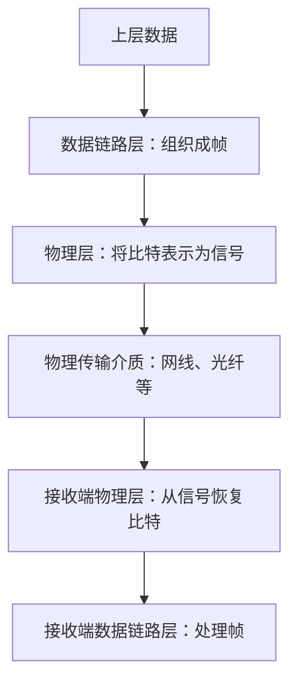
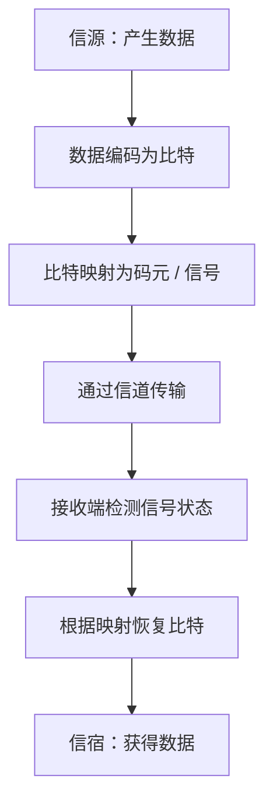

# 计算机网络物理层（一）：通信基础、信号、码元与速率

> 本节进入计算机网络第二章“物理层”，介绍通信基础中的常见概念：信源、信宿、信号、信道、数字信号、模拟信号、码元、波特率和比特率。重点理解**一个码元可以携带多少比特**，以及波特率与比特率之间的关系。

---

## 一、物理层的任务与学习背景

### 1. 为什么要学习物理层？

前面学习过计算机网络的分层结构：

- OSI 参考模型采用七层结构。
- TCP/IP 模型通常采用四层结构。
- 教学中经常将 OSI 的物理层、数据链路层与 TCP/IP 模型的上面三层结合起来，使用**五层模型**学习计算机网络原理。

TCP/IP 模型的网络接口层对底层功能的划分较为概括，而 OSI 参考模型分别介绍物理层和数据链路层，因此教学中通常使用五层模型，便于逐层理解网络功能。

### 2. 物理层的主要任务

物理层的主要任务是：

> **实现相邻节点之间比特（0 和 1）的传输。**

上层数据经过应用层、传输层、网络层和数据链路层的逐层处理后，数据链路层通常会以**帧**为单位，将比特序列交给物理层。

物理层需要把这些比特表示为适合在物理传输介质上传输的信号，例如电信号或光信号。接收端再从收到的信号中恢复比特。



为了理解物理层如何把比特转换为信号，以及接收方如何从信号中恢复比特，需要先掌握一些通信基础知识。

---

## 二、通信系统中的基本概念

本节涉及的通信基础概念包括：

- 信源
- 信宿
- 信号
- 信道
- 码元
- 码元速率（波特率）
- 比特率
- 带宽

其中，本节重点掌握信源、信宿、信号、信道、码元、波特率和比特率。带宽在前面的性能指标部分已经介绍过，本节暂不展开。

### 1. 信源（Source）

**信源**是信号的来源，也就是数据的发送方。

例如，节点 A 要向节点 B 发送一串二进制数据，那么节点 A 就是信源。

### 2. 信宿（Destination）

**信宿**是信号的归宿，也就是数据的接收方。

在上面的例子中，节点 B 是信宿。

> 注意：字幕中容易把“信宿”识别成“信速”。规范术语是“信宿”。

### 3. 信号（Signal）

**信号是数据的载体。** 计算机内部的数据通常以二进制比特表示，但比特需要借助可以在物理介质上传播的信号传输。

数据可以表示文本、声音、图像等内容。在计算机中，这些内容最终都可以编码为二进制数据，再转换为适合传输的信号。

例如：

- 在铜线中，可以使用电信号传输数据。
- 在光纤中，可以使用光信号传输数据。
- 在无线通信中，可以使用电磁波信号传输数据。

### 4. 信道（Channel）

**信道是信号传输的通道。**

例如，电脑与家用路由器之间通过网线连接，网线为两端的数据通信提供物理传输路径。

通常，一条物理通信线路可以在逻辑上对应发送方向和接收方向的信道。例如，同一根网线既可以用于电脑向路由器发送数据，也可以用于电脑接收路由器发来的数据。


### 5. 信源、信宿、信号与信道的关系

| 概念 | 含义                   | 在 A 向 B 发送数据的例子中             |
| ---- | ---------------------- | -------------------------------------- |
| 信源 | 信号的来源、数据发送方 | 节点 A                                 |
| 信宿 | 信号的归宿、数据接收方 | 节点 B                                 |
| 信号 | 承载数据的物理表现形式 | 电信号、光信号或无线信号               |
| 信道 | 信号传输的通道         | 网线、光纤、无线链路等所提供的传输通道 |

整体过程可以概括为：

1. 信源产生要发送的数据。
2. 发送端将数据转换为适当的信号。
3. 信号通过信道传播。
4. 接收端接收到信号，并据此恢复数据。
5. 信宿获得接收的数据。

### 6. 数字信道与模拟信道

从所传输的信号类型来理解，可以把信道称为：

- **数字信道：** 用于传输数字信号的信道。
- **模拟信道：** 用于传输模拟信号的信道。

这里的命名是从传输信号的类型来区分的。实际通信系统可能涉及数字数据、模拟波形以及调制解调等多个环节，不能简单认为“数字数据”在物理介质中一定以离散电压的形式直接传输。

---

## 三、数字信号与模拟信号

信号可以进一步分为数字信号和模拟信号。它们的核心区别在于：**信号取值是离散的，还是连续的。**

### 1. 数字信号（Digital Signal）

数字信号的取值是离散的。

例如，可以约定信号值只取以下两种状态：

- \(y=-1\)：表示二进制 `0`。
- \(y=1\)：表示二进制 `1`。

在这种设计中，信号只能取 \(-1\) 或 \(1\)，因此信号值是离散的，属于数字信号。

```text
数字信号示意（仅有两种允许状态）

信号值 y
 +1 ────────      ────────          表示 1
             │    │
 -1          ──────      ─────────   表示 0

时间 t  ──────────────────────────→
```

实际数字通信系统中，信号状态可以由电压、电流、光强、相位等物理量表示。上面的 \(-1\) 和 \(1\) 只是便于理解的抽象信号值。

### 2. 模拟信号（Analog Signal）

模拟信号的取值是连续的。

例如，一个电压信号可能在 \(-1\) 到 \(1\) 之间取多个连续值：

\[
-1\leq y\leq 1
\]

如果信号能够在这个范围内连续变化，那么它就属于模拟信号。

```text
模拟信号示意

信号值 y
 +1        /‾‾\       /‾‾\
           /    \     /    \
  0 ──────/──────\───/──────\────→ 时间 t
         /        \ /        \
 -1     /          V

信号值可以在范围内连续变化
```

### 3. 数字信号与模拟信号的对比

| 对比项             | 数字信号                                       | 模拟信号                                 |
| ------------------ | ---------------------------------------------- | ---------------------------------------- |
| 信号取值           | 离散                                           | 连续                                     |
| 简化示例           | 只允许取 \(-1\) 或 \(1\)                       | 可以在 \(-1\) 到 \(1\) 之间连续变化      |
| 用于表示数据的方式 | 不同离散状态映射为符号或比特组合               | 用连续变化的波形承载或表示信息           |
| 需要注意           | 数字信号也可以通过实际的电压、光强等物理量实现 | 连续波形并不意味着它不能用于传输数字数据 |

### 4. 通过电压函数理解信号

视频用一个形象化的例子帮助理解：假设皮卡丘作为信源，可以释放一定范围内的电压；你的右手作为信宿；皮卡丘和右手之间用导线连接，导线充当信道。

- 信源：皮卡丘（发送方）。
- 信宿：你的右手（接收方）。
- 信道：导线。
- 信号的物理量：电压。

这只是用于解释信源、信宿、信道和信号的比喻。

#### 用数字信号传送比特

假设要发送 `11010001` 这 8 个比特，并约定：

- \(+1\text{ V}\) 表示 `1`；
- \(-1\text{ V}\) 表示 `0`。

每个比特占用一个信号时间间隔。发送方根据比特值输出相应的电压，接收方在每个时间间隔内检测电压，并按照相同规则恢复比特。

| 时间间隔    | 比特 |        约定电压 |
| ----------- | ---: | --------------: |
| 第 1 个间隔 |    1 | \(+1\text{ V}\) |
| 第 2 个间隔 |    1 | \(+1\text{ V}\) |
| 第 3 个间隔 |    0 | \(-1\text{ V}\) |
| 第 4 个间隔 |    1 | \(+1\text{ V}\) |
| 第 5 个间隔 |    0 | \(-1\text{ V}\) |
| 第 6 个间隔 |    0 | \(-1\text{ V}\) |
| 第 7 个间隔 |    0 | \(-1\text{ V}\) |
| 第 8 个间隔 |    1 | \(+1\text{ V}\) |

接收方依据时间与信号值的对应规则，就可以恢复出原始比特串 `11010001`。

> 电压可以是负值。电压本质上是两点之间的电势差，符号取决于参考方向和测量极性，因此出现负电压并不矛盾。

#### 用模拟波形传送数字数据

也可以使用模拟波形来代表数字数据。视频用正弦函数作示意：

\[
y=\sin(2\pi \tau)
\]

和

\[
y=\sin(2\pi \tau+\pi)
\]

其中 \(\tau\) 可以理解为每个信号间隔内的局部时间。

可以约定：

- 第一种波形代表二进制 `1`；
- 第二种波形代表二进制 `0`。

接收方观察每个信号间隔中的波形特征，按照约定判断该间隔代表的比特值。

这里虽然使用连续变化的正弦波作为信号，但是发送的数据仍然可以是二进制数据。这也说明：**数字数据和模拟信号不是同一个概念**。数字数据可以利用经过设计的模拟波形来传输。

---

## 四、码元（Symbol）

### 1. 什么是码元？

在数字通信中，可以把一个特定的信号状态或一个信号间隔中的信号表示，视为一个**码元（Symbol）**。

不同教材可能从“信号状态”“信号波形”或“信号间隔”等角度描述码元。对本节计算题而言，重点是理解：在一个码元时间内，发送方可以选择若干种允许的信号状态，每一种状态代表一个符号。

视频中也将一个信号周期的长度作为直观示意，用来帮助理解码元持续的时间。

### 2. 一个码元可以携带多少比特？

关键取决于一个码元有多少种可能的状态。

#### 二进制码元：两种状态

如果一个码元只有两种可能状态，就可以分别代表：

- `0`
- `1`

由于：

\[
2^1=2
\]

因此一个码元可以携带 1 bit 信息。

例如，约定：

| 信号状态        | 对应比特 |
| --------------- | -------- |
| \(-1\text{ V}\) | `0`      |
| \(+1\text{ V}\) | `1`      |

传送 8 bit 数据，需要 8 个码元时间（假设每个码元时间相同）。

#### 四进制码元：四种状态

如果一个码元可以有四种不同状态，就可以分别映射到两个比特的四种组合：

| 信号状态示例    | 对应的二进制组合 |
| --------------- | ---------------- |
| \(+2\text{ V}\) | `00`             |
| \(+1\text{ V}\) | `01`             |
| \(-1\text{ V}\) | `10`             |
| \(-2\text{ V}\) | `11`             |

因为：

\[
2^2=4
\]

所以一个四进制码元可表示 2 bit 信息。

例如，要发送 `11010001` 这 8 bit 数据，可以先按每 2 bit 分组：

```text
原始比特串：11010001
分组结果：  11 | 01 | 00 | 01
对应码元：  -2V| +1V| +2V| +1V
```

这样只需要发送 4 个码元，而不是 8 个二进制码元（在每个码元时间相同的假设下）。

#### 八进制码元：八种状态

如果一个码元有八种可能状态：

\[
2^3=8
\]

则一个码元可以携带 3 bit 信息。

#### 十六进制码元：十六种状态

如果一个码元有 16 种可能状态：

\[
2^4=16
\]

则一个码元可以携带 4 bit 信息。

### 3. 码元状态数与比特数的公式

如果一个码元有 \(K\) 种可能的信号状态，并且这些状态用来等长地编码二进制信息，那么每个码元可表示的比特数为：

\[
\boxed{n=\log_2 K}
\]

其中：

- \(K\)：一个码元可能出现的状态数；
- \(n\)：一个码元可携带的比特数。

常见情况：

| 码元状态数 \(K\) | 进制称呼（常见说法） | 每个码元的比特数 \(\log_2 K\) |
| ---------------: | -------------------- | ----------------------------: |
|                2 | 二进制码元           |                         1 bit |
|                4 | 四进制码元           |                         2 bit |
|                8 | 八进制码元           |                         3 bit |
|               16 | 十六进制码元         |                         4 bit |
|               32 | 三十二种状态         |                         5 bit |

**记忆重点：** 状态数越多，一个码元可以表达的信息通常越多。在固定码元速率下，每个码元携带的比特越多，理论上对应的比特率就越高。

### 4. 增加每个码元的状态数有什么代价？

让一个码元携带多个比特，可以在相同的码元数量下传输更多信息。例如：

- 二进制码元：每个码元表示 1 bit；
- 四进制码元：每个码元表示 2 bit。

因此，同样传输 8 bit 数据时，四进制码元只需要 4 个码元，而二进制码元需要 8 个码元（假设码元持续时间相同）。

但更高阶的信号通常需要更精细地区分多个信号状态。若这些状态用不同幅度来表示，那么电压幅度范围可能扩大，或者不同状态间隔变小，对信号质量、噪声水平和接收端检测能力的要求可能更高。视频以“需要使用更强的电压信号”为直观例子，说明增加状态数也会增加设计要求。

例如，四进制幅度示例使用 \(+2\text{ V}\)、\(+1\text{ V}\)、\(-1\text{ V}\)、\(-2\text{ V}\) 四种状态，而二进制示例只使用 \(+1\text{ V}\) 与 \(-1\text{ V}\) 两种状态。

### 5. 数字信号与模拟信号都可以用码元表示数据

码元强调的是**每个符号间隔所代表的信息**，并不只用于某一种波形形式。

- 采用离散电平表示不同符号时，可以形成数字信号的示例。
- 采用不同波形、相位、频率或幅度等信号特征表示符号时，也可以通过连续的物理波形传输数字数据。

因此，不要把“数字信号”“模拟信号”“数字数据”与“码元”当成同一个概念。

---

## 五、码元速率、波特率与比特率

### 1. 什么是码元速率？

**码元速率**表示每秒钟传输多少个码元。

码元速率的单位是：

- **波特（Baud）**
- 简称“波特率”

例如，如果节点 A 每秒向节点 B 传输 \(M\) 个码元，那么码元速率就是 \(M\) Baud。

\[
\boxed{R_s=M\text{ Baud}}
\]

其中 \(R_s\) 表示码元速率。

### 2. 什么是比特率？

**比特率**表示每秒钟传输多少个比特，常用单位为 bit/s 或 bps。

如果每秒传输 \(R_b\) 个比特，那么比特率为：

\[
\boxed{R_b=R_b\text{ bit/s}}
\]

在计算机网络中，速率题经常使用 bps、kbps、Mbps 或 Gbps 表示比特率。

### 3. 波特率与比特率的关系

波特率描述的是每秒传输多少个码元，比特率描述的是每秒传输多少个比特。二者之间的关系取决于**每个码元携带多少比特**。

如果每个码元携带 \(n\) bit，码元速率为 \(R_s\) Baud，那么：

\[
\boxed{R_b=R_s\times n}
\]

当一个码元具有 \(K\) 种等长编码状态，且每个码元可表示 \(\log_2 K\) bit 时：

\[
\boxed{R_b=R_s\log_2 K}
\]

其中：

- \(R_b\)：比特率，单位 bit/s；
- \(R_s\)：码元速率，单位 Baud（码元/秒）；
- \(K\)：一个码元可能使用的状态数；
- \(\log_2 K\)：每个码元携带的比特数。

### 4. 常见计算例子

#### 例 1：二进制码元

每个码元有 2 种状态，因此每个码元携带：

\[
\log_2 2=1\text{ bit}
\]

如果码元速率为 1000 Baud：

\[
R_b=1000\times1=1000\text{ bit/s}
\]

因此，比特率为 **1000 bit/s**。

#### 例 2：四进制码元

每个码元有 4 种状态，因此每个码元携带：

\[
\log_2 4=2\text{ bit}
\]

如果码元速率为 1000 Baud：

\[
R_b=1000\times2=2000\text{ bit/s}
\]

因此，比特率为 **2000 bit/s**。

#### 例 3：八进制码元

每个码元有 8 种状态，因此每个码元携带：

\[
\log_2 8=3\text{ bit}
\]

如果码元速率为 1000 Baud：

\[
R_b=1000\times3=3000\text{ bit/s}
\]

因此，比特率为 **3000 bit/s**。

### 5. 波特率与比特率的对照

| 对比项           | 波特率（码元速率） | 比特率                               |
| ---------------- | ------------------ | ------------------------------------ |
| 衡量对象         | 每秒传输的码元个数 | 每秒传输的比特个数                   |
| 单位             | Baud（码元/秒）    | bit/s、bps                           |
| 是否直接等于对方 | 不一定             | 不一定                               |
| 关系             | \(R_s\)            | \(R_b=R_s\times n\)                  |
| 关键影响因素     | 每秒发送多少个码元 | 每秒码元数，以及每个码元表示多少比特 |

**易错点：** 波特率不一定等于比特率。只有每个码元携带 1 bit 时，二者在数值上才相同。

---

## 六、通信基础的整体流程

将本节概念串起来，完整的通信过程可以理解为：

1. 信源产生要发送的数据。
2. 数据被编码为比特序列。
3. 发送端按照通信规则，将比特映射成码元或信号。
4. 信号通过信道传播。
5. 接收端检测信号，判断对应的码元状态。
6. 根据码元与比特的映射关系，恢复出比特序列。
7. 最终将恢复的数据交付给信宿。



### 关键关系示意


---

## 七、公式速查表

| 知识点                   | 公式                              | 说明                                        |
| ------------------------ | --------------------------------- | ------------------------------------------- |
| 每个码元携带的比特数     | \(\displaystyle n=\log_2 K\)      | 一个码元有 \(K\) 种等长编码状态时           |
| 比特率与码元速率         | \(\displaystyle R_b=R_s\times n\) | 每个码元携带 \(n\) bit                      |
| 直接根据状态数计算比特率 | \(\displaystyle R_b=R_s\log_2 K\) | 适用于每个码元用 \(K\) 种状态等长编码的情况 |
| 波特率的单位             | Baud                              | 每秒传输的码元数                            |
| 比特率的单位             | bit/s 或 bps                      | 每秒传输的比特数                            |

---

## 八、本节复习要点

1. **物理层的主要任务：** 实现相邻节点之间比特（0、1）的传输。
2. **信源：** 信号的来源，即数据发送方。
3. **信宿：** 信号的归宿，即数据接收方。
4. **信号：** 数据的载体，可以是电信号、光信号或无线信号等。
5. **信道：** 信号传输的通道；一条物理线路在逻辑上可能对应发送和接收两个方向的信道。
6. **数字信号与模拟信号：** 核心区别是信号取值离散还是连续。
7. **码元：** 用于表示信息的一个符号；每个码元可代表一个或多个比特。
8. **每个码元的比特数：** 当一个码元有 \(K\) 种等长编码状态时，通常为 \(\log_2 K\) bit。
9. **波特率：** 每秒传输多少个码元，单位 Baud。
10. **比特率：** 每秒传输多少个比特，单位 bit/s 或 bps。
11. **波特率与比特率的关系：** \(R_b=R_s\times n\)，其中 \(n\) 为每个码元携带的比特数。
12. **多进制编码的影响：** 一个码元能够携带更多比特，但通常也对信号状态区分、抗噪声能力和接收检测提出更高要求。

---

## 九、本节总结

本节从物理层的任务出发，介绍了通信系统中的基本概念：

- **信源**是数据发送方，**信宿**是数据接收方。
- **信号**是数据的载体，**信道**是信号传输的通道。
- **数字信号**的取值是离散的，**模拟信号**的取值是连续的。数字数据既可以用离散信号表示，也可以通过设计好的连续波形来传输。
- **码元**是用于表示信息的符号。一个码元能携带多少比特，取决于它可使用多少种不同状态。
- 当一个码元有 \(K\) 种等长编码状态时，每个码元可以携带 \(\log_2 K\) bit。
- **波特率**表示每秒传输的码元数；**比特率**表示每秒传输的比特数。

最重要的关系式是：

\[
\boxed{R_b=R_s\log_2 K}
\]

也可以写成：

\[
\boxed{\text{比特率}=\text{波特率}\times\text{每个码元携带的比特数}}
\]

复习时要特别区分码元速率和比特率。它们并不总是相等；二者的关系取决于一个码元到底表示多少比特。
