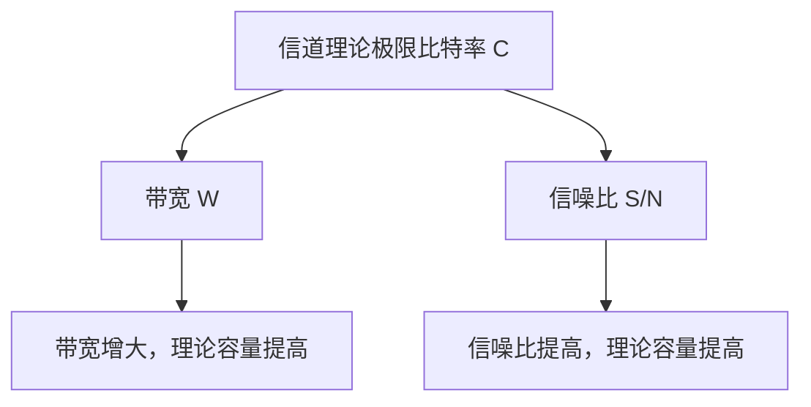
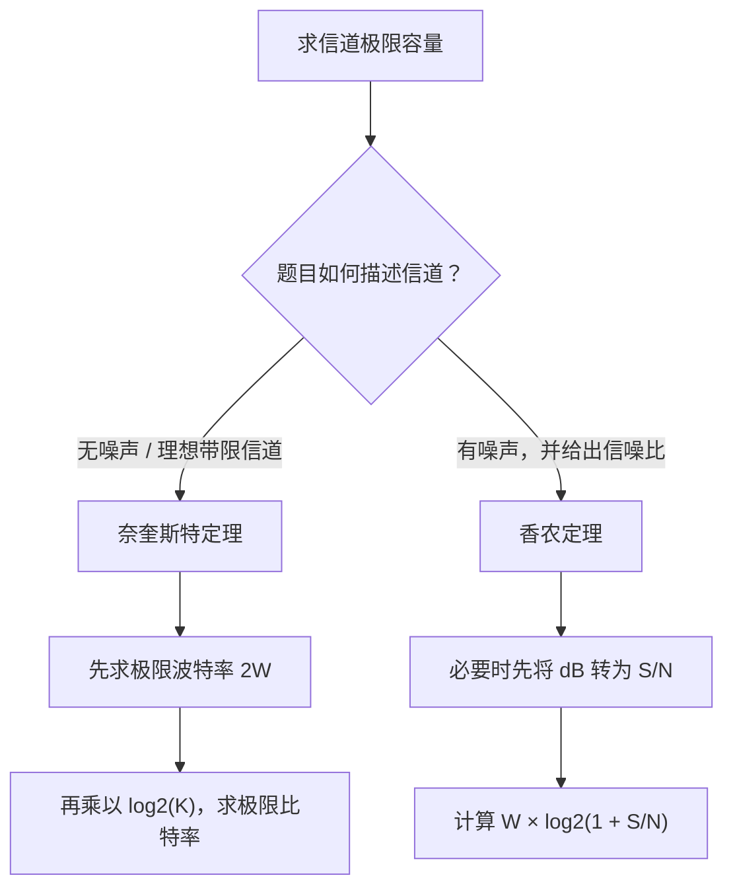
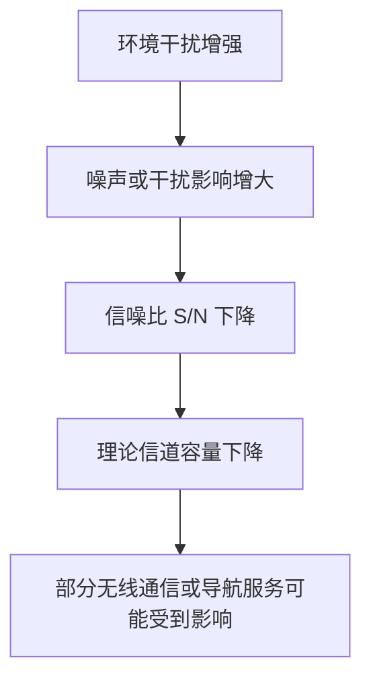

# 计算机网络物理层（二）：信道极限容量、奈奎斯特定理与香农定理

> 本节讨论信道能够达到的最高数据传输速率，即信道的极限容量。主要内容包括带宽、噪声、信噪比、奈奎斯特定理（奈氏准则）和香农定理。
>
> **考研重点：** 无噪声理想带限信道通常使用奈奎斯特定理分析极限码元速率；有噪声信道的理论极限比特率使用香农定理。计算时尤其要注意带宽单位、码元状态数，以及信噪比采用的是无单位比值还是分贝表示。

---

## 一、回顾带宽：影响信道传输能力的因素

### 1. 带宽的两种含义

“带宽”在不同课程中有不同的含义。

| 使用场景   | 带宽的含义                 | 常见单位         |
| ---------- | -------------------------- | ---------------- |
| 计算机网络 | 信道所能传送的最高数据率   | bit/s、bps、Mbps |
| 通信原理   | 信道允许通过的信号频带范围 | Hz、kHz、MHz     |

视频举例说明：

- 光纤信道的频带范围可以用较大的带宽值描述，例如 500 MHz。
- 传统电话语音信道可以用约 3 kHz 的带宽作示例。

这两种带宽的定义侧重点不同，但都与信道的数据传输能力有关。本节奈奎斯特定理和香农定理中的 \(W\)，指的是**以赫兹为单位的信号频带带宽**，不是以 bit/s 为单位的数据率。

### 2. 噪声也会影响信道传输能力

**噪声（Noise）**是指对有效信号产生干扰的因素或信号。计算机网络中的电信号、电磁波等，可能受到周围电场、磁场及其他环境因素影响，导致接收端难以准确识别发送方原本发出的信号。

通常来说：

- 带宽会影响信道可以承载信号的频带范围。
- 噪声会影响接收端区分不同信号状态的能力。
- 在其他条件相近时，噪声越强，可靠传输信息通常越困难。

### 3. 用交谈声理解噪声

视频用室友交谈的例子帮助理解：

- 你和室友谈论游戏，你说话的声音相当于有效信号。
- 另一个室友在旁边大声背单词，声音干扰你们交谈，相当于噪声。
- 如果背景噪声更大，就更难听清对方所说的话。
- 如果有效信号更清晰，或背景噪声更小，接收信息就更容易。

这是帮助理解的类比。需要区分的是：声波是机械波，电磁波是电磁场的传播；二者都可以携带信息，但物理本质并不相同。

人耳通常可以听到约 20 Hz 到 20 kHz 范围内的声音。低于约 20 Hz 的声波称为次声波，高于约 20 kHz 的声波称为超声波。按照视频中的简化类比，可以把人耳可感知的频率范围看作一个有限的“听觉频带”：

\[
20\,000-20=19\,980\text{ Hz}
\]

这个类比用于理解频带宽度，并不意味着人耳是一条实际的电信号通信信道。

---

## 二、信噪比（SNR）

### 1. 信噪比的定义

**信噪比（Signal-to-Noise Ratio，SNR）**是信号功率与噪声功率之比：

\[
\boxed{\mathrm{SNR}=\frac{S}{N}}
\]

其中：

- \(S\)：信号功率；
- \(N\)：噪声功率。

如果 \(S\) 和 \(N\) 使用相同的功率单位，例如瓦特（W），相除后单位会抵消。因此，无单位形式的信噪比是一个数值比值。

### 2. 信噪比越大意味着什么？

在其他条件相近时：

- 信号功率越大，信噪比通常越高；
- 噪声功率越小，信噪比通常越高；
- 信噪比越高，噪声对信号识别的相对影响通常越小。

例如，假设有效信号功率为 100 W，噪声功率为 5 W：

\[
\mathrm{SNR}=\frac{100}{5}=20
\]

这意味着信号功率是噪声功率的 20 倍。

### 3. 信噪比的两种表示方式

信噪比常见的表示方式有两种：

1. **无单位比值：** 直接写作 \(S/N\)，例如 20、1000。
2. **分贝表示：** 单位为 dB，便于表示较大的比值。

信噪比的分贝表示公式为：

\[
\boxed{\mathrm{SNR}_{\mathrm{dB}}=10\log_{10}\left(\frac{S}{N}\right)}
\]

反过来，从分贝换算为无单位比值：

\[
\boxed{\frac{S}{N}=10^{\mathrm{SNR}\_{\mathrm{dB}}/10}}
\]

例如，当信噪比为 30 dB 时：

\[
\frac{S}{N}=10^{30/10}=10^3=1000
\]

也就是说，30 dB 对应的无单位信噪比是 1000。

### 4. 两种表示方式对照

| 无单位信噪比 \(S/N\) | 分贝表示 |
| -------------------: | -------: |
|                    1 |     0 dB |
|                   10 |    10 dB |
|                  100 |    20 dB |
|                 1000 |    30 dB |
|          \(10^{19}\) |   190 dB |

**重要提醒：** 香农定理公式中的 \(S/N\) 应当使用**无单位的功率比值**。如果题目给出的是 dB，必须先换算，不能把 30 直接代入公式当成信噪比。

---

## 三、奈奎斯特定理（奈氏准则）

### 1. 适用条件

奈奎斯特定理讨论的是**无噪声的理想带限信道**。在这一模型下，可以计算信道能够支持的最高码元速率，以及根据码元状态数计算极限比特率。

看到题目中的“无噪声信道”或“理想低通信道”等表述时，通常需要考虑奈奎斯特定理。严格来说，定理的适用条件是理想带限、无噪声的模型；考试中应按题目给出的假设判断。

### 2. 极限波特率

如果信道的频带带宽为 \(W\) Hz，那么无噪声理想带限信道的最高码元速率为：

\[
\boxed{R_s^{\max}=2W\ \text{Baud}}
\]

其中：

- \(W\)：信道带宽，单位 Hz；
- \(R_s^{\max}\)：极限码元速率，也就是极限波特率；
- Baud：每秒传输的码元个数。

也就是说，在这个模型下，每秒最多传输 \(2W\) 个码元。

### 3. 从极限波特率求极限比特率

波特率表示每秒传输多少个码元；比特率表示每秒传输多少个比特。

如果一个码元有 \(K\) 种可能状态，并且这些状态用于等长编码，那么每个码元可以携带：

\[
n=\log_2K\ \text{bit}
\]

因此，无噪声信道的极限比特率为：

\[
\boxed{R_b^{\max}=2W\log_2K\ \text{bit/s}}
\]

其中：

- \(W\)：信道带宽（Hz）；
- \(K\)：一个码元可以取的不同状态数；
- \(\log_2K\)：每个码元可携带的比特数。

### 4. 奈奎斯特定理的记忆方式

\[
\boxed{\text{极限波特率}=2W}
\]

\[
\boxed{\text{极限比特率}=2W\log_2K}
\]

第一条公式计算每秒最多能传输多少个码元；第二条公式还考虑每个码元能表示多少比特。

### 5. 奈奎斯特定理例题：无噪声信道

视频中的例题为 2022 年考研第 34 题，题目条件概括如下：

- 信道带宽为 200 kHz；
- 信道无噪声；
- 采用四个幅值的 ASK 调制；
- 求信道的最大数据传输速率。

本题不需要深入了解 ASK 调制的实现细节。按照题目给出的“四个幅值”，可将其理解为一个码元有 4 种可能状态，即 \(K=4\)。

**第一步：计算极限波特率。**

\[
W=200\text{ kHz}=200\times10^3\text{ Hz}
\]

根据奈奎斯特定理：

\[
R_s^{\max}=2W=2\times200\times10^3
=400\times10^3\text{ Baud}
\]

因此，极限波特率是 **400 kBaud**。

**第二步：计算每个码元携带的比特数。**

\[
n=\log_2 4=2\text{ bit/码元}
\]

因此，一个码元可以携带 2 bit 数据。

**第三步：计算极限比特率。**

\[
\begin{aligned}
R_b^{\max}
&=R_s^{\max}\times n\\
&=400\times10^3\times2\\
&=800\times10^3\text{ bit/s}
\end{aligned}
\]

所以，信道的最大数据传输速率为：

\[
\boxed{800\text{ kbit/s}=800\text{ kbps}}
\]

#### 解题步骤总结

1. 先确认题目给出的是无噪声信道。
2. 把带宽 \(W\) 统一换算为 Hz。
3. 用 \(2W\) 求极限波特率。
4. 根据码元状态数 \(K\)，求每个码元的比特数 \(\log_2K\)。
5. 将极限波特率乘以每个码元携带的比特数，得到极限比特率。

---

## 四、香农定理（Shannon Theorem）

### 1. 适用条件与公式

现实信道通常存在噪声。香农定理用于计算**有噪声且带宽有限的信道的理论极限比特率**。

香农定理公式为：

\[
\boxed{C=W\log_2\left(1+\frac{S}{N}\right)\ \text{bit/s}}
\]

其中：

- \(C\)：信道的理论极限比特率，也称信道容量，单位 bit/s；
- \(W\)：信道带宽，单位 Hz；
- \(S/N\)：无单位的信噪比，即信号功率与噪声功率之比。

**关键点：** 香农定理计算的是极限比特率，不是极限波特率。

### 2. 如何理解香农定理？

从公式可以看出，信道理论极限比特率与带宽、信噪比有关：

- 带宽 \(W\) 越大，在信噪比相同的情况下，理论极限比特率越高。
- 信噪比 \(S/N\) 越大，在带宽相同的情况下，理论极限比特率越高。
- 提高信号功率或降低噪声功率，都可能提高信噪比。

香农定理给出的是理论上限，并不意味着实际系统一定能达到这个数值。

### 3. 使用香农定理时的单位要求

如果题目给出：

- 带宽以 Hz、kHz 或 MHz 表示，应先统一单位；
- 信噪比以普通数值表示，例如 1000，可以直接使用；
- 信噪比以分贝表示，例如 30 dB，需要先换算为无单位比值。

分贝转换公式：

\[
\frac{S}{N}=10^{\mathrm{SNR}\_{\mathrm{dB}}/10}
\]

香农定理使用的是：

\[
C=W\log_2(1+S/N)
\]

不能直接把 dB 数值放在 \(S/N\) 的位置。

### 4. 香农定理例题：信噪比为 30 dB

视频中引用 2016 年考研第 34 题，条件概括如下：

- 某链路的带宽为 8 kHz；
- 信噪比为 30 dB；
- 实际数据传输速率约为理论最大传输速率的 50%；
- 求实际数据传输速率。

**第一步：把信噪比从 dB 转换为无单位比值。**

\[
\mathrm{SNR}\_{\mathrm{dB}}=30\text{ dB}
\]

根据换算公式：

\[
\frac{S}{N}=10^{30/10}=1000
\]

因此，代入香农定理的信噪比应为 **1000**。

**第二步：利用香农定理计算理论最大速率。**

\[
W=8\text{ kHz}=8000\text{ Hz}
\]

\[
\begin{aligned}
C&=8000\log_2(1+1000)\\
&=8000\log_2(1001)\\
&\approx8000\times9.967\\
&\approx79\,736\text{ bit/s}
\end{aligned}
\]

因此理论最大速率约为：

\[
C\approx80\text{ kbit/s}
\]

**第三步：计算实际速率。**

题目说实际数据传输速率约为理论最大值的 50%：

\[
R\_{\text{实际}}=80\text{ kbps}\times50\%
\]

\[
\boxed{R\_{\text{实际}}\approx40\text{ kbps}}
\]

所以，按照视频给出的题目条件，实际数据传输速率约为 **40 kbit/s**。

#### 解题步骤总结

1. 先判断信道存在噪声，使用香农定理。
2. 将带宽统一换算为 Hz。
3. 如果信噪比以 dB 给出，先换算为无单位的 \(S/N\)。
4. 代入 \(C=W\log_2(1+S/N)\)，求理论极限比特率。
5. 如果题目另外给出实际速率与理论上限的比例，再计算实际速率。

---

## 五、奈奎斯特定理与香农定理对比

| 对比项         | 奈奎斯特定理（奈氏准则）                   | 香农定理                         |
| -------------- | ------------------------------------------ | -------------------------------- |
| 信道条件       | 无噪声的理想带限信道                       | 有噪声且带宽有限的信道           |
| 关注的极限     | 先给出极限波特率；结合状态数可求极限比特率 | 直接给出理论极限比特率           |
| 核心公式       | \(R_s^{\max}=2W\)                          | \(C=W\log_2(1+S/N)\)             |
| 极限比特率公式 | \(R_b^{\max}=2W\log_2K\)                   | \(C=W\log_2(1+S/N)\)             |
| 需要的参数     | 带宽 \(W\)、码元状态数 \(K\)               | 带宽 \(W\)、无单位信噪比 \(S/N\) |
| 常见关键词     | 无噪声、理想低通信道、码元、波特率         | 噪声、信噪比、分贝、极限比特率   |
| 主要注意事项   | 不要忘记乘以每个码元携带的比特数           | 先将 dB 换算为无单位信噪比       |

### 1. 两个定理各自回答什么问题？

- **奈奎斯特定理：** 在无噪声的理想带限信道中，码元速率的极限是多少？如果知道一个码元的状态数，还可以求极限比特率。
- **香农定理：** 在有噪声、带宽有限的信道中，理论极限比特率是多少？

### 2. 码元携带的比特数也有上限

奈奎斯特定理从码元速率的角度描述无噪声信道的极限；香农定理则在考虑噪声时，给出理论极限比特率。

对于带宽与信噪比都确定的信道，可靠传输所能支持的比特率有理论上限。因此，不可能无限增加每个码元携带的比特数，同时还维持可靠传输。提高码元状态数会增加接收端区分状态的难度，也受到噪声与实际调制编码方式的限制。

### 3. 对带宽与噪声的整体理解

- 带宽增大，通常可以提高信道的理论传输能力。
- 信噪比提高，香农定理给出的理论极限比特率也提高。
- 在有噪声的信道中，噪声功率上升而信号功率不变，会导致信噪比降低，理论容量随之降低。
- 奈奎斯特定理和香农定理的适用条件不同，不能不加判断地混用。

---

## 六、太阳风暴与通信：现实中的噪声影响

视频最后用太阳风暴作为拓展例子，帮助理解自然环境如何影响通信。

太阳活动剧烈时，可能扰动地球附近的空间环境和电离层条件，进而影响某些无线电通信及卫星导航系统。通信系统中的干扰或噪声条件发生变化时，接收信号的质量可能下降。

从信噪比的角度理解：

1. 有效信号功率保持不变；
2. 如果干扰或噪声功率上升；
3. 那么 \(S/N\) 会降低；
4. 按香农定理，带宽相同的信道所对应的理论极限比特率也会降低。

太阳活动还可能与极光等自然现象相关。极光体现了太阳活动与地球空间环境之间的联系；但不同太阳事件对具体通信、导航系统的影响程度并不相同，取决于事件强度、频段、系统设计和当时环境条件。

> 补充说明：视频把卫星通信称为“短波通信”并不准确。卫星通信通常使用微波等频段；太阳活动可能通过影响电离层、卫星链路或导航信号传播条件，对不同系统造成不同程度的影响。本例主要用于理解噪声、信噪比与信道能力之间的关系。

---

## 七、公式速查表

| 名称                 | 公式                                                          | 适用条件 / 注意事项                              |
| -------------------- | ------------------------------------------------------------- | ------------------------------------------------ |
| 无噪声信道极限波特率 | \(\displaystyle R_s^{\max}=2W\)                               | 奈奎斯特定理；\(W\) 用 Hz 表示                   |
| 无噪声信道极限比特率 | \(\displaystyle R_b^{\max}=2W\log_2K\)                        | \(K\) 为码元可用状态数                           |
| 信噪比（无单位）     | \(\displaystyle S/N=\frac{S}{N}\)                             | 信号功率除以噪声功率                             |
| 信噪比分贝表示       | \(\displaystyle \mathrm{SNR}_{\mathrm{dB}}=10\log_{10}(S/N)\) | 功率比转换为 dB                                  |
| 分贝转无单位信噪比   | \(\displaystyle S/N=10^{\mathrm{SNR}\_{\mathrm{dB}}/10}\)     | 香农定理代入前使用                               |
| 香农信道容量         | \(\displaystyle C=W\log_2(1+S/N)\)                            | 有噪声且带宽有限的信道；\(S/N\) 必须为无单位比值 |

其中：

- \(W\)：信道带宽，单位 Hz；
- \(K\)：每个码元可能使用的信号状态数；
- \(R_s\)：码元速率，单位 Baud；
- \(R_b\)、\(C\)：比特率或理论极限容量，单位 bit/s；
- \(S\)：信号功率；
- \(N\)：噪声功率。

---

## 八、考研计算题检查清单

做题时可按照以下顺序检查：

1. **判断信道条件：** 是无噪声的理想信道，还是有噪声信道？
2. **选择定理：** 无噪声时通常考虑奈奎斯特定理；有噪声并给出信噪比时考虑香农定理。
3. **统一带宽单位：** 例如 \(200\text{ kHz}=200\,000\text{ Hz}\)。
4. **判断题目要求：** 求波特率，还是求比特率？
5. **如果是奈奎斯特题：** 已知码元状态数时，计算 \(\log_2K\)。
6. **如果是香农题：** 把 dB 转换为无单位信噪比 \(S/N\)。
7. **统一速率单位：** 最终结果通常写成 bit/s、kbit/s 或 Mbps。
8. **区分理论上限与实际速率：** 如果题目给了“实际值为理论最大值的某个百分比”，最后再按比例计算。

---

## 九、本节复习要点

1. 本节带宽 \(W\) 指频带范围，单位为 Hz。
2. 信道传输能力既受带宽影响，也受噪声影响。
3. 信噪比 \(S/N\) 等于信号功率除以噪声功率。
4. 信噪比可以用无单位数值表示，也可以用 dB 表示。
5. 信噪比分贝公式为 \(10\log*{10}(S/N)\)，反向转换为 \(10^{\mathrm{SNR}*{\mathrm{dB}}/10}\)。
6. 奈奎斯特定理适用于无噪声理想带限信道，极限波特率为 \(2W\)。
7. 如果一个码元有 \(K\) 种状态，每个码元可携带 \(\log_2K\) bit。
8. 无噪声信道的极限比特率为 \(2W\log_2K\)。
9. 香农定理给出有噪声信道的理论极限比特率：\(C=W\log_2(1+S/N)\)。
10. 香农定理中的 \(S/N\) 必须是无单位的信噪比，不能直接代入 dB。
11. 带宽提高或信噪比提高，通常会提高理论信道容量。
12. 对同一信道，理论极限比特率不是可以无限提高的。

---

## 十、本节总结

本节研究信道的极限容量。

- **带宽：** 在通信原理语境中，指信道允许通过的信号频带范围，单位为 Hz。
- **噪声：** 会干扰有效信号，影响接收端识别数据的能力。
- **信噪比：** 信号功率与噪声功率的比值。香农定理需要无单位的 \(S/N\)。
- **奈奎斯特定理：** 对无噪声理想带限信道，极限波特率为 \(2W\)，对应的极限比特率为 \(2W\log_2K\)。
- **香农定理：** 对有噪声且带宽有限的信道，理论极限比特率为 \(W\log_2(1+S/N)\)。

核心公式：

\[
\boxed{R_s^{\max}=2W}
\]

\[
\boxed{R_b^{\max}=2W\log_2K}
\]

\[
\boxed{C=W\log_2\left(1+\frac{S}{N}\right)}
\]

记住适用条件与单位是解题的关键：**无噪声理想带限信道用奈奎斯特定理；有噪声并已知信噪比时用香农定理；分贝信噪比先换算，再代入公式。**
