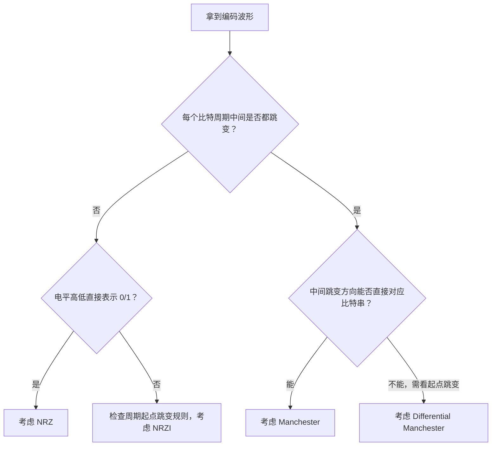

# 计算机网络物理层（三）：编码、解码与常用数字编码

> 本节介绍编码、解码、调制和解调的概念，并重点学习五种常见的数字编码方式：不归零编码（NRZ）、归零编码（RZ）、反向非归零编码（NRZI）、曼彻斯特编码和差分曼彻斯特编码。
>
> **重点：** 掌握五种编码的规则，理解它们的自同步能力、带宽开销和抗干扰能力，并能根据给定的二进制比特串判断波形，或根据波形还原比特串。

> **内容范围说明：** 原字幕开头提到还将介绍四种调制方式，但本段字幕实际展开的是编码方式和调制/解调的基础概念。这里仅整理已提供的内容，不额外补写字幕中未展开的四种调制方法。

---

## 一、编码、解码、调制与解调

### 1. 信源、信宿、信号与数据

信源通过信道向信宿发送信号。信号是数据的载体，而计算机内部的数据通常以二进制比特表示。

信号可以分为两大类：

- **数字信号：** 信号取值是离散的。
- **模拟信号：** 信号取值是连续的。

为了在通信系统中传送数据，需要在二进制数据和实际传输信号之间进行转换。

### 2. 编码与解码

**编码（Encoding）**是将二进制数据转换为数字信号的过程。

**解码（Decoding）**是将接收到的数字信号恢复为二进制数据的过程。

可以把通信系统中的发送端变换器理解为编码器，把接收端的反变换器理解为解码器。


#### 例子：有线网卡

电脑的有线网络适配器（有线网卡）具有编码和解码相关功能：

- 发送时，将计算机内部的二进制数据转换为适合在网线上传输的信号。
- 接收时，将网线上传来的信号恢复为二进制数据，再交给主机处理。

网卡还具有其他功能，本节暂不展开。

### 3. 调制与解调

**调制（Modulation）**和**解调（Demodulation）**通常用于描述二进制数据与模拟载波信号之间的转换。

- 调制：根据要发送的数据，改变载波的某些特征，使其能够携带信息。
- 解调：接收信号后，识别其中的信息并恢复相应数据。

视频用家用光猫（Modem）作为直观例子：调制解调设备在家庭网络接入过程中完成相应的信号转换功能。实际光猫的光纤收发与调制解调功能取决于具体设备和接入技术，并不都等同于传统铜线调制解调器。


### 4. 编码和调制有什么区别？

| 对比项 | 编码 / 解码 | 调制 / 解调 |
|---|---|---|
| 本节关注的转换 | 二进制数据与数字信号之间的转换 | 二进制数据与承载信息的模拟信号之间的转换 |
| 发送端 | 编码 | 调制 |
| 接收端 | 解码 | 解调 |
| 例子 | 数字基带编码 | 通过改变载波的幅度、频率或相位等特征传送信息 |

实际通信系统中，数字数据可以先经过编码，再经过调制等过程发送；具体系统如何组合这些步骤，要看其技术设计。

---

## 二、五种常见的数字编码

本节需要掌握以下五种编码方式：

1. 不归零编码（NRZ）
2. 归零编码（RZ）
3. 反向非归零编码（NRZI）
4. 曼彻斯特编码（Manchester）
5. 差分曼彻斯特编码（Differential Manchester）

为了方便比较，以下统一用每一个小时间格表示一个比特周期。波形图使用简化的文字示意；实际题目应以给出的波形和编码规则为准。

---

## 三、不归零编码（NRZ）

### 1. 英文缩写与规则

不归零编码的英文缩写是 **NRZ**，英文全称为 *Non-Return-to-Zero*。

视频中的记忆口诀是：

> **低零高一，中间不变。**

含义如下：

- 低电平表示二进制 `0`。
- 高电平表示二进制 `1`。
- 在一个比特周期中间，信号不需要特意回到零电平。

### 2. 示例

假设要传输比特串：

```text
1 1 1 0 0 1 0 1
```

按“低零高一”的规则：

- `1` 对应高电平；
- `0` 对应低电平。

简化示意：

```text
比特：  1   1   1   0   0   1   0   1
电平： ────────────      ────────
                       （低电平段）
```

上图仅为概念示意，做题时应逐个比特周期对照高、低电平。

### 3. 特点

NRZ 的编码规则简单，信号电平直接对应比特值。但它本身没有在每个比特周期中强制产生跳变，因此当连续多个比特相同时，接收方可能难以仅凭信号本身判断比特边界或保持准确的时钟同步。

如果通信系统采用 NRZ，发送方和接收方通常需要通过额外的时钟信息、同步机制或其他设计保证比特定时。

---

## 四、归零编码（RZ）

### 1. 英文缩写与规则

归零编码的英文缩写是 **RZ**，英文全称为 *Return-to-Zero*。

视频中的记忆口诀是：

> **低零高一，中间归零。**

含义如下：

- 低电平表示 `0`。
- 高电平表示 `1`。
- 一个比特周期内，信号会在中间时刻回到零电平。

### 2. 归零有什么作用？

归零编码在每个比特周期中间都返回零电平。这样的变化可以为接收端提供节奏信息，帮助发送方和接收方保持同步。

可以将它理解成一种节拍：每个比特周期中间出现归零动作，让接收方更容易识别周期边界。

视频用朗读的例子解释：

- 如果只连续念出“高高低高低……”，接收方可能很难分清各个信号的边界。
- 如果每个信号中间都插入明显的归零节奏，接收方就更容易判断一个周期在哪里结束、下一个周期何时开始。

### 3. 特点

- **优点：** 具有一定的自同步能力，信号中的归零变化可以辅助恢复节奏。
- **缺点：** 每个比特周期内需要额外的信号变化，通常比 NRZ 占用更多信号带宽。

> 视频用“每个比特消耗更多带宽”帮助记忆，但“一个比特消耗多少赫兹”只是简化理解，不是适用于所有编码和信道的严格公式。

---

## 五、反向非归零编码（NRZI）

### 1. 英文缩写与规则

反向非归零编码的英文缩写是 **NRZI**，英文常见全称为 *Non-Return-to-Zero Inverted*。

视频采用的记忆口诀是：

> **跳零不跳一，看起点，中间不变。**

在这套规则中：

- 查看每个比特周期的**起点**。
- 如果周期起点发生电平跳变，表示 `0`。
- 如果周期起点没有发生电平跳变，表示 `1`。
- 比特周期的中间不要求强制跳变。

这里按视频所用的约定说明 NRZI。不同资料或协议对“跳变对应 0 还是 1”可能采用不同约定，考试时要以题目给出的规则为准。

### 2. 如何判断 NRZI 波形？

假设给出某个 NRZI 波形，解码时依次观察每个比特周期的起点：

| 周期起点处的变化 | 按本视频约定解码 |
|---|---|
| 发生跳变 | `0` |
| 没有跳变 | `1` |

注意，判断依据是**周期起点有没有发生跳变**，而不是单纯看电平是高还是低。

### 3. 中间为什么不变？

NRZI 与 NRZ 一样，一个比特周期中间没有强制跳变。它与 NRZ 的区别是：

- NRZ 主要看电平高低来表示 `0` 或 `1`。
- NRZI 主要看比特周期起点是否发生电平跳变来表示 `0` 或 `1`。

### 4. 如何记住 NRZ、RZ、NRZI 的缩写？

| 缩写 | 英文关键词 | 记忆 |
|---|---|---|
| NRZ | Non-Return-to-Zero | 不归零 |
| RZ | Return-to-Zero | 归零 |
| NRZI | Non-Return-to-Zero Inverted | 不归零基础上的反向/跳变编码 |

NRZI 中的 `I` 可以理解为 *Inverted*，即反向或反转相关的含义。更重要的是记住题目采用的具体电平转换规则，而不是只凭缩写猜答案。

### 5. 通过增加冗余位辅助同步

NRZI 本身不保证每个比特周期都发生跳变，因此连续一长串 `1` 时，信号可能长时间不变化，不利于接收端恢复时钟。

视频介绍了一种辅助同步的简单思路：每传输 8 个有效比特，再增加一个冗余的 `0`。按照“跳零”的规则，插入的 `0` 会产生跳变，从而为接收端提供同步线索。

```text
有效数据：  d1 d2 d3 d4 d5 d6 d7 d8
加入冗余位：d1 d2 d3 d4 d5 d6 d7 d8 0
                                      ↑
                              该 0 按规则触发跳变
```

这种方式会带来额外开销，具体的同步策略取决于通信协议。它说明了：可以通过额外的冗余信息或编码约束，改善 NRZI 的同步问题。

---

## 六、曼彻斯特编码（Manchester）

### 1. 编码规则

曼彻斯特编码的一个关键特征是：

> **每个比特周期的中间一定发生跳变。**

视频采用的常见规则为：

- **上跳（低到高）表示 `0`。**
- **下跳（高到低）表示 `1`。**

因此，可以将口诀概括为：

> **看中间的跳变方向。**

### 2. 如何解码？

读取波形时，对每一个比特周期：

1. 找到周期中间位置。
2. 观察中间是否发生跳变。
3. 判断跳变方向。
4. 按题目约定还原比特值。

按照视频采用的规则：

| 周期中间的跳变 | 对应比特 |
|---|---|
| 上跳：低 → 高 | `0` |
| 下跳：高 → 低 | `1` |

### 3. 曼彻斯特编码有不同约定

视频提醒，曼彻斯特编码存在两种常见的跳变方向约定：

| 约定 | 上跳（低 → 高） | 下跳（高 → 低） |
|---|---|---|
| 本笔记采用的常见考研约定 | `0` | `1` |
| 另一种约定 | `1` | `0` |

因此，做题时要先确认题目或教材使用哪一种约定。若题目明确给出编码规则，应以题目为准。

### 4. 特点

- 每个比特周期的中间一定会跳变。
- 中间跳变可以提供时钟同步线索，因此曼彻斯特编码具有自同步能力。
- 每个比特周期包含中间跳变，信号变化较多，因此通常需要比 NRZ 更大的信号带宽。

---

## 七、差分曼彻斯特编码（Differential Manchester）

### 1. 编码规则

差分曼彻斯特编码的核心是：

- 每个比特周期的**中间一定跳变**，用于同步。
- 周期开始处是否发生跳变，用来表示该比特的值。

视频使用的规则口诀是：

> **跳零不跳一，看起点；周期中间一定跳变。**

具体为：

- 比特周期起点发生跳变，表示 `0`。
- 比特周期起点没有跳变，表示 `1`。
- 不论比特值如何，周期中间都一定发生一次跳变。

### 2. 解码步骤

解码差分曼彻斯特时：

1. 先确定每个比特周期的边界。
2. 观察周期起点处是否发生跳变。
3. 起点有跳变，按本视频规则判为 `0`。
4. 起点没有跳变，按本视频规则判为 `1`。
5. 周期中间的跳变只用于保持同步，不用它直接判断 `0` 或 `1`。

### 3. 差分曼彻斯特与 NRZI 的区别

NRZI 和差分曼彻斯特都可能采用“起点跳变表示 `0`，不跳变表示 `1`”的规则，但它们有重要区别：

| 对比项 | NRZI | 差分曼彻斯特 |
|---|---|---|
| 周期起点是否用于编码比特 | 是 | 是 |
| 起点跳变的意义（本视频约定） | `0` | `0` |
| 起点不跳变的意义（本视频约定） | `1` | `1` |
| 周期中间是否强制跳变 | 否 | 是 |
| 自同步能力 | 本身不保证每个周期都有跳变；可通过额外机制辅助 | 每个周期中间都有跳变，具有自同步能力 |
| 带宽特征（课程简化比较） | 相对较省 | 因额外跳变，通常占用更大带宽 |

### 4. 差分曼彻斯特的优点

视频强调两个优点：

1. **同步：** 每个比特周期中间固定发生跳变，可以用作时钟同步线索。
2. **抗干扰能力较强：** 相较前面几种较简单的编码，曼彻斯特类编码常被概括为抗干扰能力更强。

实际抗干扰性能还取决于线路、噪声、接收器、编码实现等多方面因素；课程中的“强/弱”是用于比较和记忆的概括。

---

## 八、五种编码方式的综合比较

### 1. 编码规则对照表

| 编码方式 | 缩写 | 如何表示比特 | 周期中间是否强制跳变 | 自同步能力（课程概括） |
|---|---|---|---|---|
| 不归零编码 | NRZ | 低电平 `0`，高电平 `1` | 否 | 无 |
| 归零编码 | RZ | 低电平 `0`，高电平 `1`，中间归零 | 是，回到零电平 | 有 |
| 反向非归零编码 | NRZI | 按本视频约定，起点跳变 `0`，不跳变 `1` | 否 | 本身不保证；可用冗余位等辅助 |
| 曼彻斯特编码 | Manchester | 看周期中间的跳变方向；本笔记采用上跳 `0`、下跳 `1` | 是 | 有 |
| 差分曼彻斯特编码 | Differential Manchester | 起点跳变 `0`，不跳变 `1`；中间固定跳变 | 是 | 有 |

### 2. 同步能力、带宽与抗干扰能力

按视频的课程简化比较方式：

| 编码方式 | 自同步能力 | 带宽开销（概念比较） | 抗干扰能力（课程概括） |
|---|---|---|---|
| NRZ | 无 | 较低 | 较弱 |
| RZ | 有 | 较高，视频概括为有额外开销 | 较弱 |
| NRZI | 本身有限；可通过冗余位等方式改善 | 通常较低，但额外冗余位会增加开销 | 较弱 |
| Manchester | 有 | 较高，通常比 NRZ 更占带宽 | 较强 |
| Differential Manchester | 有 | 较高，通常比 NRZ 更占带宽 | 较强 |

> **关于带宽的说明：** 视频使用“一个比特约消耗 1 Hz 或 2 Hz”来帮助理解不同编码的相对开销，并明确说明这种讲法并不严谨。实际所需带宽取决于比特率、波形、线路特性、编码规则以及具体系统设计。本表只用于记忆课程中的相对比较，不能当作通用精确公式。

### 3. 一句话记忆

- **NRZ：** 低零高一，中间不变。
- **RZ：** 低零高一，中间归零。
- **NRZI：** 跳零不跳一，看起点，中间不变。
- **Manchester：** 看中间跳变方向。
- **Differential Manchester：** 起点跳零不跳一，中间一定跳变。

---

## 九、波形判断题的方法

### 1. 先读题目给定的规则

做编码题时，不能只凭记忆中的波形判断，应先确认题目有没有明确给出：

- 高电平与低电平分别表示什么；
- 跳变方向如何映射为比特；
- 起点跳变对应 `0` 还是 `1`；
- 每个比特周期的边界在哪里。

曼彻斯特编码尤其要注意不同教材可能采用相反的跳变方向约定。

### 2. 判断 NRZ 还是 NRZI

给定比特串和波形时：

- 如果高低电平直接对应 `1` 和 `0`，并且周期中间不需要强制跳变，考虑 NRZ。
- 如果主要通过每个周期起点是否跳变来表示比特，考虑 NRZI。

对于视频给出的某道题，原始比特串中第二个比特是 `1`。如果波形在第二个比特周期起点发生跳变，按本视频的 NRZI 规则应解码为 `0`，与原始比特串不一致，因此可以排除 NRZI，选择 NRZ。

### 3. 判断 Manchester 还是 Differential Manchester

两者都具有每个比特周期中间的跳变，因此不能只看“中间是否跳变”。

正确方法：

1. 找到每个比特周期的中间跳变。
2. 如果每个周期中间的跳变方向可以直接按照规定映射为给定的比特串，则是 Manchester。
3. 如果中间跳变方向不能直接匹配比特串，需要看周期起点处是否跳变来判断比特，则考虑 Differential Manchester。



---

## 十、例题一：识别 NRZ 与 Manchester 编码

视频引用 2015 年考研第 34 题。题目给出一段比特串和两个编码波形，要求判断对应的编码方式。

### 1. 判断第一个波形

选项中需要区分 NRZ 与 NRZI。

原始比特串中，电平高低与二进制 `0`、`1` 可以直接对应：

- `0` 对应低电平；
- `1` 对应高电平。

这符合 NRZ 的规则。

如果把该波形理解成 NRZI，则需要逐个检查比特周期起点的跳变。若第二个周期起点发生了跳变，按视频使用的 NRZI 规则意味着该比特为 `0`；但题目给定的第二个比特是 `1`，因此 NRZI 不符合。

所以，第一个波形判断为 **NRZ（不归零编码）**。

### 2. 判断第二个波形

第二个波形需要区分 Manchester 与 Differential Manchester。

观察每个比特周期的中间跳变方向，按视频约定：

- 上跳对应 `0`；
- 下跳对应 `1`。

如果逐位得到的比特值能够与原始比特串一一对应，则应判断为 Manchester 编码。

视频示例中，第二个波形中间跳变方向能够与原始比特串对应，因此该波形是 **Manchester（曼彻斯特编码）**，采用“上跳 `0`、下跳 `1`”的约定。

---

## 十一、例题二：根据波形还原差分曼彻斯特比特串

视频引用 2021 年考研第 34 题，题目给出一段波形，要求还原对应的二进制比特串。

### 1. 解题规则

按照本视频采用的差分曼彻斯特规则：

- 周期起点发生跳变：`0`。
- 周期起点没有跳变：`1`。
- 周期中间一定有跳变，但中间跳变不直接决定比特值。

### 2. 按周期逐个判断

视频讲解逐个检查 8 个周期的起点，得到：

| 比特周期 | 起点是否跳变 | 解码结果 |
|---:|---|---:|
| 1 | 不跳变 | 1 |
| 2 | 跳变 | 0 |
| 3 | 不跳变 | 1 |
| 4 | 不跳变 | 1 |
| 5 | 不跳变 | 1 |
| 6 | 跳变 | 0 |
| 7 | 跳变 | 0 |
| 8 | 不跳变 | 1 |

因此，解码结果为：

\[
\boxed{10111001}
\]

视频中的结论是对应 **A 选项**。

### 3. 如果题目反过来，给比特串和波形，判断编码类型怎么办？

依然先观察每个比特周期中间的跳变：

- 如果中间跳变方向按照 Manchester 的规则可以与比特串一一对应，那么可能是 Manchester 编码。
- 如果中间跳变无法直接体现比特值，而必须观察周期起点的跳变情况，才能确定 `0` 或 `1`，则可能是 Differential Manchester。

---

## 十二、公式与概念速查

本节侧重编码规则和波形辨认，没有统一的通用计算公式。下表适合考前快速复习。

| 项目 | 速记 |
|---|---|
| 编码 | 二进制数据 → 数字信号 |
| 解码 | 数字信号 → 二进制数据 |
| 调制 | 根据数据改变载波等信号特征以承载信息 |
| 解调 | 从接收到的调制信号中恢复信息 |
| NRZ | 低零高一，中间不变 |
| RZ | 低零高一，中间归零 |
| NRZI | 起点跳变为零，不跳变为一；中间不变（本视频约定） |
| Manchester | 每个周期中间跳变；本笔记约定上跳为零、下跳为一 |
| Differential Manchester | 周期中间固定跳变；起点跳变为零、不跳变为一（本视频约定） |

---

## 十三、本节总结

本节先介绍了编码、解码、调制和解调的概念，再重点学习五种常见的数字编码方式。

- **编码/解码：** 在二进制数据与数字信号之间转换。
- **调制/解调：** 根据数据生成或恢复承载信息的调制信号。
- **NRZ：** 低电平表示 `0`，高电平表示 `1`，周期中间不强制改变。
- **RZ：** 低零高一，周期中间回到零电平，具有同步线索但通常需要更多带宽。
- **NRZI：** 按本视频规则，周期起点跳变为 `0`，不跳变为 `1`，周期中间不强制跳变。
- **Manchester：** 每个周期中间一定跳变，通过跳变方向表示比特。
- **Differential Manchester：** 周期中间固定跳变用于同步，周期起点的跳变情况表示比特。

考试中尤其要关注各编码的英文缩写、编码规则、自同步能力、带宽相对开销和抗干扰能力。波形题的关键，是先确认题目约定，再看每个周期的电平、起点跳变或中间跳变，逐位进行判断。
