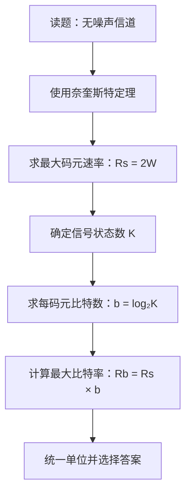

# 计算机网络物理层：数字编码与模拟调制技术

> **学习重点**
>
> 1. 区分编码、解码、调制和解调。
> 2. 掌握 ASK、FSK、PSK、QAM 的基本原理和缩写。
> 3. 会根据信号状态数计算一个码元携带的比特数。
> 4. 会使用奈奎斯特定理计算无噪声信道的最大数据传输速率。
> 5. 熟悉讲解中涉及的历年真题计算方法。

---

## 一、编码、解码、调制与解调

### 1. 基本概念

| 过程                     | 含义                                               | 转换方向                      |
| ------------------------ | -------------------------------------------------- | ----------------------------- |
| **编码（Encoding）**     | 将二进制数据转换为数字信号                         | 二进制数据 → 数字信号         |
| **解码（Decoding）**     | 编码的逆过程，从数字信号中恢复数据                 | 数字信号 → 二进制数据         |
| **调制（Modulation）**   | 将二进制数据映射到模拟信号上，以便在相应信道中传输 | 二进制数据 → 调制后的模拟信号 |
| **解调（Demodulation）** | 调制的逆过程，从接收到的调制信号中恢复数据         | 调制信号 → 二进制数据         |

可以用下面的流程帮助理解：


当通信系统需要把数字数据映射到模拟载波上时，可以使用调制：


### 2. 为什么需要调制？

- 信源产生的基带信号通常是数字信号，可以直接用不同电平表示二进制 `0` 和 `1`。
- 某些信道可以传输数字信号，也可以传输模拟信号，例如在适当条件下工作的双绞线电缆。
- 通信系统也常常需要把数字信息调制到适合信道传播的载波上，再进行传输。
- 调制的核心是改变载波的某些参数，让不同的信号状态代表不同的数据。

**补充说明：** 真空中传播的是电磁波；数字信息也可以通过调制到电磁波上进行传输。因此，不能把“真空中只能传输模拟信号”理解为数字信息无法在太空中通信。实际系统是否采用某种调制方式，还要考虑信道条件、设备和抗干扰需求。

---

## 二、三种基本调制方式

最常见的三种基本调制方式是：

| 调制方式 | 英文名称             | 缩写                 | 通过改变什么来表示数据 |
| -------- | -------------------- | -------------------- | ---------------------- |
| 调幅     | Amplitude Modulation | AM；数字调幅常称 ASK | 信号振幅               |
| 调频     | Frequency Modulation | FM；数字调频常称 FSK | 信号频率               |
| 调相     | Phase Modulation     | PM；数字调相常称 PSK | 信号相位               |

在计算机网络相关考题中，更常见的是数字调制的缩写：**ASK、FSK、PSK 和 QAM**。

### 1. 先理解正弦波的三个参数

可以把正弦波写成：

\[
y(t)=A\sin(2\pi ft+\varphi)
\]

其中：

- \(A\)：振幅，决定波形的幅度大小。
- \(f\)：频率，表示单位时间内振动的次数。
- \(\varphi\)：相位，决定波形在时间轴上的起始位置。
- \(t\)：时间。

三种基本调制方式的区别，可以概括为：

```text
调幅（ASK）：改变振幅 A
调频（FSK）：改变频率 f
调相（PSK）：改变相位 φ
```

### 2. 调幅：ASK

**ASK（Amplitude Shift Keying，幅移键控）**通过改变载波的振幅来区分不同的码元。

#### 二进制 ASK 的基本思路

- 用振幅为 `0` 的信号表示二进制 `0`。
- 用振幅为 `1` 的信号表示二进制 `1`。

可将一个码元区间内的信号示意为：

```text
数据 0：振幅为 0       ─────────────────
数据 1：振幅为 1       /‾\__/‾\__/‾\__
                         （有振幅的载波）
```

如果用数学式子表示，可以理解为改变正弦波前面的振幅系数：

\[
s(t)=A\sin(\omega t)
\]

当 \(A=0\) 时，信号没有振幅；当 \(A=1\) 时，信号具有对应振幅。通过振幅状态区分数据，就是调幅。

#### 重要缩写

- **ASK**：Amplitude Shift Keying，幅移键控。
- 字母 **A** 对应 Amplitude，即振幅。

#### 多进制 ASK

若不只使用两种振幅，而是设计出 \(K\) 种能够区分的振幅状态，就可以表示 \(K\) 种不同的码元。

每个码元可以携带的比特数为：

\[
\boxed{b=\log_2 K}
\]

例如，使用四种不同振幅：

| 振幅状态 | 可分配的二进制数据 |
| -------- | ------------------ |
| 振幅 1   | `00`               |
| 振幅 2   | `01`               |
| 振幅 3   | `10`               |
| 振幅 4   | `11`               |

此时共有 \(K=4\) 种信号状态，因此：

\[
b=\log_2 4=2\text{ bit/码元}
\]

> 注意：这里的四种振幅是四种可区分的信号状态，不是说每个码元中同时传输四个振幅。

### 3. 调频：FSK

**FSK（Frequency Shift Keying，频移键控）**通过改变载波的频率来区分不同的码元。

假设在一个码元区间内：

- 用较低的频率表示二进制 `0`。
- 用较高的频率表示二进制 `1`。

```text
数据 0：较低频率   /‾‾\____/‾‾\____
数据 1：较高频率   /‾\_/‾\_/‾\_/‾\_
                    振动次数更多
```

讲解中的示意采用如下思路：在同样长度的信号区间内，`sin x` 表示一种频率状态，`sin 2x` 表示另一种频率状态。后者在相同区间内振动次数更多，因此频率更高。

一般可以把信号写成：

\[
s(t)=A\sin(2\pi ft+\varphi)
\]

在 FSK 中，主要改变的是频率 \(f\)。

#### 重要缩写

- **FSK**：Frequency Shift Keying，频移键控。
- 字母 **F** 对应 Frequency，即频率。

#### 多进制 FSK

如果设计 \(K\) 种可区分的频率状态，就可以表示 \(K\) 种码元。

\[
\boxed{b=\log_2 K}
\]

例如，设计四种不同频率状态，可以表示 `00`、`01`、`10`、`11` 四种二进制组合，因此每个码元可以携带 2 bit。

### 4. 调相：PSK

**PSK（Phase Shift Keying，相移键控）**通过改变载波的相位来区分不同的码元。

讲解中的例子使用两种相位：

- 相位为 \(0\) 的信号表示一种数据状态。
- 相位为 \(\pi\) 的信号表示另一种数据状态。

可用下式理解这两种信号：

\[
s_0(t)=\sin x
\]

\[
s_1(t)=\sin(x+\pi)
\]

两者频率相同，但相位不同，所以波形在时间轴上的位置不同。

```text
相位 0：       /‾\__/‾\__/‾\__
相位 π：       \__/‾\__/\__/‾\_
               （波形相位发生变化）
```

#### 重要缩写

- **PSK**：Phase Shift Keying，相移键控。
- 字母 **P** 对应 Phase，即相位。

> **注意：** 不同教材或题目可能对具体相位与比特的映射采用不同约定。分析题目中的波形时，应优先遵循题目给出的映射规则。

#### 多进制 PSK

如果设计 \(K\) 种不同的相位状态，就可以表示 \(K\) 种不同码元：

\[
\boxed{b=\log_2 K}
\]

例如，四种相位状态可以对应 `00`、`01`、`10`、`11`，每个码元携带 2 bit。

### 5. ASK、FSK、PSK 对比

| 调制方式 | 改变的参数       | 英文关键词 | 记忆方法 |
| -------- | ---------------- | ---------- | -------- |
| ASK      | 振幅 \(A\)       | Amplitude  | A：幅度  |
| FSK      | 频率 \(f\)       | Frequency  | F：频率  |
| PSK      | 相位 \(\varphi\) | Phase      | P：相位  |

记忆口诀：

> **ASK 看振幅，FSK 看频率，PSK 看相位。**

---

## 三、码元与比特：一个码元可以携带多少比特？

### 1. 核心公式

如果一种调制方式可以产生 \(K\) 种不同且可区分的信号状态，则一个码元最多可以表示 \(K\) 种情况。

若每个码元携带 \(b\) 个比特，则：

\[
2^b=K
\]

所以：

\[
\boxed{b=\log_2 K}
\]

其中：

- \(K\)：信号状态数，也可理解为可区分的码元种类数。
- \(b\)：每个码元携带的比特数。
- 当 \(K=2^b\) 时，可以恰好对应 \(b\) bit 的固定长度二进制组合。

### 2. 常见状态数速查表

| 信号状态数 \(K\) |           计算 | 每个码元携带的比特数 |
| ---------------: | -------------: | -------------------: |
|                2 |   \(\log_2 2\) |                1 bit |
|                4 |   \(\log_2 4\) |                2 bit |
|                8 |   \(\log_2 8\) |                3 bit |
|               16 |  \(\log_2 16\) |                4 bit |
|               32 |  \(\log_2 32\) |                5 bit |
|               64 |  \(\log_2 64\) |                6 bit |
|              128 | \(\log_2 128\) |                7 bit |
|              256 | \(\log_2 256\) |                8 bit |

**结论：** 信号状态数越多，一个码元能够表示的比特数通常越多。

---

## 四、正交幅度调制：QAM

### 1. QAM 的基本原理

**QAM（Quadrature Amplitude Modulation，正交幅度调制）**结合了振幅和相位两个维度，通过不同的振幅与相位组合表示不同的码元。

可以先这样理解：

- ASK 主要通过改变振幅区分信号。
- PSK 主要通过改变相位区分信号。
- QAM 同时利用振幅和相位的不同组合，形成更多可区分的信号状态。

### 2. 信号状态数的计算

假设设计：

- \(M\) 种不同的振幅状态；
- \(N\) 种不同的相位状态。

每一种振幅都可以与每一种相位进行组合，因此总信号状态数为：

\[
\boxed{K=M\times N}
\]

每个码元携带的比特数为：

\[
b=\log_2 K
\]

代入 \(K=M\times N\)，得到：

\[
\boxed{b=\log_2(MN)}
\]

#### 示例：两种振幅、四种相位

假设有两种振幅状态：

\[
A_1,\ A_2
\]

以及四种相位状态：

\[
\varphi_1,\ \varphi_2,\ \varphi_3,\ \varphi_4
\]

两两组合后得到 \(2\times4=8\) 种信号：

| 振幅／相位 | 相位 1            | 相位 2            | 相位 3            | 相位 4            |
| ---------- | ----------------- | ----------------- | ----------------- | ----------------- |
| 振幅 1     | \(A_1,\varphi_1\) | \(A_1,\varphi_2\) | \(A_1,\varphi_3\) | \(A_1,\varphi_4\) |
| 振幅 2     | \(A_2,\varphi_1\) | \(A_2,\varphi_2\) | \(A_2,\varphi_3\) | \(A_2,\varphi_4\) |

总状态数：

\[
K=2\times4=8
\]

每个码元携带：

\[
b=\log_2 8=3\text{ bit}
\]

> 可以把它理解为：振幅状态和相位状态分别提供选择，二者组合后形成更多不同的信号状态。这里的“组合”是便于理解的描述，实际 QAM 信号由相应的正交载波分量共同构成。

### 3. QAM 名称后缀的含义

QAM 后面的数字表示该调制方案中的**信号状态总数**。

| 调制方式 | 信号状态数 \(K\) | 每个码元携带的比特数 |
| -------- | ---------------: | -------------------: |
| 16-QAM   |               16 |  \(\log_2 16=4\) bit |
| 32-QAM   |               32 |  \(\log_2 32=5\) bit |
| 64-QAM   |               64 |  \(\log_2 64=6\) bit |
| 128-QAM  |              128 | \(\log_2 128=7\) bit |

例如：

- **16-QAM**：共有 16 种可区分的信号状态，每个码元携带 4 bit。
- **128-QAM**：共有 128 种可区分的信号状态，每个码元携带 7 bit。

看到 `QAM` 后面的数字时，先把它看成 \(K\)，再使用：

\[
\boxed{b=\log_2 K}
\]

---

## 五、无噪声信道的极限数据传输速率：奈奎斯特定理

### 1. 适用条件

题目中出现“**无噪声信道**”时，通常考虑奈奎斯特定理。

奈奎斯特定理给出的无噪声信道最大码元传输速率为：

\[
\boxed{R_s=2W}
\]

其中：

- \(R_s\)：最大码元传输速率，单位为 baud（波特）。
- \(W\)：信道带宽，单位为 Hz。

这里得到的是**码元速率**，不是直接以 bit/s 表示的数据传输速率。

### 2. 从码元速率换算成比特率

如果每个码元能携带 \(b\) bit，那么最大数据传输速率为：

\[
R_b=R_s\times b
\]

又因为：

\[
R_s=2W,\qquad b=\log_2 K
\]

所以：

\[
\boxed{R_b=2W\log_2 K}
\]

其中：

- \(R_b\)：最大数据传输速率，单位 bit/s。
- \(W\)：信道带宽，单位 Hz。
- \(K\)：可区分的信号状态数。
- \(\log_2 K\)：每个码元携带的比特数。

### 3. 解题流程图



### 4. 常见单位换算

- \(1\text{ kHz}=10^3\text{ Hz}\)
- \(1\text{ kbps}=10^3\text{ bit/s}\)
- 若带宽以 kHz 表示，计算出的速率通常可直接整理为 kbps。

---

## 六、例题一：2022 年第 34 题

### 题目条件

- 信道为无噪声信道；
- 带宽为 \(200\text{ kHz}\)；
- 使用四种振幅状态的 ASK 调制；
- 求信道的最大数据传输速率。

### 第一步：计算最大码元速率

无噪声信道使用奈奎斯特定理：

\[
R_s=2W
\]

代入 \(W=200\text{ kHz}\)：

\[
R_s=2\times200\text{ kHz}=400\text{ kbaud}
\]

### 第二步：计算每个码元携带的比特数

题目使用四种振幅状态，因此：

\[
K=4
\]

每个码元携带的比特数：

\[
b=\log_2 4=2\text{ bit/码元}
\]

### 第三步：计算最大数据传输速率

\[
R_b=R_s\times b
\]

\[
R_b=400\text{ kbaud}\times2\text{ bit/码元}
\]

\[
\boxed{R_b=800\text{ kbps}}
\]

**答案：C，800 kbps。**

### 本题考点

题目给出的是四种幅值，不是直接给出每码元携带的比特数。需要先计算：

\[
b=\log_2 4=2
\]

再把波特率换算为比特率。

---

## 七、例题二：2009 年第 34 题

### 题目条件

- 信道为无噪声信道；
- 带宽为 \(3\text{ kHz}\)；
- 采用 QAM 调制；
- 有四种振幅状态、四种相位状态；
- 求信道的最大数据传输速率。

### 第一步：计算最大码元速率

\[
R_s=2W
\]

\[
R_s=2\times3\text{ kHz}=6\text{ kbaud}
\]

### 第二步：计算总信号状态数

QAM 同时利用不同振幅和相位的组合：

\[
K=M\times N
\]

题目给出 \(M=4\)、\(N=4\)，因此：

\[
K=4\times4=16
\]

### 第三步：计算每个码元携带的比特数

\[
b=\log_2 16=4\text{ bit/码元}
\]

### 第四步：计算最大数据传输速率

\[
R_b=R_s\times b
\]

\[
R_b=6\text{ kbaud}\times4\text{ bit/码元}
\]

\[
\boxed{R_b=24\text{ kbps}}
\]

**答案：B，24 kbps。**

### 本题考点

QAM 的总信号状态数等于振幅状态数与相位状态数的乘积：

\[
K=4\times4=16
\]

因此一个码元携带：

\[
\log_2 16=4\text{ bit}
\]

---

## 八、编码与调制的综合回顾

### 1. 五种常见数字编码

本节前半部分还回顾了五种常见的数字编码。看波形时，应先确认题目采用的电平和跳变约定。

| 编码方式         | 英文／缩写              | 识别特点（按课程讲解采用的约定）                                                   |
| ---------------- | ----------------------- | ---------------------------------------------------------------------------------- |
| 不归零编码       | NRZ                     | 在整个码元期间保持高、低电平；本课程示例中低电平表示 `0`，高电平表示 `1`           |
| 归零编码         | RZ                      | 码元期间的信号会返回零电平；本课程示例中低电平表示 `0`，高电平表示 `1`             |
| 反向非归零编码   | NRZI                    | 以是否发生电平跳变表示数据；讲解示例采用“码元开始处跳变表示 `0`，不跳变表示 `1`”   |
| 曼彻斯特编码     | Manchester              | 每个码元中间都有一次跳变；讲解示例采用“中间上跳表示 `0`，中间下跳表示 `1`”         |
| 差分曼彻斯特编码 | Differential Manchester | 每个码元中间都有一次跳变；讲解示例采用“码元开始处有跳变表示 `0`，没有跳变表示 `1`” |

> **约定提醒：** 曼彻斯特、NRZI 等编码的“跳变对应 0 还是 1”在不同教材或题目中可能采用相反约定。解题时要以题目给出的规则为准。

### 2. 四种常见调制方式

| 调制方式     | 英文缩写 | 区分码元的参数   |
| ------------ | -------- | ---------------- |
| 幅移键控     | ASK      | 振幅             |
| 频移键控     | FSK      | 频率             |
| 相移键控     | PSK      | 相位             |
| 正交幅度调制 | QAM      | 振幅与相位的组合 |

### 3. 编码与调制不要混淆

| 比较内容     | 编码                                  | 调制                                             |
| ------------ | ------------------------------------- | ------------------------------------------------ |
| 主要转换     | 二进制数据 → 数字信号                 | 二进制数据 → 调制信号                            |
| 典型例子     | NRZ、RZ、NRZI、曼彻斯特、差分曼彻斯特 | ASK、FSK、PSK、QAM                               |
| 题目常考内容 | 波形判断、跳变规则、同步特性          | 调制原理、信号状态数、每码元比特数、最大传输速率 |

### 4. 公式汇总

| 知识点                                          | 公式                              |
| ----------------------------------------------- | --------------------------------- |
| 有 \(K\) 种可区分信号状态时，每码元携带的比特数 | \(\displaystyle b=\log_2K\)       |
| QAM 的信号状态数                                | \(\displaystyle K=M\times N\)     |
| QAM 每码元携带的比特数                          | \(\displaystyle b=\log_2(MN)\)    |
| 无噪声信道最大码元传输速率                      | \(\displaystyle R_s=2W\)          |
| 最大数据传输速率                                | \(\displaystyle R_b=R_s\times b\) |
| 无噪声信道最大数据传输速率                      | \(\displaystyle R_b=2W\log_2K\)   |

---

## 九、考研解题方法与易错点

### 1. 看到题干关键词，先选公式

- **无噪声信道**：通常使用奈奎斯特定理，先求 \(R_s=2W\)。
- **四种幅值／四种信号状态**：先算 \(b=\log_2 4=2\)。
- **16-QAM**：状态数 \(K=16\)，每码元携带 \(\log_2 16=4\) bit。
- **四种振幅、四种相位的 QAM**：先算 \(K=4\times4=16\)，再算每码元携带 4 bit。
- **题目要求 bit/s 或 kbps**：最后一定要把码元速率转换成比特率。

### 2. 常见错误

1. **把波特率当成比特率。** 两者只有在每个码元携带 1 bit 时数值才相同。
2. **没有计算信号状态数。** 多进制 ASK、FSK、PSK 要根据状态数使用 \(b=\log_2 K\)。
3. **忽略 QAM 的组合关系。** QAM 的状态数为振幅状态数与相位状态数的乘积。
4. **使用错定理。** 题目强调无噪声信道时，按本节讲解使用奈奎斯特定理；若题目给出噪声、信噪比等条件，则需进一步判断是否应用香农定理。
5. **混淆调制方式的缩写。** ASK 看振幅，FSK 看频率，PSK 看相位，QAM 结合振幅和相位。
6. **把某一教材的波形映射当成唯一标准。** 具体的编码跳变和相位映射应以题目定义为准。

### 3. 最后记忆

> - **编码**：二进制数据变成数字信号。
> - **解码**：数字信号还原为数据。
> - **调制**：通过改变载波参数来表示数据。
> - **解调**：从调制信号中恢复数据。
> - **ASK**：改振幅。
> - **FSK**：改频率。
> - **PSK**：改相位。
> - **QAM**：组合振幅与相位。
> - **每码元比特数**：\(\log_2 K\)。
> - **无噪声信道最大码元速率**：\(2W\)。
> - **最大比特率**：码元速率 × 每码元比特数。

---

## 十、复习自测

尝试先独立计算，再对照前文公式：

1. 某调制方式有 8 种可区分的信号状态，一个码元可以携带多少 bit？
2. 某个 QAM 方案有 8 种振幅状态和 4 种相位状态，总共有多少种信号状态？每个码元携带多少 bit？
3. 无噪声信道带宽为 \(10\text{ kHz}\)，采用 16 种信号状态，按奈奎斯特定理计算最大数据传输速率。
4. ASK、FSK、PSK 分别改变载波的哪个参数？

**参考答案：**

1. \(\log_2 8=3\text{ bit/码元}\)。
2. \(K=8\times4=32\)，每码元携带 \(\log_2 32=5\text{ bit}\)。
3. \(R_s=2\times10\text{ kHz}=20\text{ kbaud}\)，每码元携带 \(\log_2 16=4\text{ bit}\)，所以 \(R_b=20\times4=80\text{ kbps}\)。
4. ASK 改变振幅，FSK 改变频率，PSK 改变相位。
