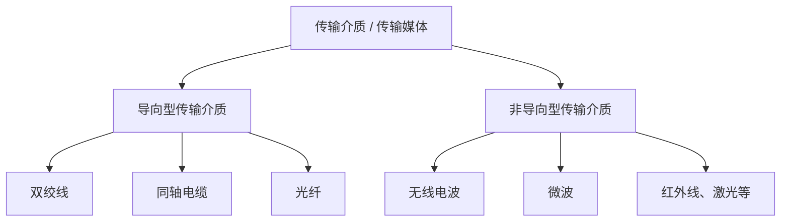
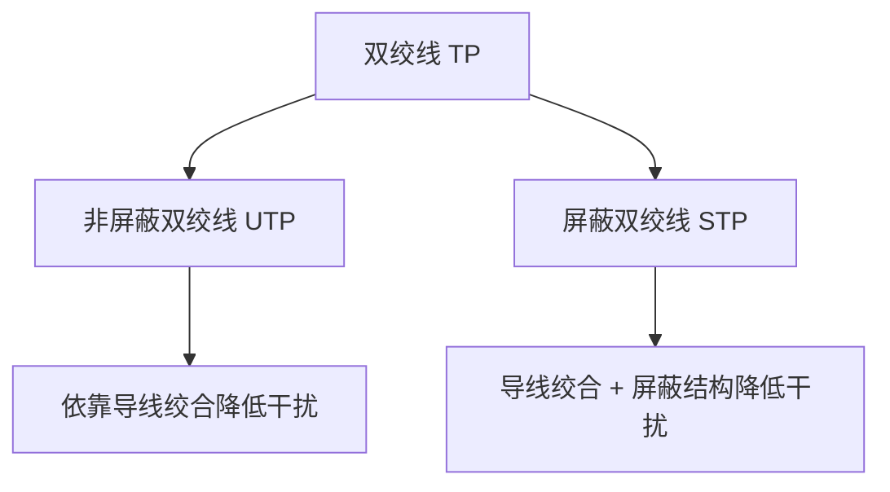
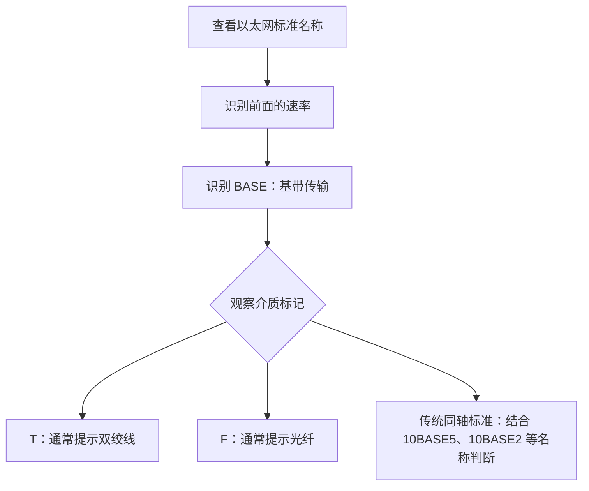
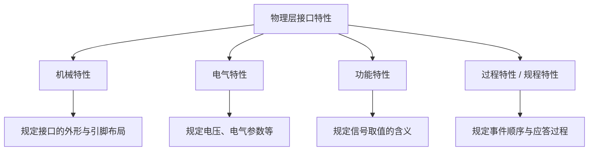

# 计算机网络物理层：传输介质与物理层接口特性

> **本节重点**
>
> 1. 区分导向型传输介质与非导向型传输介质。
> 2. 掌握双绞线、同轴电缆、光纤的结构与特点。
> 3. 区分单模光纤和多模光纤。
> 4. 看懂以太网常见传输介质命名中的 `BASE`、`T`、`F` 等信息。
> 5. 理解无线电波、微波、红外线、激光等无线传输方式的基本特点。
> 6. 掌握物理层接口的机械特性、电气特性、功能特性和过程特性。

---

## 一、传输介质概述

### 1. 什么是传输介质？

**传输介质（Transmission Medium）**，也常称为**传输媒体**，是信号在发送方和接收方之间传播所经过的媒介。

计算机网络常见的传输介质可以分为两大类：

- **导向型传输介质**：信号沿着某种物理路径传播，例如线缆。
- **非导向型传输介质**：信号通过空间传播，通常以电磁波作为载体，例如无线通信。

### 2. 导向型与非导向型的区别

| 类型 | 传播特点 | 常见例子 |
|---|---|---|
| 导向型传输介质 | 信号受物理介质引导，沿着线缆等固定路径传播 | 双绞线、同轴电缆、光纤 |
| 非导向型传输介质 | 信号通过空间传播，不依赖一根有形线缆引导 | 无线电波、微波、红外线、激光等无线通信方式 |



> **理解要点：** 导向型和非导向型主要是按照信号传播是否受到有形介质的引导进行区分。无线通信中传播的是电磁波；电磁波可以在真空中传播，也可以在空气等介质中传播。

### 3. 本节的学习范围

本节主要涉及两个方面：

1. **传输介质**：了解第零层所涉及的传输媒体类型与特点。
2. **物理层接口特性**：了解物理层与传输介质之间的接口需要规定哪些内容，才能让设备与介质协调工作。

---

## 二、导向型传输介质

常见的导向型传输介质包括：

1. 双绞线
2. 同轴电缆
3. 光纤

---

## 三、双绞线

### 1. 双绞线的结构

**双绞线（Twisted Pair，TP）**由两根相互绝缘的导线按照一定方式绞合而成。

绞合的作用是降低外界电磁干扰及线对之间的相互干扰，从而提高线路的抗干扰能力。

常见网线内部通常有 **四对双绞线**，每一对由两根导线绞合而成：

```text
网线内部
┌───────────────────────────────┐
│ 线对 1：  两根导线相互绞合     │
│ 线对 2：  两根导线相互绞合     │
│ 线对 3：  两根导线相互绞合     │
│ 线对 4：  两根导线相互绞合     │
└───────────────────────────────┘
```

可以把两根导线的绞合想象成“拧麻花”。这种结构可以帮助两根导线抵消一部分外界干扰。

### 2. 非屏蔽双绞线与屏蔽双绞线

按照是否设置屏蔽层，双绞线可以分为非屏蔽双绞线和屏蔽双绞线。

| 类型 | 英文名称 | 缩写 | 结构特点 |
|---|---|---|---|
| 非屏蔽双绞线 | Unshielded Twisted Pair | **UTP** | 双绞线外没有额外的金属屏蔽层 |
| 屏蔽双绞线 | Shielded Twisted Pair | **STP** | 具有金属屏蔽结构，用于降低电磁干扰 |

屏蔽层可以包住单独的线对，也可以包住多对线的整体；不同线缆类别的具体屏蔽结构并不完全相同。



### 3. 为什么要绞合、为什么要增加屏蔽层？

提高双绞线抗干扰能力，常见思路包括：

- **合理绞合线对**：降低外界电磁干扰和线对间串扰。
- **增加屏蔽结构**：进一步减小外部电磁干扰对信号的影响。
- **采用更高类别的线缆和匹配设备**：满足更高频率、更高数据传输速率的要求。

这些设计都可能增加材料、制造和施工成本。因此，不同类别网线的内部结构、性能指标和价格会有差别。

### 4. 双绞线的应用

- 现代局域网中大量使用双绞线网线连接设备。
- 早期电话线路也广泛使用双绞线。
- 不同类别的双绞线可支持不同的传输速率和传输距离，具体能力需要结合线缆类别、长度、设备和布线环境判断。

> **学习提示：** 网线水晶头外观相似，并不意味着内部结构和性能完全相同。例如，不同类别的线缆可能在绞合方式、屏蔽结构和电气性能方面存在差异。

### 5. 英文缩写速记

| 缩写 | 英文 | 含义 |
|---|---|---|
| TP | Twisted Pair | 双绞线 |
| STP | Shielded Twisted Pair | 屏蔽双绞线 |
| UTP | Unshielded Twisted Pair | 非屏蔽双绞线 |

---

## 四、同轴电缆

### 1. 同轴电缆的结构

**同轴电缆（Coaxial Cable）**的核心结构包括内导体和外导体屏蔽层。它们通常共享同一中心轴线，因此称为“同轴”。

从内到外，典型同轴电缆包括：

1. **内导体**：主要负责传输电信号，常见材料为铜。
2. **绝缘层**：隔开内导体和外导体。
3. **外导体／屏蔽层**：提供回路，并帮助屏蔽外界电磁干扰。
4. **外部保护套**：保护电缆内部结构。

```text
同轴电缆横截面（由内向外）

       ┌───────────────────────┐
       │     外部保护套        │
       │  ┌─────────────────┐  │
       │  │ 外导体/屏蔽层   │  │
       │  │  ┌───────────┐  │  │
       │  │  │ 绝缘层    │  │  │
       │  │  │  ┌─────┐  │  │  │
       │  │  │  │内导体│  │  │  │
       │  │  │  └─────┘  │  │  │
       │  │  └───────────┘  │  │
       │  └─────────────────┘  │
       └───────────────────────┘
```

### 2. 同轴电缆的特点

- 内导体用于传输电信号。
- 外导体屏蔽层有助于降低外界电磁干扰。
- 内导体的材料、尺寸以及电缆的整体结构会影响电阻、衰减和传输性能。
- 在其他条件相近时，导体电阻较低有助于减小导体损耗；但实际传输性能还取决于频率、绝缘材料、屏蔽结构和电缆规格等因素。

### 3. 同轴电缆的应用

同轴电缆曾广泛用于早期局域网，也长期用于有线电视等系统。随着接入网络和传输技术的发展，许多场景改用光纤、双绞线或其他接入方案，但同轴电缆在某些有线电视、宽带接入和射频系统中仍然会使用。

### 4. 结构速记

| 组成部分 | 主要作用 |
|---|---|
| 内导体 | 传输电信号 |
| 绝缘层 | 隔离内、外导体 |
| 外导体／屏蔽层 | 提供屏蔽，并构成电气回路的一部分 |
| 外部保护套 | 保护电缆 |

---

## 五、光纤

### 1. 光纤的基本结构

**光纤（Optical Fiber）**主要由纤芯和包层组成，外部通常还有涂覆层或保护结构。

- **纤芯**：光信号主要在其中传播。
- **包层**：包围纤芯，其折射率通常低于纤芯。
- **保护层／护套**：保护光纤免受机械损伤和环境影响。

```text
光纤结构示意（由内向外）

┌────────────────────────────┐
│       保护层／外护套        │
│    ┌──────────────────┐    │
│    │       包层       │    │
│    │   ┌──────────┐   │    │
│    │   │   纤芯   │   │    │
│    │   └──────────┘   │    │
│    └──────────────────┘    │
└────────────────────────────┘
```

### 2. 光纤为什么能传输光信号？

光纤利用纤芯与包层之间的折射率差，使符合条件的光在纤芯中传播。典型解释是**全反射**：当光从高折射率区域射向低折射率区域，且入射角满足全反射条件时，光会反射回高折射率区域。

经过连续反射，光信号便可以沿着光纤传播。


> **说明：** 单模光纤的传播更适合用导模来描述，不能简单地把所有光都理解为一条几何光线在内部不断反射。全反射模型适合作为入门阶段的直观理解。

### 3. 光纤的优点

与铜缆相比，光纤具有以下典型优势：

- **抗电磁干扰能力强**：光信号不容易受到外界电场、磁场的直接干扰。
- **传输损耗较低**：适合长距离通信。
- **带宽潜力大**：可以支持高速数据传输。
- **线缆较细、重量较轻**：有利于节省布线空间。
- **长距离链路中可能减少中继或再生设备需求**：具体取决于链路距离、光纤类型、收发设备和系统设计。

### 4. 中继器的作用

当信号传输距离较长时，信号可能衰减或失真。此时可以在链路中布置中继或再生设备，对接收到的信号进行处理后继续传输。


光纤链路的衰减通常较低，因此在相同传输要求下，长距离链路可能需要较少的中继或再生设备。不过，实际数量由链路预算和系统设计决定。

### 5. 单模光纤与多模光纤

光纤常见的两种类别是**单模光纤**和**多模光纤**。

#### （1）多模光纤

- 纤芯相对较粗。
- 可以支持多个传播模式。
- 不同模式的传播路径和到达时间可能不同。
- 模式间的传播时延差可能造成脉冲展宽，因此通常更适合相对较短的距离。

#### （2）单模光纤

- 纤芯很细，典型单模光纤的纤芯直径约为 9 μm（具体规格会有差异）。
- 主要支持一个空间传播模式。
- 模式色散较小，适合高速、长距离传输。
- 长距离光通信通常广泛采用单模光纤。

### 6. 单模与多模对比

| 对比项目 | 多模光纤 | 单模光纤 |
|---|---|---|
| 纤芯 | 相对较粗 | 很细 |
| 传播模式 | 多个模式 | 一个主要空间模式 |
| 模式色散 | 通常较明显 | 通常较小 |
| 常见用途 | 相对较短距离的链路 | 高速、较长距离链路 |
| 传输距离 | 通常较短 | 通常较长 |

### 7. 输入脉冲与输出脉冲

信号沿光纤传播时，可能会发生衰减或展宽：

```text
多模光纤：输入脉冲             输出脉冲
             │                    /────\
             │                   /      \
             └───传播一段距离───┘        （可能变宽）

单模光纤：输入脉冲             输出脉冲
             │                    /\
             │                   /  \
             └───传播一段距离───┘    （通常展宽较小）
```

这是概念示意图，并非按比例绘制。实际结果还取决于光纤类型、长度、波长和系统参数。

### 8. 光纤外皮颜色

在常见布线规范中，外皮颜色有时可用于提示光纤类别，例如：

- 黄色外皮常见于单模光纤。
- 橙色或青绿色外皮常见于某些多模光纤。

但颜色规则可能因标准、地区、线缆类型和厂商而有所不同，**不能仅凭外皮颜色判断所有光纤的具体规格**。

### 9. 三种导向型介质对比

| 项目 | 双绞线 | 同轴电缆 | 光纤 |
|---|---|---|---|
| 主要信号形式 | 电信号 | 电信号 | 光信号 |
| 抗电磁干扰 | 受绞合和屏蔽结构影响 | 屏蔽能力通常较好 | 很强，不易受电磁干扰 |
| 典型优势 | 成本与布线便利性 | 屏蔽结构较好，适用于某些射频系统 | 高带宽、低损耗、适合远距离 |
| 常见应用 | 局域网、电话线路 | 有线电视、射频系统、部分接入网络 | 光纤宽带、骨干网、长距离通信 |

在课程的总体对比中，可以把三者理解为：**抗电磁干扰能力一般从双绞线、同轴电缆到光纤逐渐增强，典型传输损耗也逐渐降低**。实际性能仍需要结合具体线缆和使用条件判断。

---

## 六、以太网对传输介质的常见命名

### 1. 基本命名形式

以太网的传统命名通常可以看到如下结构：

```text
速率 + BASE + 介质或距离等信息
```

- 前面的数字通常表示标称数据速率。
- `BASE` 表示基带传输（Baseband）。
- 后面的字母或数字用于区分介质、距离或其他物理层规格。

基带传输通常指使用基带信号进行传输。以太网的具体编码方式取决于以太网物理层标准，并不是所有以太网标准都使用曼彻斯特编码。

### 2. 同轴电缆示例：10BASE5 与 10BASE2

| 名称 | 速率 | 介质 | 传统标准中的典型最大网段长度 |
|---|---:|---|---:|
| 10BASE5 | 10 Mbps | 粗同轴电缆 | 500 m |
| 10BASE2 | 10 Mbps | 细同轴电缆 | 约 185 m |

记忆时可以注意：

- `10` 表示 10 Mbps。
- `BASE` 表示基带传输。
- `10BASE5` 中的 `5` 与典型 500 m 网段长度有关。
- `10BASE2` 中的 `2` 与约 185 m 的典型网段长度有关；入门讲解有时将其近似记为 200 m。

> **标准值提醒：** 做选择题时，若选项涉及精确数值，应优先记住 10BASE2 的典型最大网段长度为约 185 m，而非严格的 200 m。

### 3. 光纤与双绞线的命名线索

- 名称中出现 `F`，常常提示采用光纤（Fiber／Optical Fiber）作为传输介质。
- 名称中出现 `T`，常常提示采用双绞线（Twisted Pair）作为传输介质。
- 后面还可能跟其他字符，用来区分更具体的物理层规格。

例如：

| 名称示例 | 可以先识别的信息 |
|---|---|
| 1000BASE-T | 1000 Mbps 级别，T 提示双绞线 |
| 2.5GBASE-T | 2.5 Gbps 级别，T 提示双绞线 |
| 1000BASE-FX 等 | F 提示光纤，后缀用于区分具体物理层规格 |

> **注意：** 以太网标准名称有明确的写法。讲解中提到的“1000BASE-T1”与常见的“1000BASE-T”并非可以随意互换；阅读具体题目时，应以题干的完整标准名称为准。

### 4. 命名规则速记



---

## 七、非导向型传输介质：无线通信

### 1. 基本概念

无线通信通常通过电磁波在空间中传递信息。常见方式包括无线电波通信、微波通信、红外线通信和激光通信等。

常见的手机通信、Wi-Fi 等都使用无线电频段中的电磁波。

### 2. 无线电波的典型特点

入门课程通常从以下方面理解无线电波：

- **穿透与绕射能力**：信号能否穿过或绕过障碍物，取决于频率、波长、材料和传播环境。
- **传播距离**：与发射功率、频段、天线、地形、环境及通信系统有关。
- **指向性**：天线设计会影响信号的传播方向性；使用定向天线时，信号可以集中在特定方向。

手机或 Wi-Fi 信号在一定范围内可以绕过或穿过部分障碍物，因此接收设备不必始终正对路由器或基站，但墙体和其他障碍物仍可能明显削弱信号。

### 3. 波长与频率的关系

电磁波的传播速度、波长和频率之间满足：

\[
c=\lambda f
\]

其中：

- \(c\)：电磁波的传播速度。在真空中约为 \(3\times10^8\text{ m/s}\)。
- \(\lambda\)：波长。
- \(f\)：频率。

因此：

\[
\boxed{\lambda=\frac{c}{f}}
\qquad
\boxed{f=\frac{c}{\lambda}}
\]

在传播速度近似固定时，波长与频率成反比：

```text
波长越短  ⇔  频率越高
波长越长  ⇔  频率越低
```

### 4. 波长对传播特点的影响

作为一般性的入门规律：

- 较短波长、较高频率的信号，通常更容易使用定向天线形成较窄的波束；一些高频通信对视距和遮挡更敏感。
- 较长波长的信号通常更容易发生绕射，可能更有利于绕过某些障碍物。
- 这些只是一般趋势，不能仅根据波长判断所有场景下的传播距离、穿透能力或传输速率；实际效果还与频段、天线、发射功率和环境密切相关。

| 比较方面 | 较短波长（通常对应较高频率） | 较长波长（通常对应较低频率） |
|---|---|---|
| 天线方向性 | 更容易形成较窄的定向波束 | 在相同天线尺度等条件下，通常较不容易形成同样窄的波束 |
| 绕射能力 | 通常较弱 | 通常较强 |
| 遮挡影响 | 某些高频链路对遮挡更敏感 | 某些低频链路绕射能力更好 |
| 数据传输能力 | 可用带宽可能较大，但并非只由频率决定 | 可用带宽常受频谱分配等因素影响 |

> **术语校正：** 微波是无线电频谱中的一个频段范围；“短波”通常特指另一个无线电波段。两者不是同义词。卫星通信经常使用微波频段，但不应把“微波通信”直接说成“短波通信”。

### 5. 常见无线传输方式

| 方式 | 说明 |
|---|---|
| 无线电波通信 | 广泛用于无线通信系统，例如移动通信、广播和部分无线接入 |
| 微波通信 | 常使用较高频率和定向天线，许多链路对视距条件有要求 |
| 红外线通信 | 使用红外波段电磁波，通常适用于特定距离和环境 |
| 激光通信 | 使用高度定向的光束，要求较精确的指向与对准 |

这些方式本质上都利用电磁波传递信息，但使用的波长、频率、天线或光学设备，以及传播要求有所不同。

---

## 八、卫星通信与中继

### 1. 卫星作为中继节点

卫星通信中，卫星可以接收来自地面站的信号，再转发给另一个地面站或其他通信节点。


当通信距离很长时，中继设备可帮助将信号传送到更远的位置。

### 2. 地球同步轨道卫星与传播时延

地球同步轨道卫星位于距离地面约 3.6 万公里的轨道高度量级。信号需要从地面传播到卫星，再从卫星传播到地面，因此会产生明显的传播时延。

### 3. 低地球轨道卫星

低地球轨道卫星距离地面更近。采用大量卫星组成星座，可以扩大覆盖范围，并在不少链路场景中显著降低传播时延。

讲解中以 SpaceX 的 Starlink（星链）项目作为例子，用于说明通过大量近地卫星提供通信服务的思路。

| 对比项目 | 地球同步轨道卫星 | 低地球轨道卫星 |
|---|---|---|
| 与地面的距离 | 约 3.6 万公里轨道高度量级 | 更低 |
| 传播时延 | 受长距离传播影响，通常较高 | 通常可以降低传播时延 |
| 覆盖方式 | 单颗卫星可以覆盖较大的地面区域 | 通常需要大量卫星协同形成覆盖 |
| 系统特点 | 覆盖范围大，链路传播距离长 | 卫星移动较快，需进行星座和切换管理 |

> **说明：** 传播时延的具体数值会受到轨道高度、链路路径、路由、处理和网络拥塞等因素影响。课堂中的“传统卫星通信 500 ms 以上”“近地卫星 20 ms 以内”等数值用于建立量级印象，不应当作所有系统和所有路径都满足的固定保证。

### 4. 使用短波长／定向链路时的注意事项

定向程度较强的微波或激光链路往往需要较准确的天线或光学设备指向。卫星数量、卫星之间的链路、地面站布局和路由设计都会影响实际覆盖与时延。

---

## 九、物理层接口的四大特性

物理层不仅涉及传输介质，还需要规定设备与传输介质之间的接口。常见的四大特性是：

1. **机械特性**
2. **电气特性**
3. **功能特性**
4. **过程特性（规程特性）**



### 1. 机械特性

机械特性规定接口的机械结构，例如：

- 形状和尺寸；
- 引脚数量；
- 引脚排列；
- 引脚或连接器之间的对应关系；
- 锁定装置等连接结构。

以网线水晶头为例，机械特性相关的内容包括连接器的形状和尺寸、触点数量、触点排列，以及引脚和线对的连接关系。

### 2. 电气特性

电气特性规定接口电路的电气参数，例如：

- 允许出现的电压范围；
- 电气信号的幅度和其他相关参数；
- 电气负载、时序或传输速率等相关要求；
- 在规定条件下可使用的线缆长度等指标。

电气特性关注的是信号的电气规范，不是某个电压值所代表的具体语义。

### 3. 功能特性

功能特性规定接口中某一条信号线或某种电平的**功能与含义**。

例如，需要明确某个信号状态表示什么控制信息，某条线承担什么功能等。

**区分电气特性和功能特性：**

- 电气特性：规定电压范围、电气参数等。
- 功能特性：规定这些信号状态或线路承担什么含义、功能。

### 4. 过程特性（规程特性）

过程特性也称为规程特性，规定不同事件出现的顺序，以及设备在这些事件出现时应当作出的反应。

例如：

- 插入网线之后，接口应当执行什么操作；
- 拔掉网线之后，设备应当如何响应；
- 建立连接、传输数据或结束连接时，相关信号与操作应按什么顺序进行。

### 5. 四大特性对比表

| 特性 | 核心问题 | 关键词 | 网线接口的理解示例 |
|---|---|---|---|
| 机械特性 | 接口长什么样、如何连接？ | 形状、尺寸、引脚、排列、锁定结构 | 水晶头的尺寸、触点数与排列 |
| 电气特性 | 电气信号的参数是什么？ | 电压范围、电气参数、传输要求 | 规定信号的电气范围 |
| 功能特性 | 信号或线路代表什么？ | 功能、含义 | 某条信号线承担什么功能 |
| 过程特性／规程特性 | 事件按什么顺序发生、设备如何响应？ | 顺序、流程、应答 | 插拔连接器或建立连接时的反应 |

> **易错点：** 电气特性与功能特性容易混淆。电气特性规定“信号的电气参数是什么”；功能特性规定“信号状态或线路的含义是什么”。

---

## 十、全章重点汇总

### 1. 传输介质分类

| 传输介质分类 | 主要类型 |
|---|---|
| 导向型 | 双绞线、同轴电缆、光纤 |
| 非导向型 | 无线电波、微波、红外线、激光等无线通信方式 |

### 2. 三种有线传输介质

| 介质 | 主要结构 | 重点特点 |
|---|---|---|
| 双绞线 | 两根导线绞合成一对，可有屏蔽结构 | 绞合与屏蔽有助于抗干扰；局域网常用 |
| 同轴电缆 | 内导体、绝缘层、外导体屏蔽层、保护套 | 屏蔽结构较明显；用于有线电视、射频系统等 |
| 光纤 | 纤芯、包层、保护结构 | 抗电磁干扰能力强、传输损耗低、适合高速和长距离通信 |

### 3. 单模光纤与多模光纤

- **多模光纤**：纤芯相对较粗，支持多个传播模式，模式色散通常较明显，常用于相对较短距离的链路。
- **单模光纤**：纤芯很细，主要支持一个空间传播模式，模式色散较小，适合高速、长距离通信。

### 4. 无线传输介质重点

- 无线通信使用电磁波传递信息。
- 波速、波长和频率关系：\(\boxed{c=\lambda f}\)。
- 在传播速度近似不变时，波长与频率成反比。
- 较短波长、较高频率的信号通常更容易配合定向天线形成窄波束；较长波长通常更有利于绕射。
- 微波与短波不是同义词；卫星通信常使用微波频段。
- 卫星可以充当中继节点；低地球轨道卫星通常有助于降低传播时延，但系统实际表现取决于具体部署。

### 5. 物理层接口四大特性

记忆口诀：

> **机械看外形，电气看参数，功能看含义，过程看顺序。**

| 特性 | 一句话记忆 |
|---|---|
| 机械特性 | 规定接口的形状、尺寸、引脚数量与排列等 |
| 电气特性 | 规定电压范围和电气参数等 |
| 功能特性 | 规定信号或线路的功能和含义 |
| 过程特性／规程特性 | 规定事件发生的顺序及对应的操作 |

---

## 十一、复习自测

先尝试独立回答，再对照前文复习。

1. 导向型与非导向型传输介质的主要区别是什么？
2. 双绞线为什么要绞合？屏蔽层有什么作用？
3. 同轴电缆的内导体和外导体屏蔽层分别有什么作用？
4. 光纤中的纤芯和包层有什么区别？
5. 单模光纤与多模光纤在传播模式和适用距离方面有什么差异？
6. 在传统以太网命名中，`10BASE5` 的 `10`、`BASE` 和 `5` 各表达什么信息？
7. 波长与频率之间是什么关系？
8. 为什么地球同步轨道卫星通信的传播时延通常比较大？
9. 物理层接口四大特性分别规定什么内容？
10. 电气特性与功能特性有什么区别？

**参考答案要点：**

1. 导向型信号沿有形介质引导的路径传播；非导向型信号通过空间传播。
2. 绞合有助于降低电磁干扰和串扰；屏蔽层进一步降低外界干扰。
3. 内导体传输电信号；外导体提供屏蔽，并参与构成电气回路。
4. 光主要在纤芯中传播；包层的折射率通常低于纤芯，帮助光限制在纤芯附近传播。
5. 多模支持多个传播模式，通常更适合相对较短的链路；单模主要支持一个空间传播模式，模式色散较小，适合长距离通信。
6. `10` 表示 10 Mbps；`BASE` 表示基带传输；`5` 对应传统 10BASE5 的典型 500 m 网段长度。
7. \(c=\lambda f\)；传播速度近似不变时，波长越短，频率越高。
8. 信号需要经过地面到卫星再返回地面的长距离传播，因此传播时延较明显。
9. 机械看外形；电气看参数；功能看含义；过程看事件顺序与响应。
10. 电气特性规定信号的电气参数；功能特性规定信号状态或线路承担的功能和含义。
