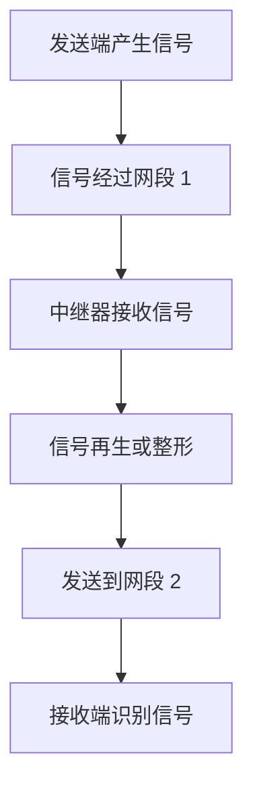
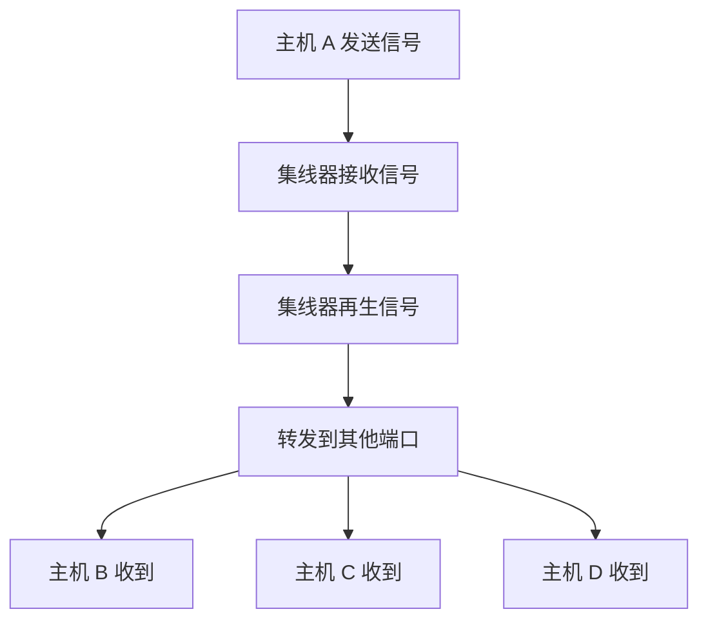
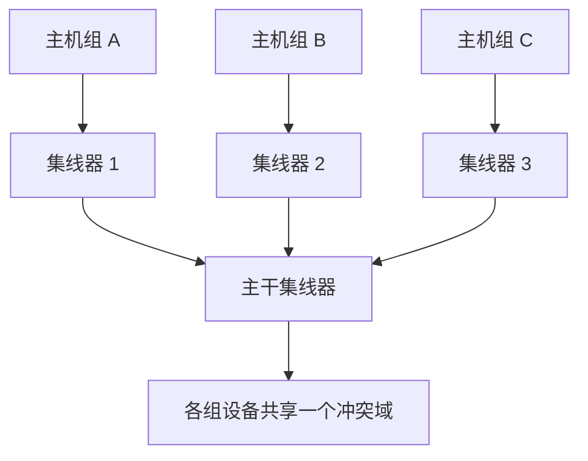
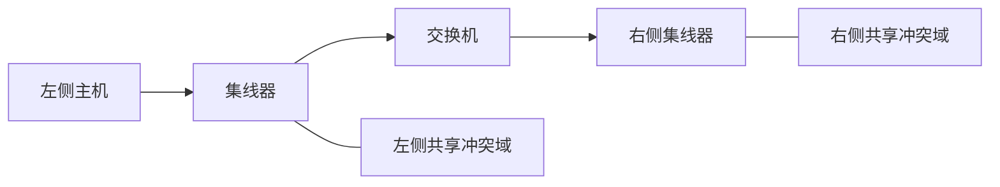
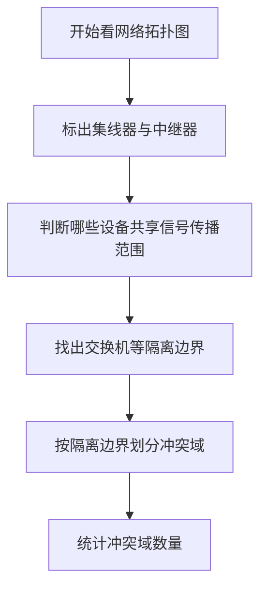

# 计算机网络物理层：中继器与集线器

> **本节重点**
>
> 1. 中继器的作用与工作原理。
> 2. 集线器的工作原理，以及它与中继器的关系。
> 3. 冲突域的概念，为什么中继器和集线器不能隔离冲突域。
> 4. 五四三原则。
> 5. 集线器网络的物理拓扑与逻辑拓扑。
> 6. 集线器连接设备时的带宽共享问题。
> 7. 考试教材表述与真实设备实现之间需要注意的边界。

---

## 一、为什么需要中继器？

### 1. 信号传输会出现衰减和失真

计算机网络中的两个节点，需要通过物理传输介质连接，例如：

- 同轴电缆；
- 双绞线；
- 光纤。

假设节点 A 要向节点 B 发送数据，二进制数据经过协议栈处理后，最终由物理层转换为适合传输介质的信号，再通过线路发送出去。

例如，某些以太网物理层会采用曼彻斯特编码，把二进制数据表示为相应的电信号。

信号在传输过程中可能受到线路损耗、噪声和其他因素的影响，导致信号衰减或失真。传输距离越长，信号质量越可能下降。当失真严重到接收端无法正确判断信号状态时，就会造成数据接收错误。


### 2. 为什么要限制传输介质的长度？

传输介质的电气特性和相关网络标准会限制线路长度。例如，传统以太网中：

| 标准    | 传输介质   |                       典型最大网段长度 |
| ------- | ---------- | -------------------------------------: |
| 10BASE5 | 粗同轴电缆 |                                  500 m |
| 10BASE2 | 细同轴电缆 | 约 185 m，入门讲解中有时近似记为 200 m |

这些是传统以太网标准中的典型值。线路长度、线缆规格、信号速率和设备标准都可能影响实际可用范围。

**核心原因：** 为了让接收端能够可靠识别信号，必须将传输距离控制在相应物理层标准允许的范围内。

### 3. 如何扩大网络的覆盖距离？

当两个节点之间的距离超过单段传输介质能够可靠支持的范围时，可以使用中继器等物理层设备，将链路分成多段。

---

## 二、中继器（Repeater）

### 1. 中继器的基本作用

**中继器（Repeater）**是工作在物理层的网络设备，主要用于对接收到的信号进行再生或整形，然后继续向另一侧发送，从而延伸信号可覆盖的距离。

中继器通常有两个端口：

- 一个端口接收信号；
- 另一个端口把再生后的信号发送到下一段链路。


### 2. 中继器如何工作？

假设节点 A 向节点 B 发送数据：

1. A 的物理层将数据转换为信号，并发送到网段 1。
2. 信号在网段 1 中传输时，可能发生衰减或失真。
3. 中继器接收到信号后，根据其物理层工作规则对信号进行再生或整形。
4. 中继器再将处理后的信号发送到网段 2。
5. B 接收到较为可靠的信号后，继续完成后续的物理层和上层处理。



### 3. 用电压范围理解信号再生

假设某种物理层接口规定：

- 0.5 V 至 1.5 V 表示低电平；
- 4.5 V 至 5.5 V 表示高电平；
- 落在这两个范围之外的电压可能被视为无效信号。

在这个**仅用于说明原理的假设例子**中：

- 标准低电平可取 1 V；
- 标准高电平可取 5 V。

如果传输后的低电平从 1 V 偏移到了 1.2 V，只要仍在有效低电平范围内，接收电路就可能正确判断它代表低电平。中继器对信号进行再生时，可以让输出重新符合相应的信号规范，从而避免前一段链路的累积失真继续影响后一段链路。

> **注意：** 上述电压范围只是课程中的示意值，不是所有以太网接口通用的电压标准。具体电气门限应以对应物理层标准为准。

### 4. 中继器的特点

- 工作在物理层。
- 主要对信号进行再生、整形或转发。
- 不能据此理解为会检查以太网帧、读取 MAC 地址或进行网络层路由。
- 通常用于延伸可覆盖的物理距离。
- 会引入一定的处理延迟。
- 传统以太网中，中继器连接的网段仍处于同一个冲突域。
- 中继器本身不能解决同一冲突域内多个设备同时发送数据导致的冲突。

### 5. 中继器与双向通信

中继器的信号可以从左向右传输，也可以从右向左传输。但在传统共享式、半双工以太网场景中，同一冲突域内的设备不能同时有效地进行双向发送，否则可能发生冲突。

- **半双工（Half-Duplex）**：两个方向都可以传输，但不能同时进行。
- **全双工（Full-Duplex）**：两个方向可以同时传输。

> 这里讨论的是传统中继式以太网的工作方式。不要把“任何中继设备在所有现代链路中都只能半双工”扩大为普遍规则；具体行为取决于设备类型和物理层标准。

---

## 三、集线器（Hub）

### 1. 集线器是什么？

**集线器（Hub）**可以看作多端口中继器。它有多个端口，收到某个端口传来的信号后，会把信号再生后转发到其他端口。

例如，一个四端口集线器可以连接多台主机：

```text
             主机 A
                |
             ┌──┴──┐
主机 B ──────│     │────── 主机 C
             │ Hub │
             │     │
             └──┬──┘
                |
             主机 D
```

> 上图展示的是设备的物理连接方式。集线器网络的逻辑拓扑会在后文解释。

### 2. 集线器的工作原理

假设主机 A 从某个端口发送信号：

1. 集线器从与 A 相连的端口接收信号。
2. 集线器对信号进行再生或整形。
3. 集线器把信号转发到其他端口。
4. 与集线器相连的其他主机都可能在各自端口收到该信号。

集线器不会像交换机那样根据 MAC 地址学习并选择性地只向目标端口转发帧。



### 3. 集线器的特点

- 工作在物理层。
- 本质上是多端口中继器。
- 将收到的信号转发到其他端口。
- 不根据 MAC 地址进行选择性转发。
- 传统集线器连接的设备共享同一个冲突域。
- 传统集线器不能隔离冲突域。
- 在共享式以太网中，带宽由连接在同一集线器上的设备共同使用。

### 4. 中继器与集线器对比

| 对比项目                 | 中继器                             | 集线器                   |
| ------------------------ | ---------------------------------- | ------------------------ |
| 英文名称                 | Repeater                           | Hub                      |
| 所属层次                 | 物理层                             | 物理层                   |
| 端口数量                 | 通常用于连接两个方向／两段链路     | 多端口                   |
| 主要操作                 | 接收并再生、整形信号，再送往另一侧 | 接收信号并向其他端口转发 |
| 根据 MAC 地址转发        | 否                                 | 否                       |
| 能否隔离冲突域           | 不能                               | 不能                     |
| 传统共享式以太网工作方式 | 半双工场景                         | 半双工、共享介质场景     |

---

## 四、冲突域（Collision Domain）

### 1. 什么是冲突域？

**冲突域**也称为**碰撞域**。

如果多个设备同时发送数据时，可能因为共享同一传输介质而发生信号冲突，那么这些设备处于同一个冲突域中。

冲突域是中继器和集线器相关考点中非常重要的概念。

### 2. 一台集线器连接的主机处于同一个冲突域

例如，一台集线器连接了四台主机：

```text
       主机 A
          |
       ┌──┴──┐
主机 B ─ Hub ─ 主机 C
       └──┬──┘
          |
       主机 D

    以上设备处于同一个冲突域
```

如果主机 A 正在发送数据，而主机 C 也在同一时间发送数据，就可能发生冲突。因此，传统集线器连接的主机共享一个冲突域。

### 3. 多台集线器互联时，冲突域会扩大

假设三台集线器原本各自连接一组主机。如果它们分别独立工作，可能对应三个相互独立的冲突域。

当它们再通过一台主干集线器互联时，信号可以在各台集线器之间继续转发。此时这些设备被放进同一个共享冲突域中。



原因是：某台主机发送的信号能够经过集线器和主干集线器被转发到其他连接路径。如果另一台主机此时也发送数据，两者就可能相互冲突。

### 4. 集线器不能隔离冲突域

这是本节的核心结论：

> **集线器不能隔离冲突域。通过集线器互联的传统共享式以太网设备通常处于同一个冲突域。**

集线器会把接收到的信号发送到其他端口，无法像交换机一样按端口分隔冲突域。

### 5. 交换机可以隔离冲突域

虽然本节主要讲中继器和集线器，但课程在真题中提前提到了以太网交换机：

- 集线器：把信号向其他端口转发，不能隔离冲突域。
- 交换机：可以依据 MAC 地址等转发信息选择端口；每个交换机端口可以形成独立的冲突域（在常见交换式以太网中）。



> 上图用于表达概念：交换机能够把两侧的冲突域隔开。图中的左、右侧若各自使用集线器，内部各自连接的主机仍共享各自的冲突域。

### 6. 冲突域与广播域不要混淆

本节的真题讲解中，题目同时询问冲突域和广播域，但当时还没有讲到广播域，因此先只分析冲突域。

本节需掌握：

- **冲突域**：关注共享介质中同时发送数据可能造成的冲突范围。
- **广播域**：属于后续交换机、路由器等知识中的概念，需要结合二层广播与三层设备继续学习。

不要因为一道题同时提到两者，就把冲突域和广播域当作同一个概念。

---

## 五、真题思路：根据设备图判断冲突域

课程提到 2020 年第 35 题，用网络设备示意图询问冲突域和广播域数量。讲解时暂时不计算广播域，只关注冲突域。

### 1. 先认识常见设备图标

不同教材或题目中的图标可能略有区别，但常见画法包括：

| 设备         | 常见图标提示（依课程讲解）                     |
| ------------ | ---------------------------------------------- |
| 集线器       | 立方体或方框，顶部常用一个箭头表示             |
| 以太网交换机 | 立方体或方框，顶部常用多个双向箭头表示         |
| 路由器       | 圆柱体或其他网络设备图标，常配有多个方向的箭头 |

**判断题目时应以图例、设备名称和题目说明为准，不要只凭图标外形作绝对判断。**

### 2. 冲突域的判断步骤

1. 找出所有集线器。
2. 确认哪些主机和集线器直接或间接相连。
3. 沿着集线器之间的连接关系追踪信号是否可以被继续转发。
4. 遇到交换机时，考虑交换机对冲突域的隔离作用。
5. 统计被交换机或其他具备相应隔离功能的设备分开的冲突域。



### 3. 课程例题的结论思路

讲解中的网络图包含四台集线器和两台交换机。由于：

- 集线器不能隔离冲突域；
- 交换机可以隔离冲突域；

所以，讲解认为该图中的冲突域数量为 **4 个**。

> 由于此处没有附上原题完整拓扑图，以上仅整理讲解中给出的结论与判断思路。实际做题仍应根据题图中的连接关系逐个划分冲突域。

---

## 六、中继器和集线器不能无限串联：五四三原则

### 1. 五四三原则是什么？

传统共享式以太网、尤其是使用同轴电缆和中继器的场景中，课程介绍了**五四三原则（5-4-3 Rule）**：

- **5**：最多涉及五个网段；
- **4**：这些网段之间最多使用四个中继器；
- **3**：最多只有三个网段连接计算机，其余网段作为中间延伸段。

```text
计算机网段 1
     |
  中继器 1
     |
中间网段 2（不接计算机）
     |
  中继器 2
     |
计算机网段 3
     |
  中继器 3
     |
中间网段 4（不接计算机）
     |
  中继器 4
     |
计算机网段 5
```

上图是示意性的串联结构，用来说明“最多五个网段、四个中继器、三个连接计算机的网段”的概念。

### 2. 为什么要有这样的限制？

中继器和集线器能够延伸信号传播范围，但它们并不能让信号传播距离无限增长。随着网络段和中继设备增加，还需要考虑：

- 信号传播与再生所需的时间；
- 共享式网络的冲突检测要求；
- 以太网标准对网络直径和设备串联方式的限制。

因此，不能简单认为“只要不断增加集线器或中继器，两个节点之间的距离就可以无限扩大”。

> **适用范围提醒：** 五四三原则属于传统共享式以太网（尤其是经典同轴电缆以太网）的历史性规则。它不是现代所有以太网结构都必须遵循的通用串联规则。

### 3. 总线型网络与同轴电缆

早期总线型以太网可能使用一根同轴电缆作为共享总线，并通过相应接口连接多台计算机。

当一台计算机向总线发送信号时，信号会沿总线传播，其他连接在这段总线上的设备都可能接收到信号。如果多台计算机同时发送数据，则可能发生冲突。

```text
主机 A ─────┬────────┬────────┬─────
            │        │        │
          主机 B   主机 C   主机 D

       一根共享总线连接多个节点
```

---

## 七、集线器网络的物理拓扑与逻辑拓扑

### 1. 物理拓扑：星型

从布线形态看，多个主机分别用独立线缆连接到中心的集线器，因此集线器网络的**物理拓扑是星型**。

```text
           主机 A
              |
              |
主机 B ──── 集线器 ──── 主机 C
              |
              |
           主机 D
```

### 2. 逻辑拓扑：总线型

从信号传播和共享介质的工作方式看，集线器收到信号后会将它转发到其他端口，因此连接在集线器上的设备共享信号传播范围。

所以，传统集线器网络通常表现为：

- **物理拓扑：星型**
- **逻辑拓扑：总线型**

### 3. 对比总结

| 观察角度               | 集线器网络的拓扑                               |
| ---------------------- | ---------------------------------------------- |
| 物理连接形态           | 星型                                           |
| 信号共享方式与逻辑特征 | 总线型                                         |
| 核心原因               | 集线器位于中心，但会把收到的信号转发到其他端口 |

> 这是集线器考点中非常常见的判断题。注意区分物理连接形态与逻辑上的信号传播方式。

---

## 八、集线器连接的设备共享带宽

### 1. 集线器的带宽是共享的

传统集线器连接多个主机时，这些主机共享同一个传输介质和冲突域。因此，集线器所连接的网络具有**共享带宽**的特点。

例如，一台标称 10 Mbps 的集线器连接八台主机：

- 10 Mbps 是共享网络的标称速率；
- 不能认为每台主机都拥有独立的 10 Mbps；
- 也不能简单保证每台主机永远平均分到 1.25 Mbps。

实际每台主机获得的吞吐量会随发送行为、冲突、协议开销和网络负载而变化。

### 2. 为什么不能直接平均分配？

假设八台主机连接在同一个 10 Mbps 共享式网络中：

| 情况                 | 结果                                               |
| -------------------- | -------------------------------------------------- |
| 只有一台主机发送数据 | 它可能使用大部分可用带宽（仍受协议和其他因素影响） |
| 多台主机同时发送     | 可能发生冲突，并通过相应机制协调发送               |
| 多台主机都持续传输   | 它们争用共享带宽，实际吞吐量不一定平均分配         |

因此，课程中“总带宽由多个节点共享”的结论是重点；“每台主机平均得到某个固定值”只能作为理想化算术示例，不能当作协议保证。

---

## 九、课程提到的两个特殊问题：连接不同介质和不同速率

课程最后讨论了两个与部分国内教材表述不完全一致的观点：

1. 集线器能否连接不同的传输介质或不同物理层协议？
2. 集线器能否连接速率不同的网段？

这两点需要区分**纯粹的传统中继器／集线器**与**具有额外转换或多速率功能的具体设备**。

### 1. 不同传输介质或不同物理层协议

课程举例提到某些设备具有同轴电缆接口和双绞线接口，并据此讨论跨介质连接。

需要区分：

- **普通中继器／集线器**的核心职责是再生并转发物理信号，通常要求相关端口符合其设计支持的物理层规范。
- 如果设备需要连接不同的物理介质或不同的物理层编码方式，并在中间进行转换，通常需要相应的收发器、介质转换器或具备转换功能的专用设备。
- 不能仅凭“设备有两个不同外形的接口”就认定它能任意转换不同的物理层协议。

例如，简单地把采用一种编码的信号直接接到使用另一种编码规范的接口上，未必能正常工作；若要实现转换，设备需要具备相应的协议／信号处理能力。

### 2. 不同速率的网段

课程也提到，现实设备可能出现不同端口速率的情况，并讨论“向下兼容”的现象。

需要注意：

- **传统共享式集线器**通常工作在单一的物理层速率和共享冲突域中。
- 不能把一个普通集线器理解成可以自动协调任意不同速率的端口。
- 某些被称为多速率或双速率集线器的设备，可能包含额外的内部结构或分段机制；这类设备不能简单代表所有传统集线器的工作方式。
- 现代以太网中，不同速率设备之间的连接通常更常见于交换机等设备，具体取决于端口是否支持相应速率、双工模式和协商机制。

### 3. 考试时该如何处理？

课程讲解明确提醒：**做题时要以考试所依据的教材和题目设定为准**。如果题目采用传统教材对中继器和集线器的简化描述，就按照该描述判断；不要把特殊硬件的能力无条件推广到所有集线器。

可以记住下面这组原则：

| 问题                                     | 稳妥的理解方式                                           |
| ---------------------------------------- | -------------------------------------------------------- |
| 集线器是否能隔离冲突域？                 | 不能，这是本节核心结论                                   |
| 传统集线器是否能任意连接不同物理层协议？ | 不能这样泛化；跨协议转换需要相应设备能力                 |
| 传统集线器是否能任意连接不同速率网段？   | 不能这样泛化；要看设备是否支持相关速率和内部结构         |
| 现实中是否存在带额外转换功能的设备？     | 存在，但不能据此改变普通集线器的基本定义                 |
| 选择题与教材说法不一致时怎么办？         | 按题目给定条件和课程要求作答，同时理解真实设备的适用边界 |

---

## 十、核心知识点汇总

### 1. 中继器与集线器

| 知识点                       | 中继器                               | 集线器                               |
| ---------------------------- | ------------------------------------ | ------------------------------------ |
| 所属层次                     | 物理层                               | 物理层                               |
| 主要作用                     | 再生、整形信号，延伸链路             | 多端口接收并再生信号，转发到其他端口 |
| 端口数量                     | 通常连接两段链路                     | 多端口                               |
| 根据 MAC 地址选择转发        | 否                                   | 否                                   |
| 隔离冲突域                   | 不能                                 | 不能                                 |
| 传统共享式以太网中共享冲突域 | 是                                   | 是                                   |
| 网络逻辑拓扑                 | 取决于实际连接；会延伸共享式信号范围 | 传统集线器网络逻辑上呈总线型         |

### 2. 冲突域相关结论

- 一台传统集线器连接的主机通常属于同一个冲突域。
- 多台集线器互联后，冲突域可能扩大为一个共享范围。
- 集线器和中继器不能隔离冲突域。
- 交换机可在常见交换式以太网中隔离冲突域。
- 集线器网络的物理拓扑是星型，逻辑拓扑是总线型。
- 集线器上的设备共享带宽，不能保证简单的平均分配。
- 传统共享式以太网中的中继器／集线器不能无限串联；五四三原则是经典网络的重要历史规则。

### 3. 记忆口诀

> **中继器：两侧再生信号。**  
> **集线器：多端口中继器，收到后发往其他端口。**  
> **集线器不隔离冲突域。**  
> **集线器网络：物理星型，逻辑总线型。**  
> **共享带宽，不保证平均分配。**  
> **五四三原则：五个网段、四个中继器、三个网段连接计算机。**

---

## 十一、复习自测

先自己作答，再核对参考答案。

1. 为什么长距离传输时可能需要使用中继器？
2. 中继器接收到信号后，主要执行什么操作？
3. 集线器为什么被称为多端口中继器？
4. 为什么集线器不能隔离冲突域？
5. 交换机与集线器在冲突域方面有什么重要区别？
6. 什么是五四三原则？
7. 集线器网络的物理拓扑和逻辑拓扑分别是什么？
8. 为什么不能把 10 Mbps 集线器连接的八台主机简单地认定为每台固定获得 1.25 Mbps？
9. 传统集线器能否任意连接不同速率、不同物理层协议的网段？
10. 做题时，遇到教材简化描述和特殊设备能力不一致，应当如何处理？

### 参考答案

1. 长距离传输可能导致信号衰减或失真；中继器可对信号再生或整形后继续发送。
2. 对信号进行再生、整形或转发。
3. 因为它有多个端口，会把一个端口收到的信号转发到其他端口。
4. 它不会根据 MAC 地址选择性转发，而是向其他端口转发信号，因此共享式网络中的设备仍在同一个冲突域。
5. 集线器不能隔离冲突域；交换机在常见交换式以太网中可以隔离冲突域。
6. 传统共享式以太网中的经典限制：最多五个网段、最多四个中继器、最多三个网段连接计算机。
7. 物理拓扑是星型，逻辑拓扑是总线型。
8. 带宽是共享的，实际吞吐量受发送行为、冲突和协议开销等因素影响，并不保证平均分配。
9. 不能这样泛化；需要检查设备是否支持相应介质、物理层规范和速率，转换功能需要额外能力。
10. 选择题按题目给定条件和考试教材要求作答，同时理解特殊设备能力并不代表所有传统集线器都具备这些功能。
