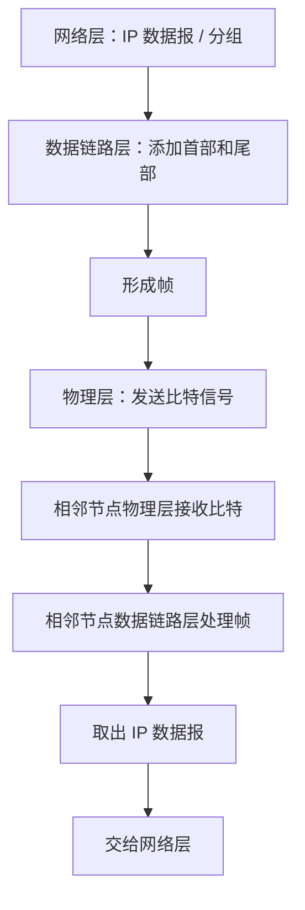
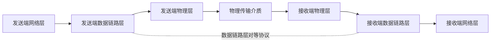
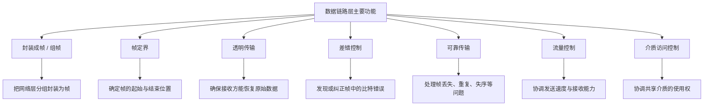
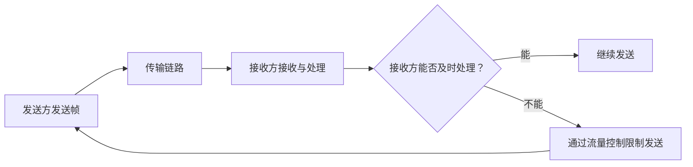
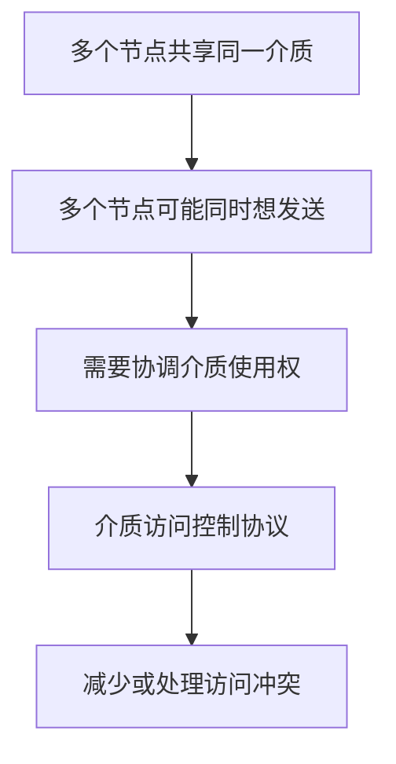
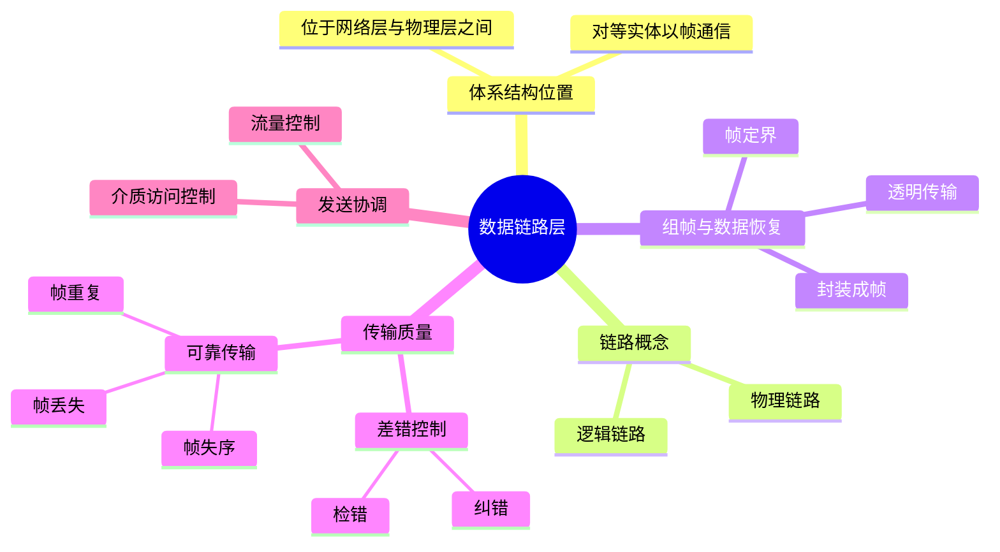

# 计算机网络：数据链路层的功能

> **本节学习目标**
>
> 1. 理解数据链路层在五层体系结构中的位置。
> 2. 区分物理链路与逻辑链路。
> 3. 理解数据链路层的主要功能：封装成帧、帧定界、透明传输、差错控制、可靠传输、流量控制和介质访问控制。
> 4. 区分比特差错与帧传输中的丢失、重复、失序问题。
> 5. 明确点对点信道与广播信道对介质访问控制的不同需求。

---

## 一、数据链路层在计算机网络体系结构中的位置

### 1. 五层体系结构回顾

计算机网络课程通常使用五层体系结构：

| 层次   | 名称       | 主要作用（概括）                 |
| ------ | ---------- | -------------------------------- |
| 第五层 | 应用层     | 为应用程序提供网络服务           |
| 第四层 | 运输层     | 为进程间通信提供传输服务         |
| 第三层 | 网络层     | 负责分组转发与网络间通信         |
| 第二层 | 数据链路层 | 在相邻节点之间以帧为单位传输数据 |
| 第一层 | 物理层     | 在物理介质上发送和接收比特       |

不同类型的网络设备需要实现的层次可能不同：

- **主机**通常需要实现第一层至第五层的功能。
- **路由器**主要需要实现第一层至第三层的功能。
- 其他网络设备实现哪些层次，则取决于设备的具体功能。

本章主要学习第二层——**数据链路层**。

### 2. 数据从源主机到目的主机的大致处理过程

假设左侧用户要向右侧用户发送一串数据。数据会经过协议栈逐层处理。

当数据到达网络层时，网络层会将其组织为 IP 数据报（也常称为分组），再交给数据链路层。数据链路层会为网络层的数据加上首部和尾部等控制信息，封装成**帧（Frame）**，随后请求物理层把帧转换为可在介质上传输的比特信号。



数据链路层的处理可以概括为：

1. **发送端**：将网络层交付的分组封装成帧。
2. **发送端物理层**：将帧作为比特序列发送到物理介质。
3. **相邻节点物理层**：接收比特序列并交给数据链路层。
4. **相邻节点数据链路层**：识别并处理帧，取出网络层数据。
5. **接收端网络层**：获得 IP 数据报，继续进行上层处理。

### 3. 数据链路层的对等通信

数据链路层的对等实体之间，以**帧**为单位进行通信；但帧在物理介质上的传输依赖于物理层提供的比特传输服务。

数据链路层向网络层提供服务：将网络层交付的 IP 数据报加上必要的控制信息，封装成帧，再交给物理层发送。



> 图中实线表示数据向下或向上的实际交付路径；虚线表示发送端与接收端的数据链路层在逻辑上按相应协议进行对等通信。实际比特传输仍然经过物理层和传输介质。

---

## 二、物理链路与逻辑链路

### 1. 物理链路

**物理链路**指相邻节点之间由物理层和传输介质实现的实际连接。

例如，两个设备之间通过双绞线或同轴电缆连接，物理介质为比特传输提供了基础。

### 2. 逻辑链路

数据链路层基于物理链路，进一步通过协议和控制机制实现相邻节点之间的逻辑数据传输关系。这种逻辑上的连接称为**逻辑链路**；有些教材也会把数据链路称为逻辑链路。

物理链路可以提供比特传输，但传输过程可能受到噪声等因素干扰，导致比特发生错误，例如：

- 原本发送 `1`，接收时变成 `0`；
- 原本发送 `0`，接收时变成 `1`。

数据链路层需要使用相应的差错控制机制，发现或处理传输中出现的错误。

### 3. 两者对比

| 对比项目             | 物理链路                         | 逻辑链路                                 |
| -------------------- | -------------------------------- | ---------------------------------------- |
| 含义                 | 相邻节点之间实际的物理连接       | 数据链路层协议建立的逻辑数据传输关系     |
| 依赖内容             | 物理介质与物理层功能             | 物理链路，以及数据链路层的协议与控制机制 |
| 主要关注             | 如何在介质上传输比特             | 如何组织、识别并控制帧的传输             |
| 是否可能受到差错影响 | 可能出现信号衰减、噪声和比特错误 | 需要通过差错控制等机制处理传输问题       |

> **理解要点：** 物理链路提供底层连接；数据链路层在此基础上实现逻辑上的帧传输与控制。

---

## 三、数据链路层的主要功能总览

数据链路层要实现的功能，可以先从整体上把握：

1. **封装成帧（组帧）**
2. **帧定界**
3. **透明传输**
4. **差错控制**
5. **可靠传输**
6. **流量控制**
7. **介质访问控制**

其中，封装成帧、帧定界和透明传输紧密相关，但解决的问题并不完全相同。



以下分别说明这些功能。

---

## 四、封装成帧（组帧）

### 1. 什么是封装成帧？

数据链路层从网络层接收到一个分组后，会为它添加数据链路层协议所需的控制信息，例如首部和尾部，从而形成一个**帧**。

```text
网络层交付的数据（分组）
┌──────────────────────────────┐
│          IP 数据报            │
└──────────────────────────────┘

数据链路层封装后
┌────────┬─────────────────────┬────────┐
│ 帧首部 │   网络层数据 / 分组  │ 帧尾部 │
└────────┴─────────────────────┴────────┘
                  一帧
```

### 2. 为什么要封装成帧？

数据链路层需要把网络层的数据组织成合适的传输单位，并在帧中放入必要的控制信息，以便接收端识别和处理。

封装成帧后，数据链路层就能以帧为单位与相邻节点进行通信。

---

## 五、帧定界

### 1. 什么是帧定界？

物理层传送的是一串比特。接收端拿到连续的比特序列后，需要判断：

- 一帧从哪里开始？
- 一帧在哪里结束？
- 连续比特流中是否包含多个帧？

这些问题由**帧定界**功能解决。

例如，物理层交给数据链路层的比特流可能对应一帧，也可能依次包含多帧：

```text
连续比特流：
... [帧 1 的比特] [帧 2 的比特] [帧 3 的比特] ...

接收端需要识别：
          ↑ 帧 1 起点
                         ↑ 帧 1 终点 / 帧 2 起点
```

不同数据链路层协议可以采用不同的帧定界方案，例如利用特定的定界标志、长度字段或其他协议规则。具体方法将在后续内容中学习。

### 2. 帧定界与封装成帧的区别

| 概念     | 主要解决的问题                               |
| -------- | -------------------------------------------- |
| 封装成帧 | 如何把网络层分组加上控制信息，组织成一个帧   |
| 帧定界   | 接收方如何确定连续比特流中每一帧的起点和终点 |

两者相互关联，但并不是同一个问题。

---

## 六、透明传输

### 1. 什么是透明传输？

数据链路层接收到网络层交付的数据（即数据链路层的服务数据单元，SDU）后，会添加帧首部、尾部等控制信息。有些成帧方式还可能需要对数据内容进行特定处理。

接收端需要能够从帧中恢复出原始的 SDU，并将其交给网络层。

所谓**透明传输**，指的是：对上层而言，数据链路层对数据所做的成帧处理不应改变上层数据本身的内容含义；接收端应能够恢复原始数据。

### 2. SDU 与协议数据单元 PDU

在分层体系结构中，可以用以下关系理解：

\[
\text{某层的 PDU}=\text{该层的 SDU}+\text{该层协议控制信息}
\]

对于数据链路层来说：

- 网络层交付的 IP 数据报，是数据链路层需要传输的 SDU。
- 数据链路层为它添加首部和尾部等控制信息。
- 封装后形成数据链路层的 PDU，也就是帧。

```text
数据链路层 SDU
┌──────────────────────┐
│ 网络层交付的 IP 数据报 │
└──────────────────────┘
            +
数据链路层控制信息
┌──────────┬──────────────┬──────────┐
│ 帧首部   │ 原始 SDU      │ 帧尾部   │
└──────────┴──────────────┴──────────┘
            ↓
          数据链路层 PDU（帧）
```

### 3. 为什么叫“透明”？

接收端将帧处理完毕后，应取出原始 SDU 并交给网络层。网络层不需要了解数据链路层为传输帧所采用的内部编码、定界或其他处理细节。

因此，组帧和拆帧对网络层而言是透明的。

> **注意：** 透明传输并不是说帧中完全没有控制信息，也不是说数据链路层不处理数据；它强调接收端能够恢复上层原始数据，不让成帧所需的处理破坏数据本身。

---

## 七、差错控制

### 1. 什么是比特差错？

信号在传输中可能受到噪声等因素的影响，导致接收方获得的比特与发送方不同。例如：

```text
发送比特：  1 0 1 1 0 0 1
接收比特：  1 0 0 1 0 0 1
                ↑
             发生差错
```

数据链路层的差错控制需要发现或处理帧中的比特错误。

### 2. 检错与纠错

常见的差错控制思路包括检错和纠错。

| 技术     | 作用                                                         | 基本思路                                       |
| -------- | ------------------------------------------------------------ | ---------------------------------------------- |
| 检错编码 | 判断数据中是否发生错误                                       | 添加冗余信息，使接收端能够检测某些差错         |
| 纠错编码 | 在满足编码能力等条件时，不仅发现错误，还能定位并纠正某些错误 | 添加足够的冗余信息，使接收端有可能直接纠正错误 |

### 3. 检错后如何处理？

发现差错后，常见处理方式之一是：

1. 接收端发现帧存在差错；
2. 丢弃该帧；
3. 通过相应的可靠传输机制，要求发送端重传。

另一种方式是在编码具备相应能力时，由接收端对某些错误进行纠正。

> **注意：** 检错编码不一定能发现所有任意差错；纠错能力也受到编码方案和冗余位数量的限制。实际系统使用哪种方式，取决于相应协议和应用需求。

### 4. 差错控制关注什么？

本节主要先建立概念：

- 检错：发现帧中的比特差错。
- 纠错：在能力范围内纠正某些比特差错。
- 重传：发现错误后，通过可靠传输机制让发送方重新发送帧。

详细的检错编码、纠错编码和重传协议会在后续小节中进一步学习。

---

## 八、可靠传输

### 1. 可靠传输与差错控制的区别

差错控制关注帧中的比特是否出错，以及如何发现或纠正这些错误。

可靠传输关注的是：接收端最终是否能够正确、完整并按要求获得发送方发送的数据。在帧传输层面，除了比特差错，还可能出现帧丢失、帧重复和帧失序等问题。

课程中需要掌握的三种典型帧错误是：

1. 帧丢失
2. 帧重复
3. 帧失序

### 2. 帧丢失

假设发送方准备发送四个帧：

```text
发送方：  1 → 2 → 3 → 4
接收方：  1 → 2 →   → 4
                   ↑
                第 3 帧丢失
```

接收方只收到第 1、2、4 帧，没有收到第 3 帧。可靠传输机制需要能够识别这种缺失，并在相应协议下让发送方重新传输缺失的帧。

### 3. 帧重复

假设发送方发送第 1、2、3、4 帧，但接收方收到：

```text
发送方：  1 → 2 → 3 → 4
接收方：  1 → 2 → 3 → 3 → 4
                       ↑
                   第 3 帧重复
```

接收方收到两个第 3 帧。可靠传输机制需要识别重复帧，避免将同一帧的数据重复交付给上层。

### 4. 帧失序

假设发送方按顺序发送第 1、2、3、4 帧，但接收方收到：

```text
发送方：  1 → 2 → 3 → 4
接收方：  1 → 3 → 2 → 4
                └─┘
                顺序发生变化
```

接收端需要根据协议采用的序号和缓存等机制，识别帧的顺序，并在需要时恢复正确顺序。

### 5. 三种帧错误对比

| 问题   | 现象                     | 需要解决的问题                   |
| ------ | ------------------------ | -------------------------------- |
| 帧丢失 | 应收到的某个帧没有到达   | 发现缺失，并按协议恢复或重传     |
| 帧重复 | 同一个帧被收到多次       | 识别重复帧，避免重复交付         |
| 帧失序 | 帧到达顺序与发送顺序不同 | 识别顺序，并按协议重新排序或处理 |

### 6. 可靠传输的核心目标

可靠传输机制的目标是尽可能确保接收端得到符合协议要求的数据。实际通过序号、确认、超时、重传、缓存或其他机制实现，具体方案取决于协议设计。

---

## 九、流量控制

### 1. 什么是流量控制？

**流量控制**主要用于协调发送方的发送速率与接收方的处理能力，避免发送方发送得过快，以至于接收方来不及接收或处理数据。



### 2. 流量控制解决什么问题？

- 发送方不能只按自身的最快速度持续发送。
- 接收方可能受到缓存容量、处理速度等因素限制。
- 协议需要协调发送与接收，避免接收方因处理不过来而丢失数据。

> 本节先掌握“控制发送速度，使接收方来得及接收”这一核心思想。具体流量控制协议将在后续内容中展开。

---

## 十、介质访问控制

### 1. 什么是介质访问控制？

介质访问控制（Medium Access Control，MAC）要解决的问题是：当多个节点共享同一传输介质时，如何协调它们对传输介质的使用权。

这里的“介质”指物理传输介质。

### 2. 为什么广播信道需要介质访问控制？

广播信道在逻辑上常呈现共享介质的特点。如果多个节点同时争用同一介质，就可能发生冲突。因此，需要通过相应协议决定哪个节点在什么条件下可以发送数据。



介质访问控制主要关注共享传输介质的使用规则，例如如何竞争信道、如何安排发送时机等。

### 3. 为什么点对点信道通常不需要争用？

点对点信道连接两个节点，链路由这两个节点专用。例如，电脑通过一根网线连接家庭路由器。

在这种情况下，信道由这两个节点使用，不需要像共享广播介质那样，在许多发送节点之间竞争同一介质的访问权。

如果链路支持全双工通信，两个方向还可以同时传输数据。

### 4. 点对点信道与广播信道对比

| 对比项目         | 点对点信道                 | 广播信道／共享介质                 |
| ---------------- | -------------------------- | ---------------------------------- |
| 连接特点         | 两个节点之间的链路         | 多个节点共享同一传输介质           |
| 是否需要争用介质 | 通常不需要多个节点之间争用 | 通常需要协调共享介质的访问         |
| 主要关注         | 链路两端的数据传输         | 多节点如何合理使用共享介质         |
| 典型问题         | 传输、差错控制、流量控制等 | 除其他功能外，还要考虑介质访问控制 |

> **补充说明：** 介质访问控制是否需要，取决于具体链路和协议的共享方式，不能只凭介质外观判断。在本节的概念框架中，广播信道通常需要介质访问控制，点对点专用链路通常不需要多节点争用机制。

---

## 十一、数据链路层功能对照表

| 功能           | 核心问题                           | 关键词                       |
| -------------- | ---------------------------------- | ---------------------------- |
| 封装成帧／组帧 | 如何把网络层分组组织为帧？         | 帧首部、帧尾部、控制信息     |
| 帧定界         | 如何找到帧的起点和终点？           | 帧边界、定界标志、长度等     |
| 透明传输       | 接收端如何还原上层原始数据？       | 恢复 SDU、对上层透明         |
| 差错控制       | 如何发现或纠正帧中的比特错误？     | 检错、纠错、重传             |
| 可靠传输       | 如何处理帧丢失、重复、失序等问题？ | 序号、确认、超时、重传、排序 |
| 流量控制       | 如何避免发送方发送过快？           | 发送速率、接收能力、缓存     |
| 介质访问控制   | 多节点共享介质时如何协调使用权？   | 信道争用、发送时机、MAC      |

---

## 十二、复习时容易混淆的概念

### 1. 帧定界与透明传输

- **帧定界**：接收方要能判断每个帧从哪里开始、到哪里结束。
- **透明传输**：接收方要能从帧中还原原始 SDU，使成帧处理不破坏上层数据。

### 2. 差错控制与可靠传输

- **差错控制**：着重处理帧中的比特差错，例如检错和纠错。
- **可靠传输**：着重保证数据按协议要求正确交付，也需要处理帧丢失、重复、失序等情况。

二者存在联系，但关注重点不同。

### 3. 流量控制与介质访问控制

- **流量控制**：协调发送速度和接收能力，解决“发送得是否太快”的问题。
- **介质访问控制**：协调多个节点对共享介质的使用权，解决“谁可以使用共享信道发送”的问题。

### 4. 物理链路与逻辑链路

- **物理链路**：相邻节点之间的实际物理连接。
- **逻辑链路**：数据链路层协议基于物理链路实现的逻辑数据传输关系。

---

## 十三、知识框架图



---

## 十四、复习自测

先尝试独立回答，再对照参考要点。

1. 数据链路层的对等实体通常以什么为单位进行数据传输？
2. 数据链路层如何向网络层提供服务？
3. 物理链路和逻辑链路有什么区别？
4. 封装成帧与帧定界分别解决什么问题？
5. 什么是透明传输？为什么对上层来说，组帧和拆帧应当是透明的？
6. 检错编码和纠错编码分别有什么作用？
7. 可靠传输需要处理哪三种典型帧错误？
8. 流量控制解决什么问题？
9. 介质访问控制主要解决什么问题？
10. 为什么广播信道通常需要介质访问控制，而点对点专用链路通常不需要多个节点之间的争用机制？

### 参考答案要点

1. 帧。
2. 将网络层交付的分组封装成帧，交给物理层发送；接收端处理帧后取出分组并交给网络层。
3. 物理链路是实际物理连接；逻辑链路是数据链路层协议基于物理链路实现的逻辑数据传输关系。
4. 封装成帧是把分组添加控制信息并组织为帧；帧定界是识别每一帧的起点和终点。
5. 接收端应能从帧中恢复原始 SDU，成帧处理不应破坏上层数据。
6. 检错编码用于发现某些差错；纠错编码在编码能力范围内可以定位并纠正某些差错。
7. 帧丢失、帧重复、帧失序。
8. 协调发送方速率和接收方处理能力，避免发送过快。
9. 协调多个节点对共享传输介质的使用权。
10. 广播信道由多个节点共享，可能需要争用；点对点专用链路通常只连接两个节点，不需要多节点竞争同一介质的访问权。

---

## 十五、课程补充提示

课程中提到，如果使用的是 **2025 版《王道计算机网络》**相关教材，可以结合课程说明，按授课安排决定是否跳过教材的 3.1.2 和 3.1.3 两个小节。教材版本及后续修订可能不同，复习时以自己使用的版本、老师要求和考试大纲为准。
