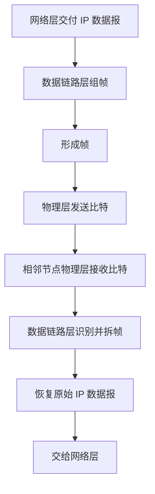
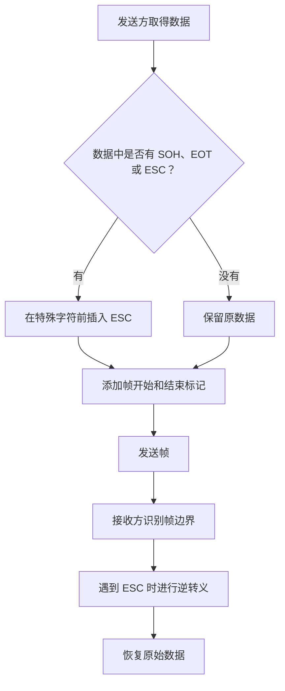
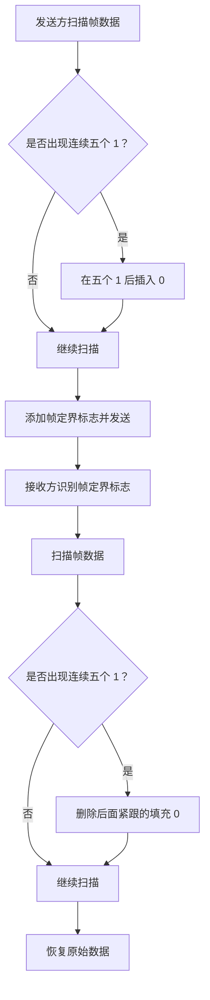
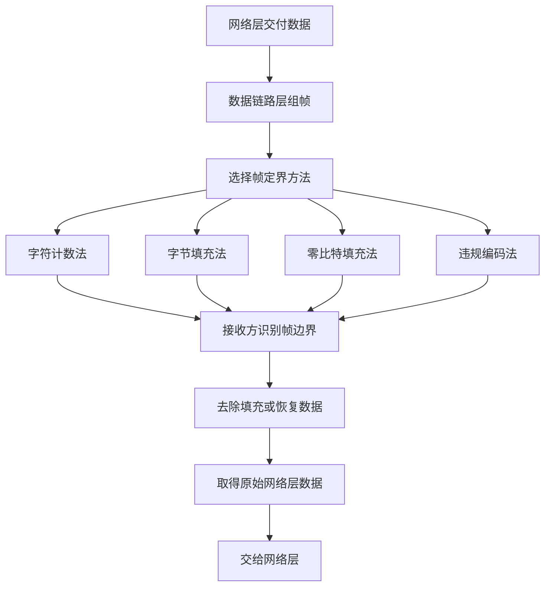

# 计算机网络数据链路层：组帧方法

> **本节重点**
>
> 1. 理解数据链路层为什么要组帧。
> 2. 理解帧定界与透明传输分别要解决什么问题。
> 3. 掌握四种常见组帧方法：字符计数法、字节填充法、零比特填充法、违规编码法。
> 4. 牢记字符计数法的长度字段包含自身；字节填充法的转义规则；零比特填充法的“连续五个 1 后填 0”。
> 5. 知道 HDLC 等协议采用零比特填充的基本思路，并注意具体协议模式的差异。

---

## 一、为什么需要组帧？

### 1. 数据链路层的作用

数据链路层位于网络层下方，为网络层提供相邻节点之间的数据传输服务。

网络层会将 IP 数据报（也称分组）交给数据链路层。数据链路层需要在数据前后添加相应的控制信息，将其封装成一个**帧（Frame）**，再交给物理层发送。

接收端的数据链路层收到帧后，需要识别帧的边界，从帧中恢复出原始 IP 数据报，并交给网络层继续处理。



### 2. 什么是组帧？

**组帧（Framing），也称封装成帧**，就是数据链路层把网络层交付的数据组织成帧的过程。

一个简单的帧结构可以表示为：

```text
┌────────────┬──────────────────────┬────────────┐
│   帧首部   │   网络层交付的数据   │   帧尾部   │
└────────────┴──────────────────────┴────────────┘
                  一个数据链路层帧
```

帧首部和帧尾部可能携带帧定界、地址、差错检测等控制信息，具体取决于数据链路层协议。

### 3. 组帧要解决的两个核心问题

组帧主要要解决两个问题：

1. **帧定界**：接收方怎样从连续的比特流中判断一帧从哪里开始、在哪里结束？
2. **透明传输**：接收方怎样去除组帧过程中加入的附加信息，并恢复帧内原始数据？

| 问题     | 关注点                             | 接收端要完成的事情               |
| -------- | ---------------------------------- | -------------------------------- |
| 帧定界   | 帧与帧之间的边界在哪里？           | 识别每个帧的起点和终点           |
| 透明传输 | 如何避免帧内数据被误认为定界信息？ | 去除填充或转义信息，恢复原始数据 |

### 4. 为什么帧定界和透明传输都重要？

物理层传输的是连续的比特序列。接收方不能仅凭“比特流到了”就知道某一帧在哪里开始、在哪里结束。

发送方为帧添加定界标记或对数据进行必要的变换后，接收方还必须能够区分：

- 真正用于标记帧边界的控制信息；
- 恰好出现在帧数据内部、但与控制标记相同或相似的内容。

因此，组帧既要能定界，又要保证接收端能够恢复原始数据。

---

## 二、四种常见组帧方法总览

常见的组帧方法包括：

1. **字符计数法**
2. **字节填充法**
3. **零比特填充法**
4. **违规编码法**

| 方法         | 定界思路                                 | 为透明传输采取的处理                       | 主要特点                             |
| ------------ | ---------------------------------------- | ------------------------------------------ | ------------------------------------ |
| 字符计数法   | 帧首部的计数字段记录帧长度               | 通常不依靠特殊标记来避开数据内容           | 计数字段若出错，可能影响后续帧的定界 |
| 字节填充法   | 用特殊字符标记帧的开始和结束             | 数据中出现特殊字符时，在其前面插入转义字符 | 按字节处理，接收端进行逆操作         |
| 零比特填充法 | 用特殊比特串作为开始和结束标记           | 数据中连续出现五个 `1` 后插入一个 `0`      | 常见、便于硬件实现                   |
| 违规编码法   | 利用不符合正常编码规则的信号作为定界标志 | 数据本身使用正常编码，定界处使用违规信号   | 需要物理层编码规则配合               |

---

## 三、字符计数法

### 1. 基本原理

字符计数法（Character Count）的做法是：在帧首部设置一个固定长度的计数字段，用来表示**整个帧的总长度**。

例如，使用 1 个字节（8 bit）记录帧的总字节数：

```text
┌─────────────────┬─────────────────────────────┐
│ 计数字段：7 字节 │      帧的数据部分           │
└─────────────────┴─────────────────────────────┘
          ↑
       计数字段本身也是帧的一部分
```

假设计数字段的值为十进制 `7`，表示整个帧的总长度是 7 字节。如果计数字段占 1 字节，那么数据部分就是剩余的 6 字节。

\[
\text{帧总长度}=\text{计数字段长度}+\text{帧数据部分长度}
\]

### 2. 长度字段的取值范围

如果计数字段长度为 8 bit，则它最多能够表示 \(2^8=256\) 种二进制取值。若按无符号整数解释，数值范围为：

\[
0\sim 255
\]

因此，在该示例中，1 字节的计数字段无法表示大于 255 的数值。实际协议还会规定哪些长度值有效。

> **易错点：** 计数字段记录的是整个帧的长度，包含计数字段本身，而不只是后面的数据部分。

### 3. 字段出错的影响

字符计数法的主要缺点是：如果计数字段出错，接收方可能无法正确判断当前帧的长度，从而导致后续帧的边界也被误判。

例如，原本计数字段记录的值是 `7`，但传输过程中其中某个比特发生变化，接收方可能把它解释成 `3`。接收方就会过早地认为第一帧结束，并把后续某个字节误认为下一帧的长度字段。

```text
正确理解：
[帧 1：长度 7] [帧 2：长度 ...] [帧 3：...]

计数字段出错后：
[帧 1：被误读为更短] [从错误位置解释帧 2] [后续边界继续错位...]
```

这会产生类似多米诺骨牌的影响：前面的长度判断一旦出错，后续帧的定界就可能连续发生错误。

### 4. 字符计数法总结

| 项目             | 内容                                                   |
| ---------------- | ------------------------------------------------------ |
| 如何定界         | 通过首部的计数字段确定帧长                             |
| 长度字段表示什么 | 整个帧的长度，包含计数字段本身                         |
| 主要优点         | 思路直观、实现简单                                     |
| 主要缺点         | 长度字段一旦发生差错，可能导致后续帧的边界判断全部错乱 |

---

## 四、字节填充法

### 1. 基本原理

字节填充法（Byte Stuffing）使用特定的控制字符标记帧的开始和结束。

课程示例中使用的字符如下：

| 字符  | 英文全称            | 十六进制值 | 用途                 |
| ----- | ------------------- | ---------: | -------------------- |
| `SOH` | Start of Header     |     `0x01` | 示例中作为帧开始标记 |
| `EOT` | End of Transmission |     `0x04` | 示例中作为帧结束标记 |
| `ESC` | Escape Character    |     `0x1B` | 转义字符             |

这些名称来自 ASCII 控制字符。实际协议可以采用不同的定界字符组合；本节先按照课程中的 `SOH`、`EOT`、`ESC` 示例理解。

### 2. 仅使用开始和结束字符会有什么问题？

假设发送方约定：

- `SOH` 表示一帧开始；
- `EOT` 表示一帧结束。

但如果帧的数据部分本身刚好包含 `SOH` 或 `EOT`，接收方就可能把数据内容误认为真正的帧边界。

例如：

```text
SOH | A | B | EOT | C | EOT
↑                 ↑
帧开始标记        数据内部恰好出现 EOT

如果没有额外规则，接收方可能把数据内部的 EOT
误判为整帧结束。
```

因此，需要一种机制来区分“作为数据出现的特殊字符”和“真正表示控制意义的特殊字符”。

### 3. 使用 ESC 进行转义

字节填充法的规则是：

> 如果帧的数据部分包含特殊字符 `SOH`、`EOT` 或 `ESC`，发送方就在该字符前面插入一个 `ESC` 转义字符。

这样，接收方遇到数据中的 `ESC` 时，就知道后面跟着的是普通数据字符，而不应把它简单解释为帧定界符。

### 4. 发送方如何填充？

假设帧的数据部分原本包含：

```text
普通数据：  A | EOT | B | SOH | C | ESC | D
```

发送方进行字节填充后，可以表示为：

```text
填充后：    A | ESC EOT | B | ESC SOH | C | ESC ESC | D
```

也就是说：

- 数据中的 `EOT` 前面加 `ESC`；
- 数据中的 `SOH` 前面加 `ESC`；
- 数据中的 `ESC` 自身前面也加 `ESC`。

完整帧示意：

```text
┌─────┬────────────────────────────────────┬─────┐
│ SOH │ A | ESC EOT | B | ESC SOH | C ...  │ EOT │
└─────┴────────────────────────────────────┴─────┘
帧开始                    数据部分           帧结束
```

### 5. 接收方如何逆处理？

接收方从帧开始标记之后读取内容：

1. 识别真正的帧边界。
2. 在帧的数据部分内，如果遇到 `ESC`，就把它作为转义提示处理。
3. 去掉填充用的 `ESC`，并把后面的字符按原始数据保留下来。
4. 继续读取，直到遇到真正的帧结束标记。

通过发送方的填充和接收方的逆处理，接收方就能恢复原始数据。

### 6. 字节填充法示意流程



### 7. 字节填充法总结

| 项目                             | 内容                                         |
| -------------------------------- | -------------------------------------------- |
| 如何定界                         | 用特殊字符标记帧开始和结束                   |
| 如何解决数据中出现特殊字符的问题 | 在特殊字符前插入 `ESC`                       |
| 发送方的任务                     | 扫描数据，必要时填充转义字符                 |
| 接收方的任务                     | 识别帧边界，删除填充用的 `ESC`，恢复原始数据 |
| 主要特点                         | 以字节／字符为处理单位，规则直观             |

> **注意：** `SOH`、`EOT`、`ESC` 是本节讲解使用的示例。不同协议可以使用其他控制字符或定界标志，但“转义特殊数据，避免与帧边界混淆”的思想相同。

---

## 五、零比特填充法

### 1. 基本原理

零比特填充法（Bit Stuffing）不按字节处理，而是在比特流中插入额外的 `0`。

课程中使用的帧开始和结束标记为：

```text
01111110
```

也就是：

```text
0 + 六个连续的 1 + 0
```

接收方通过识别这个特殊比特串来判断帧的边界。

### 2. 为什么需要填充 0？

如果帧的数据部分刚好也出现 `01111110`，接收方就可能误以为数据中出现了帧的开始或结束标记。

为了避免这种情况，发送方会扫描帧的数据部分：

> **每当遇到连续五个 `1`，就在这五个 `1` 后面插入一个 `0`。**

这样处理后，帧的数据部分不会出现标记中所包含的连续六个 `1`，因此不会与 `01111110` 这个定界标志混淆。

### 3. 发送方填充示例

假设某段数据中出现连续五个 `1`：

```text
原始数据：  1 0 1 1 1 1 1 0 1
                    └─────┘
                    五个连续的 1

填充之后：  1 0 1 1 1 1 1 0 0 1
                              ↑
                     在五个 1 后插入的 0
```

继续从左向右扫描，凡是帧的数据部分出现连续五个 `1`，发送方就执行相同操作。

> **记忆重点：** 填充条件是“连续五个 `1`”，不是“连续六个 `1`”。

### 4. 帧的结构示意

```text
┌──────────┬──────────────────────────┬──────────┐
│ 01111110 │   经过零比特填充的数据   │ 01111110 │
└──────────┴──────────────────────────┴──────────┘
  开始标记             帧数据             结束标记
```

### 5. 接收方如何逆处理？

接收方需要做发送方的逆操作：

1. 识别帧的开始和结束标记 `01111110`。
2. 处理帧的数据部分。
3. 从左向右扫描比特流。
4. 每当遇到连续五个 `1`，检查紧跟其后的比特；如果该比特为填充的 `0`，就将其删除。
5. 继续处理，恢复原始帧数据。

发送方与接收方的过程可以总结如下：



### 6. 为什么这种方法能保证透明传输？

帧的开始和结束标记中包含连续六个 `1`。发送方会在数据部分出现连续五个 `1` 后立刻插入一个 `0`，因此在填充完成的数据部分中，不会出现连续六个 `1`。

于是：

- 真正的标记 `01111110` 可以用来识别帧边界；
- 数据内部不会未经处理地出现相同的标记模式；
- 接收方去除填充的 `0` 后，可以恢复原始数据。

### 7. HDLC 与 PPP

课程要求记住两个协议名称：

- **HDLC（High-Level Data Link Control，高级数据链路控制）**
- **PPP（Point-to-Point Protocol，点对点协议）**

按照本课程这一部分的讲解口径，HDLC 和 PPP 会与零比特填充方法一起讲解。

> **协议细节提醒：** HDLC 的同步帧传输常用 `01111110` 标志和零比特填充。PPP 的具体填充方式要结合链路模式理解：同步 PPP 常用比特填充，异步 PPP 常使用字节转义。做课程题目时，先遵循题干和教材对协议场景的设定。

### 8. 零比特填充法总结

| 项目         | 内容                                         |
| ------------ | -------------------------------------------- |
| 帧定界标记   | `01111110`                                   |
| 发送方规则   | 数据部分每出现连续五个 `1`，就在后面填充 `0` |
| 接收方规则   | 发现连续五个 `1` 后，删除后面紧跟的填充 `0`  |
| 核心作用     | 避免帧数据与定界标记混淆，实现透明传输       |
| 典型协议联系 | HDLC；PPP 的同步链路场景也使用比特填充       |

---

## 六、违规编码法

### 1. 基本原理

违规编码法（Coding Violation）利用正常编码规则中不允许出现的信号形式来表示帧的开始或结束。

它需要**物理层编码规则的配合**：数据本身仍按照正常的编码方式表示，而帧边界则使用不符合正常编码规则的信号形式来表示。

### 2. 以曼彻斯特编码为例

曼彻斯特编码规定：在每个码元／时钟周期的中间位置必须发生一次跳变。跳变的方向用于表示数据值，具体映射应以题目或协议采用的约定为准。

按照课程示例采用的约定：

- 中间点上跳表示二进制 `0`；
- 中间点下跳表示二进制 `1`。

例如，数据比特串为：

```text
数据：      0 1 0 0 1 1 1
中间跳变：  ↑ ↓ ↑ ↑ ↓ ↓ ↓
```

正常的曼彻斯特信号在每个码元的中间点都有跳变。如果某个信号在规定的中间位置没有发生所要求的跳变，就属于不符合该编码规则的信号形式。

### 3. 用违规信号表示帧边界

可以在帧数据开始前放置一个特殊的违规信号，表示帧开始；在帧数据结束后再放置一个违规信号，表示帧结束。

```text
违规信号      正常编码的数据部分       违规信号
   |        |-------------------|         |
   ↓                                   ↓
 帧开始标记                           帧结束标记
```

这样，接收方物理层就能依据违规信号识别帧边界，并将相应信息交给数据链路层处理。

### 4. 为什么需要物理层配合？

数据链路层本身组织帧，但具体信号的编码由物理层执行。因此，发送方的数据链路层需要与物理层配合，让物理层在帧的起点和终点采用规定的违规信号。

接收方物理层同样需要识别这些特殊信号，再将恢复出的帧数据交给数据链路层。

### 5. 违规编码法总结

| 项目               | 内容                                                         |
| ------------------ | ------------------------------------------------------------ |
| 定界思路           | 用正常编码规则中不允许出现的信号表示边界                     |
| 是否需要物理层配合 | 需要                                                         |
| 优点               | 边界标记可与正常编码的数据区分                               |
| 关键前提           | 必须存在能够识别的违规信号形式，且发送端和接收端采用一致规则 |

---

## 七、四种组帧方法对比

| 对比项目         | 字符计数法                     | 字节填充法                     | 零比特填充法                    | 违规编码法                 |
| ---------------- | ------------------------------ | ------------------------------ | ------------------------------- | -------------------------- |
| 定界依据         | 首部的长度字段                 | 特殊字符                       | 特殊比特串                      | 不符合正常编码规则的信号   |
| 发送方的主要处理 | 写入帧长度                     | 数据中出现特殊字符时插入 `ESC` | 连续五个 `1` 后插入 `0`         | 在边界位置使用违规信号     |
| 接收方的主要处理 | 按长度字段确定帧边界           | 识别控制字符并逆转义           | 识别标志并删除填充的 `0`        | 识别违规信号               |
| 透明传输的关键   | 计数值必须可靠                 | 区分数据字符与控制字符         | 避免数据中出现定界标记          | 数据编码与违规信号需可区分 |
| 主要风险或限制   | 长度字段出错会导致后续边界错位 | 需要正确执行转义和逆转义       | 需要准确处理连续 `1` 的填充规则 | 需要物理层支持相应编码规则 |

---

## 八、常考细节与易错点

### 1. 字符计数法的长度

如果帧首部的计数字段占 1 字节，且字段值为 7，表示的是整个帧共 7 字节。

\[
\boxed{\text{帧总长度}=\text{计数字段长度}+\text{数据部分长度}}
\]

不要误把 7 字节当成纯数据长度。

### 2. 字节填充法的转义字符

- `SOH`：示例中的帧开始标记。
- `EOT`：示例中的帧结束标记。
- `ESC`：转义字符。

帧的数据部分如果出现 `SOH`、`EOT` 或 `ESC`，发送方需要在其前面插入 `ESC`。接收方再去掉填充的转义字符，恢复原始数据。

### 3. 零比特填充法的规则

- 帧定界标志：`01111110`。
- **每连续五个 `1` 后填充一个 `0`。**
- 接收方检测到连续五个 `1` 后，删除后面紧跟的填充 `0`。
- 填充规则应用于帧数据部分；帧定界标志本身不按普通数据填充。

### 4. 违规编码法的重点

- 利用正常编码规则中不会出现的信号形式表示帧边界。
- 需要物理层编码规则配合。
- 使用曼彻斯特编码理解时，记住每个码元中间点按规则应有一次跳变；不符合规定的信号可用于特定的定界用途。

### 5. 透明传输的本质

透明传输并不是“不对数据做任何处理”，而是：

> **发送方可以为组帧而添加或变换信息，但接收方能够进行逆处理，最终恢复出原始数据。**

---

## 九、复习流程图



---

## 十、复习自测

先独立回答，再对照答案要点。

1. 组帧要解决哪两个核心问题？
2. 字符计数法的计数字段表示数据部分长度还是整个帧的长度？
3. 为什么字符计数法的计数字段发生错误后，可能影响后续所有帧？
4. 字节填充法使用的 `SOH`、`EOT` 和 `ESC` 分别起什么作用？
5. 如果数据部分中出现 `ESC`，发送方应如何处理？
6. 零比特填充法使用什么比特串作为帧标记？
7. 零比特填充法在数据部分什么时候填充 `0`？
8. 接收方如何执行零比特填充法的逆操作？
9. 违规编码法为什么需要物理层配合？
10. HDLC 与 PPP 的填充方式应注意什么差别？

### 参考答案要点

1. 帧定界，以及接收端能够恢复帧内原始数据的透明传输。
2. 整个帧的长度，包含计数字段本身。
3. 接收方可能从错误位置寻找下一帧的长度字段，导致后续帧的边界连续错位。
4. `SOH` 用于示例中的开始标记，`EOT` 用于结束标记，`ESC` 用于转义数据中出现的特殊字符。
5. 在数据中的 `ESC` 前面再插入一个 `ESC`，接收方逆转义后保留原始字符。
6. `01111110`，即一个 `0`、六个连续的 `1`、再一个 `0`。
7. 每当帧数据部分出现连续五个 `1`，就在后面填充一个 `0`。
8. 在帧数据中检测连续五个 `1`，并删除其后紧跟的填充 `0`。
9. 因为违规信号依赖于物理层的编码规则，发送端和接收端都必须能够生成或识别该信号。
10. HDLC 的同步帧常用零比特填充；PPP 的具体方式要结合链路模式，异步 PPP 常使用字节转义，同步 PPP 常使用比特填充。

---

## 十一、快速记忆

> **字符计数法**：首部记长度，长度包含首部的计数字段；计数出错可能导致后续帧定界错位。
>
> **字节填充法**：`SOH` 开始，`EOT` 结束；数据中遇到 `SOH`、`EOT`、`ESC`，就在前面填 `ESC`。
>
> **零比特填充法**：帧标志为 `01111110`；数据中每连续五个 `1` 后填 `0`，接收方再删除填充的 `0`。
>
> **违规编码法**：用正常编码规则不允许出现的信号表示边界，需要物理层配合。
