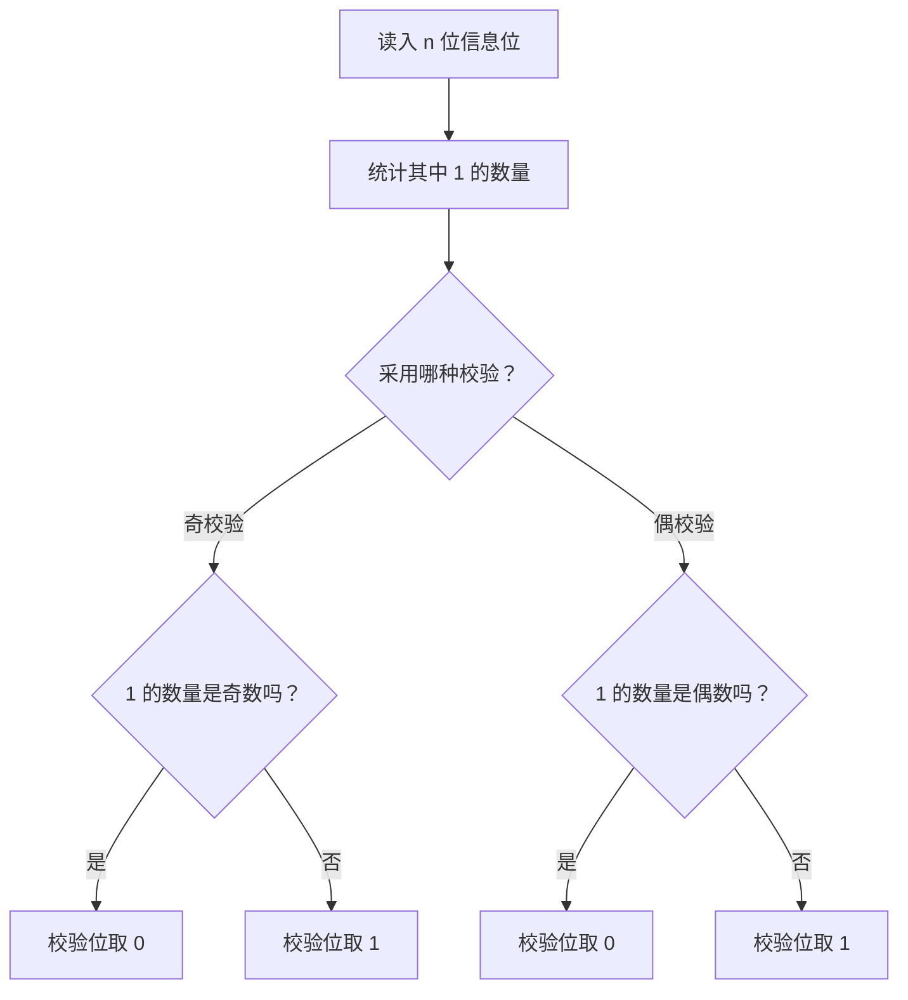

# 计算机网络数据链路层：奇偶校验码

> **本节重点**
>
> 1. 理解数据链路层差错控制的目标。
> 2. 掌握信息位、校验位（冗余位）的概念。
> 3. 区分奇校验与偶校验的规则。
> 4. 掌握异或（XOR，也称模 2 加）运算。
> 5. 会计算奇偶校验位，并判断接收的比特串是否符合校验规则。
> 6. 明确奇偶校验码只能检错、不能纠错；能够检测奇数个比特错误，但可能漏检偶数个比特错误。

---

## 一、差错控制概述

### 1. 为什么需要差错控制？

数据链路层在传输帧时，传输介质可能受到噪声等因素影响，导致帧内部的比特发生错误。例如：

```text
发送方发送：  1 0 1 1 0 0 1
接收方收到：  1 0 0 1 0 0 1
                  ↑
               比特发生错误
```

数据链路层需要能够发现帧内部的比特错误，这就是**差错控制**的重要目标。

### 2. 发现差错后，如何处理？

发现差错后，常见思路有两种：

1. **检错后丢弃并重传**：接收方检测到帧存在错误，就丢弃该帧，并通过可靠传输机制促使发送方重新发送。
2. **纠错**：接收方不仅能发现错误，还能在编码能力允许的情况下确定错误位置并修正错误。

这两种思路涉及不同的编码技术：

| 目的                   | 技术类型 | 本课程涉及的例子                  |
| ---------------------- | -------- | --------------------------------- |
| 发现是否发生比特错误   | 检错编码 | 奇偶校验码、CRC（循环冗余校验码） |
| 发现并纠正某些比特错误 | 纠错编码 | 海明校验码                        |

本节先学习最简单的检错编码：**奇偶校验码**。CRC 和海明校验码会在后续内容中学习。

---

## 二、信息位与校验位

### 1. 信息位

**信息位**是帧中真正承载有效数据的比特。

假设有 \(n\) 个信息位：

\[
x_1,x_2,\ldots,x_n
\]

### 2. 校验位（冗余位）

为了检测数据中是否发生比特错误，发送方会在信息位前面或后面增加额外的比特，称为**校验位**。校验位也常称为**冗余位**。

对于单比特奇偶校验码：

- 信息位有 \(n\) 位；
- 增加 1 位校验位；
- 最终传输 \(n+1\) 位。

```text
┌──────────┬─────────────────────────────┐
│ 校验位   │           信息位            │
└──────────┴─────────────────────────────┘
  1 bit              n bits

总长度：n + 1 bits
```

校验位可以放在信息位之前，也可以放在之后，具体取决于所采用的协议或题目约定。

---

## 三、奇偶校验码的基本原理

奇偶校验分为两种：

1. **奇校验（Odd Parity）**
2. **偶校验（Even Parity）**

两者的思路类似，区别在于增加校验位之后，整个码字中 `1` 的总数应满足不同要求。

### 1. 奇校验

使用奇校验时，发送方需要选择校验位，使得：

> **校验位 + 信息位组成的整个比特串中，`1` 的总数为奇数。**

例如，信息位中原本有 4 个 `1`。为了让加入校验位后的 `1` 的总数变成奇数，校验位应当为 `1`。

\[
4+1=5
\]

总共有 5 个 `1`，符合奇校验规则。

如果信息位中原本有 5 个 `1`，那么校验位应当为 `0`，这样总数仍为 5，是奇数。

### 2. 偶校验

使用偶校验时，发送方需要选择校验位，使得：

> **校验位 + 信息位组成的整个比特串中，`1` 的总数为偶数。**

例如，信息位中原本有 4 个 `1`，校验位应当为 `0`，这样整个比特串仍有 4 个 `1`，符合偶校验规则。

如果信息位中原本有 5 个 `1`，校验位应当为 `1`：

\[
5+1=6
\]

总共有 6 个 `1`，符合偶校验规则。

### 3. 奇校验与偶校验对比

| 信息位中 `1` 的数量 | 奇校验位 | 加入校验位后的 `1` 数量 | 偶校验位 | 加入校验位后的 `1` 数量 |
| ------------------: | -------: | ----------------------: | -------: | ----------------------: |
|           4（偶数） |        1 |               5（奇数） |        0 |               4（偶数） |
|           5（奇数） |        0 |               5（奇数） |        1 |               6（偶数） |
|           6（偶数） |        1 |               7（奇数） |        0 |               6（偶数） |
|           7（奇数） |        0 |               7（奇数） |        1 |               8（偶数） |

**快速记忆：**

- **奇校验**：最终 `1` 的总数必须是奇数。
- **偶校验**：最终 `1` 的总数必须是偶数。

---

## 四、如何计算校验位？

### 1. 使用数 `1` 的个数判断

题目给出一串信息位时，可以先数一数其中 `1` 的数量。

#### 示例一：信息位中有 4 个 `1`

- 奇校验：当前有 4 个 `1`，是偶数，因此添加校验位 `1`，使总数变为 5。
- 偶校验：当前有 4 个 `1`，已经是偶数，因此添加校验位 `0`。

#### 示例二：信息位中有 5 个 `1`

- 奇校验：当前有 5 个 `1`，已经是奇数，因此添加校验位 `0`。
- 偶校验：当前有 5 个 `1`，是奇数，因此添加校验位 `1`，使总数变为 6。

### 2. 计算步骤



> 无论采用哪一种规则，目标都是让“信息位与校验位合起来”的 `1` 数量满足指定奇偶性。

---

## 五、异或运算（XOR）

奇偶校验经常使用异或运算实现。异或也称为 **XOR**，在一些教材中也称为**模 2 加**。

### 1. 异或的规则

两个比特进行异或运算时：

- 两个比特不同，结果为 `1`；
- 两个比特相同，结果为 `0`。

真值表如下：

| \(A\) | \(B\) | \(A\oplus B\) |
| ----: | ----: | ------------: |
|     0 |     0 |             0 |
|     0 |     1 |             1 |
|     1 |     0 |             1 |
|     1 |     1 |             0 |

符号 \(\oplus\) 表示异或。

记忆口诀：

> **相同为 0，不同为 1。**

### 2. 多个比特进行异或

多个比特可以依次进行异或运算。例如：

\[
1\oplus1=0
\]

接着：

\[
(1\oplus1)\oplus0=0\oplus0=0
\]

再例如：

\[
1\oplus1\oplus0\oplus1=1
\]

异或运算还有一个重要规律：

- 如果一组比特中 `1` 的个数为偶数，所有比特异或的结果为 `0`。
- 如果一组比特中 `1` 的个数为奇数，所有比特异或的结果为 `1`。

因此，所有比特的异或结果可以用来判断 `1` 的数量是奇数还是偶数。

### 3. 异或与偶校验位的关系

假设信息位为：

\[
x_1,x_2,\ldots,x_n
\]

偶校验位 \(p\) 可以计算为：

\[
\boxed{p=x_1\oplus x_2\oplus\cdots\oplus x_n}
\]

为什么成立？

- 如果信息位中 `1` 的数量为偶数，异或结果为 `0`，校验位取 `0`。
- 如果信息位中 `1` 的数量为奇数，异或结果为 `1`，校验位取 `1`。

加入校验位后，所有比特的异或结果必定为 `0`，也就保证了整个比特串中 `1` 的总数为偶数。

### 4. 奇校验位与异或的关系

奇校验位可表示为：

\[
\boxed{p=\neg(x_1\oplus x_2\oplus\cdots\oplus x_n)}
\]

这里的 \(\neg\) 表示取反。

- 如果信息位中的 `1` 数量已经是奇数，异或结果为 `1`，校验位取 `0`。
- 如果信息位中的 `1` 数量是偶数，异或结果为 `0`，校验位取 `1`。

这样加入校验位之后，整个比特串中 `1` 的总数就是奇数。

---

## 六、用异或快速计算偶校验位

### 1. 计算思路

发送方可以依次将所有信息位进行异或运算，得到偶校验位。

例如，假设信息位为：

```text
1 1 0 1 0 1 1
```

其中 `1` 的个数为 5，是奇数。因此，偶校验位应当是 `1`，使最终 `1` 的总数变为 6。

利用异或计算：

\[
1\oplus1\oplus0\oplus1\oplus0\oplus1\oplus1=1
\]

因此偶校验位为：

\[
\boxed{p=1}
\]

加上校验位后：

```text
校验位 + 信息位：
1 | 1 1 0 1 0 1 1

整个比特串中共有 6 个 1，符合偶校验规则。
```

> 校验位放在信息位之前或之后都可以；这里仅为便于阅读，将校验位放在最前面。

### 2. 为什么硬件实现简单？

异或运算可以通过异或门实现。对多个比特进行连续异或即可得到校验位，因此奇偶校验在硬件上实现比较简单。

考试时通常重点掌握：

- 如何通过数 `1` 的数量确定校验位；
- 如何用异或计算校验位；
- 如何判断收到的码字是否符合指定的奇偶校验规则。

通常不需要深入研究具体的硬件电路实现。

---

## 七、接收方如何检查奇偶校验？

发送方计算校验位后，会将校验位和信息位一起发送给接收方。接收方的数据链路层对收到的全部比特进行校验。

### 1. 偶校验的检查规则

如果发送方与接收方约定使用偶校验，接收方对收到的全部比特进行异或运算：

\[
r=b_0\oplus b_1\oplus\cdots\oplus b_n
\]

- 若 \(r=0\)，说明收到的比特串符合偶校验规则。
- 若 \(r=1\)，说明收到的比特串不符合偶校验规则，检测到了错误。

也可以从数 `1` 的数量来判断：

- `1` 的总数为偶数：通过偶校验检查。
- `1` 的总数为奇数：校验失败。

### 2. 奇校验的检查规则

如果约定使用奇校验：

- `1` 的总数为奇数：符合奇校验规则。
- `1` 的总数为偶数：校验失败。

用异或运算表示时：

- 全部比特异或的结果为 `1`：符合奇校验规则。
- 全部比特异或的结果为 `0`：校验失败。

### 3. 收到的比特串如何判断？

| 校验约定 | 收到全部比特后 `1` 的数量 | 结果       |
| -------- | ------------------------- | ---------- |
| 偶校验   | 偶数                      | 通过校验   |
| 偶校验   | 奇数                      | 检测到错误 |
| 奇校验   | 奇数                      | 通过校验   |
| 奇校验   | 偶数                      | 检测到错误 |

**注意：** “通过校验”只能说明比特串符合当前奇偶校验规则，并不代表一定没有错误。若发生偶数个比特翻转，奇偶性可能保持不变，接收方就可能检测不到错误。

---

## 八、奇偶校验的检错能力与局限

### 1. 可以检测奇数个比特错误

如果传输过程中发生 1 个比特翻转，`1` 的数量奇偶性一定会改变，因此校验结果会发生变化。

一般来说，只要发生了**奇数个比特翻转**，奇偶性就会改变，所以单比特奇偶校验能够检测到奇数个比特错误。

例如，偶校验的原始码字中有偶数个 `1`。如果某一个比特从 `1` 变成 `0`，或者从 `0` 变成 `1`，那么 `1` 的总数就会由偶数变为奇数，接收方会发现校验失败。

### 2. 可能检测不到偶数个比特错误

假设原始码字满足偶校验，传输过程中有两个比特同时发生翻转：

```text
原始码字：  1 0 1 0 1 0 1 0
接收码字：  0 0 1 0 1 0 1 1
             ↑             ↑
         两个比特发生翻转
```

两个比特翻转可能使 `1` 的总数变化 0、+2 或 -2，最终奇偶性仍可能保持不变。这样，接收方的校验结果仍然可能为 0，无法发现错误。

因此：

> **单比特奇偶校验可以检测奇数个比特翻转，但无法保证检测出偶数个比特翻转。**

### 3. 奇偶校验只能检错，不能定位和纠正错误

奇偶校验码只提供一个奇偶约束。若校验失败，它能说明比特串不符合约定的规则，但无法确定具体哪一个比特出错。

因此，单比特奇偶校验码：

- **能够检错**：发现奇数个比特翻转导致的校验异常。
- **不能纠错**：不能仅靠这一位校验信息定位并修正错误。
- **可能漏检**：偶数个比特翻转可能不改变奇偶性。

如果协议采用“检错后丢弃并重传”的方式，则需要通过后续的可靠传输机制处理重传问题。本节暂时聚焦于如何发现比特错误。

---

## 九、核心知识点汇总

### 1. 信息位与校验位

| 名称           | 含义                                                      |
| -------------- | --------------------------------------------------------- |
| 信息位         | 帧中承载有效数据的比特                                    |
| 校验位／冗余位 | 为检错或纠错而附加的比特                                  |
| 单比特奇偶校验 | 在 \(n\) 个信息位之外增加 1 个校验位，总长度为 \(n+1\) 位 |

### 2. 奇校验与偶校验

| 项目                      | 奇校验           | 偶校验           |
| ------------------------- | ---------------- | ---------------- |
| 整个码字中 `1` 的总数     | 奇数             | 偶数             |
| 信息位中的 `1` 数为偶数时 | 校验位取 `1`     | 校验位取 `0`     |
| 信息位中的 `1` 数为奇数时 | 校验位取 `0`     | 校验位取 `1`     |
| 接收端通过校验的条件      | `1` 的总数为奇数 | `1` 的总数为偶数 |

### 3. 异或运算

| 公式         | 结果 |
| ------------ | ---: |
| \(0\oplus0\) |    0 |
| \(0\oplus1\) |    1 |
| \(1\oplus0\) |    1 |
| \(1\oplus1\) |    0 |

记忆口诀：

> **异或：相同为 0，不同为 1。**  
> **所有比特异或结果为 0，表示 `1` 的个数为偶数；结果为 1，表示 `1` 的个数为奇数。**

### 4. 奇偶校验的能力

| 项目                           | 结论 |
| ------------------------------ | ---- |
| 是否能检测所有单比特错误       | 能   |
| 是否能检测任意奇数个比特翻转   | 能   |
| 是否一定能检测偶数个比特翻转   | 不能 |
| 能否仅凭单个奇偶校验位纠正错误 | 不能 |

---

## 十、复习自测

先独立作答，再检查参考答案。

### 题目

1. 差错控制主要要解决什么问题？
2. 信息位和校验位分别是什么？
3. 7 个信息位中有 4 个 `1`，分别采用奇校验和偶校验时，校验位应是多少？
4. 7 个信息位中有 5 个 `1`，分别采用奇校验和偶校验时，校验位应是多少？
5. 异或运算的规则是什么？
6. 偶校验的校验位可以如何通过异或运算计算？
7. 偶校验接收方把收到的全部比特异或，结果为 1，说明什么？
8. 奇偶校验为什么会漏检某些错误？
9. 奇偶校验能否纠正错误？
10. 奇偶校验与 CRC、海明校验码的学习重点有什么不同？

### 参考答案

1. 发现并处理帧内部的比特错误。
2. 信息位承载有效数据；校验位是为了进行检错或纠错而附加的冗余比特。
3. 奇校验位为 `1`；偶校验位为 `0`。
4. 奇校验位为 `0`；偶校验位为 `1`。
5. 相同为 `0`，不同为 `1`。
6. 将所有信息位异或，结果就是偶校验位。
7. 收到的比特串不符合偶校验规则，检测到了错误。
8. 偶数个比特翻转可能不改变 `1` 的总数奇偶性，因此校验仍可能通过。
9. 不能。单比特奇偶校验可以检错，但不能定位并纠正错误。
10. 本节的奇偶校验是最简单的检错编码；CRC 是另一种检错编码；海明校验码则用于学习能够检测并纠正某些比特错误的纠错编码思路。

---

## 十一、快速记忆

> **奇校验：** 加入校验位后，整个码字中 `1` 的总数必须为奇数。
>
> **偶校验：** 加入校验位后，整个码字中 `1` 的总数必须为偶数。
>
> **异或运算：** 相同为 `0`，不同为 `1`；一组比特全部异或，结果能反映 `1` 的数量是奇数还是偶数。
>
> **偶校验位：** 信息位全部异或，得到的结果就是偶校验位。
>
> **接收端偶校验：** 全部比特异或结果为 `0`，符合偶校验；结果为 `1`，检测到错误。
>
> **检错能力：** 能检测奇数个比特翻转，但可能漏检偶数个比特翻转；只能检错，不能纠错。
