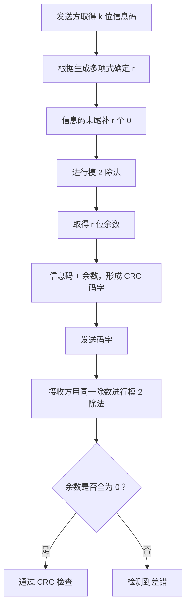
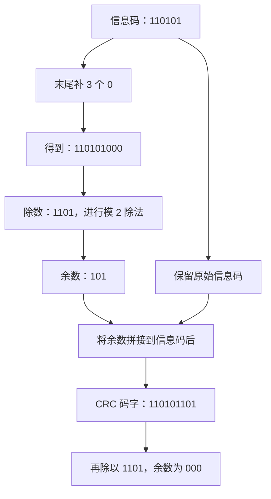
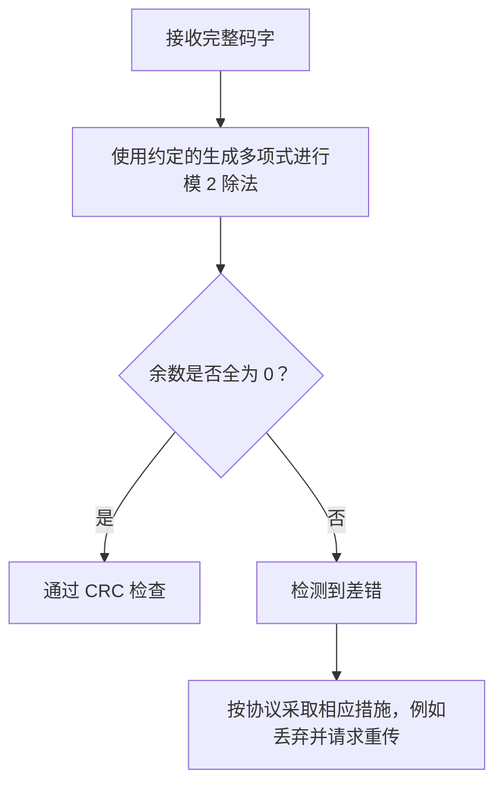
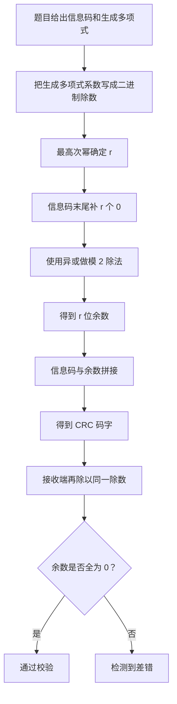

# 计算机网络数据链路层：循环冗余校验码（CRC）

> **本节重点**
>
> 1. 理解 CRC 的基本思想：发送方和接收方约定生成多项式，发送方添加校验位，使完整码字的模 2 除法余数为 0。
> 2. 掌握生成多项式与二进制除数之间的转换。
> 3. 掌握模 2 除法：减法使用异或运算，不借位、不进位。
> 4. 会根据 \(k\) 位信息码和生成多项式计算 \(r\) 位 CRC 校验位。
> 5. 会在接收端用生成多项式进行模 2 除法，并根据余数判断是否检测到差错。
> 6. 理解 CRC 的检错能力，以及“余数能否唯一确定出错位置”与码字长度之间的关系。

---

## 一、CRC 的基本思想

### 1. 从十进制除法理解检错

假设发送方要传递十进制数字 `882`。发送方与接收方事先约定一个除数 `7`。

因为：

\[
882\div7=126,\qquad \text{余数}=0
\]

接收方收到数据后，也用收到的数除以约定的除数 7：

- 如果收到 `882`，余数为 0，说明数据符合约定的校验条件。
- 如果传输后变成 `883`，则：

\[
883\div7=126,\qquad \text{余数}=1
\]

余数不为 0，说明接收的数据没有通过检验。

再例如，假设原数据中的十位数字由 `8` 变成 `5`，数字变成 `852`：

\[
852\div7=121,\qquad \text{余数}=5
\]

余数同样不为 0，因此能够检测到差错。

这个例子说明了 CRC 的基本思路：**发送方和接收方预先约定一个除数，接收方收到数据后再进行除法检查，依据余数判断数据是否通过校验。**

> 这种十进制例子只是帮助理解“约定除数、检查余数”的思想。真正的 CRC 处理的是二进制比特串，并采用模 2 除法。

### 2. CRC 的基本做法

CRC 的英文全称是 **Cyclic Redundancy Check**，中文为**循环冗余校验**，得到的校验码常称为 CRC 码。

发送方和接收方预先约定一个二进制除数，也就是**生成多项式**对应的二进制比特串。

发送方的主要步骤是：

1. 取得 \(k\) 位原始信息码。
2. 根据生成多项式确定校验位长度 \(r\)。
3. 在信息码末尾补 \(r\) 个 `0`。
4. 使用生成多项式对应的除数进行模 2 除法。
5. 将得到的 \(r\) 位余数作为 CRC 校验位。
6. 将原始信息码与 CRC 校验位拼接，形成最终发送的码字。

接收方收到完整码字后，用相同的生成多项式进行模 2 除法：

- 余数为全 `0`：接收码字通过 CRC 检查。
- 余数非全 `0`：检测到差错。



---

## 二、生成多项式与二进制除数

### 1. 什么是生成多项式？

CRC 题目通常会给出一个生成多项式 \(G(x)\)。例如：

\[
G(x)=x^3+x^2+1
\]

可以把它完整写成：

\[
G(x)=1x^3+1x^2+0x^1+1x^0
\]

每一项的系数不是 `0` 就是 `1`，所以可以按幂次从高到低，依次取出系数，转换成二进制除数：

```text
x³  x²  x¹  x⁰
 1   1   0   1

生成多项式对应的二进制除数：1101
```

因此：

\[
\boxed{G(x)=x^3+x^2+1\quad\longleftrightarrow\quad 1101}
\]

### 2. 如何由多项式转换成除数？

按照从最高次幂到 \(x^0\) 的顺序，依次写出每一项的系数：

| 多项式项 | \(x^3\) | \(x^2\) | \(x^1\) | \(x^0\) |
| -------- | ------: | ------: | ------: | ------: |
| 系数     |       1 |       1 |       0 |       1 |
| 对应比特 |       1 |       1 |       0 |       1 |

最终得到 `1101`。

反过来，二进制除数 `1101` 也可以解释为：

\[
1x^3+1x^2+0x^1+1x^0=x^3+x^2+1
\]

### 3. 校验位长度 \(r\) 如何确定？

如果生成多项式的最高次幂是 \(r\)，通常就需要添加 \(r\) 个 CRC 校验位。

例如：

\[
G(x)=x^3+x^2+1
\]

最高次幂是 3，因此：

\[
\boxed{r=3}
\]

如果原始信息码有 \(k=6\) 位，则最终 CRC 码字长度为：

\[
\boxed{k+r=6+3=9\text{ bit}}
\]

**记忆要点：**

- 生成多项式的最高次幂是 \(r\)。
- 除数的比特数通常是 \(r+1\)。
- CRC 余数／校验位的长度为 \(r\)。
- 最终码字长度为 \(k+r\)。

---

## 三、模 2 除法的规则

CRC 不使用普通十进制除法，而是采用**模 2 除法**。

### 1. 模 2 减法等价于异或

模 2 除法中的减法不需要借位，逐位执行异或运算即可。

| 当前位 | 除数对应位 | 模 2 减法结果 |
| -----: | ---------: | ------------: |
|      0 |          0 |             0 |
|      0 |          1 |             1 |
|      1 |          0 |             1 |
|      1 |          1 |             0 |

所以：

\[
\boxed{0\oplus0=0,\quad 0\oplus1=1,\quad 1\oplus0=1,\quad 1\oplus1=0}
\]

**模 2 减法不进位、不借位，与异或运算完全相同。**

### 2. 模 2 除法如何进行？

手算时，可以把步骤理解为：

1. 从被除数左侧开始，找到当前需要处理的最高位。
2. 如果当前部分的最高位为 `1`，就把除数对齐到该位置，并进行异或。
3. 如果当前部分的最高位为 `0`，该位置不需要真正进行减法，继续向右处理。
4. 每次处理后，按长除法的方式继续读取后续比特。
5. 处理结束后，留下的余数长度小于除数长度，通常表示为 \(r\) 位。

### 3. 普通除法与模 2 除法的区别

| 项目           | 普通十进制除法         | CRC 模 2 除法                 |
| -------------- | ---------------------- | ----------------------------- |
| 运算对象       | 十进制数值             | 二进制比特串                  |
| 减法           | 普通减法，需要处理借位 | 按位异或，不借位              |
| 计算结果       | 商和余数               | 模 2 商和余数                 |
| CRC 校验的目标 | —                      | 计算余数，构造或检查 CRC 码字 |

### 4. 模 2 除法小示意

```text
当前部分：  1101
除数：      1101
模 2 减法： 0000

因为每一位都执行异或：
1 XOR 1 = 0
1 XOR 1 = 0
0 XOR 0 = 0
1 XOR 1 = 0
```

---

## 四、发送方如何构造 CRC 码字？

下面使用课程中的生成多项式示例：

\[
G(x)=x^3+x^2+1
\]

对应二进制除数：

```text
1101
```

假设原始信息码为：

```text
110101
```

信息码长度：

\[
k=6
\]

生成多项式最高次幂为 3，因此：

\[
r=3
\]

### 第一步：在信息码末尾补 \(r\) 个 0

原始信息码：

```text
110101
```

末尾补三个 `0`：

```text
110101000
```

这等价于将信息码左移 3 位，也就是乘以 \(x^3\)。

### 第二步：用 `110101000` 除以 `1101`

执行模 2 除法。初始时，对齐被除数左侧的 `1101`，与除数进行异或。

```text
被除数：110101000
除数：  1101
```

第一步对齐：

```text
110101000
110100000
---------
000001000
```

继续对齐当前最高位为 `1` 的部分：

```text
000001000
000001101
---------
000000101
```

最终余数为：

```text
101
```

所以，按原稿给出的信息码 `110101` 和生成多项式 `1101` 进行复算，正确余数应为：

\[
\boxed{R=101}
\]

> **计算校对说明：** 原始转写中这一组条件对应的余数记成了 `001`，但 `110101000` 对 `1101` 进行模 2 除法的余数实际为 `101`。因此，本笔记采用可复算的结果 `101`，避免后续发送和接收示例互相矛盾。

### 第三步：将余数拼接到原始信息码后面

原始信息码：

```text
110101
```

CRC 余数：

```text
101
```

最终发送的 CRC 码字为：

```text
110101101
```

也就是：

\[
\boxed{\text{CRC 码字}=\text{信息码}\,\Vert\,\text{余数}}
\]

其中 \(\Vert\) 表示拼接。

### 第四步：验证最终码字

将最终码字 `110101101` 用除数 `1101` 进行模 2 除法，余数为：

```text
000
```

因此，该码字符合构造要求。



---

## 五、接收方如何使用 CRC 检错？

### 1. 接收方的基本步骤

接收方和发送方事先约定了相同的生成多项式。接收方拿到完整码字后，直接用该除数进行模 2 除法。

- 余数全为 `0`：码字通过 CRC 检查。
- 余数非全 `0`：检测到差错。

对于上面的例子，正确码字是：

```text
110101101
```

用 `1101` 进行模 2 除法，余数为：

```text
000
```

说明它通过了 CRC 检查。

### 2. 如果接收码字发生错误

假设传输过程中，某一个比特发生变化，接收方收到的码字就会与原始码字不同。

接收方仍然使用约定的除数 `1101` 进行模 2 除法。如果算得的余数不是 `000`，就说明检测到了差错。



> **注意：** 余数为 0 表示“通过 CRC 检查”，不能在一般情况下绝对保证数据一定没有错误。某些差错模式可能产生零余数，因而被漏检。

### 3. CRC 的职责与可靠传输

CRC 主要负责检错。若接收方发现差错，常见处理方式是丢弃该帧，并通过可靠传输机制请求发送方重传。

CRC 本身通常不负责通知发送方，也不直接规定完整的重传流程；这些行为由相应的链路协议或可靠传输机制完成。

---

## 六、CRC 余数与出错位置的关系

这是课程中进一步讨论的内容：CRC 的余数除了用于检错，在某些受限条件下，也可能帮助识别单比特错误的位置。

但需要注意，**不能只看到某个余数，就在任何码字长度下直接断定出错位置**。

### 1. 单比特错误会产生综合值（余数）

假设原本正确的码字是 \(T\)，传输过程中错误地翻转了某一位。接收码字可以写成：

\[
T'=T\oplus E
\]

其中 \(E\) 是错误模式，只有出错的位置对应比特为 `1`，其余位置为 `0`。

由于正确码字 \(T\) 能被生成多项式整除，接收码字的模 2 除法余数主要取决于错误模式 \(E\)。这个余数常称为错误综合值或 syndrome。

因此，在固定生成多项式下，不同的单比特错误位置会对应一定的余数模式。

### 2. 为什么余数不一定能唯一确定出错位置？

如果生成多项式的最高次幂是 \(r\)，CRC 余数最多有 \(r\) 位，因此余数最多能表示：

\[
2^r
\]

种不同状态。

其中：

- 一种状态是全零余数，表示通过检查；
- 剩下最多 \(2^r-1\) 种是非零余数。

如果码字总长度为：

\[
n=k+r
\]

那么有 \(n\) 种单比特错误位置。若 \(n\) 大于 \(2^r-1\)，就不可能给每一个单比特错误位置分配一个互不相同的非零余数。此时至少有一些不同位置会产生相同余数，接收方不能仅凭余数唯一定位出错位。

### 3. 六位信息码、三位校验位的例子

本节示例中：

\[
k=6,\qquad r=3,\qquad n=k+r=9
\]

余数有 3 位，因此共有：

\[
2^3=8
\]

种余数状态。其中一个是 `000`，其余只有 7 种非零状态。

但 9 位码字有 9 个可能的单比特错误位置，无法让这 9 个位置全部对应到互不相同的 7 种非零余数。

所以，在这个示例中，**即使知道非零余数，也不一定能唯一确定哪一位出错**。

### 4. 四位信息码、三位校验位的情况

如果信息位长度为 \(k=4\)，校验位长度仍为 \(r=3\)，那么：

\[
n=k+r=4+3=7
\]

此时可能发生单比特错误的位置只有 7 个，而非零余数最多有：

\[
2^3-1=7
\]

种。

如果所选生成多项式使这 7 个单比特错误位置都对应不同的非零余数，那么就可以通过余数唯一确定出错位置，并在受限条件下纠正该单比特错误。

对于课程示例中的生成多项式 `1101`，它对应的单比特错误综合值在 7 位码字范围内可以形成不同的非零模式，因此这个短码字例子可以用于说明单比特纠错的可能性。

> **关键区别：** “余数状态数量足够”是进行单比特定位所需的容量条件；实际能否纠错，还必须确认具体生成多项式能使目标码字范围内的各个单比特错误产生互不相同的非零余数。

### 5. 单比特纠错的容量条件

若码字总长度为 \(n=k+r\)，要用 \(r\) 位余数区分“无错”和所有可能的单比特错误，至少需要：

\[
2^r\ge n+1
\]

也就是：

\[
\boxed{2^r\ge k+r+1}
\]

这是余数状态数量方面的必要容量条件。实际纠错仍依赖生成多项式，以及各错误模式产生的余数是否唯一。

### 6. CRC 在实际网络中的主要用途

实际网络传输的帧往往包含大量信息位，而 CRC 只附加相对较少的校验位。对于很长的码字，余数通常不足以唯一定位所有可能的错误位置。

因此，CRC 在计算机网络中主要用于**检错**，再配合协议中的丢弃、确认和重传机制保证数据正确交付，而不是普遍直接使用 CRC 余数纠正单比特错误。

---

## 七、CRC 的检错能力

CRC 的检错能力取决于生成多项式和帧长，不能脱离条件理解。

### 1. 常见结论

对合适的生成多项式，CRC 可以检测多种常见差错，包括：

- 所有单比特错误；
- 满足相应条件的双比特错误；
- 长度不超过生成多项式阶数 \(r\) 的突发错误；
- 某些更长的突发错误。

### 2. “可以检测所有奇数个错误”需要什么条件？

有些讲解会把 CRC 的性质简化为“能够检测所有奇数个比特错误”。更严谨地说：

> 如果生成多项式 \(G(x)\) 含有因子 \(x+1\)，CRC 就能检测所有奇数个比特错误。

并非所有生成多项式都满足这个条件。例如，本节示例中的 `1101` 对应：

\[
G(x)=x^3+x^2+1
\]

它在 \(x=1\) 处的值为：

\[
G(1)=1+1+1=1\pmod 2
\]

因此该多项式不含因子 \(x+1\)，不能无条件声称它会检测所有奇数个比特错误。

### 3. 双比特错误与突发错误

- **双比特错误**：能否全部检出取决于生成多项式和允许的码字长度／错误位间距。
- **突发错误**：若生成多项式的阶数为 \(r\)，标准 CRC 性质保证能检测所有长度不超过 \(r\) 的非零突发错误；更长的突发错误也通常有很高的检出概率，但不能笼统保证全部检出。

| 差错类型                 | CRC 的检测情况                        |
| ------------------------ | ------------------------------------- |
| 单比特错误               | 对常见、合适的 CRC 生成多项式可检测   |
| 双比特错误               | 取决于生成多项式和码字长度／两位间距  |
| 所有奇数位错误           | 需要生成多项式含因子 \(x+1\) 才可保证 |
| 突发错误长度不超过 \(r\) | 对标准的非零生成多项式，能够保证检测  |
| 任意更长差错             | 不保证全部检出                        |

### 4. CRC 的定位

考试通常要求掌握：

1. 根据生成多项式算出 CRC 校验位。
2. 拼接得到最终 CRC 码字。
3. 接收端进行模 2 除法，判断余数是否为零。
4. 理解 CRC 通常用于检错，差错后常通过重传处理。

检错能力的更细致条件作为补充理解即可，但如果题目直接考查生成多项式性质，应以题目给出的条件为准。

---

## 八、为什么叫“循环冗余校验”？

在特定生成多项式下，单比特错误位置对应的余数模式具有规律性。继续将相应错误模式的多项式乘以 \(x\)（在二进制表示中相当于向左移一位或在末尾补一个 `0`），再对生成多项式取模，余数会按固定规律变化。

当生成多项式对应的余数序列周期性重复时，就能直观地看到“循环”的特征。

例如，对生成多项式 `1101`：

- 单比特错误模式对应的余数可以从 `001` 开始；
- 对相应错误模式向下一位移动，余数按模 2 运算规则变化；
- 余数序列在有限状态下可能重复。

不过，这个现象的具体周期取决于生成多项式。它用于帮助理解名称，不是基础计算题的核心要求。

---

## 九、CRC 计算题的标准步骤

遇到 CRC 计算题时，按下面顺序进行。

### 发送端

1. **读题**：确定 \(k\) 位信息码。
2. **转换生成多项式**：把多项式系数转为二进制除数。
3. **确定校验位数**：生成多项式最高次幂为 \(r\)，则补 \(r\) 个零。
4. **进行模 2 除法**：减法使用异或。
5. **写出余数**：余数不足 \(r\) 位时，前面补零写满 \(r\) 位。
6. **拼接码字**：原始信息码 + CRC 余数。

### 接收端

1. 收到完整码字。
2. 使用相同的生成多项式对应的除数进行模 2 除法。
3. 余数全零：通过 CRC 检查。
4. 余数非零：检测到差错。
5. 是否丢弃、重传或采取其他措施，由上层协议和可靠传输机制决定。



---

## 十、公式与术语速查

| 内容                     | 结论                                               |
| ------------------------ | -------------------------------------------------- |
| CRC 英文全称             | Cyclic Redundancy Check                            |
| 生成多项式               | \(G(x)\)                                           |
| 除数                     | 生成多项式系数按幂次从高到低形成的二进制串         |
| 生成多项式最高次幂       | \(r\)，即 CRC 校验位长度                           |
| 原始信息码长度           | \(k\)                                              |
| 最终码字长度             | \(k+r\)                                            |
| 构造时的被除数           | 信息码末尾补 \(r\) 个 `0`                          |
| 模 2 减法                | 按位异或，无借位、无进位                           |
| 发送码字                 | 信息码与模 2 除法得到的 \(r\) 位余数拼接           |
| 接收端余数全 0           | 通过 CRC 检查，不代表在所有情况下绝对无错          |
| 接收端余数非零           | 检测到差错                                         |
| 单比特纠错的状态数量条件 | \(2^r\ge k+r+1\)，且需要各单比特错误的余数互不相同 |

---

## 十一、复习自测

### 题目

1. CRC 的英文全称是什么？
2. 生成多项式 \(G(x)=x^3+x^2+1\) 对应的二进制除数是什么？
3. 如果生成多项式最高次幂为 4，通常需要附加多少位 CRC 校验位？
4. 模 2 除法中的减法使用什么运算？
5. 信息码为 `110101`，生成多项式为 `1101`。补三个零后，被除数是什么？
6. 对第 5 题，模 2 除法的余数是多少？最终 CRC 码字是什么？
7. 接收端用生成多项式对码字相除，余数非零说明什么？
8. 余数为零是否在任何情况下都能保证没有错误？
9. 为什么 6 位信息码加 3 位 CRC 校验位的例子中，余数不一定能唯一指出错误位？
10. “CRC 能检测所有奇数个比特错误”需要什么条件？

### 参考答案

1. Cyclic Redundancy Check，循环冗余校验。
2. `1101`。
3. 4 位。
4. 异或运算，也称模 2 减法。
5. `110101000`。
6. 余数为 `101`；最终 CRC 码字为 `110101101`。
7. 检测到差错。
8. 不能，某些差错模式可能产生零余数，从而漏检。
9. 码字长为 9 位，但 3 位余数最多只有 7 种非零状态，无法为 9 个单比特错误位置全部分配唯一余数。
10. 生成多项式需要含有因子 \(x+1\)。

---

## 十二、快速记忆

> **生成多项式最高次幂是 \(r\)，就补 \(r\) 个零。**
>
> **模 2 除法的减法就是异或，不进位、不借位。**
>
> **发送端：信息码末尾补零 → 模 2 除法 → 得到余数 → 原信息码拼接余数。**
>
> **接收端：完整码字除以约定的生成多项式；余数全零表示通过检查，非零表示检测到差错。**
>
> **CRC 通常用于检错，重传由可靠传输机制处理。**
>
> **CRC 在特定条件下也可用于单比特纠错，但余数能否唯一定位错误取决于码字长度和生成多项式；实际网络中 CRC 主要用于检错。**
