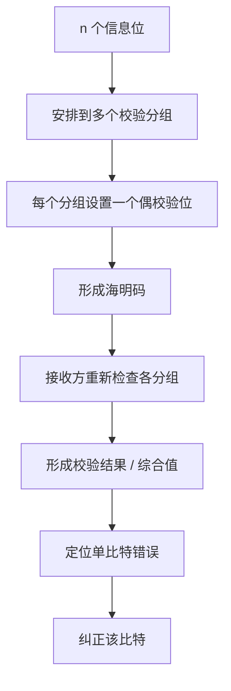
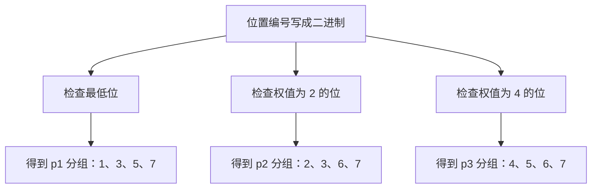
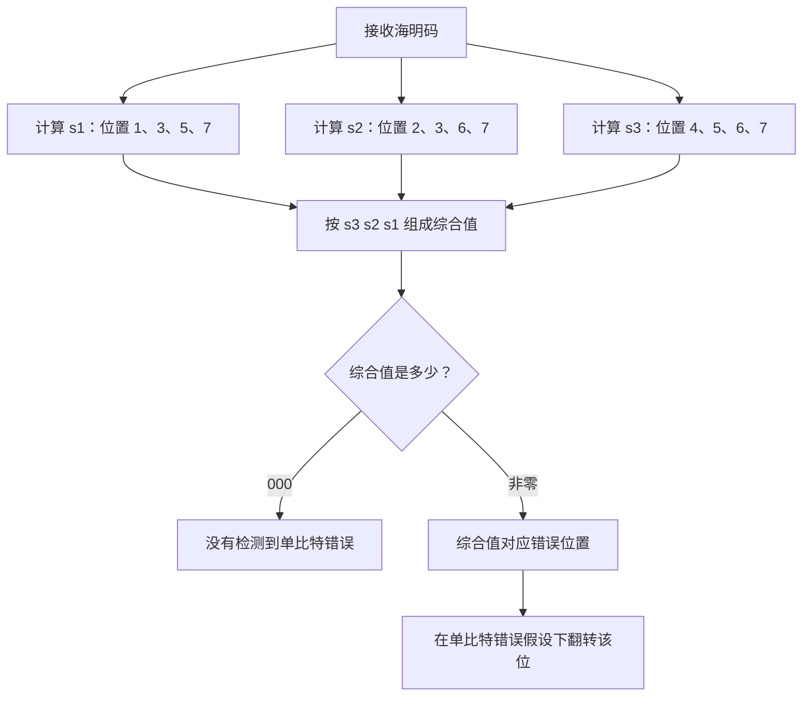
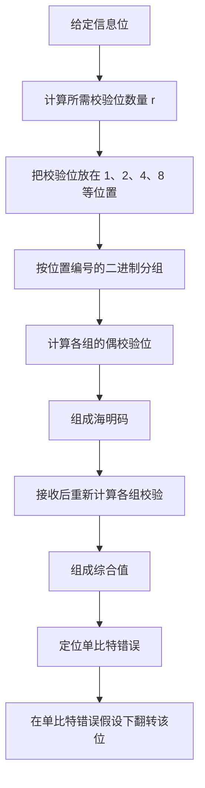

# 计算机网络数据链路层：海明校验码（汉明码）

> **本节重点**
>
> 1. 理解海明码为什么要设置多个校验位。
> 2. 会使用公式 \(2^r \ge n+r+1\) 确定校验位数量。
> 3. 掌握校验位放在 \(1、2、4、8、16\ldots\) 等位置的规则。
> 4. 会根据位号的二进制表示划分校验分组。
> 5. 会计算校验位、计算综合值（syndrome），并定位单比特错误。
> 6. 区分普通海明码与增加全校验位后的扩展海明码：后者可以实现单比特纠错、双比特检错（SECDED）。

---

## 一、海明码的基本思想

### 1. 海明码也称汉明码

海明码也称汉明校验码或汉明码，英文为 **Hamming Code**，名称来自提出这种编码方法的理查德·汉明（Richard Hamming）。课程中提到，他因相关贡献获得了 1968 年图灵奖。

### 2. 从奇偶校验码的局限说起

奇偶校验码的基本做法是：对 \(n\) 个信息位增加一个校验位，使整个码字中 `1` 的数量满足奇校验或偶校验规则。

它的局限是：

- 可以发现某些比特错误；
- 只使用一个校验位时，校验结果只能反映是否符合奇偶规则；
- 它无法仅凭这个校验位判断究竟哪一位出错；
- 因此，单比特奇偶校验不能直接定位并纠正错误。

### 3. 海明码的扩展思路

海明码不是只添加一个校验位，而是把信息位安排到多个相互重叠的校验分组中，并为每个分组设置一个校验位。

每个分组分别进行偶校验。接收端重新计算各分组的校验结果后，就能得到一组校验状态。不同的错误位置会影响不同的分组，因此可以利用这些结果定位单比特错误。



### 4. 海明码需要解决的两个问题

1. **需要多少个校验位？**
2. **信息位和校验位应如何排列、如何分组？**

下面分别说明。

---

## 二、如何确定校验位数量？

设：

- \(n\)：信息位数量；
- \(r\)：校验位数量；
- \(n+r\)：最终海明码的总位数。

我们希望这些校验位不仅能发现错误，还能通过校验结果标示哪个比特位置出现错误。

### 1. 校验状态的数量

\(r\) 个校验位可以形成：

\[
2^r
\]

种不同状态。

对于一个总长度为 \(n+r\) 位的码字，可能的情况至少包括：

- 没有任何位出错：1 种状态；
- 第 1 位出错；
- 第 2 位出错；
- ……
- 第 \(n+r\) 位出错。

因此，至少需要 \(n+r+1\) 种状态来区分“无错”和所有可能的单比特错误位置。

于是得到：

\[
\boxed{2^r \ge n+r+1}
\]

这是确定海明码校验位数量的常用条件。

### 2. 示例：4 个信息位需要几个校验位？

设 \(n=4\)。

先尝试 \(r=2\)：

\[
2^2=4
\]

而：

\[
n+r+1=4+2+1=7
\]

不满足 \(4\ge7\)，所以两个校验位不够。

再尝试 \(r=3\)：

\[
2^3=8
\]

而：

\[
n+r+1=4+3+1=8
\]

满足条件，因此 4 个信息位至少需要 3 个校验位。

最终海明码长度为：

\[
\boxed{n+r=4+3=7\text{ bit}}
\]

### 3. 常见数量速查

| 信息位数 \(n\) | 满足条件的校验位数 \(r\) | 总位数 \(n+r\) | 检查                     |
| -------------: | -----------------------: | -------------: | ------------------------ |
|              1 |                        2 |              3 | \(2^2=4 \ge 1+2+1=4\)    |
|              2 |                        3 |              5 | \(2^3=8 \ge 2+3+1=6\)    |
|              3 |                        3 |              6 | \(2^3=8 \ge 3+3+1=7\)    |
|              4 |                        3 |              7 | \(2^3=8 \ge 4+3+1=8\)    |
|              5 |                        4 |              9 | \(2^4=16 \ge 5+4+1=10\)  |
|              8 |                        4 |             12 | \(2^4=16 \ge 8+4+1=13\)  |
|             11 |                        4 |             15 | \(2^4=16 \ge 11+4+1=16\) |

> **考试方法：** 把 \(r=1、2、3\ldots\) 逐个代入 \(2^r \ge n+r+1\)，找到第一个满足条件的 \(r\) 即可。

---

## 三、校验位和信息位如何排列？

### 1. 校验位放在 2 的幂次位置

海明码规定，校验位放在以下位置：

\[
\boxed{1,\ 2,\ 4,\ 8,\ 16,\ldots}
\]

这些位置就是 2 的幂次：

\[
2^0,\ 2^1,\ 2^2,\ 2^3,\ 2^4,\ldots
\]

例如，4 个信息位需要 3 个校验位，最终共 7 位。校验位 \(p_1、p_2、p_3\) 分别放在位置 1、2、4。

其余位置放信息位：

| 位置 | 1       | 2       | 3       | 4       | 5       | 6       | 7       |
| ---- | ------- | ------- | ------- | ------- | ------- | ------- | ------- |
| 类型 | \(p_1\) | \(p_2\) | \(d_1\) | \(p_3\) | \(d_2\) | \(d_3\) | \(d_4\) |

其中：

- \(p_1、p_2、p_3\)：校验位；
- \(d_1、d_2、d_3、d_4\)：信息位；
- \(h_1\ldots h_7\)：最终海明码从位置 1 到位置 7 的各位。

### 2. 位置表

```text
位号：     1   2   3   4   5   6   7
类型：    p1  p2  d1  p3  d2  d3  d4
           ↑   ↑       ↑
          校验位放在 1、2、4
```

校验位不能随意全部放在最前面。它们放在 \(1、2、4、8\ldots\) 的位置，是为了让每一位的二进制位号能够用于决定它属于哪些校验分组。

---

## 四、如何确定每个校验位负责哪些位置？

### 1. 将位置编号转换为二进制

对 7 位海明码，每个位的位置编号可以用 3 位二进制表示：

| 位置编号 | 二进制 | 是否为校验位 |
| -------: | ------ | ------------ |
|        1 | `001`  | \(p_1\)      |
|        2 | `010`  | \(p_2\)      |
|        3 | `011`  | \(d_1\)      |
|        4 | `100`  | \(p_3\)      |
|        5 | `101`  | \(d_2\)      |
|        6 | `110`  | \(d_3\)      |
|        7 | `111`  | \(d_4\)      |

二进制每一位的权值分别是：

```text
二进制位：  4  2  1
权值：      4  2  1
```

例如：

\[
3=(011)\_2=2+1
\]

\[
5=(101)\_2=4+1
\]

\[
6=(110)\_2=4+2
\]

### 2. \(p_1\) 的分组规则

校验位 \(p_1\) 放在位置 1，对应位号二进制的最低位，也就是权值为 1 的那一列。

把二进制最低位为 `1` 的位置编入 \(p_1\) 负责的分组：

- 位置 1：`001`
- 位置 3：`011`
- 位置 5：`101`
- 位置 7：`111`

因此，\(p_1\) 负责的位置是：

\[
\boxed{1,\ 3,\ 5,\ 7}
\]

其中位置 1 是 \(p_1\) 自己，数据位部分则是 \(d_1、d_2、d_4\)。

### 3. \(p_2\) 的分组规则

校验位 \(p_2\) 放在位置 2，对应位号二进制中权值为 2 的那一列。

把该列为 `1` 的位置编入 \(p_2\) 的分组：

\[
\boxed{2,\ 3,\ 6,\ 7}
\]

其中校验位是位置 2，信息位是 \(d_1、d_3、d_4\)。

### 4. \(p_3\) 的分组规则

校验位 \(p_3\) 放在位置 4，对应位号二进制中权值为 4 的那一列。

把该列为 `1` 的位置编入 \(p_3\) 的分组：

\[
\boxed{4,\ 5,\ 6,\ 7}
\]

其中校验位是位置 4，信息位是 \(d_2、d_3、d_4\)。

### 5. 三个分组总表

| 校验位  | 负责的位置 | 对应信息位        |
| ------- | ---------- | ----------------- |
| \(p_1\) | 1、3、5、7 | \(d_1、d_2、d_4\) |
| \(p_2\) | 2、3、6、7 | \(d_1、d_3、d_4\) |
| \(p_3\) | 4、5、6、7 | \(d_2、d_3、d_4\) |



> **记忆方法：** 哪个校验位对应哪一列，就把位置编号二进制中该列为 `1` 的位分到该校验位的组里。

---

## 五、海明码校验位如何计算？

本节沿用偶校验。

偶校验要求每个分组中包含校验位在内的所有比特，`1` 的总数为偶数。等价地说，每个分组中所有比特进行异或运算，结果应为 `0`。

因此：

\[
p_1=d_1\oplus d_2\oplus d_4
\]

\[
p_2=d_1\oplus d_3\oplus d_4
\]

\[
p_3=d_2\oplus d_3\oplus d_4
\]

这里的异或规则为：

- 相同为 `0`；
- 不同为 `1`。

### 1. 计算示例

假设信息位为：

\[
d_1=0,\quad d_2=1,\quad d_3=0,\quad d_4=1
\]

计算 \(p_1\)：

\[
p_1=d_1\oplus d_2\oplus d_4
=0\oplus1\oplus1=0
\]

计算 \(p_2\)：

\[
p_2=d_1\oplus d_3\oplus d_4
=0\oplus0\oplus1=1
\]

计算 \(p_3\)：

\[
p_3=d_2\oplus d_3\oplus d_4
=1\oplus0\oplus1=0
\]

因此：

\[
\boxed{p_1p_2p_3=010}
\]

### 2. 组成 7 位海明码

位置关系为：

| 位置 | 1       | 2       | 3       | 4       | 5       | 6       | 7       |
| ---- | ------- | ------- | ------- | ------- | ------- | ------- | ------- |
| 内容 | \(p_1\) | \(p_2\) | \(d_1\) | \(p_3\) | \(d_2\) | \(d_3\) | \(d_4\) |
| 数值 | 0       | 1       | 0       | 0       | 1       | 0       | 1       |

所以最终的海明码为：

\[
\boxed{0100101}
\]

### 3. 检查三个分组是否满足偶校验

| 分组                        | 位值      | `1` 的数量 | 异或结果 |
| --------------------------- | --------- | ---------: | -------: |
| \(p_1\) 组：位置 1、3、5、7 | `0,0,1,1` |          2 |        0 |
| \(p_2\) 组：位置 2、3、6、7 | `1,0,0,1` |          2 |        0 |
| \(p_3\) 组：位置 4、5、6、7 | `0,1,0,1` |          2 |        0 |

三个分组都通过偶校验，因此没有校验失败的迹象。

---

## 六、接收方如何定位并纠正单比特错误？

### 1. 重新检查各个分组

接收方收到海明码后，对每个校验分组重新执行偶校验。把校验结果分别记为：

- \(s_1\)：位置 1、3、5、7 的异或结果；
- \(s_2\)：位置 2、3、6、7 的异或结果；
- \(s_3\)：位置 4、5、6、7 的异或结果。

如果三个分组都符合偶校验，则：

\[
s_1=s_2=s_3=0
\]

如果某个位发生错误，它会影响包含该位的分组，使相应的校验结果变为 `1`。

### 2. 综合值如何指示错误位置？

将结果按以下顺序组合：

\[
\boxed{S=(s_3s_2s_1)\_2}
\]

把二进制数 \(s_3s_2s_1\) 转换成十进制，即可得到单比特错误的位置编号（针对该 7 位海明码且假设至多一位错误）。

| \(s_3\) | \(s_2\) | \(s_1\) | 二进制综合值 |              十进制位置 |
| ------: | ------: | ------: | ------------ | ----------------------: |
|       0 |       0 |       0 | `000`        | 0：没有检测到单比特错误 |
|       0 |       0 |       1 | `001`        |                       1 |
|       0 |       1 |       0 | `010`        |                       2 |
|       0 |       1 |       1 | `011`        |                       3 |
|       1 |       0 |       0 | `100`        |                       4 |
|       1 |       0 |       1 | `101`        |                       5 |
|       1 |       1 |       0 | `110`        |                       6 |
|       1 |       1 |       1 | `111`        |                       7 |

### 3. 示例：第 2 位校验位出错

正确码字为：

```text
0100101
```

假设位置 2 的 \(p_2\) 从 `1` 翻转为 `0`，收到的码字为：

```text
0000101
```

重新计算各组：

- \(s_1=0\)：第 1、3、5、7 位组成的分组没有受到位置 2 错误的影响。
- \(s_2=1\)：第 2 位属于 \(p_2\) 分组，偶校验失败。
- \(s_3=0\)：第 2 位不属于 \(p_3\) 分组。

因此：

\[
s_3s_2s_1=010
\]

\[
(010)\_2=2
\]

所以可以判断：**位置 2 出错**。将位置 2 的比特翻转回来，就可以纠正这个单比特错误。

### 4. 示例：第 6 位信息位出错

正确码字为：

```text
0100101
```

如果位置 6 的 \(d_3\) 发生翻转，收到：

```text
0100111
```

位置 6 属于 \(p_2\) 组和 \(p_3\) 组，不属于 \(p_1\) 组，所以：

\[
s_1=0,\qquad s_2=1,\qquad s_3=1
\]

组合为：

\[
s_3s_2s_1=110
\]

\[
(110)\_2=6
\]

综合值指向位置 6，因此可以将该位翻转回来。

### 5. 示例：第 7 位信息位出错

位置 7 同时属于三个校验分组：

- \(p_1\) 分组；
- \(p_2\) 分组；
- \(p_3\) 分组。

如果位置 7 出错，三个分组都会校验失败：

\[
s_1=1,\quad s_2=1,\quad s_3=1
\]

因此：

\[
s_3s_2s_1=111
\]

\[
(111)\_2=7
\]

综合值指向位置 7。

### 6. 为什么这种定位方法有效？

每个位置编号的二进制表示，恰好表明该位置属于哪些校验分组。

例如：

- 位置 2 的二进制位号是 `010`，只对应 \(p_2\) 的校验组；
- 位置 6 的二进制位号是 `110`，对应 \(p_2\) 和 \(p_3\) 两个分组；
- 位置 7 的二进制位号是 `111`，对应三个分组。

因此，校验结果组成的二进制综合值就能反映出错位置。



> **适用前提：** 上面的定位和纠正过程假设最多发生一个比特错误。若有多个比特同时出错，普通海明码可能会误定位，不能把单比特纠错的规则直接用于任意多比特错误。

---

## 七、校验位与信息位编号的方向

不同教材或题目可能采用不同的编号或书写方向。例如：

- 从左往右将位置编号写成 \(1,2,3,\ldots\)；
- 或者从右往左编号；
- 有时校验位和信息位的书写顺序也可能采用不同约定。

这不会改变海明码的基本原理，但会影响最终写出的比特串和位置标号。

**做题时应以题目规定的编号方向为准**，并保持以下过程一致：

1. 确定每一位的位置编号。
2. 按位置编号的二进制表示划分校验组。
3. 根据题目规定的奇校验或偶校验计算校验位。
4. 接收端用同样的编号规则计算综合值。
5. 将综合值解释为对应的位置编号。

---

## 八、普通海明码与扩展海明码

### 1. 普通海明码的能力

普通海明码可以通过分组校验结果定位并纠正一个比特错误。

但如果有两个比特同时发生错误，得到的综合值可能指向第三个位置，造成误纠正。因此，**普通海明码不能单凭综合值可靠地区分单比特错误与双比特错误**。

### 2. 为什么要增加全校验位？

为区分单比特错误和双比特错误，可以在普通海明码之外增加一个**全校验位**（overall parity bit）。

全校验位对普通海明码的所有位统一进行一次偶校验，确保扩展后整个码字中 `1` 的数量为偶数。

课程示例中把这个全校验位放在最前面。为避免与 \(p_1,p_2,p_3\) 混淆，下面记为 \(p_0\)。

对于前面计算得到的海明码：

```text
普通海明码：0100101
```

其中共有 3 个 `1`，是奇数，所以全校验位应取 `1`，使整体变为偶数个 `1`：

```text
全校验位 + 普通海明码：

1 | 0100101
↑
p0：全校验位
```

此时扩展码字是：

```text
10100101
```

这里的最前面 `1` 是全校验位 \(p_0\)，后面 7 位仍按 \(h_1\) 至 \(h_7\) 编号。

### 3. 利用全校验位区分错误数量

接收方需要检查两项：

1. 普通海明码的综合值 \(S=s_3s_2s_1\)；
2. 全部比特的总体偶校验是否通过。

按课程采用的“全校验位放在最前面”的表示方式，通常可以这样理解：

| 普通海明码综合值 | 整体偶校验 | 解释                                            |
| ---------------- | ---------- | ----------------------------------------------- |
| \(S=000\)        | 通过       | 没有检测到错误                                  |
| \(S\ne000\)      | 失败       | 普通海明码 7 位中发生单比特错误，可按综合值定位 |
| \(S=000\)        | 失败       | 全校验位本身发生错误                            |
| \(S\ne000\)      | 通过       | 检测到双比特错误；不能按综合值直接纠正其中一位  |

### 4. 示例：一个比特错误

假设普通海明码的 \(p_1\) 发生翻转：

- 综合值指向位置 1；
- 全校验位检查失败，说明总的奇偶性改变；
- 这与“普通海明码部分有一个位出错”的情况一致；
- 在扩展海明码的单比特纠错假设下，可以纠正位置 1。

如果只有全校验位 \(p_0\) 出错，则普通海明码的综合值仍为 `000`，但总体偶校验失败。此时可以判断错误位是全校验位本身。

### 5. 示例：两个比特同时出错

假设 \(p_1\) 和 \(p_2\) 同时翻转：

- \(p_1\) 所在分组和 \(p_2\) 所在分组均受到影响；
- 综合值为 \(s_3s_2s_1=011\)，数值为 3；
- 但是总体偶校验仍可能通过，因为两个比特翻转不会改变整个码字中 `1` 的数量奇偶性。

如果没有全校验位，只看到综合值 `011`，可能会误以为第 3 位出错。加入全校验位后，接收方发现“综合值非零，但整体偶校验通过”，便知道这不是普通的单比特错误，而是双比特错误的特征，因此应报告错误，不能直接翻转第 3 位。

### 6. 扩展海明码的能力

加入全校验位后，扩展海明码通常称为具备 **SECDED** 能力：

- **SEC**：Single Error Correction，单比特纠错；
- **DED**：Double Error Detection，双比特检错。

> **注意：** SECDED 不保证任意三个或更多比特错误都能被正确分类。多比特错误可能形成其他综合值和总体校验结果，因此不要把它理解为对任意数量错误都能可靠纠错或定位。

---

## 九、海明码的完整解题流程

### 第一步：求校验位数量

已知信息位数量 \(n\)，从小到大试算 \(r\)，直到：

\[
2^r\ge n+r+1
\]

### 第二步：安排位置

把校验位放在：

\[
1,\ 2,\ 4,\ 8,\ 16,\ldots
\]

其他位置依次放入信息位。

### 第三步：根据位置编号的二进制划分校验组

例如 7 位海明码：

- \(p_1\)：位置 1、3、5、7；
- \(p_2\)：位置 2、3、6、7；
- \(p_3\)：位置 4、5、6、7。

### 第四步：计算校验位

根据题目规定使用奇校验或偶校验。课程示例采用偶校验，用异或运算求出各校验位，使每个分组满足偶校验。

### 第五步：接收端重新计算校验结果

得到 \(s_1,s_2,\ldots,s_r\)，按从高位到低位的顺序组成综合值：

\[
S=(s_r\ldots s_2s_1)\_2
\]

### 第六步：解释综合值

- 普通海明码且假定最多一个比特出错：非零综合值指向出错位置。
- 综合值为零：没有检测到单比特错误。
- 若要区分单比特错误与双比特错误，需要扩展海明码的全校验位辅助判断。



---

## 十、公式与位置速查表

### 1. 校验位数量公式

\[
\boxed{2^r\ge n+r+1}
\]

- \(n\)：信息位数量；
- \(r\)：校验位数量；
- \(n+r\)：普通海明码总位数。

### 2. 校验位位置

| 校验位  | 所在位置 | 对应二进制权值 |
| ------- | -------: | -------------: |
| \(p_1\) |        1 |      \(2^0=1\) |
| \(p_2\) |        2 |      \(2^1=2\) |
| \(p_3\) |        4 |      \(2^2=4\) |
| \(p_4\) |        8 |      \(2^3=8\) |
| \(p_5\) |       16 |     \(2^4=16\) |

### 3. 7 位海明码分组表

| 校验结果 | 需要检查的位置 | 对应的二进制位号  |
| -------- | -------------- | ----------------- |
| \(s_1\)  | 1、3、5、7     | 最低位为 `1`      |
| \(s_2\)  | 2、3、6、7     | 权值 2 的位为 `1` |
| \(s_3\)  | 4、5、6、7     | 权值 4 的位为 `1` |

### 4. 综合值与出错位置

\[
\boxed{\text{错误位置}=(s_3s_2s_1)\_2}
\]

例如：

- `001` → 位置 1；
- `010` → 位置 2；
- `011` → 位置 3；
- `100` → 位置 4；
- `101` → 位置 5；
- `110` → 位置 6；
- `111` → 位置 7。

---

## 十一、容易混淆的要点

1. **校验位数量不是随意决定的。** 用 \(2^r\ge n+r+1\) 确定。
2. **校验位位置是 1、2、4、8……。** 也就是 2 的幂次位置。
3. **分组依据是位置编号的二进制。** 对应哪一列为 `1`，就归入相应校验组。
4. **本节使用偶校验。** 每个分组（包括校验位）中 `1` 的数量为偶数。
5. **综合值的顺序是 \(s_3s_2s_1\)。** 不要写成 \(s_1s_2s_3\) 后再直接转换十进制。
6. **普通海明码主要实现单比特纠错。** 双比特错误可能造成误定位。
7. **增加全校验位后才具备经典 SECDED 行为。** 全校验位用于区分普通海明码中的单比特错误和双比特错误特征。
8. **编号方向要看题目。** 从左向右或从右向左编号时，必须始终遵循题目所给的位号规则。

---

## 十二、复习自测

### 题目

1. 海明码与普通奇偶校验码相比，主要增加了什么设计？
2. 有 4 个信息位，至少需要几个校验位？请用公式验证。
3. 为什么校验位要放在位置 1、2、4、8……？
4. 7 位海明码中，\(p_2\) 负责哪些位置？
5. 7 位海明码中，位置 6 的二进制位号是什么？它属于哪些校验分组？
6. 若接收端得到 \(s_1=0,s_2=1,s_3=0\)，综合值指向哪个位置？
7. 若接收端得到 \(s_1=0,s_2=1,s_3=1\)，综合值指向哪个位置？
8. 为什么普通海明码无法可靠区分单比特错误和双比特错误？
9. 全校验位的作用是什么？
10. 扩展海明码中的 SECDED 分别表示什么？

### 参考答案

1. 使用多个相互重叠的校验分组，通过各组的校验结果定位单比特错误。
2. \(r=3\)，因为 \(2^2=4<4+2+1=7\)，而 \(2^3=8\ge4+3+1=8\)。
3. 这些位置对应不同的二进制权值，使位置编号的二进制表示能够决定每一位属于哪些校验分组。
4. 位置 2、3、6、7。
5. 位置 6 的二进制位号是 `110`，属于 \(p_2\) 和 \(p_3\) 的分组。
6. 综合值为 \(s_3s_2s_1=010\)，指向位置 2。
7. 综合值为 \(s_3s_2s_1=110\)，指向位置 6。
8. 多位错误可能产生与某个单比特错误相同的综合值，从而造成误定位。
9. 检查整个扩展码字的总体奇偶性，帮助区分单比特错误与双比特错误。
10. SEC 表示单比特纠错；DED 表示双比特检错。

---

## 十三、快速记忆

> **校验位数量：** \(2^r\ge n+r+1\)。
>
> **校验位位置：** \(1、2、4、8、16\ldots\)。
>
> **分组方法：** 看每个位号的二进制表示，哪一列为 `1`，就属于相应校验位的分组。
>
> **偶校验：** 每个分组的 `1` 的总数为偶数，异或结果为 `0`。
>
> **综合值：** 按 \(s_3s_2s_1\) 的顺序组合成二进制数，指向单比特错误的位置。
>
> **普通海明码：** 单比特纠错。
>
> **扩展海明码：** 添加全校验位后，可实现单比特纠错、双比特检错（SECDED）。
