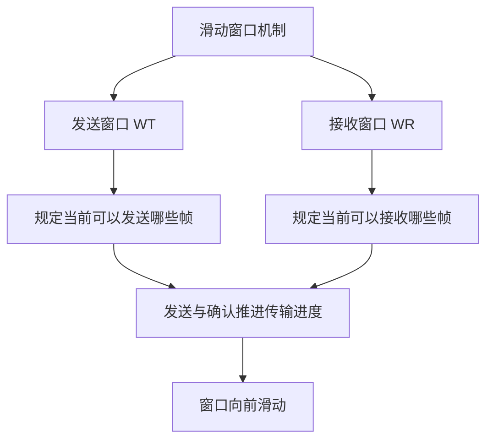
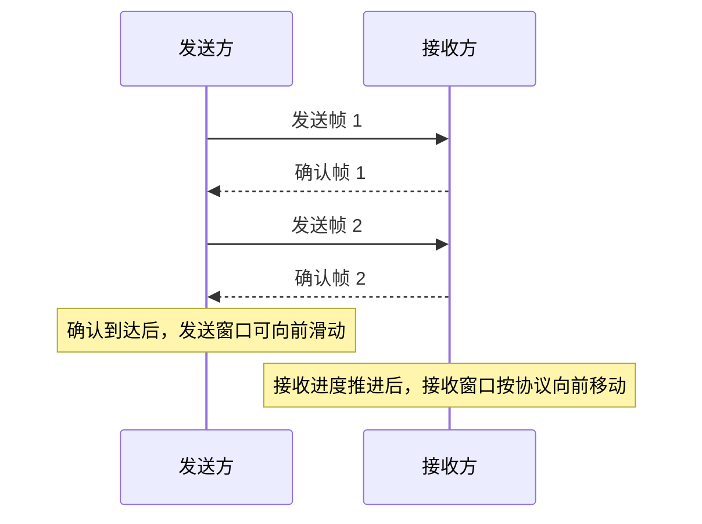
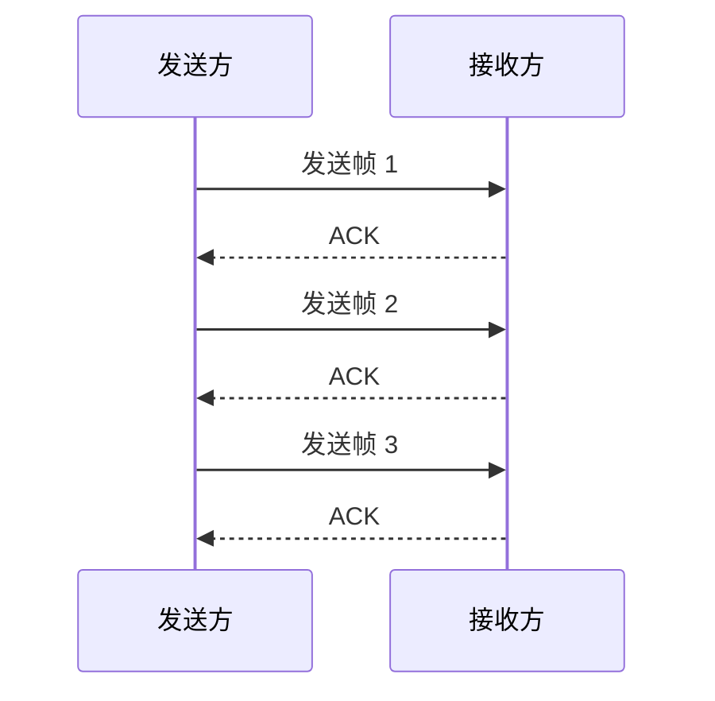

# 计算机网络数据链路层：滑动窗口机制入门

> **本节重点**
>
> 1. 理解可靠传输与流量控制分别解决什么问题。
> 2. 理解为什么这两个功能都与滑动窗口机制密切相关。
> 3. 掌握发送窗口 \(W_T\) 与接收窗口 \(W_R\) 的含义。
> 4. 理解确认机制如何推动发送窗口向前滑动。
> 5. 初步认识停止等待协议、后退 N 帧协议和选择重传协议。

---

## 一、为什么要学习可靠传输与流量控制？

### 1. 可靠传输要解决的问题

数据链路层在传输数据时，除了可能出现帧内部的比特错误，还可能出现以下帧错误：

- **帧丢失**：发送方发送了某个帧，但接收方没有收到。
- **帧重复**：接收方多次收到同一个帧。
- **帧失序**：接收方收到帧的顺序与发送方发送的顺序不同。

在差错控制部分，我们已经知道：接收方有时会在检测到帧内比特错误后，直接丢弃该帧。

但帧被丢弃后，发送方和接收方之间就出现了一个传输缺口。如何发现缺失、通知发送方，以及让发送方重新传输，需要依靠**可靠传输机制**来处理。

因此，解决帧丢失等问题，不仅可以实现可靠传输，也能够处理差错控制中“发现差错后丢弃帧”所带来的后续问题。

### 2. 流量控制要解决的问题

**流量控制（Flow Control）**的主要目标是协调发送方与接收方，让发送方发送帧的速度不要超过接收方能够接收和处理的能力。

如果发送方发送得过快，接收方来不及接收或处理数据，可能会造成缓存压力，甚至导致帧丢失。

因此，流量控制需要通过协议机制限制或协调发送速度。

### 3. 两个功能的区别

| 功能     | 核心问题                                     | 关注重点               |
| -------- | -------------------------------------------- | ---------------------- |
| 可靠传输 | 帧是否丢失、重复、失序，或者是否需要重传？   | 正确、完整地交付数据   |
| 流量控制 | 发送方是否发送得太快，导致接收方来不及处理？ | 协调发送速率与接收能力 |

这两个功能解决的问题不同，但在数据链路层中，它们的实现都与**滑动窗口机制**密切相关。

---

## 二、滑动窗口机制

### 1. 为什么需要滑动窗口？

停止等待、后退 N 帧和选择重传这三种协议，都可以利用滑动窗口机制实现可靠传输与流量控制，只是它们的窗口大小、允许发送和接收的帧范围，以及出错后的处理规则有所不同。

本节先建立滑动窗口的基本概念，后续再分别学习三种协议。

### 2. 什么是窗口？

在滑动窗口机制中，发送方和接收方会维护各自的窗口：

- **发送窗口**：当前允许发送方发送的帧的序号范围。
- **接收窗口**：当前允许接收方接收的帧的序号范围。

只有落在发送窗口范围内的帧，发送方才可以按协议规则发送；只有符合接收窗口规则的帧，接收方才会接收或缓存。

窗口可以随传输进度向前移动，因此称为**滑动窗口**。



### 3. 发送窗口 \(W_T\)

发送窗口常记为：

\[
\boxed{W_T}
\]

其中：

- \(W\) 来自 **Window**，表示窗口；
- \(T\) 来自 **Transmit**，表示发送或传输。

发送窗口的大小表示在当前协议状态下，发送方允许发送的帧序号范围有多大。

例如，发送窗口大小为 4，当前覆盖帧序号 `1、2、3、4`，那么这些帧位于发送窗口范围内。

```text
帧序号：      1   2   3   4   5   6   7
发送窗口：   [1] [2] [3] [4]
                WT = 4
```

> 发送窗口大小表示协议允许发送的帧范围，不等于网络中实际正在传输的帧数。

### 4. 接收窗口 \(W_R\)

接收窗口常记为：

\[
\boxed{W_R}
\]

其中：

- \(W\) 表示 Window；
- \(R\) 来自 **Receive**，表示接收。

接收窗口大小表示接收方当前允许接收或按协议处理的帧序号范围。

例如，接收窗口大小为 2，当前覆盖帧序号 `1、2`：

```text
帧序号：      1   2   3   4   5   6   7
接收窗口：   [1] [2]
                WR = 2
```

不同可靠传输协议的接收窗口规则不同。有些协议接收窗口为 1，只接收按序到达的下一个帧；另一些协议允许接收窗口内多个帧，并可以暂存失序帧。

### 5. 两个窗口的对比

| 窗口     | 简记    | 由谁维护 | 主要作用                           |
| -------- | ------- | -------- | ---------------------------------- |
| 发送窗口 | \(W_T\) | 发送方   | 限定当前允许发送的帧序号范围       |
| 接收窗口 | \(W_R\) | 接收方   | 限定当前允许接收或处理的帧序号范围 |

---

## 三、窗口为什么会滑动？

### 1. 接收方已经收到部分帧

假设发送方可以发送的帧序号为 `1、2、3、4`，其发送窗口大小为 4；接收方当前的接收窗口大小为 2。

起初可以示意为：

```text
帧序号：       1   2   3   4   5   6   7

发送窗口 WT： [1] [2] [3] [4]
接收窗口 WR： [1] [2]
```

当接收方成功收到帧 1 和帧 2 后，接收方的接收进度向前推进，接收窗口可以向右滑动，改为等待后续帧。

```text
帧序号：       1   2   3   4   5   6   7

发送窗口 WT： [1] [2] [3] [4]
接收窗口 WR：             [3] [4]
```

上图用于表示接收进度推进的概念。实际接收窗口的变化方式取决于具体协议。

### 2. 确认机制怎样影响发送窗口？

当接收方正确收到帧后，协议通常会通过确认（ACK）等反馈向发送方报告接收进度。

发送方收到符合协议要求的确认后，就可以把已经确认的帧从待确认范围中移出，并将发送窗口向前滑动，从而允许发送后续帧。



重要的是：

- 接收方通过确认等反馈报告已接收的数据；
- 发送方根据收到的确认和协议规则更新自身的发送窗口；
- 接收方也根据帧的接收情况和协议规则更新自身的接收窗口。

因此，接收方并不是直接操作发送方的窗口，而是通过协议定义的确认机制等方式影响发送方对传输进度的判断。

### 3. 为什么发送窗口的变化与流量控制有关？

只有落在发送窗口内、且符合协议当前状态的帧，发送方才允许发送。

如果发送窗口暂时不能向前移动，发送方就可能需要等待确认或其他反馈，不能无限制地继续发送。

这样，窗口和确认机制便能够协调发送进度，在一定程度上避免发送方持续发送、导致接收方无法跟上的问题。

> **注意：** 具体协议中，窗口滑动、确认方式、超时重传和发送限制的规则并不相同。这里先掌握窗口机制的整体思路即可。

---

## 四、停止等待、后退 N 帧与选择重传

计算机网络课程要求掌握的三种典型协议是：

1. **停止等待协议（Stop-and-Wait）**
2. **后退 N 帧协议（Go-Back-N，GBN）**
3. **选择重传协议（Selective Repeat，SR）**

它们都可以通过窗口机制支持可靠传输与流量控制，但规则存在差异。

### 1. 停止等待协议

停止等待协议每次只允许发送一个尚未确认的帧，因此其发送窗口大小为：

\[
\boxed{W_T=1}
\]

发送方发出一个帧后，需要等待确认，才能继续发送下一个帧。

概念示意：



停止等待协议的发送窗口较小，规则相对简单，但等待确认时链路可能处于空闲状态。

### 2. 后退 N 帧协议

后退 N 帧协议允许发送方在一定范围内连续发送多个帧，而不必每发送一帧就立即停止等待确认。

如果某个帧丢失或出错，发送方通常需要从出错或未被正确确认的帧开始，重新发送后续相关帧。

### 3. 选择重传协议

选择重传协议也允许多个帧在未被确认前发送。与后退 N 帧协议相比，它可以更有选择性地重传出错或丢失的帧；接收方通常也可以缓存窗口范围内、暂时失序到达的帧。

### 4. 三种协议的初步对比

| 协议             | 发送窗口基本特点 | 出错／丢失后的典型处理               | 本节先记住什么                       |
| ---------------- | ---------------- | ------------------------------------ | ------------------------------------ |
| 停止等待         | \(W_T=1\)        | 等待确认，超时等情况下重传当前帧     | 一次只发送一个未确认帧               |
| 后退 N 帧（GBN） | 可大于 1         | 从未正确确认的帧开始，重传后续相关帧 | 允许连续发送，重传可能涉及多个帧     |
| 选择重传（SR）   | 可大于 1         | 选择性重传丢失或出错的帧             | 更有选择性，接收方可按协议缓存失序帧 |

> 本节只是引入三种协议。它们各自的确认规则、发送窗口和接收窗口大小、超时重传、序号范围等细节，需要在后续小节中分别学习。

---

## 五、发送窗口与接收窗口的大小

### 1. 窗口大小的概念

窗口大小表示窗口当前能够覆盖的帧序号数量。

例如：

```text
发送窗口大小 WT = 4

帧序号：      1   2   3   4   5   6
发送窗口：   [1] [2] [3] [4]
```

接收窗口大小也是同样的概念。例如 \(W_R=2\) 表示接收窗口当前覆盖两个帧序号。

### 2. 不同协议的窗口并不相同

- 停止等待协议：发送窗口大小为 1。
- 后退 N 帧与选择重传协议：发送窗口通常可以大于 1。
- 接收窗口大小和行为取决于具体协议。例如，后退 N 帧通常只接受按序到达的下一帧，而选择重传允许接收窗口范围内的失序帧被缓存。

不要在尚未确定协议的情况下，将某种协议的窗口规则推广到所有滑动窗口协议。

---

## 六、核心知识点速查

| 概念             | 关键内容                                         |
| ---------------- | ------------------------------------------------ |
| 可靠传输         | 处理帧丢失、帧重复、帧失序等问题，必要时进行重传 |
| 流量控制         | 防止发送方发送得过快，协调发送与接收能力         |
| 滑动窗口         | 利用窗口范围管理当前可发送、可接收的帧序号       |
| 发送窗口 \(W_T\) | 限定当前允许发送的帧                             |
| 接收窗口 \(W_R\) | 限定当前允许接收或处理的帧                       |
| 窗口滑动         | 随着接收进度、确认反馈和协议状态向前推进         |
| 停止等待协议     | 发送窗口大小为 1                                 |
| 后退 N 帧协议    | 支持连续发送，出错后可能重传多个后续帧           |
| 选择重传协议     | 选择性重传出错／丢失帧，通常允许缓存窗口内失序帧 |

---

## 七、容易混淆的地方

### 1. 可靠传输与差错控制

- 差错控制关注帧内部的比特错误如何被发现或纠正。
- 可靠传输关注帧能否按协议要求正确、完整地交付，包括丢失、重复、失序等问题。
- 当差错控制发现帧有错并将它丢弃时，后续仍需要可靠传输机制处理缺失的问题。

### 2. 发送窗口与接收窗口

- \(W_T\)：发送方当前可以发送哪些帧。
- \(W_R\)：接收方当前可以接收或处理哪些帧。

发送窗口和接收窗口由各自节点维护，规则由协议规定。

### 3. 接收方并不直接控制发送窗口

更准确地说，接收方通过 ACK 等反馈报告接收进度；发送方根据反馈及协议规则决定是否推进发送窗口。

### 4. 窗口大小不等于实际传输中的帧数

窗口大小是协议允许的帧序号范围，不等于线路上此刻实际有多少个帧，也不保证窗口中的帧都已经发送。

---

## 八、复习自测

1. 可靠传输需要处理哪三种典型帧错误？
2. 流量控制主要解决什么问题？
3. \(W_T\) 和 \(W_R\) 分别表示什么？
4. 发送窗口大小为 4，表示什么？
5. 接收方收到帧并返回确认后，发送方如何推进发送窗口？
6. 为什么说接收方不是直接操作发送方的窗口？
7. 停止等待协议的发送窗口大小是多少？
8. 后退 N 帧和选择重传在重传策略上有什么基本区别？
9. 为什么可靠传输与流量控制都与滑动窗口机制有关？
10. 窗口大小是否等于当前实际发送中的帧数？

### 参考答案要点

1. 帧丢失、帧重复、帧失序。
2. 协调发送速度与接收能力，防止发送方发送得太快。
3. \(W_T\) 是发送窗口，\(W_R\) 是接收窗口。
4. 当前发送窗口覆盖 4 个帧序号，发送方可以按协议规则发送窗口内尚符合发送条件的帧。
5. 发送方根据 ACK 等确认反馈和协议状态更新发送窗口，使窗口向前滑动。
6. 接收方发送确认等反馈；发送方自己依据反馈和协议规则更新窗口。
7. \(W_T=1\)。
8. 后退 N 帧可能从出错或未确认的帧开始重传后续相关帧；选择重传尽可能只重传出错或丢失的帧。
9. 窗口机制既能限制尚未确认的数据量，也能协调发送进度与接收能力。
10. 不是。窗口大小是协议允许的发送或接收范围。

---

## 九、快速记忆

> **可靠传输**：解决帧丢失、重复、失序等问题。
>
> **流量控制**：不让发送方发送得过快，保证接收方来得及处理。
>
> **滑动窗口**：用窗口管理当前可以发送和接收的帧序号范围。
>
> **发送窗口 \(W_T\)**：T = Transmit，发送。
>
> **接收窗口 \(W_R\)**：R = Receive，接收。
>
> **窗口推进**：接收方通过 ACK 等反馈报告进度，发送方根据确认和协议规则推进发送窗口。
>
> **停止等待协议**：\(W_T=1\)。
>
> **后退 N 帧与选择重传**：都允许窗口大于 1，但出错后的处理规则不同。
