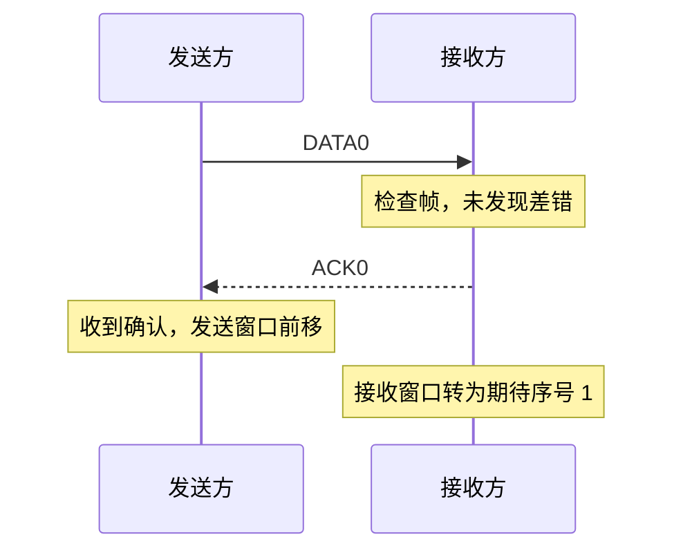
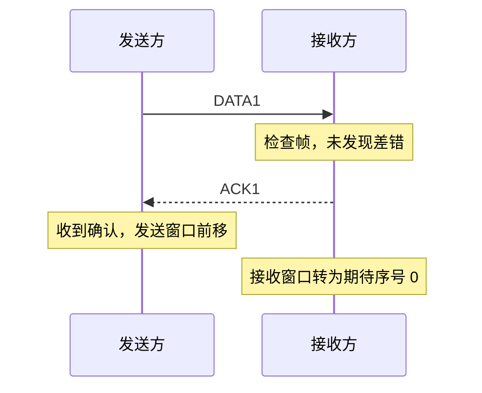
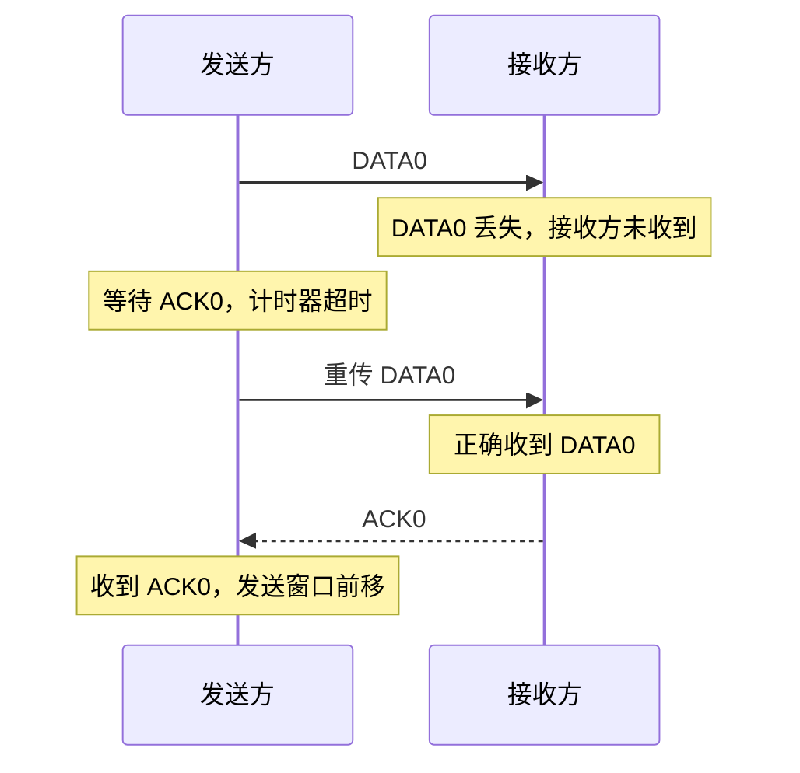
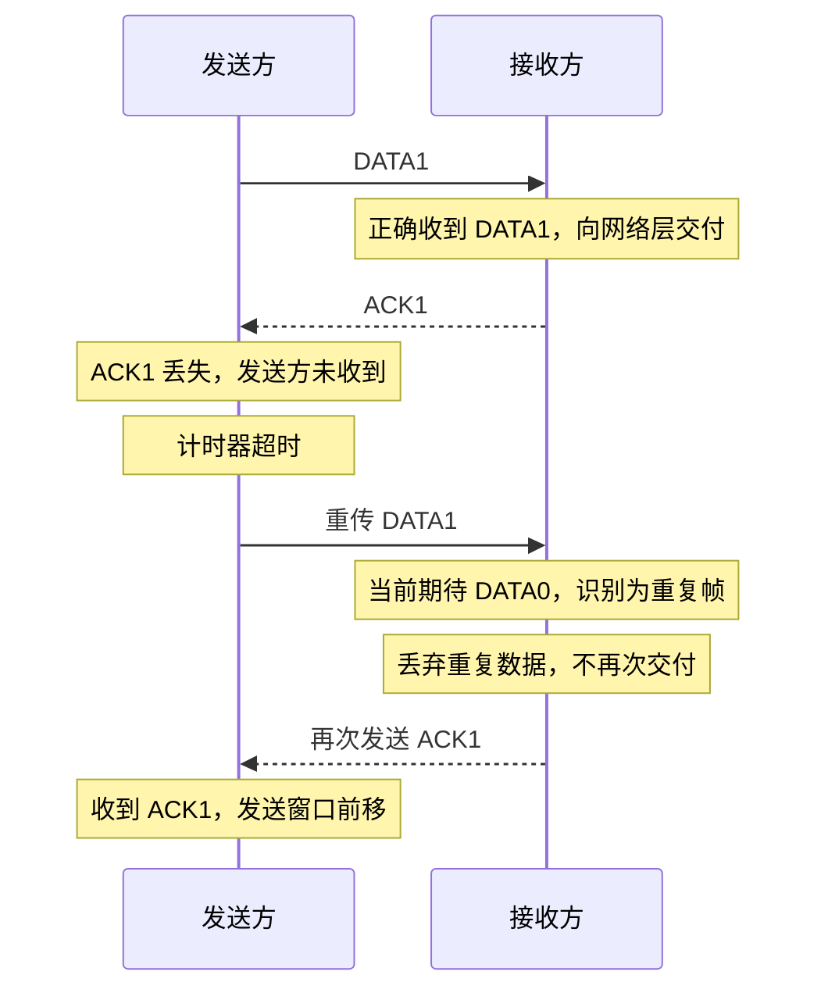
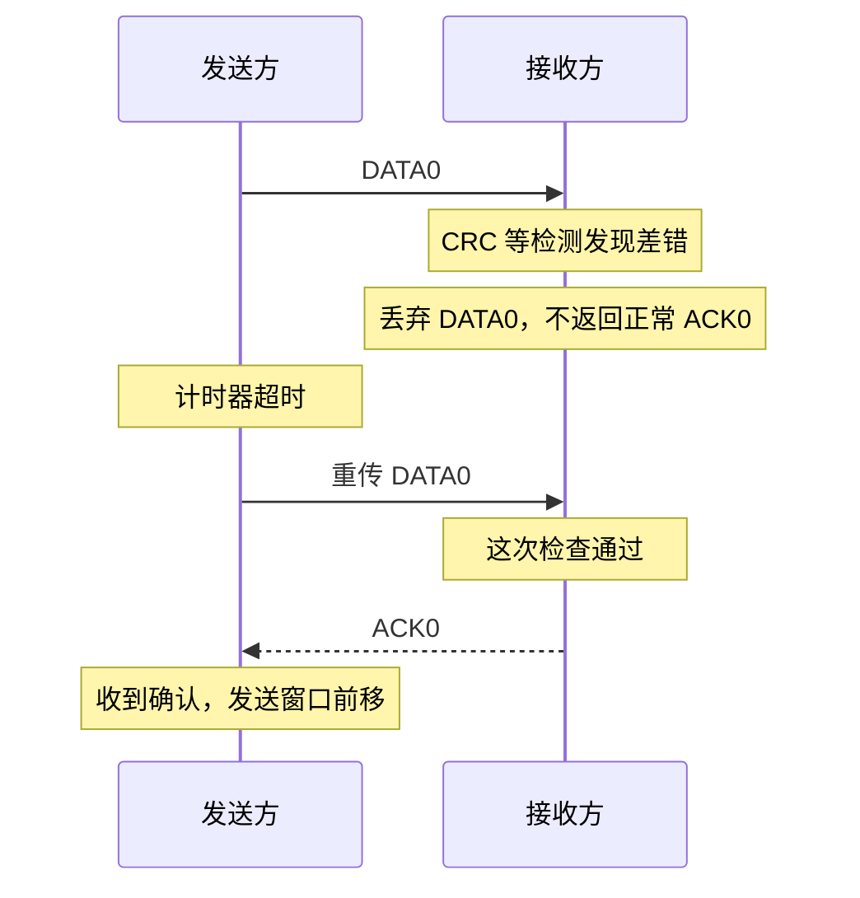
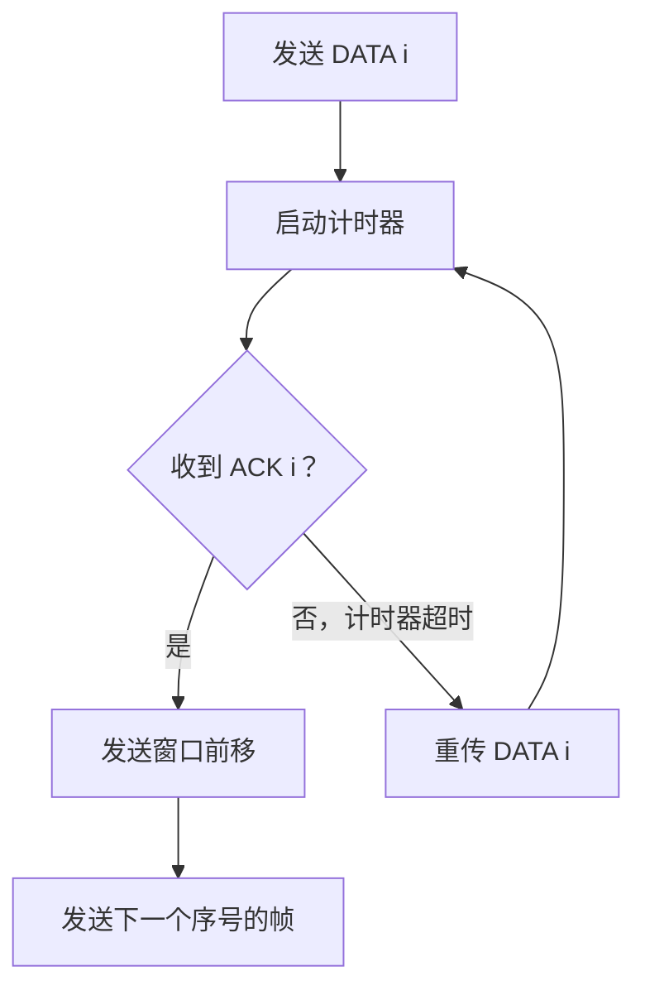

# 计算机网络数据链路层：停止等待协议（Stop-and-Wait）

> **本节重点**
>
> 1. 掌握停止等待协议的发送窗口、接收窗口大小。
> 2. 理解为什么只需要 1 bit 给数据帧编号。
> 3. 掌握确认机制（ACK）和超时重传机制。
> 4. 理解数据帧丢失、确认帧丢失、数据帧出错时如何处理。
> 5. 明白帧编号如何帮助接收方识别重复帧。
> 6. 理解停止等待协议如何实现流量控制与可靠传输。

---

## 一、停止等待协议概述

### 1. 名称与基本思想

停止等待协议的英文名称是 **Stop-and-Wait**，常写作 **SW** 或 **Stop-and-Wait Protocol**。其中：

- **Stop**：停止；
- **Wait**：等待。

它的核心思想是：

> 发送方每发送一个数据帧，就等待接收方的确认；收到正确的确认后，才继续发送下一个数据帧。

这种方式规则简单，能够配合确认、编号和超时重传机制，处理数据帧丢失、差错和重复等问题。

### 2. 四个核心方面

停止等待协议主要关注以下四个方面：

| 机制         | 规则                                             | 作用                                       |
| ------------ | ------------------------------------------------ | ------------------------------------------ |
| 滑动窗口机制 | 发送窗口 \(W_T=1\)，接收窗口 \(W_R=1\)           | 每次只处理一个待确认帧，按顺序接收         |
| 确认机制     | 正确收到第 \(i\) 号帧后，返回相应确认 ACK        | 让发送方知道帧已被正确接收                 |
| 超时重传机制 | 发送数据帧后启动计时器；超时仍未收到确认，就重传 | 处理数据帧丢失、确认帧丢失或帧被丢弃等情况 |
| 帧编号       | 使用 1 bit 序号，通常在 `0` 和 `1` 之间交替      | 区分新帧和重传的重复帧                     |

---

## 二、滑动窗口机制

### 1. 发送窗口与接收窗口

停止等待协议的窗口大小都为 1：

\[
\boxed{W_T=1,\qquad W_R=1}
\]

其中：

- \(W_T\)：发送窗口（Transmit Window）；
- \(W_R\)：接收窗口（Receive Window）。

**发送窗口大小为 1**，表示发送方一次只能有一个尚未确认的数据帧处于发送窗口中。发送该帧之后，发送方需要等待确认，窗口才能向前滑动并允许发送下一个帧。

**接收窗口大小为 1**，表示接收方当前只期待接收一个特定序号的帧。正确收到并处理该帧后，接收窗口才会转向下一个序号。

### 2. 窗口示意

```text
发送方：
帧序号：       0   1   0   1   0 ...
发送窗口：    [0]
               WT = 1

接收方：
当前期待：     0
接收窗口：    [0]
               WR = 1
```

发送窗口大小和接收窗口大小虽然都为 1，但它们分别由发送方和接收方维护，职责不同。

### 3. 为什么窗口大小会影响流量控制？

发送方发送一个帧之后，需要等待确认才能推进发送窗口。因此，发送方不能无限制地连续发送未确认的帧。

接收方收到帧后，通过 ACK 等确认反馈报告接收进度；发送方根据确认更新自身窗口状态。这样，发送方的发送进度就会受到接收方确认进度的约束，实现了基本的流量控制。

> **注意：** 接收方不是直接操作发送方的窗口，而是通过确认等协议反馈，让发送方更新自己的窗口状态。

---

## 三、帧编号：为什么只需要 1 bit？

### 1. 帧数量很多，为什么编号只需要 1 bit？

在实际网络中，发送方可能连续发送大量数据帧。没有必要为每一个帧分配一个永不重复的唯一编号。

停止等待协议只需要使用一个比特编号，让帧序号在 `0` 和 `1` 之间交替即可：

```text
数据帧序号：
0 → 1 → 0 → 1 → 0 → 1 → ...

```

1 bit 可以表示两种状态：

- `0`：0 号帧；
- `1`：1 号帧。

由于发送窗口和接收窗口大小均为 1，发送方在收到当前帧的有效确认之前，不会继续发送下一个新帧，因此交替使用 `0` 和 `1` 就足以区分当前帧与上一个帧的重传。

### 2. 编号位数的窗口条件

在停止等待、后退 N 帧和选择重传等滑动窗口协议中，编号空间需要足以区分协议允许同时存在的帧状态。课程采用的基本条件可以写为：

\[
\boxed{W_T+W_R\le 2^n}
\]

其中：

- \(W_T\)：发送窗口大小；
- \(W_R\)：接收窗口大小；
- \(n\)：帧序号所使用的比特数。

对于停止等待协议：

\[
W_T=1,\qquad W_R=1
\]

所以：

\[
1+1\le 2^n
\]

当 \(n=1\) 时：

\[
2\le 2^1=2
\]

条件成立。因此，停止等待协议最少只需要 **1 bit** 来对帧编号。

> 该窗口条件用于本课程介绍的协议窗口关系。具体协议的序号空间约束还需要结合其窗口设计规则理解。

### 3. 没有帧编号会有什么问题？

如果发送方没有及时收到确认，就可能重传刚才发送的帧。

但假如没有帧序号，接收方就无法仅凭收到的数据判断：

- 这是一个新的数据帧；
- 还是发送方因确认丢失而重传的旧帧。

如果把重复帧误认为新帧，就可能把相同数据重复交付给网络层。

因此，帧编号是识别重复帧的重要依据。

---

## 四、数据帧与确认帧

### 1. 数据帧的表示

在本节中：

- `DATA0`：序号为 `0` 的数据帧；
- `DATA1`：序号为 `1` 的数据帧；
- `ACK0`：对 0 号数据帧的确认；
- `ACK1`：对 1 号数据帧的确认。

ACK 是 **Acknowledgment**（确认）的缩写，常用来表示接收方对数据接收情况的反馈。

本笔记按照课程示例的约定，使用 `ACK0` 表示对 `DATA0` 的确认，使用 `ACK1` 表示对 `DATA1` 的确认。

### 2. 数据帧与确认帧的区别

| 对比项目     | 数据帧                             | 确认帧                             |
| ------------ | ---------------------------------- | ---------------------------------- |
| 主要用途     | 携带要传输的数据                   | 告知对方某个帧已被正确接收         |
| 数据部分     | 通常携带上层数据                   | 通常很短，也可能没有额外的数据部分 |
| 关键控制信息 | 帧类型、序号、必要的差错检测信息等 | 确认类型、相关序号等               |
| 典型表示     | `DATA0`、`DATA1`                   | `ACK0`、`ACK1`                     |

数据链路层帧通常由首部、数据部分和可能存在的尾部等构成。首部或尾部可以携带帧类型、序号、差错检测信息等控制字段。具体字段布局取决于所采用的协议。

### 3. 为什么需要帧类型字段？

两个节点之间的通信通常是双向的。某个节点既可能发送数据帧，也可能发送确认帧。

因此，接收方需要能够判断收到的是：

- 对方发来的数据；
- 还是对方发来的确认信息。

帧中必须通过协议规定的方式区分帧类型，才能正确处理。

---

## 五、正常情况下的传输过程

### 1. 发送 0 号帧

起初，发送方准备发送序号为 `0` 的数据帧，接收方当前也期待 `0` 号帧。

正常流程如下：

1. 发送方发送 `DATA0`。
2. 接收方收到并检查该帧。
3. 如果没有检测到差错，接收方接收该帧，并将数据交给网络层。
4. 接收方返回 `ACK0`。
5. 接收方的接收窗口移动，下一步期待 `DATA1`。
6. 发送方收到 `ACK0` 后，知道 `DATA0` 已正确接收，发送窗口可以向前滑动。



### 2. 接着发送 1 号帧

之后，发送方发送 `DATA1`：

1. 接收方收到并检查 `DATA1`。
2. 如果帧正确，接收方将数据交给网络层。
3. 接收方返回 `ACK1`。
4. 接收窗口转为期待序号 `0`。
5. 发送方收到 `ACK1` 后，发送窗口继续向前滑动。



### 3. 帧序号交替循环

正常通信时，数据帧序号交替循环：

```text
DATA0 → ACK0 → DATA1 → ACK1 → DATA0 → ACK0 → ...
```

这里的重点是：确认到达后，发送方才推进到下一个新帧；接收方正确接收当前期待的帧后，也将接收窗口推进到另一个序号。

---

## 六、异常情况一：数据帧丢失

### 1. 发生了什么？

假设发送方发出 `DATA0`，但数据帧在传输过程中丢失，接收方没有收到。

此时：

- 接收方无法返回 `ACK0`；
- 发送方迟迟收不到确认；
- 发送窗口无法正常推进。

### 2. 使用超时重传机制

发送方发送一个数据帧时，会启动与该帧相关的计时器。

如果计时器超时仍未收到相应确认，发送方就会重新发送该帧，并重新启动计时器。

流程如下：



### 3. 为什么重传能够解决问题？

第一次发送的 `DATA0` 丢失后，接收方并没有成功接收这个帧，因此接收窗口没有推进。

重传的 `DATA0` 到达后，接收方可以正确接收，并返回 `ACK0`。发送方收到确认后，双方的传输进度就能继续向前推进。

---

## 七、异常情况二：确认帧丢失

### 1. 发生了什么？

假设发送方发送 `DATA1`：

1. 接收方成功收到 `DATA1`。
2. 接收方把数据交给网络层，并发送 `ACK1`。
3. 但 `ACK1` 在返回过程中丢失。
4. 发送方没有收到确认，计时器最终超时。
5. 发送方重传 `DATA1`。

此时出现了一个问题：接收方已经收到过 `DATA1`，现在又收到一个序号为 `1` 的帧。

### 2. 接收方如何识别重复帧？

因为接收方之前已经成功接收了 `DATA1`，接收窗口现在期待的是序号 `0`。

当重复的 `DATA1` 到达时，它不属于当前接收窗口所期待的序号。接收方可以据此判断这是一个重复帧：

- 丢弃重复的数据帧，不把数据再次交给网络层；
- 重新发送相应的 `ACK1`，让发送方知道该帧此前已经正确接收。

这样发送方最终就能收到确认，并推进发送窗口。



### 3. 为什么帧编号必不可少？

如果没有序号，接收方就无法可靠地区分：

- 内容相同的新帧；
- 因确认丢失而重传的旧帧。

可能造成相同数据被重复交付给网络层。

因此，停止等待协议利用 `0` 和 `1` 交替编号，帮助接收方识别重传的重复帧。

---

## 八、异常情况三：数据帧发生差错

### 1. 接收方检测到差错时怎么办？

假设发送方发送 `DATA0`，并启动计时器。

接收方收到这个帧后，使用 CRC 等差错检测机制检查帧内容。如果检测出帧内部存在比特错误，则：

- 接收方丢弃该帧；
- 不把错误数据交给网络层；
- 不返回表示该帧已正确接收的确认；
- 发送方因迟迟没有收到确认，最终会超时并重传。

### 2. 正常的处理流程



### 3. 为什么这种方式可行？

接收方丢弃错误帧后，不会推进接收窗口，也不确认该帧成功接收。

发送方没有收到确认，计时器就会在合适的时间触发重传。若重传帧正确到达，接收方就可以继续接收并返回确认。

因此，停止等待协议通过差错检测、丢弃、确认与超时重传的配合，处理帧内部出现差错的情况。

> **说明：** 这里采用课程中“差错帧丢弃且不返回正常确认”的简化描述。具体协议可能还存在否定确认等机制，但不影响本节的基本理解。

---

## 九、发送方的计时器与超时重传

### 1. 计时器的作用

每发送一个当前等待确认的数据帧，发送方就启动计时器。

- 如果及时收到相应 ACK：停止或取消该次等待，并推进发送窗口。
- 如果一直没有收到相应 ACK：计时器超时，重传该帧，并重新启动计时器。

### 2. 超时重传能应对哪些情况？

| 异常情况               | 接收方是否收到原帧 | 发送方是否收到确认 | 发送方的典型动作                       |
| ---------------------- | ------------------ | ------------------ | -------------------------------------- |
| 数据帧丢失             | 否                 | 否                 | 超时后重传                             |
| 数据帧发生差错并被丢弃 | 原帧到达但未被接收 | 否                 | 超时后重传                             |
| 确认帧丢失             | 是                 | 否                 | 超时后重传；接收方识别重复帧并再次确认 |

超时重传是停止等待协议中处理丢失和未被确认情况的重要机制。

---

## 十、停止等待协议的四个机制如何配合？

### 1. 窗口大小为 1

发送窗口一次只容纳一个未确认帧；接收窗口一次只期待一个特定序号的帧。

### 2. 交替编号

数据帧使用 `0` 和 `1` 交替编号，帮助接收方识别重复帧。

### 3. 确认机制

接收方正确收到一个帧后，返回相应确认。发送方收到确认后，才能推进到下一个新帧。

### 4. 超时重传

如果发送方在计时器到期前没有收到确认，就重新发送当前帧。



这些机制共同帮助停止等待协议实现可靠传输与基本流量控制。

---

## 十一、停止等待协议的特点总结

| 项目             | 停止等待协议的规则                                       |
| ---------------- | -------------------------------------------------------- |
| 发送窗口大小     | \(W_T=1\)                                                |
| 接收窗口大小     | \(W_R=1\)                                                |
| 帧编号所需比特数 | 1 bit，序号在 `0` 和 `1` 之间交替                        |
| 确认机制         | 正确收到序号为 \(i\) 的帧后，返回对应确认                |
| 超时重传         | 发送后启动计时器；超时未收到确认则重传                   |
| 数据帧丢失       | 接收方没有收到帧，发送方超时后重传                       |
| 确认帧丢失       | 发送方超时后重传；接收方依据序号识别重复帧并再次确认     |
| 数据帧出错       | 接收方检测到差错后丢弃，发送方因未收到确认而重传         |
| 帧重复           | 接收方通过帧序号识别，不重复向网络层交付                 |
| 帧失序           | 接收窗口大小为 1，按序接收；不接受不符合当前期待序号的帧 |
| 主要功能         | 实现可靠传输与流量控制                                   |

---

## 十二、复习自测

1. 停止等待协议的英文名称是什么？
2. 停止等待协议的发送窗口和接收窗口大小各是多少？
3. 为什么停止等待协议只需要 1 bit 给帧编号？
4. `ACK0` 在本节的编号约定中表示什么？
5. 发送方发出一个帧之后，为什么要启动计时器？
6. 如果数据帧丢失，发送方和接收方分别会发生什么？
7. 如果确认帧丢失，为什么发送方会重传已经被接收方成功收到的数据帧？
8. 接收方如何识别确认帧丢失后到达的重复帧？
9. 如果接收方检测到帧内差错，为什么通常会丢弃该帧且不返回正常 ACK？
10. 停止等待协议如何实现流量控制？

### 参考答案要点

1. Stop-and-Wait。
2. \(W_T=1\)，\(W_R=1\)。
3. 因为窗口大小均为 1，当前只有一个未确认帧；序号在 `0` 与 `1` 之间交替即可区分新帧与重传帧。
4. 表示对 0 号数据帧的确认。
5. 如果迟迟收不到确认，计时器超时可以触发重传，避免因帧或 ACK 丢失而永久等待。
6. 接收方没有收到帧，不返回确认；发送方超时后重传。
7. 发送方没有收到 ACK，无法判断接收方是否已经正确收到，因此超时后按协议重传。
8. 接收方窗口当前期待另一个序号，收到旧序号帧时将其识别为重复帧，丢弃数据并重发相应 ACK。
9. 避免把错误数据交给网络层；发送方没有收到确认后会超时重传。
10. 发送方每次只发送一个未确认帧，必须等确认后才能推进窗口，因此发送速度受到接收方反馈的约束。

---

## 十三、快速记忆

> **窗口大小：** \(W_T=1,\ W_R=1\)。
>
> **编号方式：** 1 bit，帧序号 `0、1、0、1……` 交替循环。
>
> **确认机制：** 正确收到 `DATA i` 后返回 `ACK i`。
>
> **超时重传：** 发送后启动计时器，超时仍未收到对应 ACK 就重传。
>
> **数据帧丢失：** 收不到 ACK，发送方超时重传。
>
> **确认帧丢失：** 发送方重传；接收方识别重复帧，丢弃数据并再次确认。
>
> **数据帧出错：** 接收方检测到差错后丢弃，不交付网络层；发送方超时重传。
>
> **流量控制：** 发送方必须等待确认才能发送下一个新帧，因此不会无限制地发送未确认帧。
