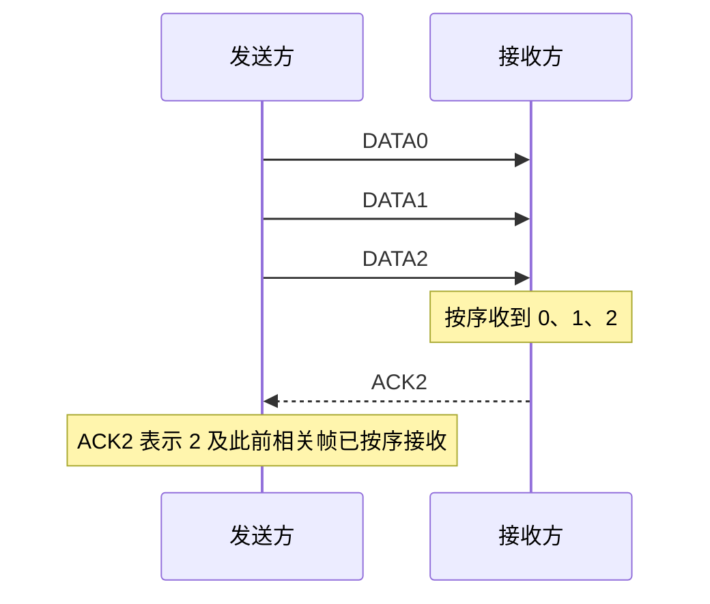
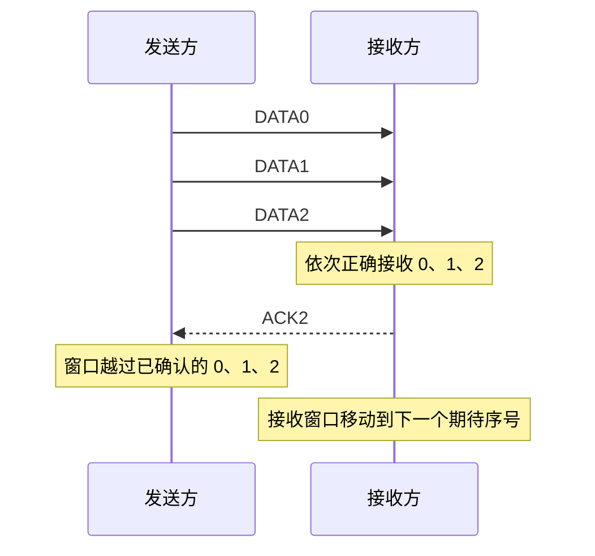
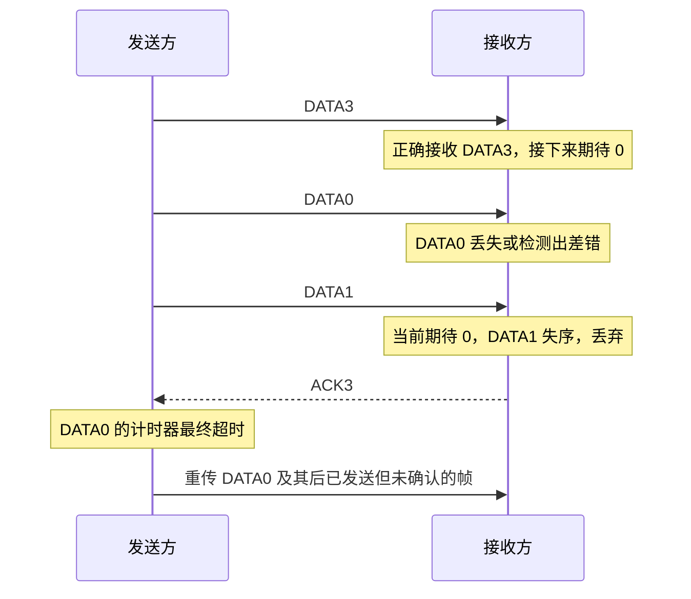
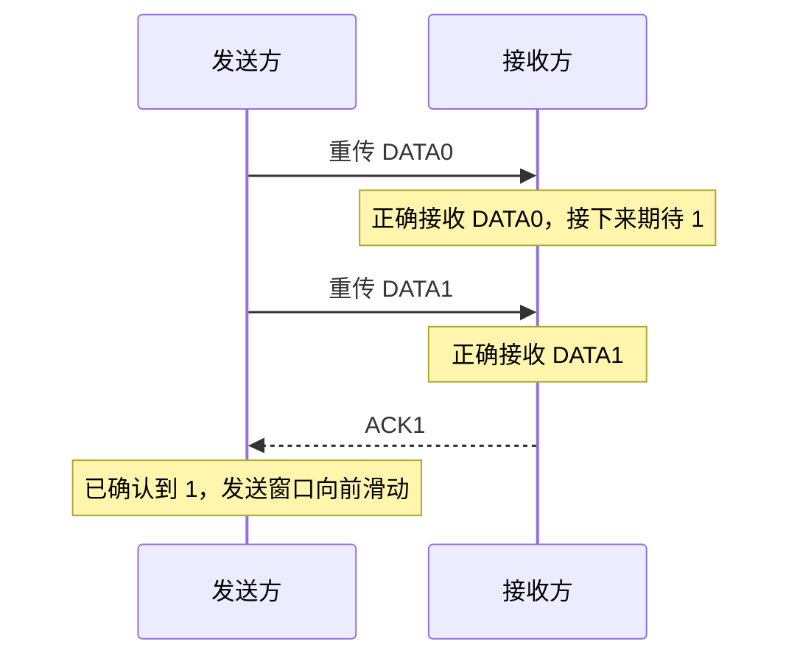
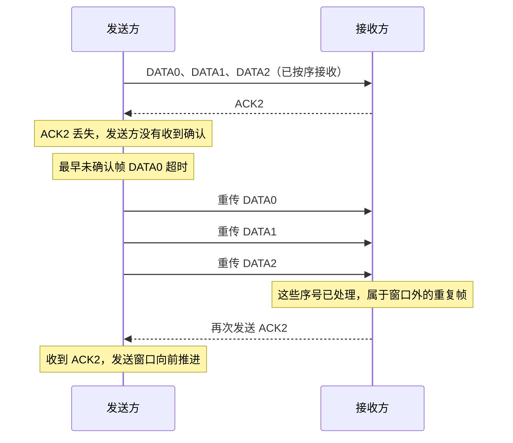
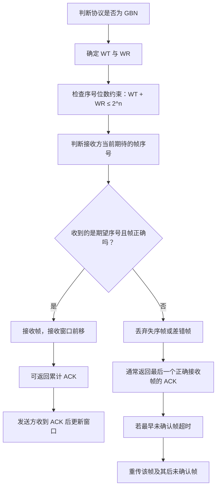

# 计算机网络数据链路层：后退 N 帧协议（GBN）

> **本节重点**
>
> 1. 理解后退 N 帧协议（Go-Back-N，GBN）的基本思想。
> 2. 掌握发送窗口和接收窗口的特点。
> 3. 理解帧序号为什么采用循环编号，以及窗口大小与序号位数的关系。
> 4. 掌握累计确认机制：收到 `ACK i` 表示序号不大于 `i` 的相关帧已按协议正确接收。
> 5. 掌握超时重传规则：第 \(i\) 个未确认帧超时后，重传该帧及其后面已经发送但尚未确认的帧。
> 6. 理解数据帧丢失、帧出错、确认帧丢失时的处理方式。
> 7. 理解 GBN 的主要缺点：接收方不能接收失序帧，丢失或出错可能导致后续多个帧被重复发送。

---

## 一、后退 N 帧协议概述

### 1. 名称与基本思想

后退 N 帧协议的英文名称是 **Go-Back-N**，缩写为 **GBN**。

它是一种基于滑动窗口机制的协议。与停止等待协议相比，GBN 允许发送方在收到确认之前连续发送多个数据帧，而不必每发一个帧就停下来等待。

GBN 的核心特点：

- 发送窗口大小大于 1；
- 接收窗口大小等于 1；
- 采用累计确认；
- 某个帧超时后，重传该帧以及后面已经发送但尚未确认的帧；
- 接收方只按序接收，失序帧或有差错的帧会被丢弃。

### 2. 与停止等待协议的主要区别

| 对比项目         | 停止等待协议                     | 后退 N 帧协议（GBN）                     |
| ---------------- | -------------------------------- | ---------------------------------------- |
| 发送窗口 \(W_T\) | 1                                | 大于 1                                   |
| 接收窗口 \(W_R\) | 1                                | 1                                        |
| 发送方式         | 一个帧确认后再发下一个新帧       | 可连续发送多个帧                         |
| 确认机制         | 通常逐帧确认                     | 累计确认                                 |
| 超时重传         | 重传当前未确认帧                 | 重传超时帧及其后已发送但尚未确认的帧     |
| 接收失序帧       | 不适用多个未确认帧连续发送的情况 | 接收窗口为 1，失序帧会被丢弃             |
| 主要优势         | 规则简单                         | 可以提高信道利用率                       |
| 主要缺点         | 等待时间可能较多                 | 一个帧丢失或出错后，后续帧也可能需要重传 |

---

## 二、发送窗口与接收窗口

### 1. 窗口大小

GBN 的窗口特点是：

\[
\boxed{W_T>1,\qquad W_R=1}
\]

其中：

- \(W_T\)：发送窗口（Transmit Window）大小；
- \(W_R\)：接收窗口（Receive Window）大小。

发送方可以把多个未确认帧放在发送窗口范围内，并连续发送它们。

接收方的窗口大小为 1，表示它只接受当前期待的那个序号。若收到的帧不在当前接收窗口中，通常会将其丢弃。

例如，假设：

\[
W_T=3,\qquad W_R=1
\]

发送窗口可以覆盖三个帧序号，而接收窗口同一时刻只期待一个序号。

```text
帧序号：        0    1    2    3    0    1 ...
发送窗口：     [0]  [1]  [2]
接收窗口：     [0]
```

> 上图只是用来说明窗口大小的示意；实际窗口覆盖哪些序号，取决于当前发送与接收进度。

### 2. 为什么 GBN 的接收窗口为 1？

GBN 的接收方只按顺序接收数据帧。

假设接收方当前期待序号为 `0`：

- 收到 `0`：正确且无差错时，接收并将窗口移到下一个序号；
- 收到 `1`，但 `0` 还没有成功接收：因为 `1` 不在当前接收窗口内，丢弃 `1`；
- 收到有差错的帧：丢弃，不向网络层交付。

GBN 不会把失序帧缓存起来等待前面的帧补齐。这个规则使接收方的处理较简单，但也会使后续帧可能被重复传输。

---

## 三、帧序号与窗口大小的关系

### 1. 帧序号采用循环编号

若使用 \(n\) 个比特给帧编号，可表示的序号数量为：

\[
\boxed{2^n}
\]

序号范围为：

\[
0,1,2,\ldots,2^n-1
\]

编号用完后会从 `0` 重新开始，也就是按模 \(2^n\) 循环。

例如，使用 2 bit 编号时：

```text
序号：0 → 1 → 2 → 3 → 0 → 1 → 2 → 3 → ...
```

下一个序号可写为：

\[
\boxed{\text{下一个序号}=(i+1)\bmod 2^n}
\]

### 2. 窗口大小的基本约束

课程中使用的窗口与序号空间条件为：

\[
\boxed{W_T+W_R\le 2^n}
\]

其中：

- \(W_T\)：发送窗口大小；
- \(W_R\)：接收窗口大小；
- \(n\)：帧序号的比特数。

对于 GBN，\(W_R=1\)，因此：

\[
W_T+1\le 2^n
\]

也就是：

\[
\boxed{W_T\le 2^n-1}
\]

### 3. 示例：发送窗口大小为 3，需要几位序号？

假设：

\[
W_T=3,\qquad W_R=1
\]

需要满足：

\[
3+1\le 2^n
\]

即：

\[
4\le 2^n
\]

最小可取 \(n=2\)，因为：

\[
2^2=4
\]

所以至少需要 2 bit，序号为：

```text
0、1、2、3
```

### 4. 2 bit 序号时，发送窗口不能取 4

假设 \(n=2\)，序号空间只有 4 个状态：

\[
0,\ 1,\ 2,\ 3
\]

如果 GBN 的发送窗口取 4、接收窗口仍为 1，那么：

\[
W_T+W_R=4+1=5>2^2=4
\]

不满足条件。因此，2 bit 序号下，GBN 发送窗口最大为：

\[
\boxed{W_T=2^2-1=3}
\]

**易错点：** GBN 中序号为 0、1、2、3，不代表发送窗口就一定可以同时覆盖这四个序号。为了区分新帧与重传帧，GBN 的发送窗口必须小于序号空间大小。

---

## 四、GBN 的累计确认机制

### 1. 什么是累计确认？

停止等待协议通常对每个正确收到的数据帧分别确认；GBN 则可以使用**累计确认（Cumulative ACK）**。

在本课程采用的表示方式中：

> 收到 `ACK i`，表示接收方已经按序正确接收了序号为 `i` 的帧，以及它之前的相关帧。

例如，接收方按序成功收到 `0、1、2` 三个帧后，可以只返回 `ACK2`，而不必分别发送 `ACK0`、`ACK1`、`ACK2`。



### 2. 累计确认的作用

累计确认可以减少确认帧的数量。

例如，接收方连续收到 `DATA0`、`DATA1`、`DATA2` 后，只返回一个 `ACK2`，就能向发送方报告截至序号 2 的接收进度。

发送方收到确认后，可以把已确认的帧移出待确认范围，让发送窗口向前滑动。

> **编号约定提醒：** 不同教材或协议规范对 ACK 的编号可能采用不同定义。有的写法用 `ACK i` 表示“已经收到 i”；有的写法表示“下一步期待 i”。本笔记遵循本课程讲解的口径：`ACK i` 表示序号为 i 的帧及其之前的相关帧已经正确接收。做题时务必先确认题目采用的定义。

---

## 五、正常传输：连续发送多个帧

假设：

\[
W_T=3,\qquad W_R=1
\]

发送方的发送窗口当前覆盖 `0、1、2`，因此可以连续发送这三个帧。

### 1. 正常传输过程

1. 发送方连续发送 `DATA0`、`DATA1`、`DATA2`。
2. 接收方依次收到 `0、1、2`，每个帧都正确且按序到达。
3. 接收窗口随着接收进度向前滑动。
4. 收到连续的多个帧后，接收方发送累计确认 `ACK2`。
5. 发送方收到 `ACK2` 后，确认 `0、1、2` 已被正确接收，并将发送窗口向前滑动。



### 2. 正常情况的窗口变化

```text
发送前：
发送窗口 WT = [0, 1, 2]
接收窗口 WR = [0]

连续发送并按序接收：
DATA0 → DATA1 → DATA2

收到 ACK2 后：
发送窗口前移，允许发送后续帧
接收窗口也已经前移到下一个期待序号
```

这个例子展示了 GBN 的两个重要特点：**发送方允许连续发送多个帧，接收方可以累计确认。**

---

## 六、异常情况一：数据帧丢失或出错

### 1. 场景

假设发送方当前发送窗口覆盖序号：

```text
[3, 0, 1]
```

发送方依次发送：

```text
DATA3 → DATA0 → DATA1
```

假设：

1. `DATA3` 正确到达；
2. `DATA0` 在传输中丢失，或者到达后检测出差错并被丢弃；
3. `DATA1` 随后到达接收方。

### 2. 接收方为什么会丢弃 `DATA1`？

接收方已经正确接收 `DATA3`，因此接收窗口向前移动，当前期待序号 `0`。

但 `DATA0` 没有成功接收。此时收到 `DATA1` 时，接收方依然期待 `0`。

因为 GBN 的接收窗口大小为 1，`DATA1` 不在当前接收窗口范围内，因此接收方会将其丢弃，而不是缓存起来等待 `DATA0`。

### 3. 接收方如何确认？

按照本课程的 ACK 编号约定，接收方返回当前最后一个正确接收的帧的确认，即 `ACK3`。

这表示接收方已经按序正确接收了 `DATA3` 及其之前的相关帧，但尚未正确接收 `DATA0`。



### 4. 为什么要重传该帧及后续帧？

当 `DATA0` 的计时器超时，发送方无法确定 `DATA0` 是否成功到达。根据 GBN 的规则，它需要重传：

- 超时的 `DATA0`；
- `DATA0` 之后已经发送、但尚未被确认的帧，例如 `DATA1`。

这个处理方式就是 **Go-Back-N**（后退 N 帧）：发送方回到出错或超时的位置，重新发送该帧以及其后的相关帧。

注意：

> “后退”指的是发送方退回到某个未被确认的帧重新发送，不是说发送窗口真的向左移动到过去的序号。发送窗口的管理仍遵循协议状态和确认规则。

### 5. 重传后恢复正常

发送方重传 `DATA0` 及其后续未确认帧后：

1. 接收方正确收到 `DATA0`；
2. 接收窗口向前移动，开始期待 `DATA1`；
3. 接收方接着正确收到 `DATA1`；
4. 接收方可以累计确认最后收到的正确帧；
5. 发送方收到累计确认后，发送窗口继续向前滑动。



---

## 七、异常情况二：确认帧丢失

### 1. 场景

假设发送方已经连续发送 `DATA0`、`DATA1`、`DATA2`，接收方也都正确收到。

接收方随后发送累计确认 `ACK2`，但这个确认帧在返回途中丢失。

此时：

- 接收方已经正确接收 `DATA0`、`DATA1`、`DATA2`；
- 接收窗口已经向前移动；
- 发送方没有收到 `ACK2`；
- 最早尚未确认的帧（这里假设为 `DATA0`）的计时器最终会超时。

### 2. 发送方会重传什么？

在 GBN 中，如果最早的未确认帧 `DATA0` 超时，发送方需要重传该帧及后面已发送但尚未确认的帧，即：

```text
DATA0、DATA1、DATA2
```

即使接收方此前已经正确收到这些帧，发送方也可能再次传输它们，因为发送方没有收到确认，无法据此确认整个窗口范围内的传输进度。

### 3. 接收方如何处理重传帧？

接收方当前已经期待更后面的序号，因此重传到达的 `DATA0`、`DATA1`、`DATA2` 都不在当前接收窗口中。

接收方会：

- 丢弃这些重复帧；
- 返回目前最后一个正确接收帧的累计确认；
- 发送方收到确认后，继续推进发送窗口。



### 4. 这个例子说明什么？

GBN 使用累计确认，减少了单独发送确认帧的需要。但如果某个关键确认帧丢失，发送方可能因超时而重传多个已经被接收方正确接收的帧。

这也是 GBN 在确认丢失或信道质量较差时可能降低传输效率的原因之一。

---

## 八、为什么发送窗口不能过大？

帧序号是循环使用的。如果发送窗口过大，序号可能在旧帧尚未被确认时就重新使用，导致接收方无法区分新帧与旧帧的重传。

### 1. 错误设置：2 bit 编号，发送窗口为 4

假设：

\[
n=2,\qquad W_T=4,\qquad W_R=1
\]

2 bit 只能表示四个序号：

```text
0、1、2、3
```

如果发送窗口大小为 4，发送方可以连续发送：

```text
DATA0 → DATA1 → DATA2 → DATA3
```

假设接收方已经正确收到这些帧，当前接收窗口又绕回期待序号 `0`。

但是，接收方发送的 `ACK3` 在途中丢失，发送方没有收到确认。由于最早发送的 `DATA0` 计时器先超时，发送方会重传 `DATA0`。

此时，接收方当前期待 `0`，收到的帧序号也是 `0`，于是可能把这次重传误认为一个新的 `DATA0`。

问题在于：这个序号 `0` 实际上是旧帧的重传，不是发送方在新一轮序号循环中发送的新数据。接收方无法仅凭 2 bit 序号区分两者。

```text
序号空间：0 → 1 → 2 → 3 → 0 → 1 → ...

如果窗口覆盖全部 4 个序号：
旧的 DATA0 尚有确认歧义时，序号可能已经绕回 0。
接收方可能把重传的旧 DATA0 当作新 DATA0。
```

### 2. 正确的窗口约束

需要满足：

\[
W_T+W_R\le 2^n
\]

对于 GBN：

\[
W_R=1
\]

所以：

\[
W_T+1\le2^n
\]

得到：

\[
\boxed{W_T\le2^n-1}
\]

当 \(n=2\) 时：

\[
W_T\le 2^2-1=3
\]

因此，2 bit 编号的 GBN 中，发送窗口最大为 3，而不是 4。

### 3. 考试提示

遇到窗口与编号位数的题目时，可以按以下步骤判断：

1. 找到发送窗口大小 \(W_T\)；
2. 找到接收窗口大小 \(W_R\)；
3. 找到序号比特数 \(n\)；
4. 检查是否满足：

\[
W_T+W_R\le2^n
\]

对于 GBN，接收窗口大小固定为 1，所以也可以直接检查：

\[
W_T\le2^n-1
\]

---

## 九、GBN 的优点与缺点

### 1. 优点

- 发送窗口大于 1，可以连续发送多个帧；
- 使用累计确认，可以减少确认帧数量；
- 相比停止等待协议，正常情况下通常有更高的信道利用率；
- 接收方只维护一个当前期待的序号，处理规则相对简单。

### 2. 缺点

GBN 的接收窗口为 1，接收方不能接收和缓存失序帧。

如果一个帧丢失或出错：

1. 接收方会丢弃后续到达的失序帧；
2. 发送方等待相应确认；
3. 当最早未确认的帧超时后，需要重传该帧以及后续已经发送但尚未确认的帧；
4. 一些原本已经到达接收方、但因前面的帧缺失而被丢弃的帧也需要重新传输。

这会造成重复传输，降低传输效率。

### 3. 哪些情况会让 GBN 效率下降？

- **接收方处理速度慢**：接收方来不及接收连续到达的帧，可能导致丢弃、超时和重传。
- **信道误码率较高**：一个帧发生差错并被丢弃后，后续帧可能因为失序而被一起丢弃。
- **确认帧丢失**：发送方可能重传已被接收方正确收到的多个帧。

| 情况             | GBN 中可能发生的结果                           |
| ---------------- | ---------------------------------------------- |
| 第一个帧丢失     | 后续失序帧被丢弃，超时后从丢失帧开始重传       |
| 中间帧出错       | 该帧被丢弃，后续帧因失序而被丢弃，重传范围扩大 |
| 累计确认丢失     | 发送方可能重传多个实际已被接收的帧             |
| 接收方只按序接收 | 实现较简单，但无法利用失序到达的后续帧         |

选择重传协议会尝试减少这类不必要的重复传输，后续课程会继续介绍。

---

## 十、GBN 的规则总表

| 项目                 | 后退 N 帧协议（GBN）                        |
| -------------------- | ------------------------------------------- |
| 发送窗口大小         | 大于 1                                      |
| 接收窗口大小         | 1                                           |
| 编号方式             | 用 \(n\) bit 编号，序号按模 \(2^n\) 循环    |
| 窗口与序号关系       | \(W_T+W_R\le2^n\)                           |
| GBN 的最大发送窗口   | \(W_T\le2^n-1\)                             |
| 确认机制             | 累计确认                                    |
| `ACK i` 的课程约定   | 表示序号为 \(i\) 及之前的相关帧已经正确接收 |
| 接收方对失序帧的处理 | 丢弃，不缓存等待                            |
| 接收方对差错帧的处理 | 丢弃，不向网络层交付                        |
| 超时重传             | 重传超时帧及其后已发送但尚未确认的帧        |
| 主要优势             | 能连续发送多个帧，确认开销较少              |
| 主要缺点             | 一个帧丢失或出错，可能导致后续多个帧重传    |

---

## 十一、解题流程图



---

## 十二、复习自测

### 题目

1. GBN 的英文全称和缩写是什么？
2. GBN 的发送窗口和接收窗口各有什么特点？
3. GBN 为什么能够采用累计确认？
4. 在本课程的编号约定中，`ACK2` 表示什么？
5. 如果接收窗口当前期待 `0`，却收到 `1`，GBN 的接收方会怎样处理？
6. 如果 `DATA0` 超时，且后面已经发送但尚未确认的帧还有 `DATA1` 和 `DATA2`，发送方应重传哪些帧？
7. 如果累计确认 `ACK2` 丢失，为什么发送方可能重传 `DATA0`、`DATA1` 和 `DATA2`？
8. 2 bit 序号时，GBN 的最大发送窗口大小是多少？为什么？
9. “后退”指什么？是否代表发送窗口真的往回滑动？
10. GBN 为什么在信道误码率较高时可能效率较低？

### 参考答案

1. Go-Back-N，缩写 GBN。
2. 发送窗口大于 1，接收窗口等于 1。
3. 接收方按序接收多个连续帧后，可以用一个确认报告截至某个序号的接收进度。
4. 按本课程约定，表示序号为 2 及其之前的相关帧已正确接收。
5. 当前期待的是 `0`，收到的 `1` 是窗口外的失序帧，因此会被丢弃，并可返回最后一个正确接收帧的确认。
6. 重传 `DATA0`、`DATA1` 和 `DATA2`。
7. 发送方没有收到确认，无法确认这一批帧已经成功交付；最早未确认帧超时后，GBN 会重传该帧及后面尚未确认的帧。
8. 最大为 \(2^2-1=3\)，因为必须满足 \(W_T+W_R\le2^n\)，而 \(W_R=1\)。
9. 指回到超时或未确认的帧重新发送，不是发送窗口向过去反向移动。
10. 因为某个帧丢失或出错后，接收方会丢弃后续失序帧，发送方可能需要重传多个帧。

---

## 十三、快速记忆

> **窗口大小：** \(W_T>1,\ W_R=1\)。
>
> **序号位数：** 满足 \(W_T+W_R\le2^n\)；GBN 中 \(W_T\le2^n-1\)。
>
> **累计确认：** 按本课程约定，`ACK i` 表示 \(i\) 及其之前的相关帧已正确接收。
>
> **接收规则：** 只按序接收；失序帧或检测出差错的帧会被丢弃。
>
> **超时重传：** 第 \(i\) 个未确认帧超时后，重传它以及后面已经发送但尚未确认的帧。
>
> **主要缺点：** 前面的帧丢失或出错时，后续帧也可能被丢弃并重复传输，降低效率。
