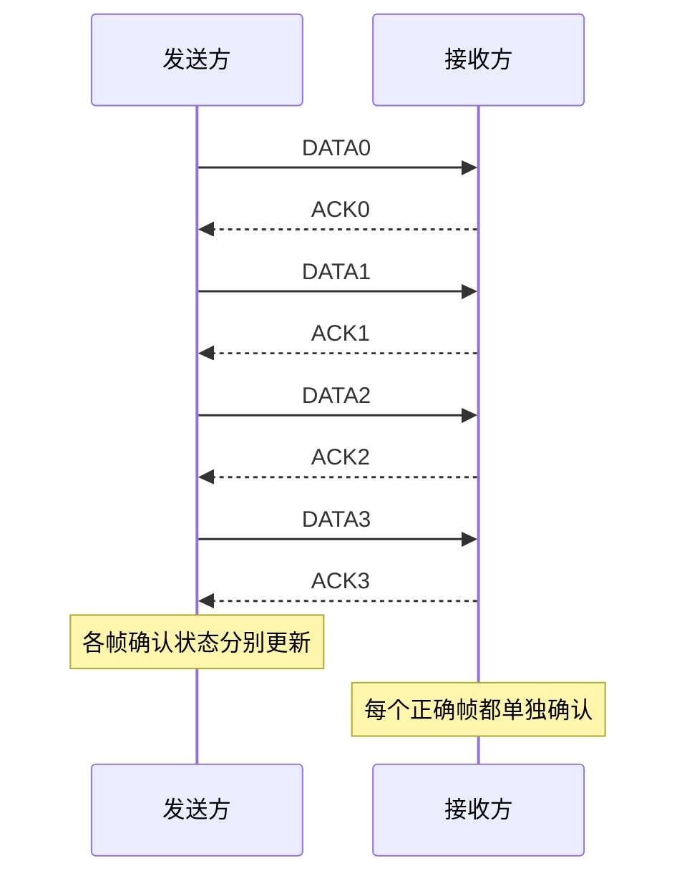
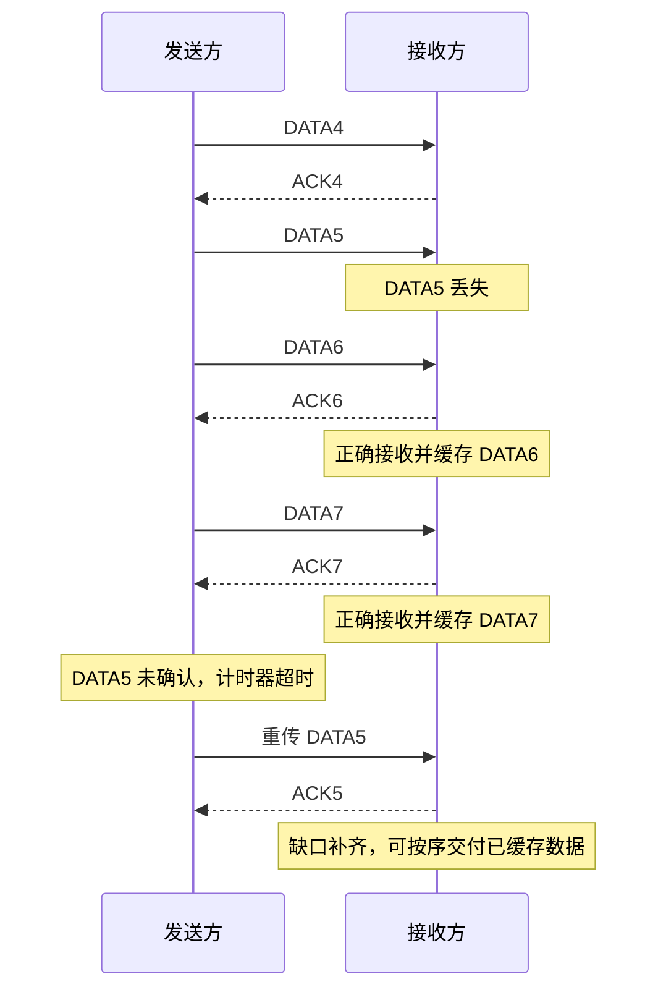
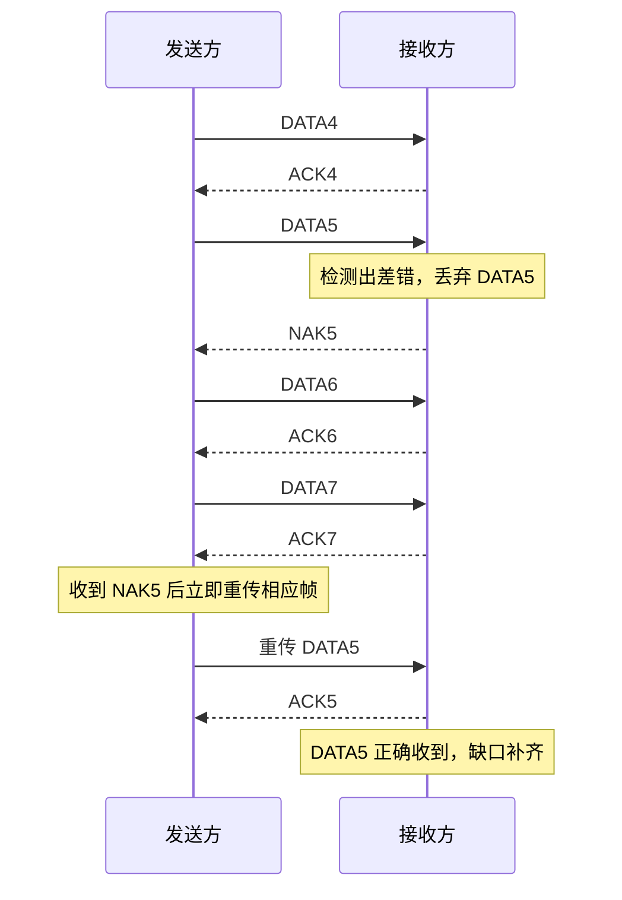
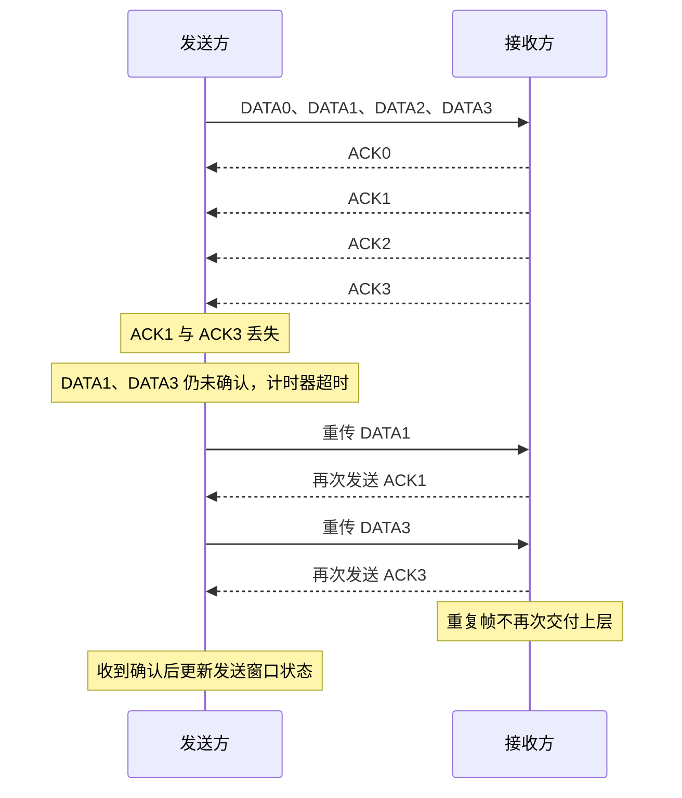
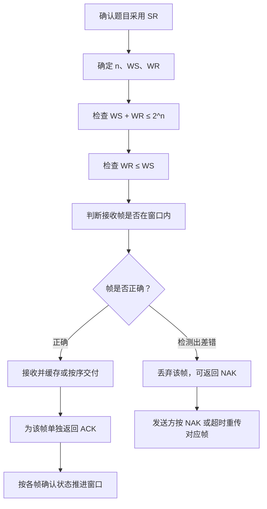

# 计算机网络数据链路层：选择重传协议（SR）

> **本节重点**
>
> 1. 掌握选择重传协议（Selective Repeat，SR）的窗口特点。
> 2. 理解序号位数、发送窗口和接收窗口之间的限制关系。
> 3. 区分 SR 与后退 N 帧协议（GBN）的确认机制。
> 4. 理解 SR 的逐帧确认、否认帧（NAK）和超时重传机制。
> 5. 掌握数据帧丢失、数据帧出错、确认帧丢失时的处理方式。
> 6. 理解 SR 为什么需要限制窗口大小，以及它如何减少不必要的重传。

---

## 一、选择重传协议概述

### 1. 名称与基本思想

选择重传协议的英文名称是 **Selective Repeat**，缩写为 **SR**。

SR 与停止等待协议、后退 N 帧协议一样，利用滑动窗口机制实现可靠传输与流量控制。它的主要特点是：

- 发送窗口大小大于 1；
- 接收窗口大小也大于 1；
- 接收窗口大小不能大于发送窗口大小；
- 每个正确接收的数据帧都需要单独确认，不采用 GBN 那样的累计确认；
- 如果接收方发现某个帧有差错，可以发送否认帧（NAK），主动请求重传；
- 如果发送方超时仍未收到对应确认，也会重传相应的数据帧；
- 接收方可以接收并缓存接收窗口内的失序帧，之后再按序交付。

### 2. 与停止等待和 GBN 的区别

| 对比项目         | 停止等待协议             | 后退 N 帧协议（GBN）         | 选择重传协议（SR）                 |
| ---------------- | ------------------------ | ---------------------------- | ---------------------------------- |
| 发送窗口 \(W_S\) | 1                        | 大于 1                       | 大于 1                             |
| 接收窗口 \(W_R\) | 1                        | 1                            | 大于 1                             |
| 确认机制         | 通常逐帧确认             | 累计确认                     | 逐帧确认                           |
| 接收失序帧       | 不接收下一序号之外的帧   | 丢弃失序帧                   | 可接收并缓存窗口内的失序帧         |
| 出错时的处理     | 超时后重传当前帧         | 超时后重传该帧及后续未确认帧 | 重传出错或丢失的相应帧             |
| NAK 请求重传     | 课程基本模型中不作为重点 | 课程基本模型中不作为重点     | 可用 NAK 主动请求某个帧重传        |
| 主要特点         | 规则简单，但等待时间较多 | 连续发送，规则较简单         | 减少不必要的重复传输，但实现更复杂 |

> **记忆重点：** GBN 采用累计确认，SR 对正确收到的帧逐帧确认；GBN 丢弃失序帧，SR 可以缓存接收窗口内的失序帧。

---

## 二、SR 的发送窗口与接收窗口

### 1. 窗口大小的基本要求

SR 的窗口需要满足两个条件：

\[
\boxed{W_S+W_R\le 2^n}
\]

\[
\boxed{W_R\le W_S}
\]

其中：

- \(W_S\)：发送窗口大小（Send Window）；
- \(W_R\)：接收窗口大小（Receive Window）；
- \(n\)：帧序号使用的比特数；
- \(2^n\)：序号空间的大小。

第一个条件要求发送窗口与接收窗口的总大小不能超过序号空间。第二个条件要求接收窗口不大于发送窗口。

### 2. 示例：3 bit 编号

若使用 3 bit 给帧编号，则序号空间大小为：

\[
2^3=8
\]

序号按模 8 循环：

```text
0 → 1 → 2 → 3 → 4 → 5 → 6 → 7 → 0 → 1 → ...
```

例如，可以设置：

\[
W_S=4,\qquad W_R=3
\]

检查条件一：

\[
W_S+W_R=4+3=7\le8
\]

检查条件二：

\[
W_R=3\le W_S=4
\]

两个条件都满足，因此该窗口设计符合本节采用的约束。

也可以设置：

\[
W_S=4,\qquad W_R=4
\]

此时：

\[
W_S+W_R=4+4=8\le8
\]

并且 \(W_R=W_S\)，也符合条件。

### 3. 为什么接收窗口不能大于发送窗口？

假设接收窗口比发送窗口更大。发送方一次最多只能发出发送窗口所覆盖的那些帧，因此接收方较大的窗口范围可能暂时用不上。

当发送方继续发送后续帧时，还需要等待前面已经发送的帧得到确认、发送窗口向前滑动。接收窗口中多出来的范围不能自动让发送方发送更多帧。

因此，按本节的窗口设计规则，要求：

\[
\boxed{W_R\le W_S}
\]

这样可以避免接收窗口大于发送窗口，减少窗口容量无法配合使用的情况。

### 4. 推荐理解：窗口大小相等

实际讲解和许多教材示例中，经常采用：

\[
W_S=W_R
\]

例如，3 bit 序号可以设置：

\[
W_S=W_R=4
\]

这满足两个限制条件，也方便说明 SR 如何缓存失序帧并选择性重传。

### 5. 窗口限制速查表

| 序号位数 \(n\) | 序号空间 \(2^n\) | 可行示例 \((W_S,W_R)\) | 检查                               |
| -------------: | ---------------: | ---------------------- | ---------------------------------- |
|              2 |                4 | \((2,2)\)              | 总和 4，且接收窗口不大于发送窗口   |
|              3 |                8 | \((4,3)\)              | 总和 7，且接收窗口不大于发送窗口   |
|              3 |                8 | \((4,4)\)              | 总和 8，且两个窗口相等             |
|              3 |                8 | \((3,4)\)              | 不符合 \(W_R\le W_S\)              |
|              3 |                8 | \((5,4)\)              | 总和 9，大于序号空间 8，不符合条件 |

---

## 三、逐帧确认：SR 与 GBN 的关键区别

### 1. SR 不采用 GBN 式累计确认

GBN 中，如果接收方连续正确接收多个帧，可以只返回最后一个帧的累计确认。

例如，连续收到 `DATA0`、`DATA1`、`DATA2`、`DATA3` 后，GBN 可以用一个累计确认报告接收进度。

SR 的确认方式不同：

> **SR 中，每收到一个正确的数据帧，接收方都要对该帧单独返回 ACK。**

例如，接收方正确收到 `DATA0` 到 `DATA3`，会分别返回：

```text
ACK0、ACK1、ACK2、ACK3
```

这些确认帧可以独立丢失或到达，发送方也需要根据每一个帧的确认状态分别管理。

### 2. 为什么要逐帧确认？

SR 允许接收方接收窗口内的失序帧，并将其缓存起来。因此，接收方可能已经收到 `DATA4`、`DATA6`、`DATA7`，但还没有收到 `DATA5`。

这种情况下，需要分别确认已经正确收到的帧，而不能简单认为“只要较大的序号已到达，之前所有序号都已收到”。

### 3. ACK 与 NAK

| 名称 | 英文                    | 含义                                           |
| ---- | ----------------------- | ---------------------------------------------- |
| ACK  | Acknowledgment          | 确认帧，表示相应数据帧正确接收                 |
| NAK  | Negative Acknowledgment | 否认帧，表示相应数据帧未被正确接收，并请求重传 |

在本节讲解的 SR 模型中：

- 正确收到帧 \(i\)：返回 `ACK i`；
- 检测到帧 \(i\) 有差错：丢弃该帧，并可以返回 `NAK i` 请求重传；
- 如果确认没有送达发送方，发送方仍可以通过超时机制重传相应帧。

> 不同协议实现对 NAK 的使用可能有所不同。本节按课程介绍的 SR 模型，将 NAK 作为接收方主动请求重传的机制。

---

## 四、正常传输：逐帧确认

假设：

\[
W_S=W_R=4
\]

发送窗口与接收窗口最初都覆盖序号 `0、1、2、3`。

### 1. 正常过程

1. 发送方连续发送 `DATA0`、`DATA1`、`DATA2`、`DATA3`。
2. 接收方逐个检查这些帧。
3. 每个帧正确到达后，接收方都返回相应 ACK。
4. 接收方按序将可交付的数据交给上层，并推进接收窗口。
5. 发送方收到相应确认后，更新每个帧的确认状态，并根据窗口规则推进发送窗口。



### 2. 与 GBN 对比

| 情况                        | GBN                        | SR                                        |
| --------------------------- | -------------------------- | ----------------------------------------- |
| 连续收到 `0、1、2、3`       | 可以累计确认到 `3`         | 分别确认 `0、1、2、3`                     |
| 帧 `5` 丢失，但 `6、7` 到达 | 通常丢弃失序的 `6、7`      | 可接收并缓存窗口内的 `6、7`               |
| 帧 `5` 出错                 | 后续失序帧通常被丢弃       | 可对 `5` 发送 NAK，继续接收窗口内的其他帧 |
| 超时重传范围                | 超时帧及后续已发送未确认帧 | 通常重传超时或被 NAK 指定的帧             |

---

## 五、异常情况一：数据帧丢失

### 1. 场景设置

假设发送窗口和接收窗口的大小都为 4。发送方发送：

```text
DATA4、DATA5、DATA6、DATA7
```

其中 `DATA5` 在传输过程中丢失，接收方实际收到：

```text
DATA4、DATA6、DATA7
```

### 2. 接收方如何处理？

- `DATA4` 正确到达，接收方返回 `ACK4`。
- `DATA5` 丢失，接收方没有收到它，因此没有对应的 ACK。
- `DATA6`、`DATA7` 如果仍落在接收窗口范围内且正确到达，SR 可以接收并缓存它们，并分别返回 `ACK6`、`ACK7`。
- 因为 `DATA5` 尚未到达，接收方不能越过这个缺口按序交付后续缓存数据。

这种处理与 GBN 的区别在于：SR 不必仅仅因为 `DATA5` 缺失就丢弃 `DATA6` 和 `DATA7`。

### 3. 发送方如何处理？

发送方收到 `ACK4`、`ACK6` 和 `ACK7` 后，可以分别标记这些帧已被确认。但是，`DATA5` 仍未确认，所以发送窗口的最左端不能跨过这个缺口。

如果 `DATA5` 的计时器超时，发送方就只需要重传 `DATA5`，而不必像 GBN 那样连同 `DATA6`、`DATA7` 一起重传。



### 4. 这个例子说明什么？

SR 的选择性重传能减少重复发送。即使某个帧丢失，后续落在接收窗口内的帧仍可以被接收和缓存；只需重传丢失的那个帧。

---

## 六、异常情况二：数据帧检测出差错

### 1. 场景设置

仍假设发送窗口和接收窗口大小都为 4。发送方连续发送：

```text
DATA4、DATA5、DATA6、DATA7
```

接收方都收到了这些帧，但 `DATA5` 的差错检测结果表明它有错误。

### 2. 接收方返回 NAK

选择重传协议可以采用如下处理：

1. 接收方接收并检查 `DATA4`，若正确则返回 `ACK4`。
2. 接收方检测到 `DATA5` 有差错，丢弃 `DATA5`，并返回 `NAK5`。
3. 接收方继续接收窗口内正确到达的 `DATA6`、`DATA7`，分别返回 `ACK6`、`ACK7`，并可缓存它们。
4. 发送方收到 `NAK5` 后，不必等到 `DATA5` 的计时器超时，就可以主动重传 `DATA5`。
5. 如果发送方在超时前没有收到 NAK，但计时器超时了，也会重传 `DATA5`。



### 3. NAK 的意义

NAK 是否认帧（Negative Acknowledgment）的缩写，作用是主动告诉发送方：相应的数据帧没有正确接收，需要重传。

与单纯等待超时相比，收到 NAK 后可以更早启动重传，从而减少等待时间。

---

## 七、异常情况三：确认帧丢失

### 1. 场景设置

发送方发送 `DATA0`、`DATA1`、`DATA2`、`DATA3`，接收方正确收到它们，并分别返回：

```text
ACK0、ACK1、ACK2、ACK3
```

假设 `ACK1` 和 `ACK3` 在传输过程中丢失，而 `ACK0` 和 `ACK2` 成功到达发送方。

### 2. 发送方的处理

- 收到 `ACK0` 后，发送方更新 0 号帧的确认状态。
- 收到 `ACK2` 后，发送方知道 2 号帧已正确接收，并可更新相应确认状态。
- 由于 `ACK1`、`ACK3` 没有到达，发送方仍把对应帧视为未确认。
- 若这些帧的计时器超时，发送方会分别重传尚未确认的帧，例如 `DATA1` 和 `DATA3`。

SR 的确认是逐帧的，因此一个 ACK 丢失并不会自动使发送方把所有后续帧都视为未确认；每个帧的状态可以单独维护。

### 3. 接收方识别重复帧

接收方此前已经正确接收过 `DATA1` 和 `DATA3`。当它们因 ACK 丢失而再次到达时，接收方会根据帧序号和接收窗口判断这些帧已经接收过，因而将其识别为重复帧。

接收方不会把重复数据再次交给上层，而会重新发送相应 ACK。发送方收到确认后，就可以把相关帧标记为已确认。



### 4. 这个例子说明什么？

在 SR 中，确认帧丢失可能导致相应数据帧重传，但通常不需要重传所有后续帧。接收方可以识别重复帧并重新发送相应确认。

---

## 八、SR 为什么需要窗口大小限制？

### 1. 序号会循环使用

若使用 \(n\) bit 给帧编号，序号空间大小为：

\[
2^n
\]

编号范围为：

\[
0,1,\ldots,2^n-1
\]

之后会回到 0。

窗口必须足够小，以便接收方区分当前新帧与旧帧重传。否则，序号绕回后，旧帧可能与新帧拥有相同的序号，接收方就可能误判。

### 2. 错误设置示例：3 bit 编号，\(W_S=5\)、\(W_R=4\)

序号空间大小为：

\[
2^3=8
\]

但是：

\[
W_S+W_R=5+4=9>8
\]

因此，这种设置不满足窗口约束。

假设发送方先发送 `DATA0` 到 `DATA4`，接收方全部正确收到。接收方的接收窗口推进到更后面的序号。若所有 ACK 都丢失，发送方可能超时并重传 `DATA0` 到 `DATA4`。

此时，因为序号已经循环使用，重传的旧 `DATA0` 可能落在接收方当前接收窗口内，被误认为是新一轮的 `DATA0`。这样就会产生重复数据误交付的问题。

```text
序号空间：0 1 2 3 4 5 6 7 （共 8 个状态）

发送窗口大小 5 + 接收窗口大小 4 = 9
9 > 8，窗口范围可能出现序号重叠
```

### 3. 两个条件必须同时满足

SR 的窗口设计要满足：

\[
\boxed{W_S+W_R\le2^n}
\]

并且：

\[
\boxed{W_R\le W_S}
\]

只要有一个条件不满足，设计就不符合本节介绍的 SR 规则。

### 4. 常见的对称窗口情况

当发送窗口与接收窗口大小相等时：

\[
W_S=W_R=W
\]

第一个条件变成：

\[
2W\le2^n
\]

所以：

\[
\boxed{W\le2^{n-1}}
\]

因此，如果 \(n=3\)，通常可取：

\[
W_S=W_R=4
\]

这是 SR 的常见窗口配置。

---

## 九、SR 与 GBN 的效率对比

### 1. GBN 的重传范围较大

GBN 中，接收窗口为 1。一个帧丢失或发生差错后，接收方会丢弃后续失序帧；发送方超时后，需要从出错帧开始重传后面尚未确认的帧。

### 2. SR 只重传必要的帧

SR 中，接收方能够接收并缓存接收窗口内的失序帧。发送方也可以独立跟踪各帧是否收到确认，因此可以只重传：

- 被 NAK 明确请求重传的帧；
- 或计时器已经超时且仍未确认的帧。

### 3. 两种协议的典型表现

| 情况                        | GBN                                        | SR                                       |
| --------------------------- | ------------------------------------------ | ---------------------------------------- |
| 帧 5 丢失，帧 6、7 正确到达 | 接收方丢弃 6、7；随后重传 5 及后续未确认帧 | 接收方可缓存 6、7；主要重传 5            |
| 帧 5 检测出差错             | 丢弃 5，后续失序帧也可能被丢弃             | 可丢弃 5 并发 `NAK5`，后续正确帧仍可缓存 |
| ACK 5 丢失                  | 可能导致从最早未确认帧开始的多个帧重传     | 通常只需重传对应未确认帧                 |
| 接收方复杂度                | 较低                                       | 较高，需要缓存失序帧并管理各帧状态       |
| 传输效率                    | 差错较少时较有效率；差错时可能重复传输较多 | 能减少不必要的重复传输，但实现更复杂     |

---

## 十、SR 的规则总表

| 项目                    | 选择重传协议（SR）                                     |
| ----------------------- | ------------------------------------------------------ |
| 发送窗口 \(W_S\)        | 大于 1                                                 |
| 接收窗口 \(W_R\)        | 大于 1                                                 |
| 窗口大小约束            | \(W_S+W_R\le2^n\)，且 \(W_R\le W_S\)                   |
| 序号方式                | 使用 \(n\) bit 编号，按模 \(2^n\) 循环                 |
| 确认机制                | 每个正确接收的帧单独返回 ACK                           |
| 是否采用 GBN 式累计确认 | 不采用                                                 |
| 发现帧差错              | 丢弃该帧，可返回 NAK 请求重传                          |
| 超时重传                | 重传超时且未确认的相应帧                               |
| 失序帧                  | 若在接收窗口内且通过检查，可缓存                       |
| 重复帧                  | 根据序号与窗口状态识别，不再次交付上层，可重发对应 ACK |
| 主要优点                | 减少不必要的重传                                       |
| 主要缺点                | 需要较复杂的缓冲、确认状态和窗口管理                   |

---

## 十一、解题流程图



---

## 十二、容易混淆的地方

1. **SR 的接收窗口大于 1。** 它能够接收并缓存窗口内的失序帧；GBN 的接收窗口为 1，失序帧会被丢弃。
2. **SR 不采用 GBN 式累计确认。** 正确收到每个帧后，需要针对该帧单独确认。
3. **SR 可以使用 NAK。** 接收方检测到某帧有差错时，可以主动请求重传，不必始终等待超时。
4. **SR 仍然需要超时重传。** NAK 不能代替所有超时处理，因为数据帧或 ACK 本身也可能丢失。
5. **接收窗口不能大于发送窗口。** 还必须满足 \(W_S+W_R\le2^n\)。
6. **序号是循环的。** \(n\) bit 只能表示 \(2^n\) 个序号，窗口太大可能让新旧帧的序号产生歧义。
7. **“逐帧确认”不代表每个帧的确认都必然送达。** ACK 可能丢失，所以仍需通过重传和重复帧识别来保证可靠传输。

---

## 十三、复习自测

### 题目

1. SR 的英文全称是什么？
2. SR 的发送窗口与接收窗口有哪些基本要求？
3. 3 bit 编号时，序号空间有多少种状态？
4. \(W_S=4,W_R=3,n=3\) 是否满足窗口条件？
5. \(W_S=3,W_R=4,n=3\) 是否满足窗口条件？为什么？
6. SR 与 GBN 的确认机制有什么区别？
7. SR 中 `DATA5` 丢失，但 `DATA6`、`DATA7` 正确到达时，接收方可以怎么做？
8. NAK 的作用是什么？
9. 如果 `ACK1` 丢失，发送方最终可能怎么处理？
10. 为什么 SR 不允许发送窗口与接收窗口之和超过序号空间？
11. 如果 \(W_S=W_R=W\)，窗口总和条件可以化简成什么？
12. SR 为什么通常比 GBN 更复杂？

### 参考答案

1. Selective Repeat。
2. \(W_S>1\)、\(W_R>1\)，并满足 \(W_R\le W_S\) 和 \(W_S+W_R\le2^n\)。
3. \(2^3=8\) 种，即 `0` 到 `7`。
4. 满足，因为 \(4+3=7\le8\)，且 \(3\le4\)。
5. 不满足，因为 \(W_R=4>W_S=3\)。
6. GBN 可以累计确认；SR 对正确接收的帧逐帧确认。
7. 若这些帧位于接收窗口内且没有差错，可以接收、缓存并分别 ACK；等待缺失的 `DATA5` 到达后再按序交付。
8. NAK 用来否认某个帧未被正确接收，并主动请求重传。
9. 计时器超时后重传尚未确认的 `DATA1`；接收方识别重复帧并再次发送 ACK1。
10. 防止序号循环使用时，新帧与旧帧重传产生歧义。
11. \(2W\le2^n\)，即 \(W\le2^{n-1}\)。
12. 因为它需要缓存失序帧，分别管理确认状态，并进行选择性重传。

---

## 十四、快速记忆

> **窗口：** \(W_S>1,\ W_R>1\)。
>
> **窗口约束：** \(W_S+W_R\le2^n\)，且 \(W_R\le W_S\)。
>
> **确认：** 每收到一个正确帧，就对该帧单独返回 ACK，不采用 GBN 式累计确认。
>
> **NAK：** 接收方发现某个帧有差错时，可主动请求重传对应帧。
>
> **超时：** 未确认帧计时器超时后，重传相应的帧，而不是必然把所有后续帧一起重传。
>
> **失序帧：** 只要在接收窗口内且检查正确，就可以缓存；缺失帧补齐后再按序交付。
>
> **核心优势：** 比 GBN 减少不必要的重复传输；代价是接收缓存和确认状态管理更复杂。
