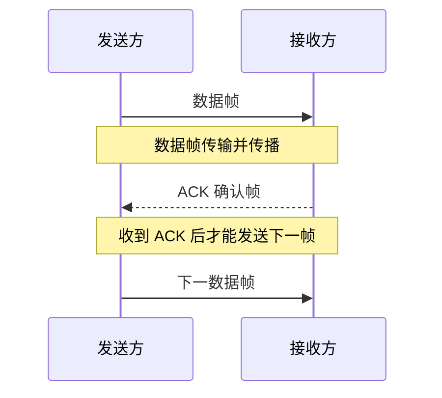
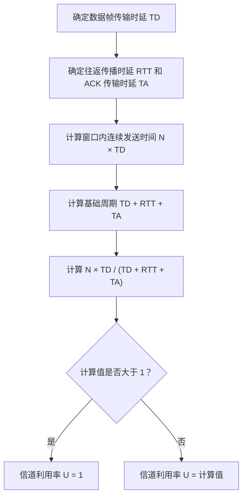
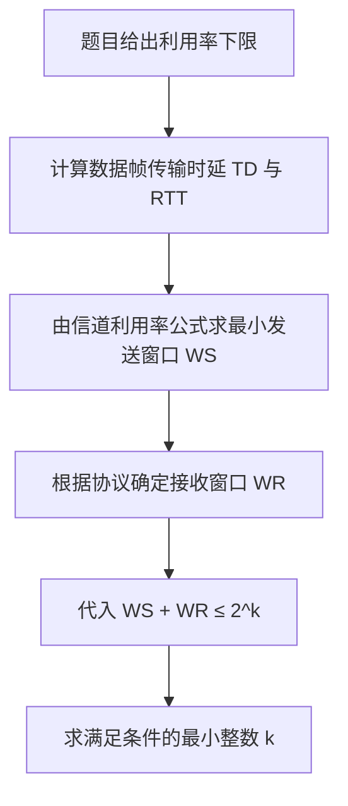

# 计算机网络数据链路层：停止等待、GBN 与 SR 的信道利用率

> 本笔记根据视频讲解整理，涵盖停止等待协议、后退 N 帧协议（GBN）和选择重传协议（SR）的信道利用率、典型例题及相关术语。
>
> 保留原讲解的主要知识点、推导思路和例题；修正明显的语音转写错误、单位书写和公式排版，并补充必要的计算说明。

---

## 一、信道利用率的基本思路

### 1. 什么是信道利用率

信道利用率可以理解为：在一段观察时间内，发送信道真正用于传输数据的时间所占的比例。

\[
U=\frac{\text{发送信道上传输数据的时间}}{\text{观察周期的总时间}}
\]

需要注意：

- 本节讨论的是**发送信道**的利用率。
- 数据帧由发送方发往接收方，使用发送信道。
- ACK 确认帧由接收方返回发送方，使用反方向的接收信道。
- ACK 的**传输时延**可能需要计入周期总时间；但 ACK 在反方向传输，不表示发送信道也在传输数据。
- 理想情况下，假设数据帧和 ACK 都不会丢失，也不会发生比特差错。

### 2. 三种协议的分析重点

| 协议 | 发送方式 | 分析信道利用率时的关键点 |
|---|---|---|
| 停止等待协议（Stop-and-Wait） | 发送一帧，等待 ACK，再发送下一帧 | 发送一帧后，需要等待确认返回 |
| 后退 N 帧协议（GBN） | 可连续发送多个数据帧 | 发送窗口内的多帧可以连续发送 |
| 选择重传协议（SR） | 可连续发送多个数据帧 | 理想情况下的利用率分析方法与 GBN 相同 |

对于 GBN 和 SR，在**理想传输条件**下，发送窗口中的数据帧都能顺利传输，因此利用率主要取决于发送窗口大小；接收窗口在此时不直接影响该利用率公式。但接收窗口仍然会影响帧序号位数的约束。

---

## 二、相关时延符号

| 符号 | 含义 |
|---|---|
| \(T_D\) | 发送一个数据帧所需的传输时延 |
| \(T_A\) | 发送一个 ACK 确认帧所需的传输时延 |
| \(T_P\) | 信道的单向传播时延 |
| \(RTT\) | 往返传播时延，通常记作 \(RTT=2T_P\) |
| \(N\) | 发送窗口大小，即窗口中最多允许未确认的数据帧数量 |
| \(U\) | 发送信道利用率 |

### 1. 传输时延与传播时延的区别

**传输时延**：把一个帧的所有比特送上链路所需要的时间。

\[
T_D=\frac{\text{数据帧长度（bit）}}{\text{链路传输速率（bit/s）}}
\]

**传播时延**：一个比特从链路一端传播到另一端所需要的时间，取决于传播距离和传播速度。

**往返传播时延**：

\[
RTT=2T_P
\]

若题目说“忽略 ACK 的传输时延”，表示可以令 \(T_A=0\)；这**不代表**可以忽略 ACK 的传播时延。ACK 仍然要从接收方传播回发送方。

---

## 三、停止等待协议的信道利用率

### 1. 停止等待协议的工作过程

停止等待协议的发送窗口和接收窗口都为 1。发送方每次只能发送一个数据帧：

1. 发送方发送一个数据帧。
2. 接收方收到数据帧并检查无误后，返回 ACK。
3. 发送方收到 ACK 后，才发送下一个数据帧。
4. 以上过程不断重复。

### 2. 示例：计算停止等待协议的信道利用率

假设：

- 链路传输速率为 \(1\text{ KB/s}\)；
- 数据帧长度为 \(4\text{ KB}\)；
- ACK 长度为 \(1\text{ KB}\)；
- 单向传播时延为 \(7\text{ s}\)。

#### （1）计算传输时延

数据帧传输时延：

\[
T_D=\frac{4\text{ KB}}{1\text{ KB/s}}=4\text{ s}
\]

ACK 传输时延：

\[
T_A=\frac{1\text{ KB}}{1\text{ KB/s}}=1\text{ s}
\]

往返传播时延：

\[
RTT=2T_P=2\times7=14\text{ s}
\]

#### （2）计算一个完整周期的时间

从开始发送一个数据帧，到发送方完整收到该帧的 ACK，所经历的时间为：

\[
T_{\text{周期}}=T_D+RTT+T_A
\]

\[
T_{\text{周期}}=4+14+1=19\text{ s}
\]

在这 19 秒内，发送信道上只有发送数据帧的 4 秒真正用于传输数据。ACK 在反方向的接收信道上传输，不计为发送信道上传输数据的时间。

#### （3）计算信道利用率

\[
U=\frac{T_D}{T_D+RTT+T_A}
\]

\[
U=\frac{4}{4+14+1}=\frac{4}{19}\approx21.05\%
\]

因此，发送信道利用率约为 **21.1%**。

### 3. 停止等待协议的一般公式

理想情况下：

\[
\boxed{U=\frac{T_D}{T_D+RTT+T_A}}
\]

也可以写为：

\[
\boxed{U=\frac{T_D}{T_D+2T_P+T_A}}
\]

公式背后的逻辑是：

- **分子 \(T_D\)**：发送一个数据帧真正占用发送信道的时间。
- **分母 \(T_D+RTT+T_A\)**：从发送一个数据帧开始，到发送方完整收到 ACK、可以继续发送下一帧为止的周期总时间。

要理解公式的物理含义，不要只靠死记硬背。题目改变 ACK 时延、传播时延或帧长度时，都应从“一个周期总时间”和“真正传输数据的时间”出发分析。

### 4. ACK 很短、ACK 传输时延可忽略的情况

若题目说明 ACK 很短，忽略 ACK 的**传输时延**，则：

\[
T_A\approx0
\]

停止等待协议的信道利用率变为：

\[
\boxed{U=\frac{T_D}{T_D+RTT}}
\]

继续使用上面的例子，\(T_D=4\text{ s}\)，\(RTT=14\text{ s}\)：

\[
U=\frac{4}{4+14}=\frac{4}{18}\approx22.22\%
\]

注意：即使忽略 ACK 的传输时延，仍然需要计入 ACK 返回方向的传播时延，所以分母中仍有 \(RTT\)。

---

## 四、例题一：2018 年考研题——停止等待协议

### 1. 题目条件

主机甲采用停止等待协议向主机乙发送数据：

- 数据传输速率：\(3\text{ kb/s}\)；
- 单向传播时延：\(200\text{ ms}\)；
- 忽略 ACK 的传输时延；
- 当信道利用率为 40% 时，求数据帧长度。

### 2. 解题过程

停止等待协议的信道利用率为：

\[
U=\frac{T_D}{T_D+RTT+T_A}
\]

忽略 ACK 的传输时延，所以 \(T_A=0\)；单向传播时延为 \(200\text{ ms}=0.2\text{ s}\)，因此：

\[
RTT=2\times0.2=0.4\text{ s}
\]

将 \(U=40\%=0.4\) 代入：

\[
0.4=\frac{T_D}{T_D+0.4}
\]

解方程：

\[
0.4T_D+0.16=T_D
\]

\[
0.6T_D=0.16
\]

\[
T_D=\frac{0.16}{0.6}\approx0.2667\text{ s}
\]

数据帧长度等于传输速率乘以传输时延：

\[
L=R T_D
\]

\[
L=3000\text{ bit/s}\times0.2667\text{ s}\approx800\text{ bit}
\]

**答案：数据帧长度为 800 bit。**

### 3. 易错点

- \(200\text{ ms}\) 必须换算成 \(0.2\text{ s}\)，再和以 bit/s 为单位的传输速率配合计算。
- 忽略 ACK 的传输时延，不等于忽略 ACK 的传播时延。
- 数据帧长度要使用 bit；若用字节表示，还需要除以 8。

---

## 五、GBN 和 SR 的信道利用率

GBN（后退 N 帧协议）和 SR（选择重传协议）都允许发送方在没有收到前面所有 ACK 时，连续发送多个数据帧。

在理想情况下，假设数据帧和 ACK 都不丢失、没有比特差错，发送窗口中的数据帧都能顺利发送和接收。因此，GBN 和 SR 的**理想信道利用率分析方法相同**。

### 1. 发送窗口大小为 \(N\) 时的分析思路

假设发送窗口大小为 \(N\)，每个数据帧的传输时延为 \(T_D\)。

发送窗口内的 \(N\) 个数据帧可以连续发出，因此发送这些帧需要：

\[
T_{\text{连续发送}}=N T_D
\]

从开始发送第一个数据帧，到收到第一个数据帧的 ACK，所对应的基础周期为：

\[
T_{\text{周期}}=T_D+RTT+T_A
\]

当窗口较小时，发送方可能发完当前窗口后，需要等待 ACK 返回；当窗口足够大时，发送方可以在 ACK 返回之前持续发送数据，发送信道便不会空闲。因此利用率不能超过 1：

\[
\boxed{U=\min\left(\frac{N T_D}{T_D+RTT+T_A},\,1\right)}
\]

也可以写成：

\[
\boxed{U=\min\left(\frac{N T_D}{T_D+2T_P+T_A},\,1\right)}
\]

有些讲解会先写出未取上限的表达式：

\[
U=\frac{N T_D}{T_D+RTT+T_A}
\]

使用它时必须检查计算结果：**若结果大于 1，应将实际信道利用率取为 1（100%）**。

### 2. 公式为什么是 \(N T_D\)

- **分子 \(N T_D\)**：发送窗口内 \(N\) 个数据帧连续发送所需的时间。
- **分母 \(T_D+RTT+T_A\)**：从开始发送第一个数据帧，到发送方收到第一个 ACK、可以继续推进发送窗口所对应的时间。
- 若 \(N T_D\) 小于分母，窗口内数据发完后，发送方会有等待时间，利用率小于 1。
- 若 \(N T_D\) 大于或等于分母，发送方可以连续发送，发送信道可一直有数据通过，利用率为 1。

### 3. 示例：发送窗口为 4

假设条件与前面的停止等待协议示例相同：

- \(T_D=4\text{ s}\)；
- \(T_A=1\text{ s}\)；
- \(RTT=14\text{ s}\)；
- 发送窗口 \(N=4\)。

窗口内 4 个数据帧连续发送需要：

\[
N T_D=4\times4=16\text{ s}
\]

一个基础周期为：

\[
T_D+RTT+T_A=4+14+1=19\text{ s}
\]

所以：

\[
U=\frac{4\times4}{4+14+1}=\frac{16}{19}\approx84.21\%
\]

**发送窗口为 4 时，信道利用率约为 84.2%。**

### 4. 发送窗口继续增大时

仍使用 \(T_D=4\text{ s}\)、\(RTT=14\text{ s}\)、\(T_A=1\text{ s}\)。

若 \(N=5\)：

\[
\frac{N T_D}{T_D+RTT+T_A}
=\frac{5\times4}{4+14+1}
=\frac{20}{19}>1
\]

这个结果不能解释为信道利用率超过 100%。它意味着窗口已足够大，使发送方可以连续发送数据；实际利用率为：

\[
\boxed{U=1=100\%}
\]

因此，GBN 和 SR 的理想信道利用率可以统一写为：

\[
\boxed{U=\min\left(\frac{N T_D}{T_D+RTT+T_A},1\right)}
\]

---

## 六、例题二：2014 年考研题——GBN 的最大平均传输速率

### 1. 题目条件

主机甲和主机乙之间使用后退 N 帧协议传输数据：

- 发送窗口大小：\(N=1000\)；
- 数据帧长度：1000 字节；
- 链路带宽：\(100\text{ Mb/s}\)；
- 接收方每收到一个数据帧就立即发送一个短 ACK；
- ACK 的传输时延可以忽略；
- 单向传播时延：\(50\text{ ms}\)。

求主机甲可以达到的最大平均数据传输速率。

### 2. 计算一个数据帧的传输时延

先把字节换算成 bit：

\[
1000\text{ Byte}\times8=8000\text{ bit}
\]

链路速率为 \(100\text{ Mb/s}=100\times10^6\text{ bit/s}\)，所以：

\[
T_D=\frac{8000}{100\times10^6}\text{ s}
=0.00008\text{ s}
=0.08\text{ ms}
\]

### 3. 计算窗口内全部数据帧的发送时间

发送窗口大小为 1000，因此一个窗口可以连续发送 1000 个数据帧：

\[
N T_D=1000\times0.08\text{ ms}=80\text{ ms}
\]

一个窗口发送的数据总量为：

\[
1000\times1000\text{ Byte}\times8
=8{,}000{,}000\text{ bit}
\]

### 4. 计算一个周期的时长

单向传播时延为 \(50\text{ ms}\)，所以：

\[
RTT=2\times50=100\text{ ms}
\]

ACK 传输时延可忽略，即 \(T_A=0\)。基础周期为：

\[
T_D+RTT+T_A=0.08+100+0=100.08\text{ ms}
\]

### 5. 计算平均数据传输速率

\[
R_{\text{avg}}=
\frac{\text{一个周期内发送的数据总量}}{\text{周期时间}}
\]

\[
R_{\text{avg}}=
\frac{8{,}000{,}000\text{ bit}}{0.10008\text{ s}}
\approx79.94\text{ Mb/s}
\]

因此，最大平均数据传输速率约为：

\[
\boxed{80\text{ Mb/s}}
\]

### 6. 也可以先算信道利用率

\[
U=\frac{N T_D}{T_D+RTT+T_A}
=\frac{80}{100.08}
\approx79.94\%
\]

平均数据传输速率约等于：

\[
R_{\text{avg}}=U\times R_{\text{链路}}
\]

\[
R_{\text{avg}}\approx79.94\%\times100\text{ Mb/s}
\approx79.94\text{ Mb/s}
\]

因此，通过“数据总量除以周期时间”或“链路带宽乘以信道利用率”两种方式，得到的结果一致。按题目选项和常见近似，约为 **80 Mb/s**。

---

## 七、例题三：2015 年考研题——由利用率求帧序号位数

### 1. 题目条件

主机甲和主机乙之间采用滑动窗口协议传输数据：

- 数据帧长度：1000 字节；
- 链路传输速率：\(128\text{ kb/s}\)；
- 单向传播时延：\(250\text{ ms}\)；
- 不考虑 ACK 的传输开销；
- 要求信道利用率不小于 80%；
- 求帧序号至少需要多少个比特。

此题的关键是：**先根据利用率要求求出发送窗口大小，再结合协议的序号空间约束求出序号位数。**

### 2. 计算数据帧传输时延

数据帧长度：

\[
L=1000\text{ Byte}\times8=8000\text{ bit}
\]

链路速率：

\[
R=128\text{ kb/s}=128000\text{ bit/s}
\]

因此：

\[
T_D=\frac{8000}{128000}\text{ s}=0.0625\text{ s}=62.5\text{ ms}
\]

### 3. 计算往返传播时延

单向传播时延为 \(250\text{ ms}=0.25\text{ s}\)，所以：

\[
RTT=2\times0.25=0.5\text{ s}
\]

题目忽略 ACK 的传输时延，因此 \(T_A=0\)。

### 4. 由利用率要求求发送窗口

GBN 和 SR 在理想情况下使用相同的利用率分析公式：

\[
U=\min\left(\frac{N T_D}{T_D+RTT+T_A},1\right)
\]

题目要求 \(U\ge80\%=0.8\)。在求满足要求的最小窗口时，可先令未封顶的比值满足：

\[
\frac{N\times0.0625}{0.0625+0.5}\ge0.8
\]

\[
\frac{0.0625N}{0.5625}\ge0.8
\]

\[
0.0625N\ge0.45
\]

\[
N\ge7.2
\]

发送窗口大小必须为整数，因此：

\[
\boxed{N\ge8}
\]

也就是说，发送窗口至少需要容纳 8 个未确认的数据帧。

### 5. 根据序号空间确定比特数

若使用 \(k\) 个比特给帧编号，则一共有 \(2^k\) 种不同的序号取值。帧序号会循环使用，因此必须满足对应协议的窗口约束，避免旧帧与新帧因序号相同而产生歧义。

#### （1）GBN：后退 N 帧协议

GBN 的接收窗口大小为 1。按窗口约束：

\[
W_S+W_R\le2^k
\]

其中 \(W_S\) 为发送窗口大小，\(W_R=1\)。因此：

\[
W_S+1\le2^k
\]

题目要求 \(W_S\ge8\)，取最小可行发送窗口 \(W_S=8\)：

\[
8+1\le2^k
\]

\[
9\le2^k
\]

\(2^3=8\) 不够，而 \(2^4=16\) 足够，所以：

\[
\boxed{k\ge4}
\]

GBN 至少需要 **4 个比特**给帧编号。

#### （2）SR：选择重传协议

SR 能缓存接收窗口内的乱序帧，因此接收窗口大小大于 1。一般窗口约束为：

\[
W_S+W_R\le2^k
\]

在本题 \(W_S\ge8\) 的条件下，即使仅取一个大于 1 的最小接收窗口 \(W_R=2\)，也有：

\[
8+2\le2^k
\]

\[
10\le2^k
\]

所以 \(k=3\) 时的 8 个序号不够，至少需要 \(k=4\)。若使用常见的等大小 SR 发送、接收窗口设置，则：

\[
W_S=W_R\le2^{k-1}
\]

这同样要求至少 4 个比特，才能让 SR 的发送窗口达到 8。

**本题按给定的利用率要求，GBN 和 SR 都至少需要 4 个比特。** 不过，两种协议的窗口约束不同，遇到其他题目条件时，计算过程和最小序号位数可能出现区别。

---

## 八、GBN 与 SR 的窗口约束对比

### 1. 为什么同样的序号位数下，GBN 可以使用更大的发送窗口

GBN 的接收窗口固定为 1；SR 的接收窗口大于 1。根据：

\[
W_S+W_R\le2^k
\]

在序号位数 \(k\) 相同的情况下，GBN 的 \(W_R\) 更小，因此允许的发送窗口 \(W_S\) 可以更大。

| 协议 | 接收窗口 | 常见窗口约束 | 同样序号位数下的特点 |
|---|---:|---|---|
| GBN | \(W_R=1\) | \(W_S+1\le2^k\) | 可使用相对更大的发送窗口 |
| SR | \(W_R>1\) | \(W_S+W_R\le2^k\)；常见等大小设置为 \(W_S=W_R\le2^{k-1}\) | 需要为接收窗口保留序号空间 |

在理想传输条件下，若 GBN 使用的发送窗口比 SR 更大，则 GBN 可达到的理想信道利用率也可能更高。注意，这是在比较相同序号位数和对应窗口限制时得到的结论；实际协议的表现还与丢帧、差错和重传开销有关。

### 2. 利用率要求如何限制序号位数

利用率要求越高，通常需要越大的发送窗口。发送窗口大小又受到帧序号位数的限制，因此整个解题过程可以归纳为：

### 3. 延伸比较：当利用率要求降为 75%

为了看清 GBN 与 SR 的区别，假设其他数据不变，只把利用率下限从 80% 改为 75%。

已知：

\[
T_D=0.0625\text{ s},\quad RTT=0.5\text{ s},\quad T_A=0
\]

要求：

\[
\frac{N\times0.0625}{0.0625+0.5}\ge0.75
\]

\[
0.0625N\ge0.421875
\]

\[
N\ge6.75
\]

由于窗口大小必须为整数，因此：

\[
\boxed{N\ge7}
\]

#### GBN 情况

接收窗口 \(W_R=1\)，若取最小发送窗口 \(W_S=7\)：

\[
W_S+W_R=7+1=8\le2^k
\]

因此 \(2^3=8\) 已经足够，GBN 至少需要 **3 个比特**。

#### SR 情况

SR 的接收窗口必须大于 1。即使只取 \(W_R=2\)：

\[
W_S+W_R=7+2=9
\]

而 \(2^3=8\) 不足以容纳 9，因此必须使用 4 个比特：

\[
2^4=16
\]

所以，在这个 75% 的延伸情形中：

- GBN 至少需要 3 个比特；
- SR 至少需要 4 个比特。

这个例子说明：**相同的信道利用率要求，不一定会让 GBN 和 SR 得到相同的最小序号位数**，因为它们对接收窗口的要求不同。

---

## 九、必须掌握的术语

### 1. 滑动窗口协议

滑动窗口机制允许发送方在一定范围内连续发送数据帧，并随着确认到达向前移动发送窗口。

本视频使用的术语口径是：

- “滑动窗口协议”通常指发送窗口大于 1 的 GBN 或 SR。
- 停止等待协议也可以从窗口大小为 1 的角度理解其机制，但在这类考研题目的术语语境中，通常把它与 GBN、SR 区分开来。

考试时应结合题目教材对术语的具体定义进行判断，不宜把某一套用语理解成所有资料都完全一致。

### 2. ARQ 协议

ARQ 是 **Automatic Repeat reQuest** 的缩写，中文通常译为“自动重传请求”。

核心思想是：发送方发出数据帧后，如果在规定时间内没有收到预期的 ACK，或检测到需要重传的情况，就根据具体协议规则重新发送数据帧。

本章讨论的三种协议都具有 ARQ 特征：

- 停止等待协议；
- 后退 N 帧协议（GBN）；
- 选择重传协议（SR）。

所以题目如果说两个节点使用 ARQ 协议，不能仅凭这个名称判断它一定是其中某一种协议，还需要结合窗口、确认和重传规则判断。

### 3. 连续 ARQ 协议

连续 ARQ 协议允许发送方连续发送多个数据帧，而不必每发一帧都等待对应 ACK。

在本视频的术语口径中，连续 ARQ 主要指：

- 后退 N 帧协议（GBN）；
- 选择重传协议（SR）。

停止等待协议每次发送一帧后都要等待 ACK，因此不属于这里所说的连续 ARQ。

---

## 十、三个协议的核心差异回顾

| 对比项 | 停止等待协议 | GBN（后退 N 帧） | SR（选择重传） |
|---|---|---|---|
| 发送窗口 | 1 | 大于 1 | 大于 1 |
| 接收窗口 | 1 | 1 | 大于 1 |
| 能否连续发送多个数据帧 | 不能 | 能 | 能 |
| 能否缓存接收窗口内的乱序帧 | 不适用一般多帧乱序接收 | 通常不能缓存并按序交付后续乱序帧 | 可以缓存接收窗口内的乱序帧 |
| 重传方式 | 对未确认帧重传 | 某帧出错或丢失后，可能重传该帧及其后尚需重传的帧 | 选择性重传出错、丢失或未被确认的帧 |
| 理想信道利用率 | \(\frac{T_D}{T_D+RTT+T_A}\) | \(\min(\frac{N T_D}{T_D+RTT+T_A},1)\) | \(\min(\frac{N T_D}{T_D+RTT+T_A},1)\) |

> 表中的利用率公式建立在理想传输假设下。若题目考虑帧丢失、比特差错或额外协议开销，就需要根据题设调整分析。

---

## 十一、做题步骤总结

### 1. 停止等待协议

1. 计算数据帧传输时延：

   \[
   T_D=\frac{L}{R}
   \]

2. 根据单向传播时延计算：

   \[
   RTT=2T_P
   \]

3. 若忽略 ACK 的传输时延，令 \(T_A=0\)；否则保留 \(T_A\)。
4. 使用：

   \[
   U=\frac{T_D}{T_D+RTT+T_A}
   \]

5. 若要求数据帧长度，则先求 \(T_D\)，再计算 \(L=R T_D\)。

### 2. GBN 和 SR

1. 计算一个数据帧的传输时延 \(T_D=L/R\)。
2. 计算往返传播时延 \(RTT=2T_P\)。
3. 根据窗口大小 \(N\) 计算：

   \[
   U=\min\left(\frac{N T_D}{T_D+RTT+T_A},1\right)
   \]

4. 若题目给出最低利用率要求，反向求出最小 \(N\)。
5. 若继续求帧序号比特数，再按具体协议的发送窗口、接收窗口约束计算 \(k\)。

### 3. 常见易错点

- **字节与比特混淆**：数据帧长度若以 Byte 给出，计算传输时延前要乘以 8。
- **ms 与 s 混淆**：代入以 bit/s 为单位的传输速率前，应统一使用秒。
- **忽略 ACK 传输时延，不等于忽略 ACK 传播时延**。
- **RTT 是往返传播时延**：单向传播时延为 \(T_P\) 时，通常 \(RTT=2T_P\)。
- **信道利用率不可能超过 100%**：若直接代入公式得出大于 1 的结果，实际利用率应取 1。
- **先求发送窗口，再求序号位数**：利用率条件决定所需窗口大小，帧序号位数则决定窗口能够有多大。
- **GBN 与 SR 的接收窗口不同**：求序号空间时不能把两种协议的约束混为一谈。
- **平均传输速率与信道利用率的关系**：在链路速率固定且忽略其他额外开销时，可用 \(R_{\text{avg}}=U R_{\text{链路}}\) 计算平均有效数据速率。

---

## 十二、最终公式速查

| 场景 | 公式 |
|---|---|
| 数据帧传输时延 | \(\displaystyle T_D=\frac{L}{R}\) |
| 往返传播时延 | \(\displaystyle RTT=2T_P\) |
| 停止等待协议利用率 | \(\displaystyle U=\frac{T_D}{T_D+RTT+T_A}\) |
| ACK 传输时延可忽略时的停止等待利用率 | \(\displaystyle U=\frac{T_D}{T_D+RTT}\) |
| GBN / SR 理想利用率 | \(\displaystyle U=\min\left(\frac{N T_D}{T_D+RTT+T_A},1\right)\) |
| 平均数据传输速率 | \(\displaystyle R_{\text{avg}}=U\times R_{\text{链路}}\) |
| GBN 序号空间约束（接收窗口为 1） | \(\displaystyle W_S+1\le2^k\) |
| 一般窗口的序号空间约束 | \(\displaystyle W_S+W_R\le2^k\) |
| SR 常见等大小窗口约束 | \(\displaystyle W_S=W_R\le2^{k-1}\) |

**本节最重要的思路：先明确一个周期的总时间，再计算发送信道真正传输数据的时间；若利用率要求进一步限制了发送窗口，再结合 GBN 或 SR 的序号空间约束求帧序号位数。**
