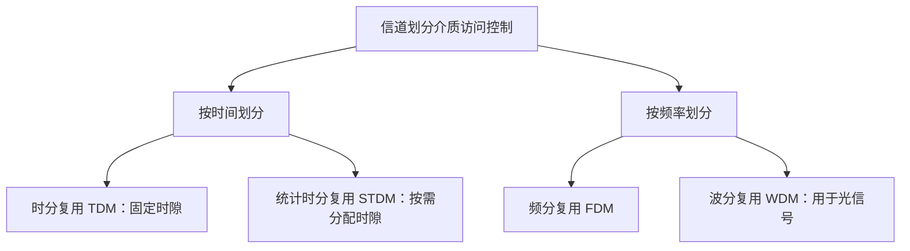
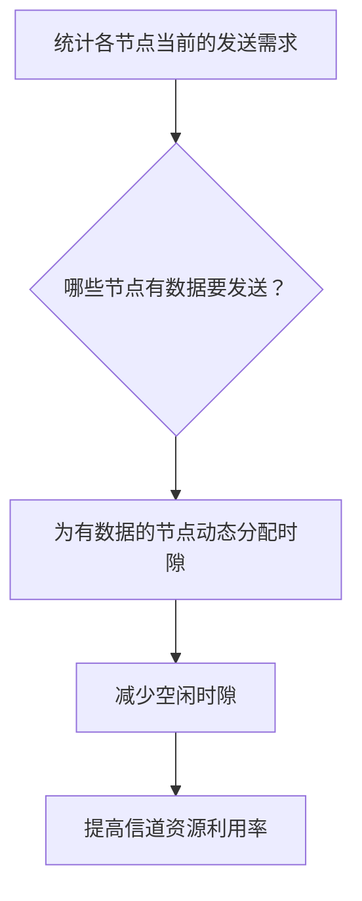
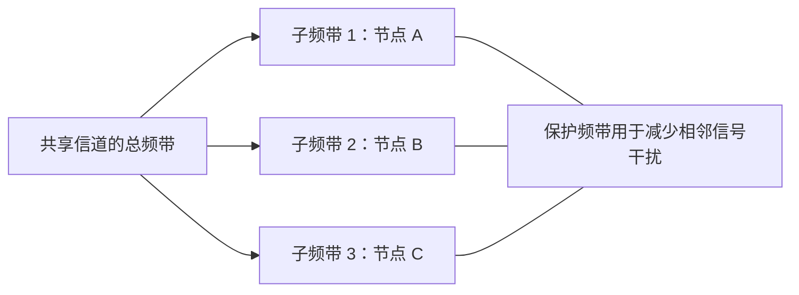
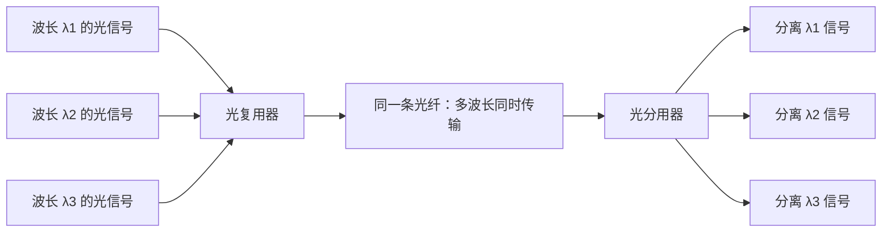

# 计算机网络数据链路层：信道划分介质访问控制

> 本笔记根据课程视频整理，介绍介质访问控制的基本问题，以及时分复用（TDM）、统计时分复用（STDM）、频分复用（FDM）和波分复用（WDM）。
>
> 整理原则：保留原讲解的主要内容、生活类比和例子，统一术语、层级、单位与排版，并补充表格和 Mermaid 示意图，方便复习和打印。

---

## 一、什么是介质访问控制

### 1. 广播信道与信号冲突

在计算机网络中，有些信道在逻辑上属于**总线型信道**，也可以称为**广播信道**。

广播信道的特点是：一个节点向信道发送信号时，信号可能被该信道覆盖范围内的多个节点接收到。

例如：

- 多个节点连接在同一条同轴电缆上；
- 多个节点通过集线器（Hub）接入同一个共享网段；
- 无线网络中的多个设备共享无线介质，例如 Wi-Fi 网络中的无线信道。

当节点 A 正在发送数据时，如果节点 B 也同时向共享信道发送数据，两者的信号就可能相互干扰，发生**信号冲突**。

无线网络中的信号也会在空间中传播，因此多个设备同时发送时同样可能出现干扰。

### 2. 介质访问控制要解决什么问题

介质访问控制（Medium Access Control，MAC）要解决的核心问题是：

> **如何控制多个节点对共享传输介质的访问，减少甚至避免信号冲突。**

在计算机网络考研（408）相关内容中，介质访问控制通常会介绍以下方法：

| 方法     | 基本思路                                                   |
| -------- | ---------------------------------------------------------- |
| 信道划分 | 将共享资源划分成不同部分，让多个节点按分配到的资源进行通信 |
| 随机访问 | 节点按照协议规则竞争信道，可能发生冲突，再按规则处理       |
| 轮询访问 | 按一定顺序或控制机制决定哪个节点可以发送                   |

本笔记重点介绍**信道划分介质访问控制**。

---

## 二、信道划分的基本思路

信道划分的核心，是把共享信道的资源划分成多个部分，再把这些资源分配给不同的通信节点。

本节主要介绍四种复用技术：

1. **时分复用（TDM，Time Division Multiplexing）**：把时间划分成时隙。
2. **统计时分复用（STDM，Statistical Time Division Multiplexing）**：根据实际需求动态分配时隙。
3. **频分复用（FDM，Frequency Division Multiplexing）**：把频率范围划分成多个子频带。
4. **波分复用（WDM，Wavelength Division Multiplexing）**：在光纤通信中，按不同波长复用光信号。

可以先用下图记住各种技术划分的资源维度：



---

## 三、时分复用（TDM）

### 1. 时分复用的生活类比

假设一个宿舍里有几位同学想同时聊天。如果大家一起大声说话，声音就会相互干扰，听的人可能无法清楚地分辨每个人说了什么。

为了解决这个问题，可以规定大家**轮流发言**：

- 第一个时间段由 A 发言；
- 第二个时间段由 B 发言；
- 第三个时间段由 C 发言；
- 然后再从 A 开始重复。

每位同学只能在分配给自己的时间段内发言。这样就把原本共享的时间资源划分成小块，再轮流分配给不同的发送方。

这就是时分复用的基本思想。

### 2. TDM 的定义

**时分复用（TDM）**的英文全称是 _Time Division Multiplexing_。

它将信道的使用时间划分成一系列**时隙（Time Slot）**，并把时隙分配给不同的通信方，使多个通信方在时间上轮流使用同一条信道。

### 3. TDM 帧与时隙

- **时隙**：一个较小的时间片，可分配给某个发送方使用。
- **TDM 帧**：由多个时隙组成的一个周期。
- **固定分配**：在传统同步 TDM 中，每个发送方在每个 TDM 帧中的位置通常固定。

例如，假设 A、B、C 三个节点共享信道，每个 TDM 帧包含三个时隙：

```text
一个 TDM 帧：
┌──────────┬──────────┬──────────┐
│ 时隙 1   │ 时隙 2   │ 时隙 3   │
│ 分配给 A │ 分配给 B │ 分配给 C │
└──────────┴──────────┴──────────┘

下一个 TDM 帧重复相同的分配：
┌──────────┬──────────┬──────────┐
│ 时隙 1   │ 时隙 2   │ 时隙 3   │
│ 分配给 A │ 分配给 B │ 分配给 C │
└──────────┴──────────┴──────────┘
```

也可以理解为：TDM 帧是一个大的时间周期，而这个周期又被划分为多个等长时隙。每个发送方在帧中的相对位置通常不变。

### 4. TDM 的带宽分配与缺点

假设共享信道的传输能力为 \(6\text{ kb/s}\)，并将每个 TDM 帧划分为三个相等的时隙，分别分配给 A、B、C。

在平均、固定划分的理想模型下，每个节点最多获得约三分之一的信道时间，因此可分配到的平均传输能力约为：

\[
\frac{6\text{ kb/s}}{3}=2\text{ kb/s}
\]

若把一个 TDM 帧划分为 \(m\) 个相等的时隙，并固定分配给 \(m\) 个节点，那么每个节点平均只能使用约 \(1/m\) 的信道时间。

**TDM 的主要缺点：**

1. **时隙固定，分配不够灵活。** 每个节点获得的时间资源通常是预先安排好的。
2. **空闲时隙会浪费资源。** 如果某个节点暂时没有数据要发送，分配给它的时隙可能闲置。
3. **信道利用率可能较低。** 如果多个节点长时间没有数据，固定时隙就可能无法被其他有大量数据的节点充分利用。

例如，如果前三个 TDM 帧期间 B 和 C 都没有数据要发送，而 A 需要发送大量数据，那么原本分配给 B 和 C 的时隙仍可能空闲，A 也不能在固定 TDM 规则下随意占用这些时隙。

---

## 四、统计时分复用（STDM）

### 1. 为什么需要统计时分复用

传统 TDM 的主要问题是时隙固定，而不同节点在不同时间的通信需求往往并不相同。

例如：

- A 当前有大量数据要发送；
- B 和 C 暂时没有数据要发送。

如果仍然把固定时隙分配给 A、B、C，那么 B 和 C 的时隙可能被浪费。

为了解决这个问题，可以统计各个节点的实际发送需求，再动态分配时隙。

### 2. STDM 的定义

**统计时分复用（STDM）**的英文全称是 _Statistical Time Division Multiplexing_，也常称为**异步时分复用**。

它是在 TDM 的基础上，增加了根据实际通信需求**动态、按需分配时隙**的机制。

与固定时隙分配相比，STDM 不必在每个周期里都把固定时隙留给暂时没有数据的节点，而是可以把共享资源分配给当前有数据要发送的节点。

### 3. STDM 的例子

假设 A、B、C 三个节点共享信道：

- 在某一段时间里，B 和 C 没有数据要发送；
- A 需要传输大量数据。

采用固定 TDM 时，B 和 C 的时隙可能闲置，A 只能使用分配给自己的时隙。

采用 STDM 时，系统可以根据实际需要，把更多时隙分配给 A。在某一段时间内，如果只有 A 有数据要发送，那么 A 就可能使用大部分甚至全部可用的时隙资源。



### 4. STDM 的优点

- **资源分配更灵活**：时隙根据实际通信需求分配。
- **减少空闲时隙**：没有数据的节点不必一直占用固定时隙。
- **提高信道利用率**：资源能够更多地分配给当前有数据要发送的节点。

> 理解重点：TDM 的典型特点是**固定分配时隙**；STDM 的典型特点是**统计发送需求，并动态按需分配时隙**。

---

## 五、频分复用（FDM）

### 1. 频分复用的生活类比

继续使用宿舍聊天的例子。多个同学同时说话时，如果他们的声音频率范围非常接近，听的人就可能难以分辨不同的声音。

如果设法让不同同学使用不同的频率范围，例如一个偏低频、一个使用中间频率、另一个使用较高频率，那么接收方就更容易把叠加在一起的信号分离出来。

这个例子想说明的核心是：**如果不同信号占用互不重叠的频率范围，就可以在同一时间内同时传输，并在接收端按频率分离。**

> 宿舍声音的频率范围只是帮助理解的比喻，不应把例子中的具体频率区间当作实际人体发声频率的标准参数。

### 2. FDM 的定义

**频分复用（FDM）**的英文全称是 _Frequency Division Multiplexing_。

它把一条信道可用的总频带划分为多个互不重叠的**子频带**，并把不同的子频带分配给不同的通信方。

这样，各个通信方可以在同一时间发送信号，因为不同通信方使用的是不同频率范围。

### 3. 子频带与隔离频带

假设总频带被划分成三段，分别分配给 A、B、C：

- A 使用低频子频带；
- B 使用中频子频带；
- C 使用高频子频带。

为了减少相邻子频带之间的干扰，实际系统中可能会在相邻的频带之间留出一定的**隔离频带（保护频带）**。

以下是一个示意表，区间只用于说明划分方式：

| 频带     | 分配对象 | 说明             |
| -------- | -------- | ---------------- |
| 子频带 1 | C        | 低频范围         |
| 隔离频带 | 不分配   | 减少相邻信号干扰 |
| 子频带 2 | B        | 中频范围         |
| 隔离频带 | 不分配   | 减少相邻信号干扰 |
| 子频带 3 | A        | 高频范围         |

这些子频带互不重叠，接收方就能根据频率范围分离出自己需要的信号。

### 4. 从总频带到多个子频带

假设一条信道可使用的总频带为 \(20\text{ Hz}\) 到 \(20000\text{ Hz}\)，那么这一段频率范围就是总频带的示意。采用 FDM 时，可以将总频带划分为多个子频带，中间留出保护频带。

真正的通信系统会依据具体技术标准、信号特征和干扰要求来设计频带；上面的数值仅为教学类比，不是实际网络系统的标准划分。



### 5. 复用器与分用器

在 FDM 系统中，通常会涉及两个设备或功能：

- **复用器（Multiplexer）**：把来自多个发送端的信号组合到共享传输介质上，不同信号占用不同的频带。
- **分用器（Demultiplexer）**：在接收端把复合信号分离成各个独立的子信号，再交给对应的接收方。

可以简单理解为：

```text
多个发送方
    │
    ▼
复用器：把信号安排到不同频带
    │
    ▼
共享传输信道：多个频带同时传输
    │
    ▼
分用器：按频带分离各个信号
    │
    ▼
对应的接收方
```

### 6. FDM 的特点

**优点：**

- 多个节点可以同时发送信号。
- 共享信道的总频带可以划分为不同子频带，分配给多个通信方并行使用。
- 接收方可以按频带区分不同信号。

**需要注意的地方：**

- 每个节点通常只能使用分配给自己的子频带，因此其可用带宽小于整个信道的总带宽。
- 子频带之间需要合理设计隔离，以降低互相干扰。
- 频分复用的实质是按频率分配频带，不应简单理解为“只能传输模拟信号”。传统讲解常从模拟信号的频率特性引入 FDM；实际通信中，数字数据也可以调制到不同载波，再通过不同频带进行复用。

---

## 六、波分复用（WDM）

### 1. WDM 的定义

**波分复用（WDM）**的英文全称是 _Wavelength Division Multiplexing_。

波分复用主要用于光纤通信。它把不同波长的光信号组合到同一条光纤中传输，接收端再将不同波长的光信号分离出来。

### 2. 波长与频率的关系

光在真空中的传播速度、波长与频率之间满足：

\[
c=\lambda f
\]

其中：

- \(c\)：光速；
- \(\lambda\)：光的波长；
- \(f\)：光的频率。

在传播速度近似固定时，波长与频率成反比：**波长越长，频率越低；波长越短，频率越高。**

因此，按照不同波长区分光信号，本质上也对应着按照不同光频率区分信号。

### 3. WDM 的基本过程

1. 不同发送端产生不同波长的光信号。
2. 复用器把这些不同波长的光信号组合到同一条光纤中。
3. 多个波长的光信号在同一条光纤内同时传输。
4. 接收端的分用器按照波长把各个光信号分离，再交给对应的接收端。



### 4. 为什么光纤适合使用 WDM

光纤能够承载的光信号频带很宽。通过波分复用，可以让不同波长的光信号共享同一条光纤，在逻辑上形成多个并行的光通道，从而提高光纤的传输容量。

可以把 WDM 理解为：**FDM 的思想应用到光通信中，只不过通常直接按光波长来区分不同信号。**

---

## 七、TDM、STDM、FDM 与 WDM 对比

| 技术              | 英文全称                               | 划分的资源 | 不同节点如何共享信道           | 主要特点                                             |
| ----------------- | -------------------------------------- | ---------- | ------------------------------ | ---------------------------------------------------- |
| 时分复用 TDM      | Time Division Multiplexing             | 时间       | 轮流使用不同时间隙             | 传统同步 TDM 通常固定分配时隙；空闲时隙可能浪费      |
| 统计时分复用 STDM | Statistical Time Division Multiplexing | 时间       | 按实际发送需求动态分配时隙     | 比固定时隙分配更灵活，有助于提高利用率               |
| 频分复用 FDM      | Frequency Division Multiplexing        | 频率       | 同时使用不同子频带             | 多个信号可在同一时间并行传输；子频带间可设置保护频带 |
| 波分复用 WDM      | Wavelength Division Multiplexing       | 光波长     | 同一光纤中传输不同波长的光信号 | 主要用于光纤通信，可增加光纤传输容量                 |

### 一句话记忆

- **TDM：分时间，轮流用。**
- **STDM：按需求动态分配时间。**
- **FDM：分频率，同时用。**
- **WDM：分波长，光纤中同时传。**

---

## 八、本节重点与易错点

### 1. 介质访问控制的目的

共享信道可能出现多个节点同时发送而导致的信号冲突。介质访问控制通过规则控制节点访问共享介质，尽量减少或避免冲突。

### 2. TDM 与 STDM 的区别

两者都是按时间划分信道资源，区别主要在时隙分配机制：

- TDM：通常预先固定分配时隙。
- STDM：根据节点实际需求动态分配时隙。

### 3. FDM 与 WDM 的区别

两者的基本思想相近，都是把可用的频率资源区分为多个部分：

- FDM 通常按照频率子带划分信道。
- WDM 在光纤通信中按光波长区分不同光信号。

### 4. 复用器与分用器

- 复用器：把多个信号组合起来，经共享介质传输。
- 分用器：把复合信号分离，再送到对应的接收端。

### 5. 传输速率与信道总带宽

采用 TDM 时，每个节点在固定时隙下只能在一部分时间使用信道；采用 FDM 时，每个节点通常只能使用总频带中的一部分。因此，单个节点可使用的资源通常小于整个共享信道的全部资源。

### 6. 本节内容范围

本节重点是信道划分介质访问控制中的 TDM、STDM、FDM 和 WDM。介质访问控制的其他方法，例如随机访问和轮询访问，需要结合后续内容继续学习。

---

## 九、复习速查表

| 问题                             | 关键答案                                                       |
| -------------------------------- | -------------------------------------------------------------- |
| 介质访问控制主要解决什么问题？   | 控制多个节点对共享介质的访问，减少或避免冲突                   |
| TDM 把什么资源划分成小块？       | 时间                                                           |
| TDM 帧由什么组成？               | 多个时隙                                                       |
| 传统同步 TDM 的主要缺点是什么？  | 固定时隙在节点没有数据时可能闲置                               |
| STDM 如何改善固定 TDM？          | 根据实际通信需求动态分配时隙                                   |
| FDM 把什么资源划分成多个子信道？ | 频率范围或总频带                                               |
| 为什么 FDM 可能设置保护频带？    | 减少相邻频带信号之间的干扰                                     |
| WDM 主要用于什么介质？           | 光纤                                                           |
| WDM 依据什么区分光信号？         | 波长                                                           |
| 光的波长和频率有何关系？         | 在传播速度近似固定时，波长越长，频率越低；满足 \(c=\lambda f\) |

**本节核心：信道划分的思路，是把共享资源按时间、频率或光波长分成不同部分，让多个通信方有序或并行地共享同一传输介质。**
