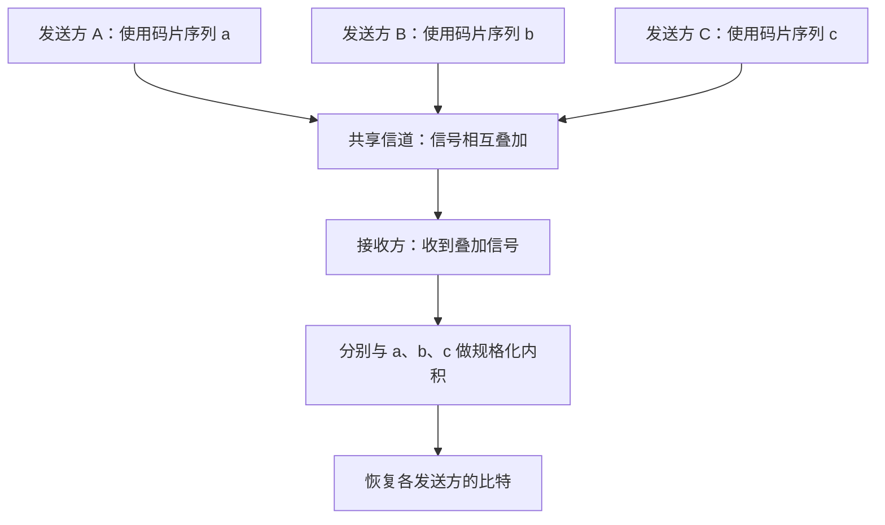
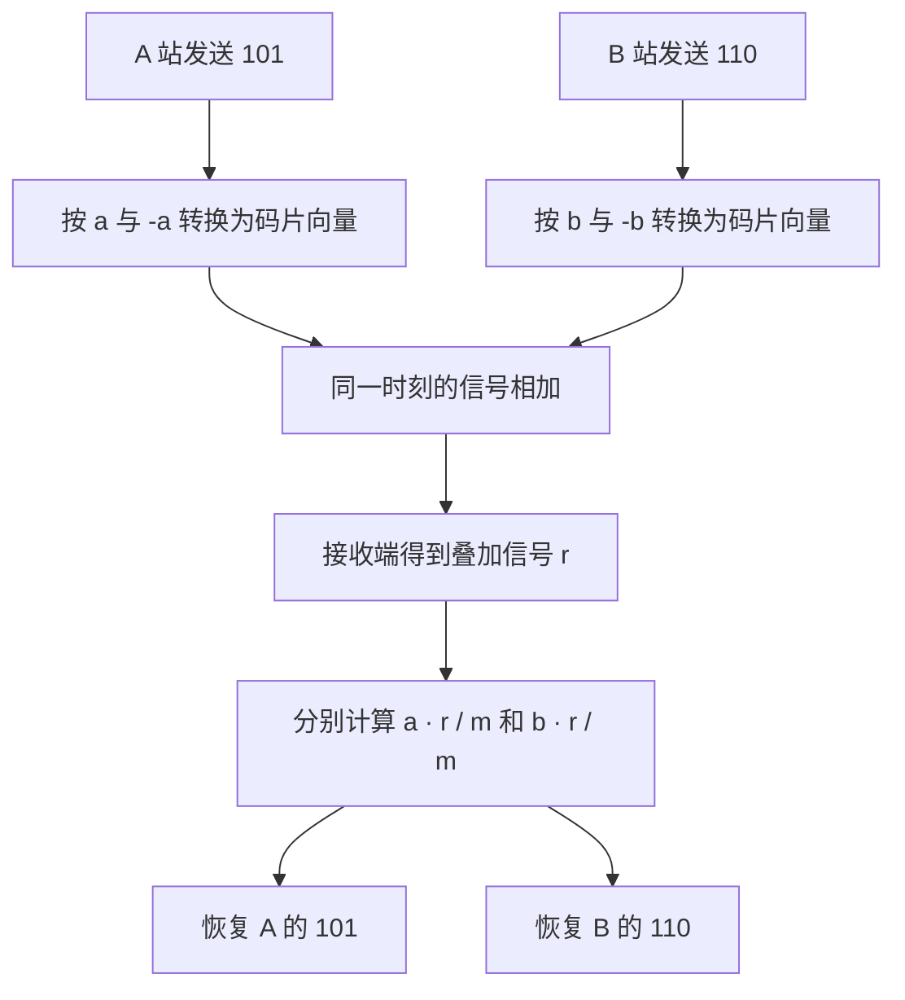
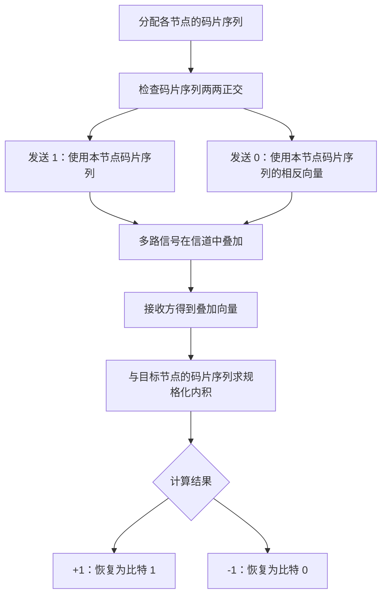

# 计算机网络数据链路层：码分复用（CDM）与码分多址（CDMA）

> 本笔记根据课程视频整理，介绍码分复用的背景、码片序列的表示方法、正交条件、信号叠加与分离，以及 2014 年考研真题的解题思路。
>
> 整理原则：保留原讲解的知识点、推导过程和例子，统一术语与公式排版，并加入表格、文本示意图和 Mermaid 流程图，方便复习和打印。

---

## 一、码分复用的背景

### 1. 从移动通信说起

在早期的 2G、3G 移动通信时代，一些手机可以选择不同的网络制式，例如 GSM 或 CDMA。它们是不同的移动通信技术，其中 CDMA 技术在 3G 时代曾得到广泛应用。

CDMA 的底层思想与**码分复用（CDM）**密切相关。

- **CDM（Code Division Multiplexing）**：码分复用，是一种利用不同码片序列来区分多个信号的复用思想。
- **CDMA（Code Division Multiple Access）**：码分多址，是将码分技术用于多用户共享通信介质的一种多址方式。

课程中常将两者联系起来讲解：理解 CDM 的码片序列和信号分离原理，就能理解 CDMA 如何支持多个节点同时通信。

### 2. 码分复用要解决什么问题

假设有三个通信基站：A 站、B 站和 C 站。

A、B 可以同时向 C 发送数据。若还有 D、E 等节点，也可以在系统规则允许的情况下同时发送。

例如：

- A 站发送比特序列 `101`；
- B 站发送自己的比特序列；
- 两个站点发送的信号在传输介质中相互叠加；
- C 站收到的是叠加信号，而不是直接分开的两路信号。

码分复用的关键是：**为不同发送节点分配不同且满足正交条件的码片序列，接收方再利用对应的码片序列，从叠加信号中分离出各发送方的数据。**

---

## 二、码片序列的表示方法

### 1. 什么是码片和码片序列

在码分复用中，每个发送节点会被分配一个专属的**码片序列（Chip Sequence）**。

假设每个码片序列包含 \(m\) 个分量，则它可以看作一个 \(m\) 维向量：

\[
\mathbf{a}=(a_1,a_2,\ldots,a_m)
\]

每一个分量称为一个**码片（Chip）**。为方便计算，通常令每个码片取值为：

\[
a_i\in\{+1,-1\}
\]

也就是说，码片序列中的每一个分量要么是 \(+1\)，要么是 \(-1\)。

> 码片不是原始数据中的一个比特。一个原始数据比特，会由整个码片序列表示。若码片序列包含 \(m\) 个码片，则每个数据比特会对应 \(m\) 个码片值。

### 2. 示例：四维码片序列

假设 A 站使用的码片序列为：

\[
\mathbf{a}=(1,1,1,1)
\]

它是一个四维向量，含有 4 个码片：

| 位置         | 第 1 个码片 | 第 2 个码片 | 第 3 个码片 | 第 4 个码片 |
| ------------ | ----------: | ----------: | ----------: | ----------: |
| A 的码片序列 |      \(+1\) |      \(+1\) |      \(+1\) |      \(+1\) |

再假设 B 站使用：

\[
\mathbf{b}=(1,-1,1,-1)
\]

C 站可以使用：

\[
\mathbf{c}=(1,1,-1,-1)
\]

它们都是四维向量，每个分量均为 \(+1\) 或 \(-1\)。

### 3. 节点必须知道彼此的码片序列

通信双方需要事先知道相应的码片序列，接收方才能使用某个发送方的码片序列，对接收到的叠加信号进行分离。

例如，C 站需要知道：

- A 站使用的码片序列 \(\mathbf{a}\)；
- B 站使用的码片序列 \(\mathbf{b}\)；
- 其他可能发送数据的节点所使用的码片序列。

在实际系统中，这些码片序列需要按照系统设计进行分配和同步，而不是各节点任意选择后就一定可以直接解码。

---

## 三、比特如何转换成码片序列

### 1. 比特 1 与比特 0 的表示方法

码分复用中，一个原始数据比特由整个 \(m\) 维码片序列表示。

若节点 A 的码片序列为 \(\mathbf{a}\)，则：

- 发送比特 **1**：发送 \(\mathbf{a}\)；
- 发送比特 **0**：发送 \(-\mathbf{a}\)，即把码片序列中每个分量的符号取反。

因此：

\[
1\longrightarrow\mathbf{a}
\]

\[
0\longrightarrow-\mathbf{a}
\]

以 \(\mathbf{a}=(1,1,1,1)\) 为例：

| 原始比特 | 发送的码片序列    |
| -------- | ----------------- |
| 1        | \((1,1,1,1)\)     |
| 0        | \((-1,-1,-1,-1)\) |

对 B 站而言，若：

\[
\mathbf{b}=(1,-1,1,-1)
\]

则：

| 原始比特 | 发送的码片序列  |
| -------- | --------------- |
| 1        | \((1,-1,1,-1)\) |
| 0        | \((-1,1,-1,1)\) |

可以用公式概括：

\[
\boxed{\text{比特 1 对应 }+\mathbf{c},\qquad \text{比特 0 对应 }-\mathbf{c}}
\]

其中 \(\mathbf{c}\) 代表发送节点自己的码片序列。

### 2. 示例：A 站发送 `101`

A 站的码片序列：

\[
\mathbf{a}=(1,1,1,1)
\]

数据为 `101`，因此三个比特对应的发送向量依次为：

\[
\mathbf{a},\quad-\mathbf{a},\quad\mathbf{a}
\]

也就是：

\[
(1,1,1,1),\quad
(-1,-1,-1,-1),\quad
(1,1,1,1)
\]

一个比特对应四个码片，所以原始的 3 个数据比特在码片层面对应 3 组、总计 12 个码片值。

### 3. 示例：B 站发送 `110`

B 站码片序列为：

\[
\mathbf{b}=(1,-1,1,-1)
\]

数据为 `110`，因此发送向量依次为：

\[
\mathbf{b},\quad\mathbf{b},\quad-\mathbf{b}
\]

即：

\[
(1,-1,1,-1),\quad
(1,-1,1,-1),\quad
(-1,1,-1,1)
\]

---

## 四、码片序列为什么必须相互正交

### 1. 向量正交的定义

在码分复用中，通常要求分配给不同节点的码片序列相互正交。

在线性代数中，两个向量的内积为 0，就表示它们相互正交：

\[
\boxed{\mathbf{a}\cdot\mathbf{b}=0}
\]

向量内积的计算方法，是把对应位置的分量相乘后相加：

\[
\mathbf{a}\cdot\mathbf{b}
=\sum\_{i=1}^{m}a_i b_i
\]

### 2. 验证 A 与 B 的码片序列正交

给定：

\[
\mathbf{a}=(1,1,1,1)
\]

\[
\mathbf{b}=(1,-1,1,-1)
\]

计算内积：

\[
\begin{aligned}
\mathbf{a}\cdot\mathbf{b}
&=1\times1+1\times(-1)+1\times1+1\times(-1)\\
&=1-1+1-1\\
&=0
\end{aligned}
\]

因此：

\[
\mathbf{a}\cdot\mathbf{b}=0
\]

A 与 B 的码片序列相互正交。

### 3. 验证另外一组码片序列

设：

\[
\mathbf{c}=(1,1,-1,-1)
\]

则：

\[
\begin{aligned}
\mathbf{a}\cdot\mathbf{c}
&=1+1-1-1\\
&=0
\end{aligned}
\]

同时：

\[
\begin{aligned}
\mathbf{b}\cdot\mathbf{c}
&=1\times1+(-1)\times1+1\times(-1)+(-1)\times(-1)\\
&=1-1-1+1\\
&=0
\end{aligned}
\]

所以这三个向量：

\[
\mathbf{a}=(1,1,1,1),\quad
\mathbf{b}=(1,-1,1,-1),\quad
\mathbf{c}=(1,1,-1,-1)
\]

两两正交。

### 4. 正交条件有什么用

正交是从叠加信号中分离不同发送方数据的重要条件。

接收方收到所有信号的叠加结果后，只需使用某个发送方的码片序列与叠加信号做内积：

- 该发送方自己的信号会留下非零结果；
- 其他与它正交的发送方的信号，其内积结果为 0。

这样便能从叠加信号中提取目标发送方的数据。

---

## 五、多个节点同时发送时，信号如何叠加

### 1. 两个节点同时发送

假设：

\[
\mathbf{a}=(1,1,1,1),\qquad
\mathbf{b}=(1,-1,1,-1)
\]

某一时刻：

- A 站发送比特 1，因此发送 \(\mathbf{a}\)；
- B 站发送比特 0，因此发送 \(-\mathbf{b}\)。

B 站发送的向量是：

\[
-\mathbf{b}=(-1,1,-1,1)
\]

信号在传输介质中叠加，因此 C 站收到：

\[
\mathbf{r}=\mathbf{a}+(-\mathbf{b})
\]

把两个向量相加：

\[
\begin{aligned}
\mathbf{r}
&=(1,1,1,1)+(-1,1,-1,1)\\
&=(0,2,0,2)
\end{aligned}
\]

所以 C 站收到的叠加信号为：

\[
\boxed{\mathbf{r}=(0,2,0,2)}
\]

注意，接收信号中的分量可能为 \(0\)、\(2\) 或 \(-2\)，因为多个发送方的信号会相加，而不是把原始比特直接排列在一起。

### 2. 信号叠加的数学本质

如果多个节点同时发送信号，接收方收到的向量可以表示为各发送方发送向量的和：

\[
\boxed{\mathbf{r}=\mathbf{x}\_1+\mathbf{x}\_2+\cdots+\mathbf{x}\_n}
\]

其中：

- \(\mathbf{r}\)：接收方收到的叠加信号；
- \(\mathbf{x}\_i\)：第 \(i\) 个发送方当前发送的码片向量。

接收方要做的，就是从 \(\mathbf{r}\) 中分别恢复每个 \(\mathbf{x}\_i\) 对应的原始比特。

---

## 六、使用规格化内积分离数据

### 1. 规格化内积

假设每个码片序列包含 \(m\) 个分量，接收方收到的叠加信号为 \(\mathbf{r}\)，目标发送方的码片序列为 \(\mathbf{a}\)。

接收方计算：

\[
\boxed{\frac{1}{m}(\mathbf{a}\cdot\mathbf{r})}
\]

这称为**规格化内积**，也就是先计算内积，再除以码片序列长度 \(m\)。

为什么要除以 \(m\)？因为码片序列中的每个分量都是 \(+1\) 或 \(-1\)，一个码片序列与自身的内积为 \(m\)，规格化之后结果正好为 \(+1\)。

### 2. 码片序列与自身的内积

若：

\[
\mathbf{a}=(a_1,a_2,\ldots,a_m),\qquad a_i\in\{+1,-1\}
\]

那么：

\[
\mathbf{a}\cdot\mathbf{a}
=a_1^2+a_2^2+\cdots+a_m^2
\]

由于：

\[
(+1)^2=(-1)^2=1
\]

所以：

\[
\boxed{\mathbf{a}\cdot\mathbf{a}=m}
\]

规格化后：

\[
\boxed{\frac{1}{m}(\mathbf{a}\cdot\mathbf{a})=1}
\]

### 3. 用 A 的码片序列恢复 A 发送的比特

继续使用上一节的例子：

\[
\mathbf{a}=(1,1,1,1)
\]

\[
\mathbf{b}=(1,-1,1,-1)
\]

接收方收到：

\[
\mathbf{r}=(0,2,0,2)=\mathbf{a}-\mathbf{b}
\]

C 站要恢复 A 的比特，就用 \(\mathbf{a}\) 与 \(\mathbf{r}\) 做规格化内积：

\[
\frac{1}{4}(\mathbf{a}\cdot\mathbf{r})
=\frac{1}{4}\bigl(\mathbf{a}\cdot(\mathbf{a}-\mathbf{b})\bigr)
\]

利用内积分配律：

\[
=\frac{1}{4}\left[
(\mathbf{a}\cdot\mathbf{a})-(\mathbf{a}\cdot\mathbf{b})
\right]
\]

因为：

\[
\mathbf{a}\cdot\mathbf{a}=4,\qquad
\mathbf{a}\cdot\mathbf{b}=0
\]

所以：

\[
\frac{1}{4}(4-0)=1
\]

计算结果为 \(+1\)，因此 A 发送的是比特 **1**。

### 4. 用 B 的码片序列恢复 B 发送的比特

接下来用 B 的码片序列与接收信号做规格化内积：

\[
\frac{1}{4}(\mathbf{b}\cdot\mathbf{r})
=\frac{1}{4}\bigl(\mathbf{b}\cdot(\mathbf{a}-\mathbf{b})\bigr)
\]

展开：

\[
=\frac{1}{4}\left[
(\mathbf{b}\cdot\mathbf{a})-(\mathbf{b}\cdot\mathbf{b})
\right]
\]

由于：

\[
\mathbf{b}\cdot\mathbf{a}=0,\qquad
\mathbf{b}\cdot\mathbf{b}=4
\]

因此：

\[
\frac{1}{4}(0-4)=-1
\]

计算结果为 \(-1\)，所以 B 发送的是比特 **0**。

### 5. 规格化内积结果的判断规则

| 规格化内积结果 | 恢复出的比特 |
| -------------: | ------------ |
|         \(+1\) | 1            |
|         \(-1\) | 0            |

在理想的、无噪声且码片序列满足正交条件的模型中，结果会为 \(+1\) 或 \(-1\)。实际通信系统可能受到噪声、同步误差等影响，接收机需要进一步处理；本节的计算按课程中的理想模型进行。

---

## 七、多个比特的完整例子：A 发送 101，B 发送 110

这一例子把前面的原理连起来。

### 1. 已知条件

A 的码片序列：

\[
\mathbf{a}=(1,1,1,1)
\]

B 的码片序列：

\[
\mathbf{b}=(1,-1,1,-1)
\]

数据：

- A 发送 `101`；
- B 发送 `110`。

### 2. 将比特转换为码片向量

A 发送 `101`：

\[
\mathbf{x}\_{A,1}=\mathbf{a}
\]

\[
\mathbf{x}\_{A,2}=-\mathbf{a}
\]

\[
\mathbf{x}\_{A,3}=\mathbf{a}
\]

B 发送 `110`：

\[
\mathbf{x}\_{B,1}=\mathbf{b}
\]

\[
\mathbf{x}\_{B,2}=\mathbf{b}
\]

\[
\mathbf{x}\_{B,3}=-\mathbf{b}
\]

### 3. 计算每个时刻的叠加信号

第 1 组：

\[
\begin{aligned}
\mathbf{r}\_1&=\mathbf{a}+\mathbf{b}\\
&=(1,1,1,1)+(1,-1,1,-1)\\
&=(2,0,2,0)
\end{aligned}
\]

第 2 组：

\[
\begin{aligned}
\mathbf{r}\_2&=-\mathbf{a}+\mathbf{b}\\
&=(-1,-1,-1,-1)+(1,-1,1,-1)\\
&=(0,-2,0,-2)
\end{aligned}
\]

第 3 组：

\[
\begin{aligned}
\mathbf{r}\_3&=\mathbf{a}-\mathbf{b}\\
&=(1,1,1,1)-(1,-1,1,-1)\\
&=(0,2,0,2)
\end{aligned}
\]

所以接收方依次收到三组信号：

\[
\boxed{
\begin{aligned}
\mathbf{r}\_1&=(2,0,2,0)\\
\mathbf{r}\_2&=(0,-2,0,-2)\\
\mathbf{r}\_3&=(0,2,0,2)
\end{aligned}}
\]

### 4. 从接收信号中恢复 A 的数据

分别计算：

\[
\frac{1}{4}(\mathbf{a}\cdot\mathbf{r}\_1)=1
\]

\[
\frac{1}{4}(\mathbf{a}\cdot\mathbf{r}\_2)=-1
\]

\[
\frac{1}{4}(\mathbf{a}\cdot\mathbf{r}\_3)=1
\]

对应比特：

\[
1,\ 0,\ 1
\]

因此，恢复出 A 发送的数据为：

\[
\boxed{101}
\]

### 5. 从接收信号中恢复 B 的数据

分别计算：

\[
\frac{1}{4}(\mathbf{b}\cdot\mathbf{r}\_1)=1
\]

\[
\frac{1}{4}(\mathbf{b}\cdot\mathbf{r}\_2)=1
\]

\[
\frac{1}{4}(\mathbf{b}\cdot\mathbf{r}\_3)=-1
\]

对应比特：

\[
1,\ 1,\ 0
\]

因此，恢复出 B 发送的数据为：

\[
\boxed{110}
\]

### 6. 这个例子说明了什么

A 与 B 同时发送数据时，接收方最初收到的是混合后的信号。由于两个码片序列相互正交，接收方能够使用各自的码片序列做规格化内积，从混合信号中分别恢复两组原始比特。

---

## 八、2014 年考研真题：CDMA 码片序列的计算思路

### 1. 题目考查什么

课程中提到的 2014 年考研真题第 37 题，考查的核心是：

- 给出 A、B、C 等站点的码片序列；
- 给出接收端从共享链路上收到的多组叠加序列；
- 要求判断其中某个站点（例如 A 站）发送了什么数据。

原字幕没有完整转写真题中所有码片序列及接收序列的具体数值，因此这里保留解题方法，不补写缺失的题面数据。

### 2. 解题步骤

假设题目要恢复 A 站发送的数据，A 站的码片序列为 \(\mathbf{a}\)，每组接收向量为 \(\mathbf{r}\_i\)，码片序列长度为 \(m\)。

对每一组接收向量执行以下步骤：

1. 将接收向量 \(\mathbf{r}\_i\) 与 A 的码片序列 \(\mathbf{a}\) 做内积。
2. 将内积结果除以 \(m\)，得到规格化内积。
3. 根据结果的正负恢复比特：
   - 结果为 \(+1\)，对应比特 1；
   - 结果为 \(-1\)，对应比特 0。
4. 按照接收向量的先后顺序排列恢复出的比特，即得到 A 发送的数据序列。

### 3. 计算模板

若码片序列长度为 4，则每组接收向量的规格化内积为：

\[
\frac{1}{4}(\mathbf{a}\cdot\mathbf{r}\_i)
\]

可以按下表记录结果：

| 接收向量          | 计算方式                                  |       规格化内积 | 对应比特 |
| ----------------- | ----------------------------------------- | ---------------: | -------: |
| \(\mathbf{r}\_1\) | \(\frac14(\mathbf{a}\cdot\mathbf{r}\_1)\) | \(+1\) 或 \(-1\) |   1 或 0 |
| \(\mathbf{r}\_2\) | \(\frac14(\mathbf{a}\cdot\mathbf{r}\_2)\) | \(+1\) 或 \(-1\) |   1 或 0 |
| \(\mathbf{r}\_3\) | \(\frac14(\mathbf{a}\cdot\mathbf{r}\_3)\) | \(+1\) 或 \(-1\) |   1 或 0 |

例如，若连续三次的规格化内积结果依次为：

\[
+1,\ -1,\ +1
\]

那么 A 站发送的数据就是：

\[
\boxed{101}
\]

原讲解给出的计算结果是 A 站发送 `101`，选择对应的 **B 选项**。若需要严格核对题目选项，应以原始真题中完整的码片序列和接收序列为准。

### 4. 怎样恢复 B 站的数据

若题目改为求 B 站发送的数据，步骤完全相同，只需把 A 的码片序列替换为 B 的码片序列 \(\mathbf{b}\)：

\[
\frac{1}{m}(\mathbf{b}\cdot\mathbf{r}\_i)
\]

根据每一组计算结果的正负，依次恢复 B 站的数据。

---

## 九、码分复用的完整流程总结

### 1. 发送端

1. 为不同节点分配专属码片序列。
2. 保证各节点的码片序列满足正交条件。
3. 发送比特 1 时，发送自己的码片序列。
4. 发送比特 0 时，发送自己码片序列的相反向量。
5. 多个节点可以同时发送，各路信号在信道中相互叠加。

### 2. 接收端

1. 收到多个发送方叠加后的信号向量。
2. 选定需要解码的发送方。
3. 用接收信号与该发送方的码片序列计算规格化内积。
4. 根据结果的正负判断该发送方发送的是 1 还是 0。
5. 对连续接收的每组信号重复计算，恢复比特序列。

---

## 十、码分复用的重点与易错点

### 1. 码片序列与原始比特不同

一个原始数据比特由完整的码片序列表示。若码片序列长度是 \(m\)，那么一个比特就由 \(m\) 个码片值构成。

### 2. 比特 0 不是一串 0

在本节采用的表示规则中：

- 比特 1 对应 \(+\mathbf{c}\)；
- 比特 0 对应 \(-\mathbf{c}\)。

所以发送比特 0 时，并不是发送数值全为 0 的向量，而是发送码片序列每个分量都取反后的向量。

### 3. 为什么码片值使用 \(+1\) 和 \(-1\)

因为这种取值便于表示反向向量，也便于进行内积计算：

\[
(+1)^2=(-1)^2=1
\]

因此，一个长度为 \(m\) 的码片序列与自身的内积一定等于 \(m\)。

### 4. 为什么码片序列要正交

若不同节点的码片序列相互正交，则目标节点的码片序列与其他节点发送向量的内积为 0，能够在规格化内积时消除其他节点的贡献，从而分离目标节点的数据。

### 5. 规格化内积要除以 \(m\)

内积本身会得到 \(+m\) 或 \(-m\)；除以码片长度 \(m\) 后，结果变为 \(+1\) 或 \(-1\)，便于判断原始比特：

\[
\boxed{\frac{1}{m}(\mathbf{c}\cdot\mathbf{r})=
\begin{cases}
+1 & \text{比特 1}\\
-1 & \text{比特 0}
\end{cases}}
\]

该判断适用于本节的理想模型。

### 6. 同时发送时，信号是向量相加

若 A 发送 \(\mathbf{a}\)，B 发送 \(-\mathbf{b}\)，那么接收方得到：

\[
\mathbf{r}=\mathbf{a}-\mathbf{b}
\]

不要将它理解为把两个原始比特序列直接拼接。接收到的是逐分量相加后的叠加向量。

---

## 十一、公式速查表

| 知识点               | 公式 / 规则                                                     |
| -------------------- | --------------------------------------------------------------- |
| 码片序列             | \(\mathbf{c}=(c_1,c_2,\ldots,c_m)\)，其中 \(c_i\in\{+1,-1\}\)   |
| 比特 1 的表示        | \(+\mathbf{c}\)                                                 |
| 比特 0 的表示        | \(-\mathbf{c}\)                                                 |
| 向量内积             | \(\mathbf{a}\cdot\mathbf{b}=\sum\_{i=1}^{m}a_i b_i\)            |
| 正交条件             | \(\mathbf{a}\cdot\mathbf{b}=0\)                                 |
| 码片序列与自身的内积 | \(\mathbf{c}\cdot\mathbf{c}=m\)                                 |
| 接收信号叠加         | \(\mathbf{r}=\mathbf{x}\_1+\mathbf{x}\_2+\cdots+\mathbf{x}\_n\) |
| 规格化内积           | \(\frac{1}{m}(\mathbf{c}\cdot\mathbf{r})\)                      |
| 规格化内积为 \(+1\)  | 目标节点发送比特 1                                              |
| 规格化内积为 \(-1\)  | 目标节点发送比特 0                                              |

---

## 十二、一页回顾

码分复用（CDM）的关键思想是：**不同节点使用不同且相互正交的码片序列，即使信号同时发送并在信道中叠加，接收方仍能通过规格化内积分离各节点的数据。**

整个过程可以压缩成四句话：

1. 为每个节点分配一个专属码片序列，码片值取 \(+1\) 或 \(-1\)。
2. 发送比特 1 时使用原码片序列，发送比特 0 时使用其相反向量。
3. 多个节点同时发送时，接收信号是各发送向量的逐分量相加。
4. 接收方将叠加信号与目标节点的码片序列做规格化内积：结果为 \(+1\) 对应 1，结果为 \(-1\) 对应 0。

考试题的常见解法，就是逐组计算规格化内积，再把恢复出的比特按顺序排列起来。
