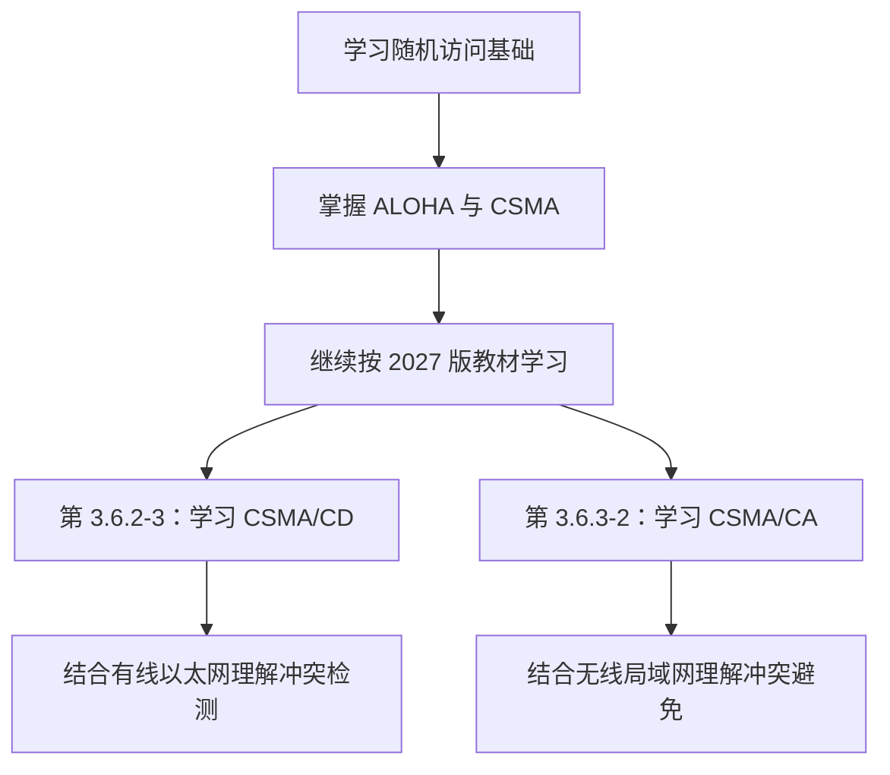
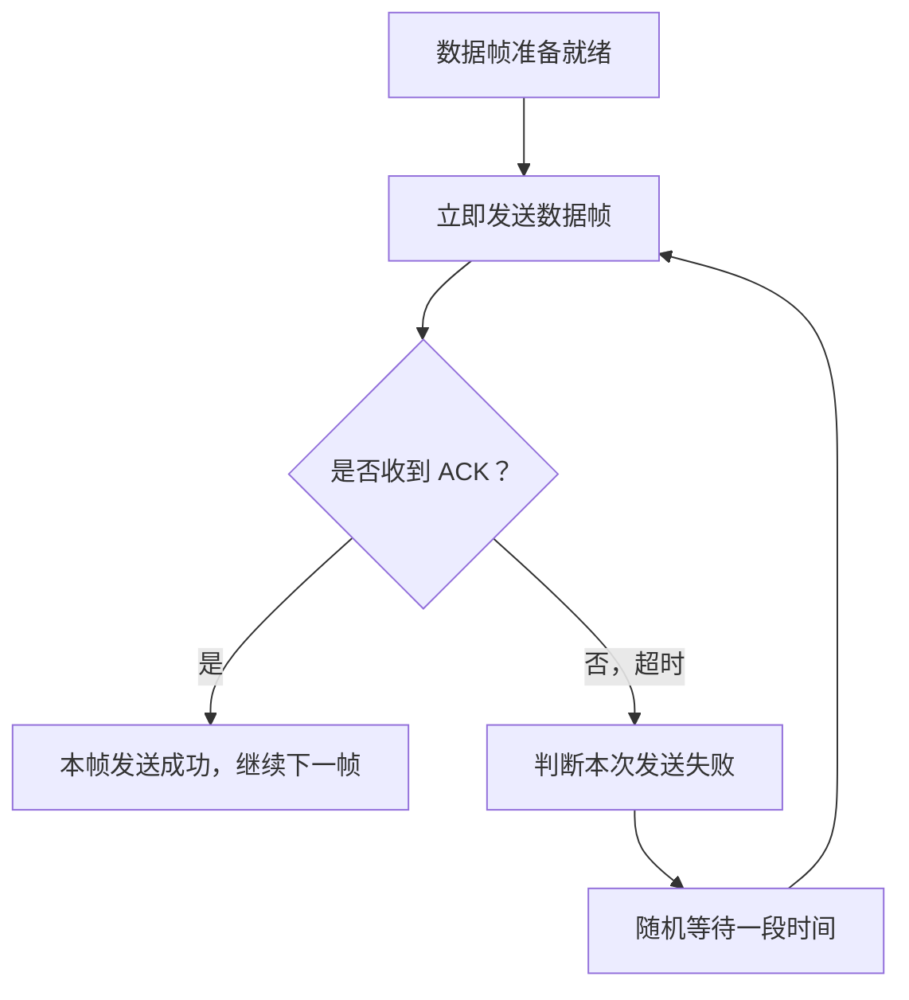
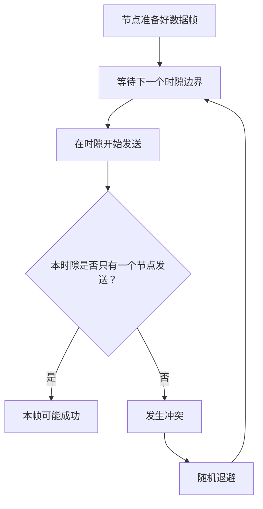
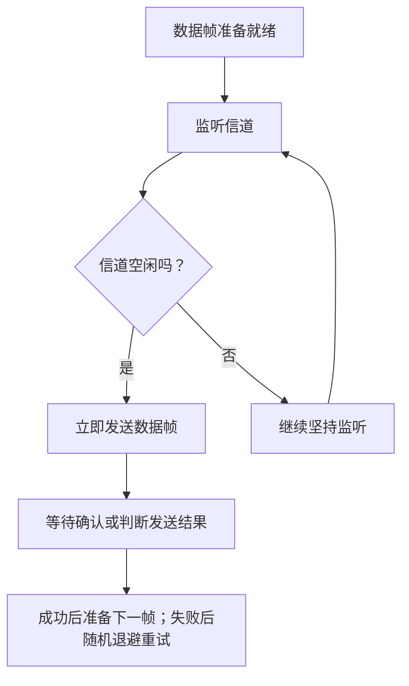
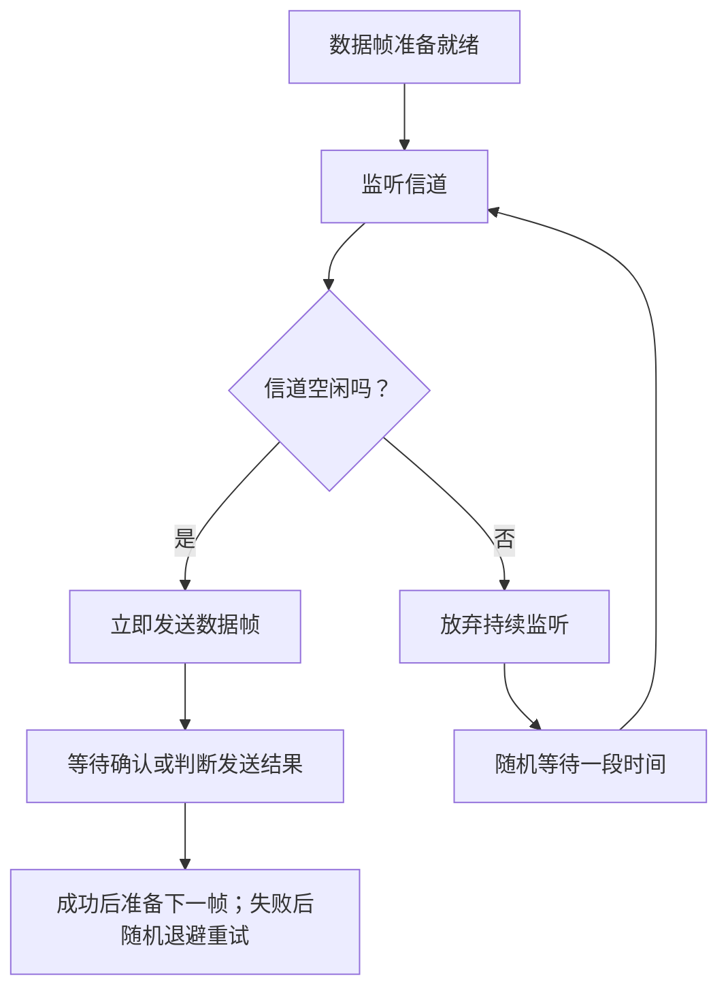
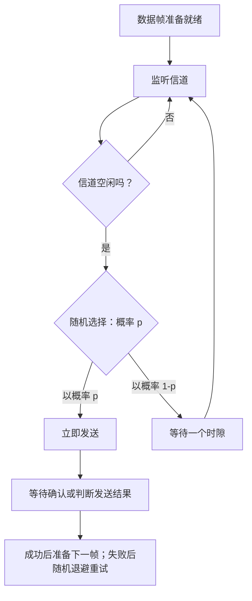
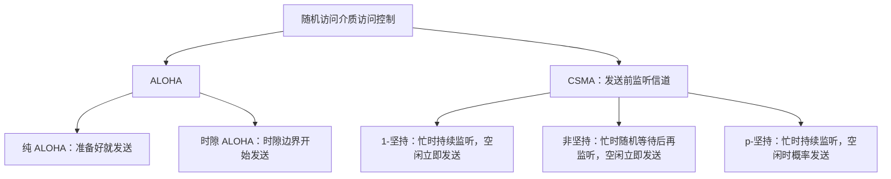

# 关于 CSMA/CD 和 CSMA/CA 协议的学习说明

> 对应课程视频：`3.5.2_2 关于 CSMA/CD 和 CA 协议的学习说明`
>
> 本文先整理课程对不同版本王道教材的学习顺序提示，再附上 ALOHA 与 CSMA 的基础复习笔记，方便后续学习 CSMA/CD 和 CSMA/CA 时查阅。

---

## 一、不同版本王道教材的学习顺序

### 1. 使用 2027 版王道书的同学

如果使用的是 **2027 版王道教材**，课程建议暂时跳过 CSMA/CD 和 CSMA/CA 这两个考点的视频，等学习到教材对应章节后，再回来观看：

| 协议    | 2027 版王道书中的位置                   | 放置原因                                                           |
| ------- | --------------------------------------- | ------------------------------------------------------------------ |
| CSMA/CD | 第 3.6.2 节相关的第 3 小部分（3.6.2-3） | 该协议通常用于传统有线以太网，因此放在以太网相关内容中             |
| CSMA/CA | 第 3.6.3 节相关的第 2 小部分（3.6.3-2） | 该协议通常用于无线局域网，例如 Wi-Fi，因此放在无线局域网相关内容中 |

这样安排的目的是让视频学习顺序尽量与新版教材保持一致，学到对应知识点时再回来补充课程视频。

### 2. 使用 2026 版王道书的同学

如果使用的是 **2026 版王道教材**，课程中 CSMA/CD 和 CSMA/CA 的位置编排与该版教材保持一致，可以按课程当前顺序继续学习。

### 3. 为什么不同版本的位置会变化

CSMA/CD 和 CSMA/CA 都是从 CSMA（载波监听多路访问）思想发展而来的随机访问介质访问控制协议，但典型应用场景不同：

- **CSMA/CD**：传统上用于共享式有线以太网，重点是冲突检测。
- **CSMA/CA**：用于无线局域网等场景，重点是冲突避免。

因此，新版教材把它们分别放到以太网和无线局域网相关章节中，有助于结合具体网络技术理解协议。

> 学习顺序可以随教材版本变化，但协议原理本身并未因此改变。复习时应以自己正在使用的教材目录为线索，并对照考研大纲掌握对应知识点。

---

## 二、随机访问介质访问控制的知识结构

介质访问控制通常包括以下几类方法：

| 方法     | 基本思路                                     |
| -------- | -------------------------------------------- |
| 信道划分 | 把共享资源分为不同部分，例如时间、频率或码片 |
| 随机访问 | 节点根据协议规则竞争信道，冲突后再按规则处理 |
| 轮询访问 | 通过控制机制轮流决定哪个节点可以发送         |

随机访问部分常见的协议或协议类别包括：

- ALOHA：纯 ALOHA、时隙 ALOHA；
- CSMA：1-坚持、非坚持、p-坚持；
- CSMA/CD：冲突检测；
- CSMA/CA：冲突避免。

本文件后半部分整理 ALOHA 与 CSMA 的基础概念。CSMA/CD 与 CSMA/CA 的具体工作机制应结合后续相应视频和教材章节学习。

---

## 三、CSMA/CD 与 CSMA/CA 的预习提示

### 1. CSMA/CD

CSMA/CD 是 **Carrier Sense Multiple Access with Collision Detection** 的缩写，中文通常称为“载波监听多路访问/冲突检测”。

理解时可抓住三个关键词：

1. **载波监听**：发送前先监听信道；
2. **多路访问**：多个节点共享同一传输介质；
3. **冲突检测**：发送过程中检测是否发生冲突。

课程提示：该协议在传统共享式有线以太网中具有代表性，因此 2027 版王道书将其安排在以太网相关内容中学习。

### 2. CSMA/CA

CSMA/CA 是 **Carrier Sense Multiple Access with Collision Avoidance** 的缩写，中文通常称为“载波监听多路访问/冲突避免”。

理解时可抓住三个关键词：

1. **载波监听**：发送前检查信道；
2. **多路访问**：多个无线设备共享信道；
3. **冲突避免**：通过协议机制尽量降低冲突发生的概率。

课程提示：该协议常用于无线局域网，例如 Wi-Fi，因此 2027 版王道书将其安排在无线局域网相关内容中学习。

### 3. 二者的应用场景提示

| 对比项       | CSMA/CD                          | CSMA/CA                        |
| ------------ | -------------------------------- | ------------------------------ |
| 重点机制     | 冲突检测                         | 冲突避免                       |
| 典型学习场景 | 传统共享式有线以太网             | 无线局域网（Wi-Fi）            |
| 学习时的重点 | 如何检测冲突以及发生冲突后的处理 | 如何通过协议机制尽可能避免冲突 |

> 表格用于帮助记忆本课程的典型应用场景，并不意味着所有现代以太网或无线网络实现都完全相同。进一步学习时，应以教材所讲的具体技术和协议规则为准。

---

## 四、学习建议与复习顺序

对于 2027 版王道书的学习者，可以按照下面的流程安排：



对于 2026 版王道书的学习者，可以沿用与课程视频一致的学习顺序，再用教材对应章节核对细节。

**核心提示：不用因为教材章节位置变化而认为协议内容发生了变化。按当前教材的编排学习，并理解 CSMA/CD 与 CSMA/CA 分别对应的机制和典型应用场景即可。**

---

## 五、随机访问协议基础回顾：ALOHA 与 CSMA

## 随机访问介质访问控制：ALOHA 与 CSMA

---

## 一、随机访问介质访问控制概述

### 1. 介质访问控制的几种方法

在计算机网络中，多个节点可能共享同一条传输介质。如果多个节点同时发送数据，信号就可能发生冲突。

介质访问控制（MAC）要解决的问题是：**如何安排或控制多个节点对共享介质的访问，减少冲突，尽可能提高信道利用率。**

常见的介质访问控制方法包括：

| 方法     | 基本思路                                               | 本节是否重点讲解 |
| -------- | ------------------------------------------------------ | ---------------- |
| 信道划分 | 将共享资源划分为时间、频率、码片等部分                 | 前面已经介绍     |
| 随机访问 | 节点根据协议规则竞争信道，可能发生冲突，再通过协议处理 | 是               |
| 轮询访问 | 通过轮询或控制机制决定哪个节点可以发送                 | 后续学习         |

### 2. 随机访问的特点

随机访问允许节点在有数据需要发送时，按照协议规定尝试访问共享信道。

它的特点是：

- 不一定预先为每个节点固定分配独占的时间或频率资源。
- 多个节点可能在相近的时间尝试发送，因此可能发生冲突。
- 协议通常需要有相应的冲突处理、超时检测和重传机制。
- 冲突后采用随机等待时间，可以使不同节点下一次重传的时刻错开，降低再次冲突的概率。

本节主要介绍两类协议：

1. **ALOHA 协议**：发送之前不监听信道是否空闲。
2. **CSMA 协议**：发送之前先监听信道，再根据监听结果决定如何发送。

后续还会接触到基于 CSMA 思想发展的 CSMA/CD 和 CSMA/CA。考试复习时通常需要特别关注 CSMA/CD 与 CSMA/CA 的工作机制。

---

## 二、ALOHA 协议

### 1. ALOHA 的背景与基本思想

ALOHA 是早期随机访问介质访问控制协议之一。课程介绍中提到，它诞生于 20 世纪 60 年代末，与美国夏威夷大学建设无线计算机通信网络的探索有关。

“ALOHA”同时也是夏威夷语中常见的问候用语，具有问候、友好等含义。

ALOHA 协议的核心思想比较直接：

> **节点准备好数据帧后，就尝试发送，而不先检查信道上是否已经有其他节点正在发送。**

这使访问过程简单，但多个节点可能同时发送数据，从而发生冲突。

ALOHA 通常分为两种：

- **纯 ALOHA（Pure ALOHA）**
- **时隙 ALOHA（Slotted ALOHA）**

两者的关键区别在于：纯 ALOHA 可以在任意时刻发送；时隙 ALOHA 则要求发送只能在时隙边界开始。

---

## 三、纯 ALOHA

### 1. 纯 ALOHA 的工作流程

假设 A、B、C、D 四个节点连接到同一条广播信道。

纯 ALOHA 的规则是：

1. 某个节点准备好一个数据帧。
2. 它立即将数据帧发送到共享信道上。
3. 若数据帧成功到达接收方，发送方会收到 ACK 确认。
4. 若数据帧发生冲突、接收方无法正确接收，发送方可能会因未收到 ACK 而在超时后判断传输失败。
5. 发送方随机等待一段时间，再尝试重传该数据帧。

在可靠传输的讲解模型中，ACK、超时检测和重传用于判断帧是否成功送达。



### 2. 为什么纯 ALOHA 容易发生冲突

纯 ALOHA 在发送之前不会监听信道。

例如：

- B 节点开始发送数据帧 `B1`；
- 在 `B1` 尚未传输完成时，C 节点也准备好数据帧 `C1`；
- C 不会先检查信道是否繁忙，而是立即发送 `C1`；
- 如果两个帧在信道上的传输时间重叠，就可能发生冲突；
- 冲突可能使其中一个或两个帧无法被正确接收。

一旦帧受到损坏，接收方会根据差错检测规则丢弃错误帧；在本节采用的确认机制下，发送方无法在超时时间内收到有效 ACK，于是会进行随机退避并重传。

### 3. 纯 ALOHA 时间示意图

以下为概念示意，横向表示时间向右推进，方块表示数据帧在信道上占用的时间：

```text
时间 ───────────────────────────────────────────────────►

A：       [   A1   ]                         [  A2  ]
B：                    [     B1     ]       [ B1 重传 ]
C：                           [ C1 ]                 [ C1 重传 ]
D：                                                    [  D1  ]

                     B1 与 C1 时间重叠 → 冲突
                                      A2 与 B1 重传重叠 → 冲突
```

**判断是否冲突时，关键看帧在信道上的传输时间是否重叠。**

帧在传输时只要有一部分时间与另一个帧重叠，就可能发生冲突。冲突并不一定要求两个发送方在完全相同的时刻开始发送。

### 4. 为什么冲突后要随机等待

假设 B1 和 C1 发生冲突。若两个节点失败后都固定等待相同的时间，那么它们很可能再次在相近的时刻重传，导致再次冲突。

因此，协议让发送方使用随机算法决定重传前的等待时间：

- B 节点可能等待较短的时间；
- C 节点可能等待较长的时间；
- 下一次尝试的发送时刻因此有机会错开。

随机退避不能保证下一次一定成功，但可以降低节点持续同步冲突的概率。

### 5. 纯 ALOHA 的特点

**优点：**

- 规则简单。
- 节点有数据时可以立即尝试发送，不需要先监听信道。

**缺点：**

- 发送前不检查信道，容易出现传输重叠。
- 多个节点负载较高时，冲突可能变多。
- 失败的帧需要经过随机等待后重传，会消耗额外的信道资源。

---

## 四、时隙 ALOHA

### 1. 为什么提出时隙 ALOHA

纯 ALOHA 的问题之一，是节点可以在任意时刻开始发送数据，帧的开始时刻并没有统一规则。

时隙 ALOHA（Slotted ALOHA）改进了这一点：把时间划分为固定大小的时隙，节点只能在时隙边界开始发送数据帧。

### 2. 时隙 ALOHA 的基本规则

1. 时间被划分成一个个固定大小的时隙。
2. 一个时隙的长度通常设置为足以传输一个完整的数据帧。
3. 节点可能在任意时刻准备好数据帧，但不能立即开始发送。
4. 节点要等到下一个时隙的开始，才能发送数据帧。
5. 如果多个节点在同一个时隙开始发送，它们仍然会发生冲突。
6. 冲突后，相关节点随机等待一段时间，再在后续时隙中尝试重传。

### 3. 时隙示意图

```text
时间 ──────────────────────────────────────────────────►
       时隙 1       时隙 2       时隙 3       时隙 4
     ┌────────┬────────────┬────────────┬────────────┐
A：  │   A1   │            │     A2     │            │
     ├────────┼────────────┼────────────┼────────────┤
B：  │        │     B1     │            │     B2     │
     ├────────┼────────────┼────────────┼────────────┤
C：  │        │            │     C1     │            │
     └────────┴────────────┴────────────┴────────────┘

各帧只在时隙边界开始发送。
若同一时隙只有一个节点发送，该帧可能成功；
若多个节点在同一时隙发送，则会发生冲突。
```

### 4. 时隙 ALOHA 是否完全不会冲突

不会。时隙 ALOHA 仍可能发生冲突。

例如，假设 A 节点在时隙 3 发送 `A2`。如果 C 节点也在时隙 3 开始发送 `C2`，那么两个节点会在同一个时隙发送数据，造成冲突。

因此，时隙 ALOHA 只是通过统一发送起点，减少了纯 ALOHA 中任意时刻开始发送带来的冲突机会，并不能完全消除冲突。



### 5. 纯 ALOHA 与时隙 ALOHA 对比

| 对比项           | 纯 ALOHA                     | 时隙 ALOHA                         |
| ---------------- | ---------------------------- | ---------------------------------- |
| 开始发送的时刻   | 任意时刻                     | 只能在时隙边界                     |
| 是否需要同步时隙 | 不需要                       | 需要                               |
| 是否会发生冲突   | 会                           | 会                                 |
| 冲突条件         | 不同帧在信道上的传输时间重叠 | 多个节点在同一个时隙发送           |
| 发生冲突后的处理 | 随机等待后重传               | 随机等待后，在后续时隙尝试重传     |
| 相比纯 ALOHA     | 发送更自由，但冲突机会更多   | 限制了开始时刻，通常能降低冲突概率 |

**记忆重点：纯 ALOHA 是“准备好就发”；时隙 ALOHA 是“准备好后，等时隙开始再发”。**

---

## 五、CSMA：载波监听多路访问协议

### 1. CSMA 的定义

CSMA 是 **Carrier Sense Multiple Access** 的缩写，中文通常译为“载波监听多路访问”。

相较于 ALOHA，CSMA 引入了一个关键机制：

> **节点发送数据之前，先监听信道是否空闲，再根据监听结果决定如何发送。**

可以将它与日常交谈类比：

- CSMA：开口前先听一听有没有别人在说话。如果别人正在说，就先等待。
- ALOHA：只要自己有话想说，就可以直接开始说，不先检查别人是否正在说话。

这个类比主要帮助理解“发送前是否监听”的区别。

### 2. 载波监听如何工作

如果网卡要支持相应的载波监听功能，需要能够检测共享介质上是否存在其他节点正在发送的信号。

例如：

1. B 节点正在使用信道发送数据。
2. A 节点准备好自己的数据帧。
3. A 在真正发送之前先监听信道。
4. A 发现信道繁忙，于是按照具体 CSMA 规则等待。
5. 当信道状态发生变化时，A 再根据协议规则决定何时发送。

CSMA 的不同变种，主要区别在于：**当信道忙碌时如何等待，以及信道空闲后以什么规则开始发送。**

### 3. CSMA 的三种策略

本节介绍三种 CSMA：

- **1-坚持 CSMA（1-persistent CSMA）**
- **非坚持 CSMA（Non-persistent CSMA）**
- **p-坚持 CSMA（p-persistent CSMA）**

它们可以从两个问题来区分：

1. **信道忙时怎么办？** 是持续监听，还是随机等待后再来监听？
2. **信道空闲时怎么办？** 是立即发送，还是按概率决定是否立即发送？

---

## 六、1-坚持 CSMA

### 1. 工作流程

1-坚持 CSMA 的规则如下：

1. 节点准备好数据帧后，先监听信道。
2. 如果信道空闲，立即发送数据帧。
3. 如果信道忙碌，就继续坚持监听。
4. 一旦监听到信道空闲，就立即发送数据帧。

其中“一坚持”的含义是：**当信道忙碌时持续监听；一旦信道空闲，就以概率 1 立即发送。**



### 2. 多个节点同时等待时为什么会冲突

假设 B 节点正在发送数据；与此同时，A 和 C 都准备好了数据帧。

- A 持续监听信道，发现信道忙。
- C 也持续监听信道，发现信道忙。
- B 发送结束，信道变为空闲。
- A 和 C 几乎同时检测到信道空闲。
- 因为 1-坚持 CSMA 要求信道一空闲就立即发送，所以 A、C 可能同时发送，从而发生冲突。

也就是说，1-坚持 CSMA 虽然在发送前监听信道，但仍然无法完全避免多个节点在信道转为空闲时同时发送。

### 3. 冲突之后如何处理

如果 A 和 C 的帧发生冲突，在采用确认和超时机制的模型中，发送方会因未收到有效 ACK 而判断发送失败。随后，各节点随机推迟一段时间，再按 1-坚持 CSMA 的规则重新监听和发送。

随机退避的原因与 ALOHA 中相同：避免发生冲突的节点在完全相同的时刻再次重传。

### 4. 1-坚持 CSMA 的优缺点

**优点：**

- 节点准备好数据后就开始监听。
- 信道一旦空闲，已有数据等待的节点会立即利用信道。
- 通常能够较快地重新使用空闲信道。

**缺点：**

- 多个节点同时等待时，信道一空闲，多个节点可能同时发送。
- 因此，当竞争节点较多时，冲突概率可能增大。

**记忆：忙时一直听，空闲就立刻发。**

---

## 七、非坚持 CSMA

### 1. 工作流程

非坚持 CSMA 的规则与 1-坚持 CSMA 的主要区别在于：如果发现信道忙碌，不会一直坚持监听，而是放弃当前的监听，随机等待一段时间后再重新监听。

规则如下：

1. 节点准备好数据帧后，先监听信道。
2. 如果信道空闲，立即发送数据帧。
3. 如果信道忙碌，就停止持续监听。
4. 随机等待一段时间。
5. 等待结束后，再次监听信道。
6. 若信道仍然忙碌，就再次随机等待；若信道空闲，则立即发送。

### 2. 工作流程图



### 3. 为什么随机等待可以降低冲突概率

假设 B 节点正在发送数据，A 和 C 都已经准备好数据帧。

- A 监听到信道忙，随机等待 3 秒后再检查。
- C 监听到信道忙，随机等待 10 秒后再检查。
- 当信道空闲时，A 和 C 不会一直紧盯着信道并立即同时发送，而是会在各自随机等待结束后重新检查。

如果 A 先检查时信道已经空闲，而 C 还在等待，那么 A 就可能先使用信道。这样便有机会把原本同时竞争的发送时刻错开，降低冲突的概率。

需要注意：具体等待时间取决于协议采用的随机退避规则；3 秒和 10 秒只是帮助理解的示例。

### 4. 非坚持 CSMA 的优缺点

**优点：**

- 信道忙时，节点会随机等待后再来检查。
- 多个节点重新检查信道的时刻更容易错开。
- 可以降低多个节点同时发送所导致的冲突概率。

**缺点：**

- 当信道刚刚变为空闲时，节点可能还在随机等待。
- 因而信道有可能空闲一段时间，不能被立即利用。
- 这可能降低信道利用率，增加数据帧的等待时延。

例如，B 发送结束后信道已经空闲，但 A 还要等 3 秒后才检查，C 还要等 10 秒后才检查。在 A 或 C 重新监听之前，信道可能出现空闲时间。

**记忆：忙时不一直听，随机等待后再来听；空闲时立即发。**

### 5. 与 1-坚持 CSMA 的区别

| 对比项           | 1-坚持 CSMA                            | 非坚持 CSMA                      |
| ---------------- | -------------------------------------- | -------------------------------- |
| 发送前是否监听   | 是                                     | 是                               |
| 发现信道忙时     | 持续监听                               | 放弃持续监听，随机等待后再监听   |
| 发现信道空闲时   | 立即发送                               | 立即发送                         |
| 冲突倾向         | 多个节点可能在信道刚空闲时同时发送     | 随机等待可错开发送时刻           |
| 信道空闲时的利用 | 更容易立即利用                         | 可能因节点尚在等待而暂时闲置     |
| 主要权衡         | 利用信道及时，但竞争集中时冲突可能较多 | 冲突机会减少，但等待可能造成空闲 |

---

## 八、p-坚持 CSMA

### 1. 为什么需要 p-坚持 CSMA

1-坚持 CSMA 有一个问题：当多个节点都在等待信道时，只要信道空闲，大家就会立刻发送，因此可能同时发生冲突。

非坚持 CSMA 通过随机等待错开发送，但这又可能导致信道已经空闲，却没有节点立即使用。

p-坚持 CSMA 在两者之间进行折中：当节点监听到信道空闲时，不一定立即发送，而是根据概率决定是否发送。

### 2. p 的含义

在 p-坚持 CSMA 中，\(p\) 表示节点检测到信道空闲时，**立即发送数据帧的概率**。

- 以概率 \(p\) 立即发送。
- 以概率 \(1-p\) 延迟一个规定的时隙，再按协议规则继续判断。

这里的 \(p\) 满足：

\[
0\le p\le1
\]

当 \(p=1\) 时，行为接近 1-坚持策略；当 \(p\) 较小时，节点立即发送的概率较低。

> 规范的 p-坚持 CSMA 通常结合时隙机制描述：检测到信道空闲后，以概率 \(p\) 发送；以概率 \(1-p\) 延迟一个时隙后再尝试，并继续遵循协议规则。因此，“随机推迟一段时间”在理解时可以使用，但做题时应留意题目是否明确规定了时隙机制。

### 3. 工作流程

常见的 p-坚持 CSMA 规则可概括如下：

1. 节点准备好数据帧后，监听信道。
2. 若信道忙碌，则继续监听，直到信道空闲。
3. 信道空闲时，以概率 \(p\) 立即发送。
4. 以概率 \(1-p\) 暂不发送，而是等待一个时隙。
5. 按规定再次判断信道状态并重复相应过程。
6. 若发送冲突或失败，则按协议规则进行重传和随机退避。



### 4. 例子：假设 \(p=\frac12\)

假设 B 节点正在发送数据，而 A 和 C 同时准备好了数据帧。A、C 会持续监听，直到 B 发送结束、信道空闲。

此时假设：

\[
p=\frac12,\qquad 1-p=\frac12
\]

那么，对于每个节点而言：

- 有 \(\frac12\) 的概率立即发送；
- 有 \(\frac12\) 的概率推迟一个时隙，再尝试。

假设随机选择结果如下：

- A 选择了“立即发送”，于是开始发送数据帧；
- C 选择了“推迟”，没有在同一时刻发送；
- 如果 C 在后续再次判断信道空闲，并按规则决定发送，就有机会在 A 发送结束后再发送。

在这种结果下，A 和 C 没有在同一个时刻开始发送，因此避免了这一次同时发送所导致的冲突。

不过，p-坚持 CSMA **并不能保证不发生冲突**。如果多个节点都以概率 \(p\) 选择立即发送，仍然可能发生冲突。

### 5. p-坚持 CSMA 的特点

- 通过概率机制，减少所有节点在信道空闲时一齐发送的机会。
- 相比非坚持 CSMA，可以降低节点始终随机等待而让信道空闲的情况。
- 通过调整 \(p\)，可以在冲突概率与信道利用效率之间进行折中。
- 仍有发生冲突的可能，具体表现受到节点数量、负载和概率参数等因素影响。

**记忆：忙时坚持监听；空闲时以概率 \(p\) 立即发，以概率 \(1-p\) 延迟后再尝试。**

---

## 九、三种 CSMA 策略对比

### 1. 关键规则一览

| 策略        | 信道忙时                       | 信道空闲时                                     | 主要优点                             | 主要缺点                     |
| ----------- | ------------------------------ | ---------------------------------------------- | ------------------------------------ | ---------------------------- |
| 1-坚持 CSMA | 一直监听                       | 立即发送，概率为 1                             | 空闲后能迅速利用信道                 | 多节点同时等待时容易同时发送 |
| 非坚持 CSMA | 放弃持续监听，随机等待后再监听 | 立即发送                                       | 随机等待有助于错开发送，降低冲突机会 | 信道空闲时，节点可能仍在等待 |
| p-坚持 CSMA | 持续监听直到信道空闲           | 以概率 \(p\) 发送，以概率 \(1-p\) 延迟一个时隙 | 在减少冲突和及时利用信道之间折中     | 仍可能冲突，需合理选取 \(p\) |

### 2. 用两个问题记忆

理解三种 CSMA，不必只死记名称，可以问自己两个问题：

**问题一：信道忙的时候，节点要不要继续监听？**

- 1-坚持：继续监听。
- 非坚持：随机等待一段时间后再监听。
- p-坚持：继续监听，直到信道空闲。

**问题二：信道空闲的时候，节点如何决定发送？**

- 1-坚持：立即发送。
- 非坚持：立即发送。
- p-坚持：以概率 \(p\) 立即发送，以概率 \(1-p\) 延迟一个时隙。

因此，“坚持”和“非坚持”主要描述**信道忙时的行为**；“1”或“p”则可以辅助理解**信道空闲时的发送规则**。

### 3. 课程中的辅助记忆法

课程中提出，可以为了统一记忆，把非坚持 CSMA 临时理解成“1-非坚持 CSMA”：

- 前面的“1”表示：发现信道空闲时，以概率 1 立即发送；
- “非坚持”表示：发现信道忙碌时，不会一直监听，而会随机等待后再来监听。

这种叫法用于辅助理解规则即可。日常教材和试题通常直接称为**非坚持 CSMA**，以题目使用的规范术语为准。

---

## 十、ALOHA 与 CSMA 对比

| 对比项             | ALOHA                                              | CSMA                                     |
| ------------------ | -------------------------------------------------- | ---------------------------------------- |
| 发送前是否监听信道 | 不需要先监听                                       | 需要先监听                               |
| 发送时机           | 纯 ALOHA 可立即发送；时隙 ALOHA 只能在时隙边界发送 | 依据载波监听结果和坚持策略决定           |
| 是否可能冲突       | 可能                                               | 仍可能                                   |
| 冲突后的常见处理   | 超时后随机等待并重传                               | 发送失败后，按协议规则退避并重传         |
| 主要改善思路       | 纯 ALOHA 限制较少；时隙 ALOHA 对齐发送起点         | 发送前感知信道状态，尽量避免在忙碌时发送 |
| 本节需掌握         | 纯 ALOHA、时隙 ALOHA 的发送规则                    | 1-坚持、非坚持、p-坚持的差异             |

需要特别注意：CSMA 在发送之前监听信道，只能判断当下检测到的信道状态，不能保证多个节点不会同时判断信道空闲并一起发送。因此 CSMA 仍可能发生冲突。

---

## 十一、复习流程图



---

## 十二、做题时的易错点

1. **ALOHA 与 CSMA 的核心区别**：ALOHA 发送前不监听信道；CSMA 发送前要先监听。
2. **纯 ALOHA 与时隙 ALOHA 的区别**：纯 ALOHA 可以在任意时刻开始发送；时隙 ALOHA 只能在时隙边界开始发送。
3. **时隙 ALOHA 仍然可能冲突**：如果多个节点在同一个时隙发送，依然会发生冲突。
4. **CSMA 不是绝对无冲突**：多个节点可能同时监听到信道空闲，从而同时发送。
5. **1-坚持 CSMA**：信道忙时持续监听；信道空闲后立即发送。
6. **非坚持 CSMA**：信道忙时随机等待一段时间，再重新监听；信道空闲后立即发送。
7. **p-坚持 CSMA**：信道空闲时，以概率 \(p\) 立即发送，以概率 \(1-p\) 延迟一个时隙后再尝试。
8. **为什么要随机退避**：让发生冲突的节点下一次尝试在时间上错开，降低重复冲突的概率。
9. **非坚持 CSMA 的代价**：虽然可以减少部分冲突机会，但节点可能在信道空闲时仍处于等待状态，从而造成资源闲置。
10. **冲突与确认超时**：在本节使用的可靠传输模型中，帧冲突或损坏后，接收方不能返回有效 ACK，发送方通常通过超时发现失败，再按协议规则重传。

---

## 十三、最后速查表

| 协议        | 一句话记忆                                         |
| ----------- | -------------------------------------------------- |
| 纯 ALOHA    | 准备好就发，不先监听，也不要求时隙对齐             |
| 时隙 ALOHA  | 准备好后，等到下一个时隙边界再发送                 |
| 1-坚持 CSMA | 忙时一直听，空闲就立即发                           |
| 非坚持 CSMA | 忙时随机等待，之后再听；空闲就立即发               |
| p-坚持 CSMA | 忙时一直听；空闲时按概率决定立即发还是延迟一个时隙 |

**本节的核心逻辑：ALOHA 通过随机发送与随机重传共享信道；CSMA 增加了发送前的载波监听，再通过不同的坚持策略，在冲突概率、等待时延和信道利用率之间进行权衡。**
