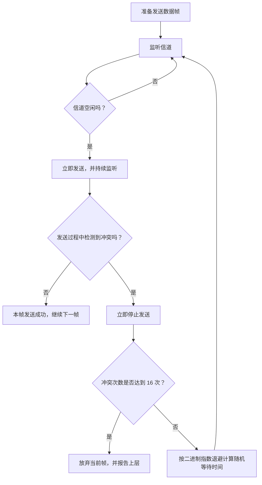
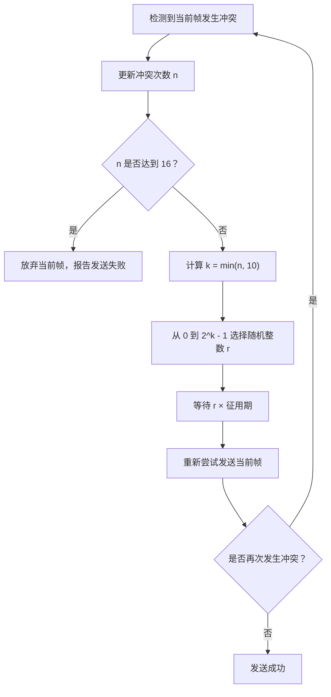
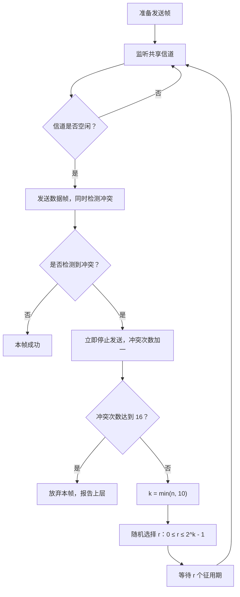

# 计算机网络数据链路层：CSMA/CD 协议与二进制指数退避

> 本笔记根据课程视频整理，重点介绍 CSMA/CD 的应用背景、工作流程、冲突检测原理、二进制指数退避算法，以及第 10 次和第 16 次冲突这两个重要边界。
>
> 整理原则：保留原讲解的主要知识点、例子和分析顺序，统一术语、符号及公式排版，并补充表格、流程图和易错点，方便复习和打印。

---

## 一、CSMA/CD 的应用背景

### 1. 从共享式以太网说起

CSMA/CD 是随机访问介质访问控制中的重要协议，也是计算机网络考研中的常见考点。

它常用于理解**传统共享式有线以太网**的介质访问控制方式。早期以太网常使用总线型结构，例如：

- 使用一根同轴电缆连接多台计算机；
- 多个节点共享同一条传输介质；
- 一个节点发送的数据会沿共享介质传播，其他节点也可能接收到信号；
- 如果多个节点同时发送数据，就可能发生信号冲突。

在这种共享式总线网络中，所有节点都需要遵守介质访问规则，尽量避免同时使用信道。

### 2. 使用集线器的以太网

后来，有线局域网中也经常使用**集线器（Hub）**连接多个节点。

从物理连接形态看，集线器网络呈星型：各节点分别连接到中心集线器。但从共享介质的工作方式看，集线器会把接收到的信号转发到其他端口，因此多个节点仍然共享同一个冲突域，逻辑上具有类似总线型网络的共享特征。

因此，传统同轴电缆以太网和使用集线器构建的共享式以太网，都可以用 CSMA/CD 来理解其介质访问控制。

### 3. 现代以太网的情况

现在的有线局域网通常使用交换机（Switch）连接各个节点，逻辑结构与共享式集线器网络不同。现代交换式以太网常使用全双工链路，在这种环境下通常不需要使用 CSMA/CD 来解决传统共享信道的冲突问题。

因此，本节讨论 CSMA/CD 时，重点是**传统共享式、半双工以太网**的工作原理。

---

## 二、CSMA/CD 的名称与核心思想

### 1. CSMA 和 CD 分别代表什么

CSMA/CD 是以下英文词组的缩写：

**Carrier Sense Multiple Access with Collision Detection**

中文通常译为：**载波监听多路访问／冲突检测**。

| 缩写 | 英文                | 含义                                     |
| ---- | ------------------- | ---------------------------------------- |
| CS   | Carrier Sense       | 载波监听：发送前先监听信道               |
| MA   | Multiple Access     | 多路访问：多个节点共享传输介质           |
| CD   | Collision Detection | 冲突检测：发送过程中继续检测是否发生冲突 |

CSMA/CD 可以看作是在 CSMA 的载波监听机制上，进一步加入了**发送时的冲突检测**。

### 2. 一句话记住工作流程

CSMA/CD 的核心流程可以概括为：

> **先听后发，边听边发，冲突停发，随机重发。**

逐项理解：

1. **先听后发**：发送数据前先监听信道；如果信道忙，就暂不发送。
2. **边听边发**：开始发送后，仍然持续监听信道。
3. **冲突停发**：如果发送过程中检测到冲突，就立即停止发送当前数据帧。
4. **随机重发**：根据冲突次数计算随机退避时间，等待结束后再尝试发送。



---

## 三、先听后发：坚持型载波监听

### 1. 信道忙时持续监听

CSMA/CD 具有 **1-坚持 CSMA** 的特性。

假设 B 节点正在共享信道上发送数据：

1. A 节点准备好一个数据帧。
2. A 在发送之前先监听信道。
3. A 发现信道忙碌，因此不立即发送。
4. A 持续监听信道。
5. 当 B 发送结束、信道变为空闲时，A 便立即发送自己的数据帧。

因此，CSMA/CD 在这一环节与 1-坚持 CSMA 的规则类似：

- 信道忙时，坚持监听；
- 信道空闲时，以概率 1 立即发送。

### 2. 为什么先监听仍然不能保证完全没有冲突

即使每个节点都会先监听信道，也仍然可能发生冲突。

原因是**信号传播需要时间**。A 发出的信号还没有传播到远处的 B 时，B 可能暂时检测不到 A 的信号，于是误以为信道空闲，并开始发送。

因此，两个相距较远的节点可能几乎同时开始发送。即使它们各自在发送前都监听到信道空闲，信号在传播过程中仍可能相遇并发生冲突。

这就是为什么 CSMA/CD 不仅要“先听后发”，还需要“边听边发”。

---

## 四、边听边发：发送过程中检测冲突

### 1. 什么是冲突检测

CSMA/CD 与普通 CSMA 的重要区别之一，是节点开始发送之后，仍然继续检测共享介质上的信号状态。

发送方并不是一旦开始发送就不再关心信道，而是要在发送期间持续监听：

- 如果整个发送期间都没有检测到冲突，则认为本次发送成功；
- 如果发送期间检测到冲突，就立即停止发送当前数据帧。

### 2. A、B 两个节点如何发生冲突

假设 A 与 B 共享同一条总线：

1. A 先监听信道，检测到信道空闲。
2. A 开始发送数据，信号沿着电缆向外传播。
3. 在 A 的信号还没有传播到 B 时，B 也监听信道。
4. B 暂时检测不到 A 的信号，因此误以为信道空闲。
5. B 也开始发送数据。
6. 随着信号传播，B 检测到来自 A 的信号，发现发生冲突，立即停止发送。
7. B 已经发到信道上的那部分信号不会瞬间消失，仍会继续沿介质传播。
8. 当冲突相关的信号传播到 A 时，A 也可能检测到冲突，于是同样停止发送。

### 3. 冲突传播示意

```text
时间向右增加 ───────────────────────────────────────────►

A：  监听空闲 ── 开始发送 A 的帧 ─────── 检测到冲突并停发
                    │
                    │ A 的信号沿介质传播
                    ▼
B：          监听时暂未检测到 A ─ 开始发送 B 的帧 ─ 检测到冲突并停发

结果：A、B 的信号发生重叠，当前数据帧发送失败，需要按规则退避重传。
```

关键点是：**停止发送只意味着不再向信道注入新的比特；已经发出的信号仍然会继续传播。**

### 4. 检测到冲突后做什么

一旦节点检测到冲突，CSMA/CD 便不会继续把当前数据帧当作正常传输来发送，而是：

1. 立即停止发送当前数据帧；
2. 记录或更新冲突次数；
3. 如果冲突次数达到规定上限，放弃当前帧并报告上层；
4. 否则执行随机退避，等待一段时间后重新尝试发送。

---

## 五、二进制指数退避算法

CSMA/CD 的随机等待时间并不是每次都从固定的相同范围中选择，而是会根据冲突次数逐渐扩大随机选择的范围。这个方法称为**二进制指数退避算法**（Binary Exponential Backoff）。

### 1. 为什么需要随机退避

假设 A 和 B 同时发送数据，发生冲突后又都固定等待相同的时间。那么，它们可能再次在相同的时刻重传，导致反复冲突。

随机退避让不同节点选择不同的等待时间，从而增加下一次发送时刻错开的机会。

同时，冲突次数越多，通常意味着当前信道竞争越激烈。因此，算法会随冲突次数增加而扩大随机等待时间的可选范围，让各节点下一次发送时刻更容易错开。

### 2. 征用期与随机等待时间

这里先使用一个概念：**征用期**（Slot Time）。

在本节的计算中，随机等待时间表示为：

\[
\boxed{T*{\text{等待}}=r\times T*{\text{slot}}}
\]

其中：

- \(T\_{\text{等待}}\)：随机退避时间；
- \(T\_{\text{slot}}\)：一个征用期的长度；
- \(r\)：随机选择的非负整数。

本节暂时重点理解随机整数 \(r\) 的取值范围；征用期的具体定义与长度，可结合后续课程继续学习。

### 3. 如何确定随机整数 \(r\)

令 \(n\) 表示**当前数据帧已经发生的冲突次数**。

当冲突次数 \(n\) 从 1 增加到 10 时，随机整数的可选范围逐次扩大：

\[
\boxed{r\in\{0,1,\ldots,2^k-1\}}
\]

其中：

\[
\boxed{k=\min(n,10)}
\]

也就是说，指数最多取 10。当冲突次数超过 10 次时，随机数的可选范围不再继续扩大。

|                冲突次数 \(n\) | 指数 \(k=\min(n,10)\) | 随机整数 \(r\) 的取值范围 | 可能的取值个数 |
| ----------------------------: | --------------------: | ------------------------- | -------------: |
|                             1 |                     1 | \(0\) 到 \(1\)            |              2 |
|                             2 |                     2 | \(0\) 到 \(3\)            |              4 |
|                             3 |                     3 | \(0\) 到 \(7\)            |              8 |
|                             4 |                     4 | \(0\) 到 \(15\)           |             16 |
|                             5 |                     5 | \(0\) 到 \(31\)           |             32 |
|                             6 |                     6 | \(0\) 到 \(63\)           |             64 |
|                             7 |                     7 | \(0\) 到 \(127\)          |            128 |
|                             8 |                     8 | \(0\) 到 \(255\)          |            256 |
|                             9 |                     9 | \(0\) 到 \(511\)          |            512 |
|                            10 |                    10 | \(0\) 到 \(1023\)         |           1024 |
| 11 及以后（未达到放弃上限时） |                    10 | \(0\) 到 \(1023\)         |           1024 |

> **符号注意：**有些教材或讲解会直接用 \(k\) 表示冲突次数，再在公式中写 \(2^k-1\)。为了避免混淆，本笔记将冲突次数记为 \(n\)，将退避公式中的指数记为 \(k=\min(n,10)\)。这样可以清楚地区分“第几次冲突”和“指数取多少”。

### 4. 示例：假设征用期为 2 毫秒

为了便于理解，假设一个征用期的长度为：

\[
T\_{\text{slot}}=2\text{ ms}
\]

实际征用期的标准定义和长度由具体以太网规范决定；这里的 2 毫秒只是沿用课程中的示意数值。

#### （1）第一次发生冲突

冲突次数：

\[
n=1,\qquad k=1
\]

随机数范围：

\[
r\in\{0,1\}
\]

退避时间可能为：

\[
T\_{\text{等待}}=0\times2=0\text{ ms}
\]

或：

\[
T\_{\text{等待}}=1\times2=2\text{ ms}
\]

因此，可能等待 0 毫秒，也可能等待 2 毫秒。

#### （2）第二次发生冲突

\[
n=2,\qquad k=2
\]

随机数范围：

\[
r\in\{0,1,2,3\}
\]

可能的等待时间为：

\[
0,\ 2,\ 4,\ 6\text{ ms}
\]

#### （3）第三次发生冲突

\[
n=3,\qquad k=3
\]

随机数范围：

\[
r\in\{0,1,2,3,4,5,6,7\}
\]

若征用期为 2 毫秒，则等待时间可能为：

\[
0,\ 2,\ 4,\ 6,\ 8,\ 10,\ 12,\ 14\text{ ms}
\]

### 5. 为什么退避范围会逐渐扩大

冲突次数越多，通常说明多个节点之间的竞争可能越激烈。

因此：

- 第一次冲突时，可选择的退避范围较小；
- 第二次冲突时，随机选择范围扩大；
- 第三次冲突时，范围继续扩大；
- 这样逐步扩大随机等待时间的范围，可以增加不同节点错开发送时刻的机会。

需要注意，扩大范围并不能保证下一次不冲突，只是降低重复冲突的概率。

---

## 六、第 10 次与第 16 次冲突：两个重要边界

CSMA/CD 的二进制指数退避有两个需要重点记忆的边界：**第 10 次冲突对应随机退避指数的上限；第 16 次连续冲突会放弃当前帧**。

### 1. 第 10 次冲突：退避范围不再扩大

当冲突次数 \(n\le10\) 时：

\[
k=n
\]

并从下面的集合中选择 \(r\)：

\[
r\in\{0,1,\ldots,2^n-1\}
\]

当冲突次数超过 10 次时：

\[
k=10
\]

因此随机整数仍然从以下范围中选择：

\[
r\in\{0,1,\ldots,2^{10}-1\}
\]

也就是：

\[
\boxed{r\in\{0,1,\ldots,1023\}}
\]

**第 10 次冲突之后，随机数的最大取值不再增加。**

### 2. 第 16 次冲突：放弃当前数据帧

如果同一个数据帧反复冲突，达到规定的最大重传尝试次数，CSMA/CD 就不会无限重试。

在传统以太网 CSMA/CD 的规则中，**达到 16 次冲突后放弃当前帧，并向上层报告发送失败**。

因此：

- 第 10 次冲突是退避随机范围的上限节点；
- 第 16 次冲突是放弃当前帧的边界。

这两个数字不能混为一谈。

### 3. 重要数字一览

| 数字 | 作用                           | 记忆方法                           |
| ---: | ------------------------------ | ---------------------------------- |
|   10 | 二进制指数退避的指数上限       | 随机范围最多扩到 \(2^{10}-1=1023\) |
|   16 | 冲突次数达到上限后，放弃当前帧 | 不再无限重传，报告发送失败         |



---

## 七、从头到尾梳理 CSMA/CD 的完整过程

以下将本节的关键机制放在一起，形成一个完整的分析流程。

### 1. 正常发送

1. 节点准备好一个数据帧。
2. 监听信道。
3. 如果信道忙，就继续监听。
4. 如果信道空闲，就立即开始发送。

### 2. 发送过程中的监听

1. 开始发送之后，节点仍然监听信道。
2. 如果整个发送过程中未检测到冲突，则认为该帧发送成功。
3. 如果检测到冲突，则立即停止发送。

### 3. 发生冲突后的处理

1. 更新当前帧的冲突次数。
2. 如果冲突次数达到 16 次，则放弃当前帧并报告上层。
3. 否则，令 \(k=\min(n,10)\)。
4. 在 \(0\) 到 \(2^k-1\) 之间随机选择一个整数 \(r\)。
5. 随机等待 \(r\) 个征用期。
6. 重新监听信道，并再次尝试发送。



---

## 八、考试中的重点与易错点

### 1. CSMA/CD 与 1-坚持 CSMA 的关系

CSMA/CD 继承了 CSMA 的载波监听机制，在发送前先监听信道；它采用 1-坚持的方式处理信道忙碌和空闲状态：

- 信道忙时持续监听；
- 信道空闲时立即发送。

它进一步加入了**边发送边检测冲突**的机制，并定义了冲突后的停止、退避和重传规则。

### 2. “边听边发”不能省略

只做“先听后发”并不能完全避免冲突，因为信号传播需要时间，远端节点可能还没有收到正在传播的信号，就认为信道空闲并开始发送。

因此，要理解 CSMA/CD，需要记住：发送期间也要继续监听，检测到冲突就立即停发。

### 3. 为什么已经停发，冲突信号仍然会传播

节点停止发送只是停止向介质中注入新的信号。已经发送到介质中的信号仍然会按传播规律继续传播，所以另一端节点也可能检测到冲突。

### 4. 随机数的范围

对第 \(n\) 次冲突，设：

\[
k=\min(n,10)
\]

则：

\[
\boxed{r\in\{0,1,\ldots,2^k-1\}}
\]

退避时间为：

\[
\boxed{T*{\text{等待}}=rT*{\text{slot}}}
\]

不能把“随机整数的取值范围”与“等待时间”直接混为一谈；等待时间还需要乘以一个征用期的长度。

### 5. 第 10 次与第 16 次冲突的含义

- **第 10 次**：二进制指数退避的指数达到上限，之后随机数的取值范围不再扩大。
- **第 16 次**：达到最大冲突次数，放弃当前帧并报告上层。

### 6. 传统 CSMA/CD 的适用场景

本节讨论的 CSMA/CD 主要用于传统共享式、半双工以太网。现代交换式全双工以太网通常不会采用这种冲突检测机制，因此做题时要根据题目给出的网络结构和工作方式判断。

---

## 九、公式与数字速查表

| 内容               | 公式或结论                                         |
| ------------------ | -------------------------------------------------- |
| CSMA/CD 的核心步骤 | 先听后发，边听边发，冲突停发，随机重发             |
| 退避指数           | \(\displaystyle k=\min(n,10)\)                     |
| 随机整数范围       | \(\displaystyle r\in\{0,1,\ldots,2^k-1\}\)         |
| 随机退避时间       | \(\displaystyle T*{\text{等待}}=rT*{\text{slot}}\) |
| 指数上限           | \(k\_{\max}=10\)                                   |
| 最大随机整数       | \(2^{10}-1=1023\)                                  |
| 放弃当前帧         | 冲突次数达到 16 次                                 |
| 冲突检测的作用     | 发送过程中检测冲突，发现冲突后立即停发             |

---

## 十、一页回顾

CSMA/CD 可以理解为 1-坚持 CSMA 加上冲突检测与二进制指数退避：

1. **先听后发**：信道忙时持续监听，空闲时立即发送。
2. **边听边发**：发送过程中持续监听，检测是否有冲突。
3. **冲突停发**：一旦发现冲突，立即停止发送当前帧。
4. **随机重发**：根据冲突次数选择随机退避时间，再尝试发送。
5. **退避范围有上限**：指数最多为 10，随机整数范围最多为 \(0\) 到 \(1023\)。
6. **重试次数有上限**：冲突达到 16 次后，放弃当前帧并报告上层。

本节最重要的记忆句是：

> **先听后发，边听边发，冲突停发，随机重发。**
