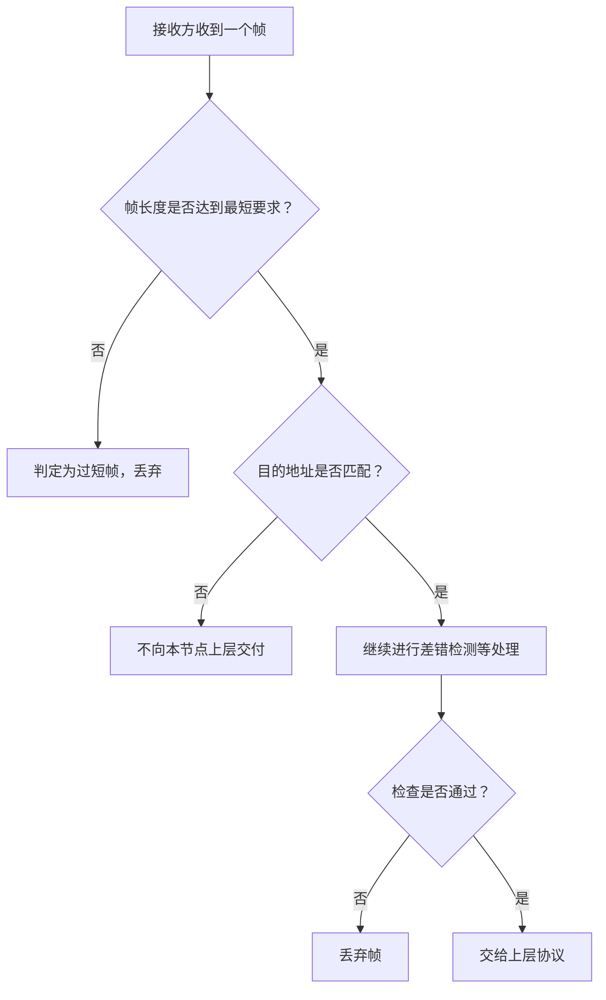
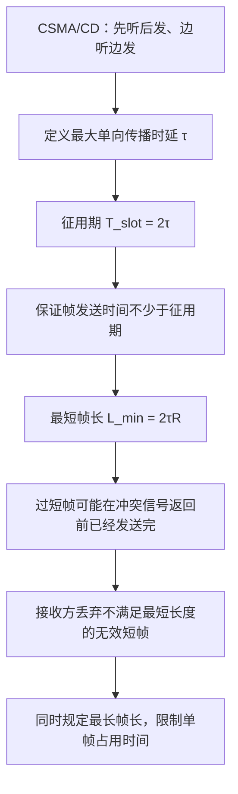

# 计算机网络数据链路层：CSMA/CD 的征用期、最短帧长与以太网帧长限制

> 本笔记根据课程视频整理，重点介绍 CSMA/CD 的征用期（时隙时间）、最短帧长的推导、短帧导致的冲突检测问题、接收方对无效短帧的处理，以及以太网的最短帧长和最长帧长。
>
> 整理原则：保留原讲解的主要推导和例子，规范术语、单位和公式格式，并用表格与 Mermaid 图示辅助理解。

---

## 一、回顾 CSMA/CD 的核心流程

CSMA/CD 是 **Carrier Sense Multiple Access with Collision Detection** 的缩写，中文通常称为“载波监听多路访问／冲突检测”。

它的核心流程可以用 16 字概括：

> **先听后发，边听边发，冲突停发，随机重发。**

| 步骤 | 含义 |
|---|---|
| 先听后发 | 发送数据前监听信道；信道忙时不立即发送 |
| 边听边发 | 发送数据的同时，继续监听信道 |
| 冲突停发 | 一旦检测到冲突，立即停止发送当前帧 |
| 随机重发 | 根据冲突次数，使用截断二进制指数退避算法选择等待时间，再尝试发送 |

CSMA/CD 主要用于理解**传统共享式、半双工以太网**的冲突处理。现代交换式全双工以太网通常不需要使用 CSMA/CD 处理冲突。

---

## 二、征用期（Slot Time）

### 1. 什么是最大单向传播时延

信号在传输介质中传播需要时间。假设总线型网络中，距离最远的两个节点之间距离为 \(d_{\max}\)，信号传播速度为 \(v\)，则最大单向传播时延为：

\[
\boxed{\tau=\frac{d_{\max}}{v}}
\]

这里的 \(\tau\) 表示**最大单向传播时延**，也就是信号从距离最远的一个节点传播到另一个节点所需的时间。

### 2. 为什么征用期等于两倍最大单向传播时延

在 CSMA/CD 中，即使发送方在发送前监听到信道空闲，也不能保证绝对没有冲突。原因是信号传播需要时间：远端节点可能尚未检测到发送方的信号，就认为信道空闲并开始发送。

考虑最不利情况：

1. A 节点开始发送数据。
2. A 的信号需要最多 \(\tau\) 时间才能传播到距离最远的 B 节点。
3. 在 A 的信号到达 B 之前，B 可能仍然检测到信道空闲，并开始发送。
4. B 发出的冲突信号又需要最多 \(\tau\) 时间，才能传播回 A。
5. 因此，从 A 开始发送算起，最迟可能在 \(2\tau\) 时才检测到冲突。

所以，征用期（也称时隙时间）定义为：

\[
\boxed{T_{\text{slot}}=2\tau=2\times\text{最大单向传播时延}}
\]

如果发送方从开始发送起经过一个完整征用期，仍未检测到冲突，那么在规定的网络距离和传播条件下，就可以确定这次发送不会再因为远端节点的同时发送而发生冲突。

> 注意：这里讨论的是 CSMA/CD 规定的冲突检测时间边界；实际系统还需要满足相应介质、拓扑和时序参数的要求。

### 3. 时间示意图

```text
时间向右增加 ─────────────────────────────────────────────►

t = 0                       t = τ                       t = 2τ
A 开始发送 ─────────────────► B 最迟收到 A 的信号
   ▲                          │
   │                          └─ 极限情况下，B 可能在 A 的信号到达前开始发送
   │
   └─────────────────────────────────────────────────────►
                         B 的冲突信号最迟在 2τ 时传播回 A

最坏情况：A 从开始发送到最迟检测到冲突，时间为 2τ。
```

---

## 三、例题：计算总线网络的最大单向传播时延与征用期

### 1. 已知条件

假设总线型网络有 A、C、D、B 四个节点，节点之间依次相距 2,000 m：

```text
A ── 2000 m ── C ── 2000 m ── D ── 2000 m ── B
```

因此，距离最远的是 A 与 B，它们之间的距离为：

\[
d_{\max}=2000+2000+2000=6000\text{ m}
\]

假设信号在介质中的传播速度为：

\[
v=2\times10^8\text{ m/s}
\]

### 2. 计算最大单向传播时延

\[
\tau=\frac{d_{\max}}{v}
=\frac{6000}{2\times10^8}\text{ s}
=3\times10^{-5}\text{ s}
\]

因为：

\[
1\text{ }\mu\text{s}=10^{-6}\text{ s}
\]

所以：

\[
\boxed{\tau=30\text{ }\mu\text{s}}
\]

即 A 发出的信号，最多需要 30 微秒才能传播到最远的 B 节点；同样，对其他节点而言，A 的信号最多经过这个时间，就能传播到共享介质上的任意节点。

### 3. 计算征用期

征用期等于两倍最大单向传播时延：

\[
T_{\text{slot}}=2\tau
=2\times30\text{ }\mu\text{s}
\]

因此：

\[
\boxed{T_{\text{slot}}=60\text{ }\mu\text{s}}
\]

这个 60 微秒，就是本例中 CSMA/CD 总线网络的征用期。

---

## 四、时延带宽积与最短帧长

征用期与 CSMA/CD 的**最短帧长**有直接关系。

### 1. 时延带宽积

在计算机网络性能指标中，时延带宽积可以写为：

\[
\text{时延带宽积}=\text{传播时延}\times\text{链路传输速率}
\]

它可以理解为：在相应传播时延内，以指定速率发送的数据量。

本例中最大单向传播时延为 \(30\text{ }\mu\text{s}\)，假设链路传输速率为：

\[
R=10\text{ Mb/s}=10^7\text{ bit/s}
\]

每微秒可传输的数据量为：

\[
10^7\text{ bit/s}\times10^{-6}\text{ s}=10\text{ bit}
\]

因此，30 微秒内可以发送：

\[
10\text{ bit/}\mu\text{s}\times30\text{ }\mu\text{s}
=300\text{ bit}
\]

也就是最大单向传播时延对应的时延带宽积为：

\[
\boxed{R\tau=300\text{ bit}}
\]

### 2. 最短帧长公式

为了保证发送方在发送过程中仍能检测到最远节点可能引发的冲突，CSMA/CD 要求帧足够长，使发送时间不小于征用期：

\[
T_{\text{帧}}\ge T_{\text{slot}}=2\tau
\]

又因为：

\[
T_{\text{帧}}=\frac{L}{R}
\]

所以：

\[
\frac{L}{R}\ge2\tau
\]

两边同时乘以链路速率 \(R\)，得到：

\[
\boxed{L_{\min}=2\tau R}
\]

因此：

\[
\boxed{\text{最短帧长}=\text{征用期}\times\text{链路传输速率}}
\]

这里的 \(L_{\min}\) 是最短帧长，单位为 bit。

### 3. 代入本例参数

已知：

\[
T_{\text{slot}}=60\text{ }\mu\text{s}
\]

\[
R=10\text{ Mb/s}=10^7\text{ bit/s}
\]

所以最短帧长为：

\[
L_{\min}=T_{\text{slot}}R
=60\times10^{-6}\text{ s}\times10^7\text{ bit/s}
\]

\[
\boxed{L_{\min}=600\text{ bit}}
\]

本例按照给定的距离、传播速度和 10 Mb/s 传输速率计算，得到的最短帧长为 **600 bit**。

> **重要区别：**这里的 600 bit 是本例参数推导出的结果，不是以太网标准帧长的通用数值。传统以太网的标准最短帧长是 64 Byte（512 bit），相关标准参数会与以太网的时隙时间、链路速率和网络设计约束相匹配。做题时要区分“按题目参数计算”与“记忆以太网标准帧长”。

---

## 五、为什么必须限制最短帧长

### 1. 假设帧长只有 500 bit

继续采用本例条件：

- 链路速率：\(10\text{ Mb/s}\)；
- 最大单向传播时延：\(30\text{ }\mu\text{s}\)；
- 征用期：\(60\text{ }\mu\text{s}\)。

如果 A 发送的帧只有 500 bit，则发送这帧需要的时间为：

\[
T_{\text{帧}}=\frac{500\text{ bit}}{10^7\text{ bit/s}}
=50\times10^{-6}\text{ s}
\]

因此：

\[
\boxed{T_{\text{帧}}=50\text{ }\mu\text{s}}
\]

假设 A 在 \(t=0\) 开始发送；B 与 A 相距最远，B 在第 \(29\text{ }\mu\text{s}\) 时准备发送。

由于 A 的第一个比特要到第 \(30\text{ }\mu\text{s}\) 左右才传播到 B，所以 B 在第 29 微秒监听时，可能仍然检测到信道空闲，于是也开始发送。

### 2. 冲突可能发生，但 A 检测不到

时间顺序如下：

| 时间 | 事件 |
|---:|---|
| \(0\text{ }\mu\text{s}\) | A 开始发送 500 bit 的帧 |
| \(29\text{ }\mu\text{s}\) | B 尚未检测到 A 的信号，误以为信道空闲，开始发送 |
| \(30\text{ }\mu\text{s}\) | A 的信号传播到 B，B 检测到冲突并停止发送 |
| \(50\text{ }\mu\text{s}\) | A 已经发送完自己的 500 bit 帧 |
| \(59\text{ }\mu\text{s}\) | B 已发出的冲突信号传播回 A，A 才可能检测到冲突 |

A 在第 50 微秒时已经发送完毕，但 B 的冲突信号到第 59 微秒才传播到 A。

因此，A 可能误以为自己在发送期间没有发生冲突，但实际上 A 与 B 的帧已经发生了冲突。

这说明：

> 如果帧太短，发送方可能在冲突信号传播回来之前就已经发送完毕，从而无法在发送过程中检测到冲突。

### 3. 时间轴示意

```text
时间（微秒） ───────────────────────────────────────────────►
0                 29   30               50          59    60
│                  │    │                │           │     │
A：开始发送 ──────────────────────────────┘
                                           A 的 500 bit 已发完
B：                  开始发送 ─停发
                                     └─────────────────────►
                                      B 已发出的冲突信号继续传播
                                                  A 检测到冲突

A 发帧用时：50 μs
最坏情况下的冲突检测边界：60 μs
```

### 4. 如果帧长达到 600 bit

如果 A 发送 600 bit，则发送时间为：

\[
T_{\text{帧}}=\frac{600\text{ bit}}{10^7\text{ bit/s}}
=60\text{ }\mu\text{s}
\]

即：

\[
T_{\text{帧}}=T_{\text{slot}}
\]

在上面的冲突例子中，B 的冲突信号在第 59 微秒传播回 A，而 A 需要到第 60 微秒才会发送完帧。因此，A 仍处于发送过程中，可以检测到冲突并停止发送。

所以最短帧长限制的目的，是保证在规定的最坏传播条件下，发送方有足够长的发送时间来检测冲突。

---

## 六、最短帧长与接收方的处理

### 1. 为什么接收方要检查帧长

CSMA/CD 检测到冲突后，会立即停止发送。这样做可能导致当前帧只发送了部分内容，形成一个不完整的短帧。

如果接收方收到的帧短于协议规定的最短帧长，那么在以太网相关场景中，这类帧通常会被视为无效帧并丢弃。

最短帧长约束不仅有助于发送方在发送过程中检测冲突，也使接收方可以按帧格式要求识别过短的帧。

### 2. 接收方的处理流程

接收方收到一个帧后，可按以下逻辑理解处理过程：

1. 检查帧的基本格式和长度。
2. 若帧长度小于协议规定的最短帧长，则丢弃该帧。
3. 若帧长度满足最短帧长要求，再检查目的地址是否为本节点或本节点应接收的地址。
4. 若不是发给本节点的帧，则不向上层交付。
5. 若目的地址匹配，再继续进行差错检测等处理。
6. 检查通过后，才将数据交给上层协议。

实际以太网硬件会依据具体标准执行帧格式、长度、FCS 等检查；上面的流程是帮助理解的简化模型。



### 3. 如果实际数据不够长怎么办

若上层提供的数据不足以达到规定的最短帧长，就需要按照帧格式要求进行填充，使发送的帧达到最短长度。

因此，发送方不能因为待发送数据较少，就直接发送一个不满足最短帧长要求的短帧。

---

## 七、CSMA/CD 是否使用 ACK

一个需要特别记住的细节是：

> **传统以太网的 CSMA/CD MAC 机制没有像停止等待协议那样，对每一个成功发送的数据帧要求接收方返回 ACK。**

在 CSMA/CD 的工作模型中，发送方在传输期间未检测到冲突，就认为本次发送成功结束，不会再等待一个链路层 ACK 来确认。

这与前面学习的停止等待协议不同：

| 对比项 | 停止等待协议 | 传统以太网 CSMA/CD |
|---|---|---|
| 成功发送后是否等待链路层 ACK | 是 | 否 |
| 发送方如何判断本次发送是否冲突 | 主要依据 ACK 与超时等确认机制 | 发送过程中持续监听并检测冲突 |
| 冲突或发送失败后的处理 | 按停止等待协议规则超时重传 | 按二进制指数退避规则重试，达到上限后放弃帧 |

需要注意，CSMA/CD 的“未检测到冲突”不等于对端一定已经成功把数据交付给应用程序。链路层是否有 ACK、端到端是否需要可靠传输，应区分不同协议层的职责。

---

## 八、最长帧长为什么也有限制

### 1. 为什么需要限制最长帧长

如果允许数据帧没有长度上限，那么某个节点可能构造一个非常长的帧。它一旦成功开始发送，就可能长期占用共享信道，使其他节点一直等待，无法及时发送自己的数据。

为避免单个数据帧占用信道的时间过长，网络标准会规定帧长上限。

### 2. 传统以太网帧长

课程需要记住的传统以太网帧长范围是：

| 项目 | 传统以太网取值 |
|---|---:|
| 最短帧长 | 64 Byte |
| 最长帧长 | 1518 Byte |

这里的普通以太网帧长通常指从目的 MAC 地址开始到帧校验序列（FCS）结束，不包括前导码和帧起始定界符；带 VLAN 标签等扩展情形可能有不同的帧长计算，做题时要按题目指定的帧格式和口径判断。

其中：

\[
64\text{ Byte}\times8=512\text{ bit}
\]

\[
1518\text{ Byte}\times8=12144\text{ bit}
\]

**考试中要注意单位：Byte 是字节，bit 是比特，1 Byte = 8 bit。**

### 3. 最短帧长与最长帧长的目的

| 限制 | 主要目的 |
|---|---|
| 最短帧长 | 保证发送方在最坏传播条件下有足够时间检测冲突；避免过短帧 |
| 最长帧长 | 限制单帧持续占用信道的时间，避免帧无限增长 |

注意：本节中按给定网络参数算出的 \(600\text{ bit}\)，是该假设网络条件下的最短帧长推导结果；而 \(64\text{ Byte}\) 和 \(1518\text{ Byte}\) 是传统以太网普通帧的标准长度边界。两类数值用途不同，不应混淆。

---

## 九、本节内容总流程



---

## 十、重点公式与数字速查表

| 内容 | 公式或结论 |
|---|---|
| 最大单向传播时延 | \(\displaystyle \tau=\frac{d_{\max}}{v}\) |
| 征用期（时隙时间） | \(\displaystyle T_{\text{slot}}=2\tau\) |
| 时延带宽积（单向） | \(\displaystyle R\tau\) |
| 最短帧长 | \(\displaystyle L_{\min}=2\tau R=T_{\text{slot}}R\) |
| 本例最大距离 | \(6000\text{ m}\) |
| 本例最大单向传播时延 | \(30\text{ }\mu\text{s}\) |
| 本例征用期 | \(60\text{ }\mu\text{s}\) |
| 本例链路速率 | \(10\text{ Mb/s}\) |
| 本例推导的最短帧长 | \(600\text{ bit}\) |
| 传统以太网普通帧最短长度 | \(64\text{ Byte}=512\text{ bit}\) |
| 传统以太网普通帧最长长度 | \(1518\text{ Byte}=12144\text{ bit}\) |

---

## 十一、做题易错点

1. **征用期是两倍最大单向传播时延**，不是单向传播时延。
2. **最大单向传播时延要按最远节点之间的距离计算**，而不是只看相邻节点距离。
3. **最短帧长公式是 \(L_{\min}=2\tau R\)**，单位必须统一。
4. 时延单位换算时，\(1\text{ }\mu\text{s}=10^{-6}\text{ s}\)。
5. 传输速率为 bit/s，计算帧传输时间时，帧长应使用 bit。
6. 帧太短时，发送方可能在冲突信号传播回来之前已经发送完，导致无法在发送期间检测到冲突。
7. 冲突后立即停发，已发送到介质上的信号仍会继续传播。
8. 传统以太网 CSMA/CD 不使用停止等待式 ACK 机制。
9. 以太网普通帧常见长度范围是 64 Byte 到 1518 Byte，注意 Byte 与 bit 的区别。
10. 本例的 600 bit 来源于指定的 6 km 距离、传播速度和 10 Mb/s 速率，不要把它当成所有以太网一概适用的标准最短帧长。

---

## 十二、一页回顾

- **征用期**：从最坏情况分析，发送方可能要经过两倍最大单向传播时延，才能确定是否发生冲突。
- **征用期公式**：\(\displaystyle T_{\text{slot}}=2\tau\)。
- **最短帧长**：发送时延至少要覆盖征用期，因此 \(\displaystyle L_{\min}=T_{\text{slot}}R=2\tau R\)。
- **短帧的问题**：帧发送完了，冲突信号可能还未返回，发送方就无法在发送期间检测到冲突。
- **接收方处理**：过短的无效帧会被丢弃；合法长度的帧还需经过地址和差错等检查。
- **最长帧长**：限制单个帧占用共享信道的时间。
- **传统以太网普通帧长度**：最短 64 Byte，最长 1518 Byte。
- **ACK**：传统以太网的 CSMA/CD MAC 不使用停止等待式 ACK。

**本节核心逻辑：征用期由最坏传播时延决定；为了让发送方有机会检测到冲突，帧的发送时间必须覆盖征用期，所以必须设置最短帧长。**
