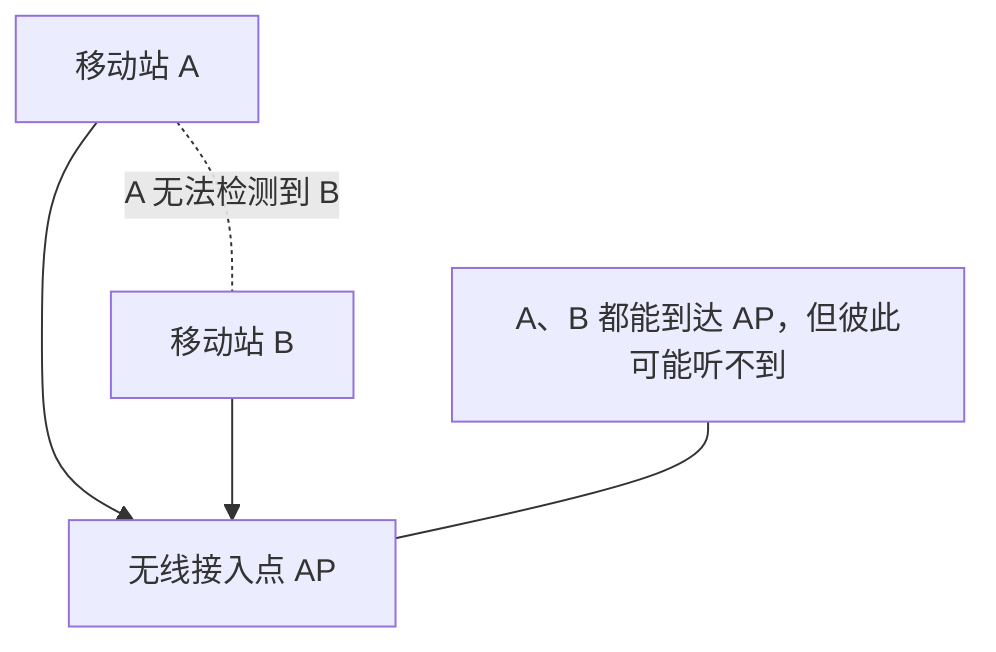
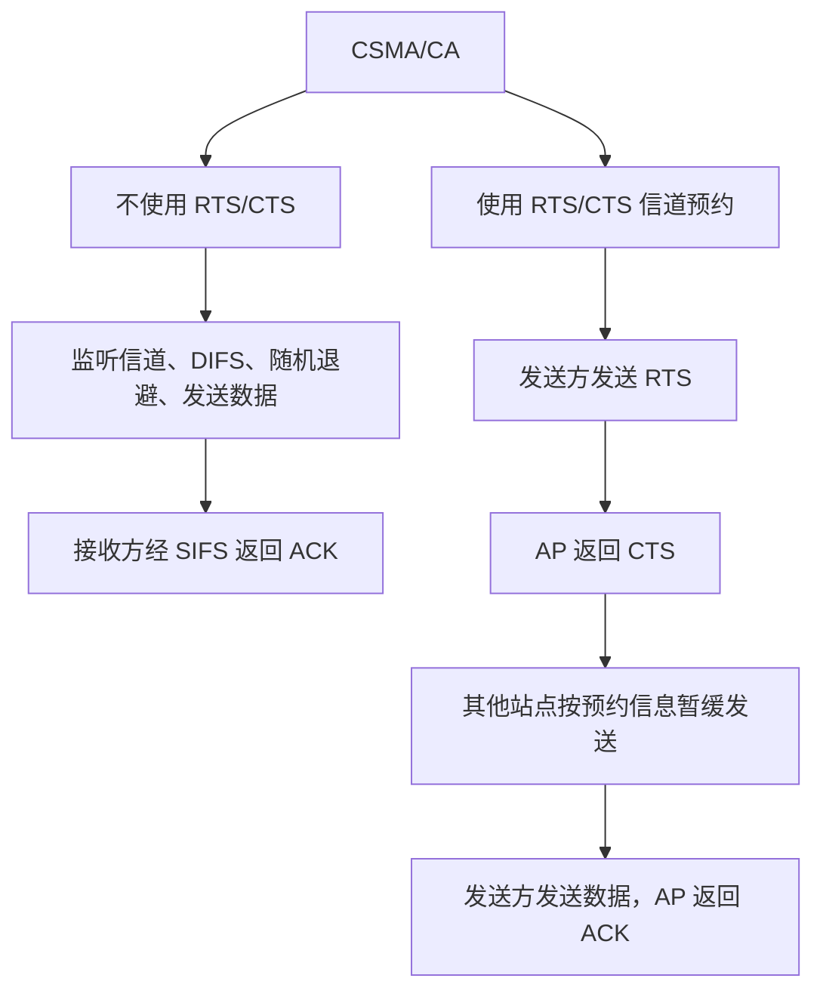
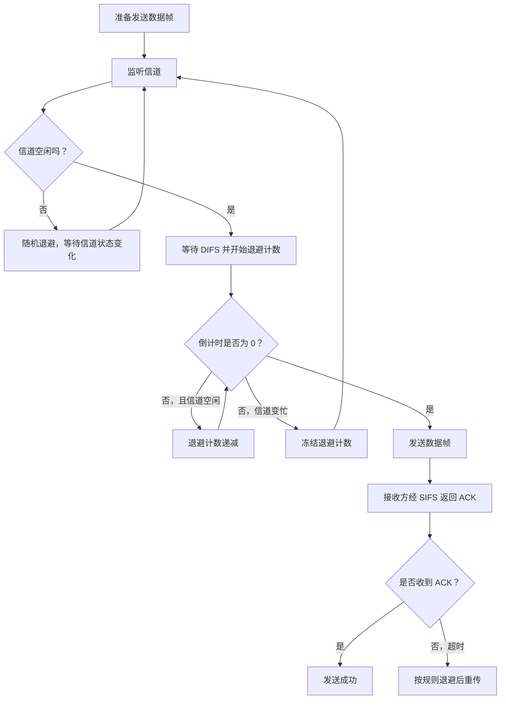
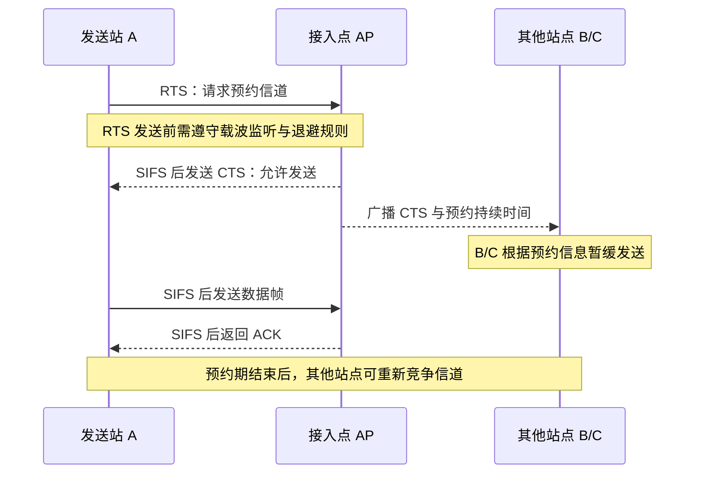
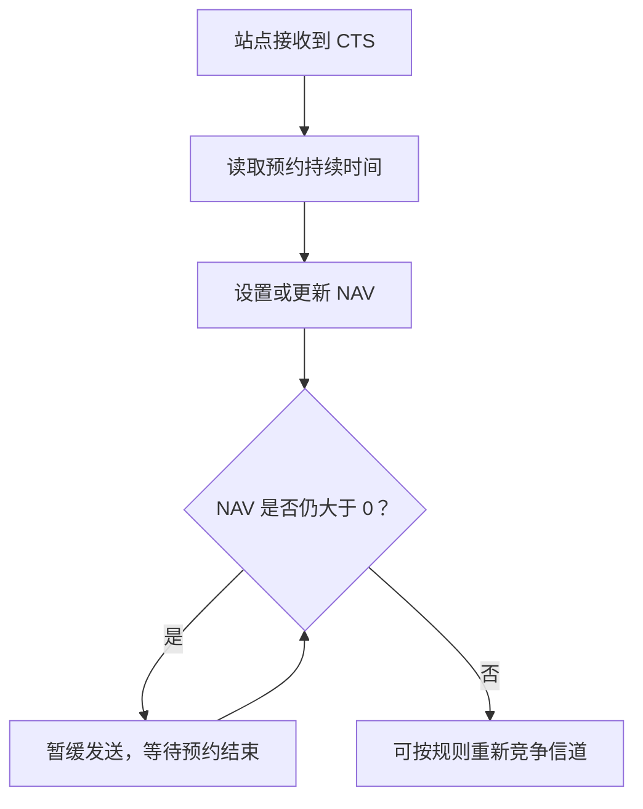

# 计算机网络数据链路层：CSMA/CA 协议与无线局域网介质访问控制

> 本笔记根据课程视频整理，介绍 CSMA/CA 的基本思想、无线网络中的特殊问题、DIFS/SIFS 等帧间间隔、随机退避机制，以及 RTS/CTS 信道预约机制和隐藏站问题。
>
> 整理原则：保留原讲解的知识点、类比例子和历年真题思路，统一术语与 Markdown 层级，并补充表格、流程图及易错点，方便复习和打印。

---

## 一、CSMA/CA 的基本概念

### 1. CSMA/CA 是什么

CSMA/CA 是 **Carrier Sense Multiple Access with Collision Avoidance** 的缩写，中文通常称为**载波监听多路访问／冲突避免**。

它是 CSMA 的一种变体，常用于无线局域网，例如 Wi-Fi。其基本思想是：

1. 发送数据前先监听信道；
2. 信道忙时不立即发送，而是退避等待；
3. 信道空闲时，也可能需要先等待规定的帧间间隔；
4. 通过随机退避、ACK 确认，以及可选的 RTS/CTS 预约机制，尽量降低冲突发生的概率。

### 2. CSMA/CD 与 CSMA/CA 的区别

此前学过的 CSMA/CD 和本节要学习的 CSMA/CA 都建立在载波监听的思想上，但其处理冲突的思路不同。

| 对比项 | CSMA/CD | CSMA/CA |
|---|---|---|
| 英文名称 | Carrier Sense Multiple Access with Collision Detection | Carrier Sense Multiple Access with Collision Avoidance |
| 中文名称 | 载波监听多路访问／冲突检测 | 载波监听多路访问／冲突避免 |
| 典型学习场景 | 传统共享式、有线以太网 | 无线局域网，例如 Wi-Fi |
| 发送前是否监听 | 是 | 是 |
| 发送过程中是否持续检测冲突 | 是，检测到冲突后立即停发 | 通常不采用发送过程中同时检测冲突的方式 |
| 核心机制 | 先听后发、边听边发、冲突停发、随机重发 | 先监听，按规则等待和随机退避；可通过 RTS/CTS 预约信道 |
| 能否完全避免冲突 | 不能 | 不能，只能尽量降低冲突发生的概率 |

**记忆重点：CSMA/CD 侧重“冲突检测”；CSMA/CA 侧重“冲突避免”。**

---

## 二、为什么无线网络不适合直接采用 CSMA/CD

### 1. 无线信号与有线信号的差别

在有线共享介质中，节点发送信号的同时，网卡可以按照相应机制监听介质状态，检测是否发生冲突。

但在无线网络中，节点自己的发送信号通常远强于它在同一时刻接收到的其他节点信号。因此，如果设备一边发送自己的无线信号，一边试图接收并检测其他节点的弱信号，自己的强信号可能会严重干扰接收电路，使其难以可靠地检测其他节点的发送。

此外，无线信号的强度会受到距离、墙壁和其他环境因素的影响，变化范围较大。

因此，无线设备很难像传统共享式有线以太网那样，可靠地在发送过程中同时检测冲突。

### 2. 无线通信中的隐藏站问题

无线通信还存在一个重要问题，称为**隐藏站问题**（Hidden Terminal Problem）。

假设 A、B、C 三个移动站点都与中间的无线接入点 AP 通信：

- A 能够与 AP 通信；
- B 也能够与 AP 通信；
- 但 A 与 B 距离较远，彼此无法检测到对方的信号。

如果 A 正在监听信道，而 B 正在向 AP 发送数据，由于 B 的信号无法传播到 A，A 可能误以为信道空闲，也开始向 AP 发送数据。这样一来，A 和 B 的信号就可能在 AP 处发生冲突。



隐藏站问题说明：

> **发送方在自己所在的位置监听到信道空闲，并不代表接收方所在的位置一定没有冲突。**

即使 A 在发送期间持续监听，也无法判断 AP 处是否有来自隐藏站 B 的信号与自己发生冲突。因此，无线局域网需要采用更适合其通信特点的冲突避免机制。

---

## 三、无线 AP 与移动站点

### 1. 什么是 AP

AP 是 **Access Point** 的缩写，中文称为**无线接入点**。

可以把 AP 理解为 Wi-Fi 无线信号的收发装置。手机、平板电脑和笔记本电脑等无线设备通过 AP 接入网络。

在常见的家庭网络中，家用路由器通常集成了多种功能，例如：

- 路由功能；
- 交换功能；
- 无线 AP 功能；
- 其他网络管理与接入功能。

因此，可以将家用路由器粗略理解为“路由器 + 交换机 + 无线 AP”等功能的组合。

在校园网中，也常有核心路由器、交换机和大量 AP 共同组成网络。AP 可以部署在教学楼、食堂、宿舍楼等位置，为附近的无线设备提供接入服务。

### 2. 什么是移动站点

- **移动站点**：可以移动的无线终端，例如手机、平板电脑、笔记本电脑。
- **固定站点**：在网络中通常固定部署的设备，例如 AP。

如果手机原先连接食堂的 AP，随后移动到教学楼并切换到教学楼的 AP，这种在无线接入点之间切换的过程通常称为**漫游**（Roaming）。

本节重点是区分：移动站点通过无线信号与 AP 通信，而多个站点可能共享无线信道。

---

## 四、CSMA/CA 的两种工作思路

CSMA/CA 可以先从较简单的方式理解，再学习用于处理隐藏站问题的信道预约机制。

### 1. 方式一：先监听，再等待和发送

基本过程如下：

1. 发送方准备好数据帧；
2. 监听信道；
3. 若信道忙，则随机退避；
4. 若信道空闲，还需要等待规定的 DIFS 帧间间隔；
5. 按规则发送数据帧；
6. 接收方成功收到并检查数据帧后，等待 SIFS，再返回 ACK；
7. 如果发送方超时没有收到 ACK，就认为本次传输可能失败，之后按照随机退避规则重传。

### 2. 方式二：先预约信道，再发送数据

当需要使用 RTS/CTS 信道预约机制时，发送方先发送 RTS 控制帧请求发送，接入点 AP 收到后返回 CTS 控制帧允许发送。其他能够听到 CTS 的站点会根据其中的预约信息，在指定时间内延迟发送。

这样可以帮助解决隐藏站问题，避免隐藏站在预约期间随意发送数据。



---

## 五、帧间间隔 IFS：DIFS、SIFS 与 PIFS

### 1. 什么是 IFS

IFS 是 **Interframe Space** 的缩写，中文通常称为**帧间间隔**。

无线局域网中的不同操作，会使用规定长度的帧间间隔。课程重点介绍三种：

- **SIFS**：Short Interframe Space，短帧间间隔；
- **PIFS**：PCF Interframe Space，点协调功能帧间间隔；
- **DIFS**：DCF Interframe Space，分布式协调功能帧间间隔。

它们的长度关系是：

\[
\boxed{\text{SIFS}<\text{PIFS}<\text{DIFS}}
\]

也就是说，SIFS 最短，PIFS 居中，DIFS 最长。

### 2. 为什么需要不同长度的帧间间隔

不同类型的发送行为具有不同的优先级。较短的帧间间隔可以让某些紧接前一帧的操作更早进行。

本节中需要重点理解：

- 接收方正确收到数据帧后，通常等待较短的 **SIFS**，再返回 ACK；
- 普通竞争发送方通常要先确认信道空闲，并等待较长的 **DIFS**，再进入发送流程。

SIFS 比 DIFS 短，可以让 ACK 等紧接前一帧的响应优先完成，减少其他普通竞争站点在响应之前抢占信道的机会。

### 3. 帧间间隔的长度关系

| 间隔 | 英文全称 | 相对长度 | 本节中的作用 |
|---|---|---|---|
| SIFS | Short Interframe Space | 最短 | 接收方等待差错检查等处理后，较快返回 ACK |
| PIFS | PCF Interframe Space | 居中 | 与点协调功能相关；本课程主要记住长度关系 |
| DIFS | DCF Interframe Space | 最长 | 普通竞争发送方在信道空闲时需要等待的间隔 |

> 课程例子中会使用 DIFS = 4 ms、SIFS = 1 ms 等数值来辅助画图。这些数值是为理解流程而假设的示意值，不是所有 IEEE 802.11 Wi-Fi 制式通用的实际标准时间。实际参数取决于具体 PHY 层与标准版本。

---

## 六、不使用 RTS/CTS 时：信道空闲的情况

### 1. 工作步骤

假设 A 站准备向 AP 发送一个数据帧：

1. A 准备好数据帧；
2. 先监听信道；
3. 如果信道空闲，仍然需要等待 DIFS；
4. DIFS 期间信道持续满足空闲要求后，A 开始发送数据帧；
5. AP 完整收到数据帧后，进行差错检测等处理；
6. 如果数据帧正确，AP 等待 SIFS；
7. AP 返回 ACK。

### 2. 时间轴示意

假设只为说明流程，使用以下示意参数：

- DIFS = 4 个时间单位；
- SIFS = 1 个时间单位；
- 单向传播时延 = 2 个时间单位。

```text
时间向右增加 ──────────────────────────────────────────────────►

A：数据帧准备好
   │
   ├──── 等待 DIFS（示意为 4 个时间单位）────┤
   │                                         └── 发送数据帧 ───────►
   │
AP：                                       接收完整数据帧
                                           │
                                           ├─ 等待 SIFS ─┤
                                                          └── 返回 ACK ─►
```

注意：**CSMA/CA 在信道空闲时并不是立即发送。** 在本节介绍的基础竞争流程中，普通发送方需等待 DIFS 后再继续发送流程。

### 3. AP 为什么在 ACK 前等待 SIFS

AP 收到数据帧后，需要进行 CRC 等差错检测和其他必要处理。若数据帧正确，AP 才返回 ACK。

SIFS 为接收方完成这些操作并返回响应提供了时间间隔，同时由于 SIFS 比 DIFS 短，ACK 可以优先于普通竞争发送。

如果数据帧差错检测失败，AP 不会返回有效 ACK。发送方在规定时间内没有收到 ACK，就会通过超时发现本次发送可能失败。

---

## 七、不使用 RTS/CTS 时：信道忙与随机退避

### 1. 信道忙时怎么办

若发送方准备好数据帧后监听到信道正忙，就不能立即发送，而要使用随机退避机制。

随机退避与此前学过的 CSMA/CD 二进制指数退避有相似之处：它们都会根据竞争或失败情况选择随机等待时间。不过，CSMA/CA 的具体时隙计数规则、退避窗口和相关参数，应以 802.11 的规则为准，不能把两种协议的全部细节完全等同。

### 2. 退避倒计时如何工作

假设 A 计算出的随机退避计数对应 5 个空闲时间单位：

1. 当信道忙时，退避计数暂停，不继续递减；
2. 当信道变为空闲，并满足相应帧间间隔要求后，退避计数才开始或继续递减；
3. 若倒计时过程中信道再次变忙，计数再次暂停；
4. 当计数递减到 0 时，A 才尝试发送数据帧。

例如，A 要完成 5 个空闲时间单位的退避：

| 时间段 | 信道状态 | 退避计数变化 |
|---|---|---|
| 第 1—2 个时间单位 | 忙 | 计数暂停 |
| 随后的 3 个时间单位 | 空闲 | 计数减少 3 |
| 接着 1 个时间单位 | 忙 | 计数暂停 |
| 再接着 2 个时间单位 | 空闲 | 计数减少 2，计数到 0 |

在最后一段空闲时间结束时，倒计时完成，A 才可以尝试发送。



> 退避倒计时并不是在真实时间中无条件连续递减，而是依据规定的空闲时隙计数；信道忙时会冻结。具体实现还包括竞争窗口和重试规则。

### 3. ACK 超时后如何处理

若 AP 正确接收数据帧，就会在 SIFS 后返回 ACK。若数据帧发生差错、ACK 丢失或发送方没有在规定时间内收到 ACK，发送方就可能判断本次传输失败。

之后，发送方按随机退避规则重新尝试发送。无线网络中的确认机制很重要，因为发送方无法像 CSMA/CD 那样在发送过程中可靠地进行冲突检测。

---

## 八、隐藏站问题与信道预约机制

### 1. 再看隐藏站问题

设 A、B 都能与 AP 通信，但 A、B 之间距离较远，彼此无法检测到对方的信号。

如果 A 正准备给 AP 发送数据，而 B 也在给 AP 发送数据：

- A 可能听不到 B；
- B 也可能听不到 A；
- 两个站点可能分别判断信道空闲；
- 两路信号最终却可能在 AP 处发生冲突。

仅仅让发送方监听自己所在位置的信道，不能解决所有隐藏站问题。

### 2. 信道预约：RTS/CTS

为了降低隐藏站造成的冲突，可以使用**信道预约机制**。发送方在发送较长的数据帧之前，先发送短控制帧，请求预留信道。

主要涉及两个控制帧：

- **RTS**：Request To Send，请求发送；
- **CTS**：Clear To Send，允许发送。

基本工作过程如下：

1. A 准备向 AP 发送数据；
2. A 先监听信道，遵循 DIFS 和随机退避等规则；
3. A 发送 RTS，说明通信对象以及希望保留信道的持续时间；
4. AP 收到 RTS 并允许预约后，等待 SIFS，再发送 CTS；
5. CTS 会被 AP 覆盖范围内的其他站点听到；
6. 其他站点根据 CTS 中的持续时间信息，暂缓竞争信道；
7. A 收到 CTS 后，再等待 SIFS 并发送数据帧；
8. AP 正确收到数据帧后，再等待 SIFS 并返回 ACK；
9. 预约持续时间结束后，其他站点再恢复竞争。

### 3. RTS/CTS 交换流程图



### 4. RTS 和 CTS 分别起什么作用

| 控制帧 | 英文全称 | 主要作用 |
|---|---|---|
| RTS | Request To Send | 发送方请求预约信道，声明后续通信需要的持续时间 |
| CTS | Clear To Send | 接入点允许发送，并向附近站点通告预约信息 |

对于 A 来说，收到 CTS 表示预约得到允许，可以继续发送数据帧。

对于能够听到 CTS 的其他站点来说，CTS 是一个通知：接下来的一段时间内，信道已被当前通信过程预约，应暂缓发送，以减少干扰。

### 5. 为什么 RTS/CTS 可以帮助解决隐藏站

假设 A 与 B 互相听不到，但都能听到 AP：

1. A 发送 RTS 给 AP；
2. AP 返回 CTS；
3. B 听到 AP 发出的 CTS，即使 B 没有听到 A 的 RTS，也知道附近有通信过程预约了信道；
4. B 根据 CTS 中的持续时间信息暂缓发送；
5. A 发送数据时，B 因预约信息而避免与 A 同时发送。

因此，RTS/CTS 可以帮助解决隐藏站问题。不过它**不能保证所有冲突完全消失**，例如 RTS 本身也可能发生冲突，或设备无法接收到预约通知。

---

## 九、虚拟载波监听与 NAV

### 1. 什么是虚拟载波监听

其他站点收到 CTS 后，可能并不是通过自身无线接收的实时信号判断信道此刻是否忙，而是依据控制帧中公布的预约持续时间，知道自己应该暂缓发送。

这种根据预约信息来判断信道在一段时间内应视为被占用的机制，称为**虚拟载波监听**。

### 2. NAV 的概念

在 IEEE 802.11 中，站点可以利用**网络分配向量（NAV，Network Allocation Vector）**记录根据接收帧中的持续时间字段计算出的预约剩余时间。

在 NAV 未归零、且相关规则要求设备保持静默时，站点会推迟竞争信道。可以将它理解为由协议维护的“预约倒计时”。

简要区分：

- **物理载波监听**：通过检测无线介质上的信号，判断信道是否忙；
- **虚拟载波监听**：根据 RTS/CTS 等帧中的预约信息，判断信道在规定时间内是否应当被占用。



---

## 十、为什么不一定每次都进行 RTS/CTS 预约

### 1. RTS/CTS 是额外开销

RTS 和 CTS 都是控制帧。使用信道预约时，在真正发送数据之前，需要额外发送控制帧并等待相应的帧间间隔。

如果数据帧很短，控制帧所占的时间和资源相对于数据帧本身可能比较大。此时，即使不预约而直接发送失败，重新传输一个短帧的代价也可能不高。

### 2. 长数据帧更可能值得预约

如果数据帧很长，直接发送时一旦失败，就可能浪费较多的传输时间。因此可以先使用较短的 RTS/CTS 交换来预约信道：

- 如果预约成功，再发送较长的数据帧；
- 如果预约失败，损失的主要是控制帧相关开销；
- 在某些条件下，这比直接发送长数据帧后再因冲突重传更划算。

因此，实际 WLAN 机制可以根据帧长度阈值等规则决定是否使用 RTS/CTS，而不是每次都必须预约。

| 数据帧情况 | 是否值得进行 RTS/CTS 的直觉 |
|---|---|
| 较短的数据帧 | RTS/CTS 的额外开销占比可能较高，可能直接发送 |
| 较长的数据帧 | 冲突后重传代价较大，先预约可能更有价值 |

> 具体是否使用 RTS/CTS，取决于设备配置、标准机制和实现策略；不能把“长帧一定预约、短帧一定不预约”理解成对所有设备都严格适用的绝对规则。

---

## 十一、CSMA/CA 使用的两种流程对比

| 对比项 | 不使用 RTS/CTS | 使用 RTS/CTS |
|---|---|---|
| 发送数据前是否监听信道 | 是 | 是 |
| 空闲时的基本流程 | 等待 DIFS，并按规则发送或进行退避竞争 | 先按规则竞争，再发送 RTS |
| 是否有预约控制帧 | 没有 | 有 RTS 和 CTS |
| 数据帧前的交换 | 直接发送数据帧 | RTS → CTS → 数据帧 |
| 接收方成功收帧后的响应 | SIFS 后发送 ACK | 数据帧后 SIFS，再发送 ACK |
| 对隐藏站的帮助 | 仅靠本地监听，不能充分解决隐藏站问题 | CTS 可通知 AP 覆盖范围内的站点暂缓发送 |
| 额外开销 | 较少 | 多了 RTS/CTS 及相关间隔 |
| 常见考虑 | 短帧、控制开销较小的情形 | 可能冲突代价较大的长帧或特定无线环境 |

---

## 十二、历年真题中的考查方式

### 1. 2018 年真题：信道预约方法

课程中提到的 2018 年第 35 题，考查 CSMA/CA 的信道预约方法。

核心知识点是：

> **CSMA/CA 采用 RTS/CTS 控制帧完成信道预约。**

记忆：

- RTS：请求发送；
- CTS：允许发送。

如果题目问“通过什么方法进行信道预约”，要想到 RTS/CTS 的交换过程。

### 2. 2020 年真题：判断哪个 IFS 最长

课程中提到的 2020 年第 37 题，给出站点与 AP 之间的传输时序，其中出现多个 IFS 间隔，问它们之中哪个最长。

需要记住：

\[
\boxed{\text{SIFS}<\text{PIFS}<\text{DIFS}}
\]

所以：

- SIFS 是最短的帧间间隔；
- PIFS 的长度居中；
- DIFS 是最长的帧间间隔。

按课程例题的说法，若图中 IFS1 对应 DIFS，其他 IFS 对应 SIFS，那么最长的是 **IFS1**。

> 做图示题时，先辨认每个 IFS 对应的类型，再依据长度关系比较，不要只凭图上画出的空白长度猜测。

---

## 十三、拓展理解：为什么 DIFS 比 SIFS 长

### 1. SIFS 留给紧接前一帧的响应

AP 收到数据帧后，需要完成必要的检查和处理。若数据帧正确，AP 在 SIFS 后发送 ACK。

SIFS 较短，能让 ACK 等响应先于普通竞争站点继续访问信道。

### 2. DIFS 让普通竞争站点稍晚开始

如果普通站点只要检测到信道空闲就立即发送，它可能与接收方即将发出的 ACK 发生冲突。

因此，普通竞争站点通常需要等待 DIFS。由于 DIFS 比 SIFS 长，接收方可以先在 SIFS 后发出 ACK；其他站点在等待较长 DIFS 时，有机会检测到这次 ACK 传输，并继续遵循相应规则。

### 3. 用课程中的假设时间理解

课程为了说明这一关系，使用了如下示意值：

- DIFS = 4 ms；
- SIFS = 1 ms；
- 单向传播时延 = 2 ms。

这是为了画图和理解优先级而设定的简化示例，不是 IEEE 802.11 的通用标准时值。

在这个示例中：

\[
T_{\text{SIFS}}+T_{\text{传播}}=1+2=3\text{ ms}
\]

而：

\[
T_{\text{DIFS}}=4\text{ ms}
\]

于是：

\[
T_{\text{DIFS}}>T_{\text{SIFS}}+T_{\text{传播}}
\]

这个示例想表达的是：普通竞争站点等待 DIFS 的时间足够长，使接收方先发送的 ACK 有机会传播并被其他站点检测到，从而降低它们与 ACK 同时发送的机会。

实际标准中的具体帧间间隔由相应的物理层与 MAC 参数定义，不能直接把这个示意不等式视为所有 Wi-Fi 制式唯一的正式计算公式。

---

## 十四、做题重点与易错点

1. **CSMA/CA 的核心是冲突避免，不是发送过程中的冲突检测。**
2. **无线局域网难以使用 CSMA/CD**，因为设备自己的发送信号可能压过接收的弱信号；同时还存在隐藏站问题。
3. **AP 是无线接入点**，负责无线终端与网络之间的接入。
4. **DIFS 比 SIFS 长，SIFS 比 PIFS 短**：\(\text{SIFS}<\text{PIFS}<\text{DIFS}\)。
5. 普通发送方监听到信道空闲后，不能简单理解为立即发送，还要等待规定的 DIFS，并遵循退避规则。
6. **信道忙时，随机退避倒计时会暂停；信道空闲时才按规则递减。**
7. 接收方正确接收数据帧后，通常等待 SIFS 再返回 ACK；若发送方超时没有收到 ACK，就可能进行退避重传。
8. **RTS = Request To Send，请求发送；CTS = Clear To Send，允许发送。**
9. RTS/CTS 通过 AP 广播的 CTS 告知附近站点预约信息，可帮助解决隐藏站问题，但不能保证完全没有冲突。
10. **NAV 属于虚拟载波监听的相关机制**：设备根据预约信息暂缓发送。
11. RTS/CTS 会带来额外开销，因此是否使用可根据帧长度阈值等规则决定。
12. 课程使用的 DIFS = 4 ms、SIFS = 1 ms、传播时延 = 2 ms 是示意数据；正式做题应以题目给定值和标准定义为准。

---

## 十五、公式与术语速查表

| 术语 | 含义 |
|---|---|
| CSMA/CA | 载波监听多路访问／冲突避免 |
| AP | Access Point，无线接入点 |
| DIFS | DCF Interframe Space，分布式协调功能帧间间隔 |
| SIFS | Short Interframe Space，短帧间间隔 |
| PIFS | PCF Interframe Space，点协调功能帧间间隔 |
| RTS | Request To Send，请求发送 |
| CTS | Clear To Send，允许发送 |
| ACK | Acknowledgment，确认帧 |
| NAV | Network Allocation Vector，网络分配向量，用于记录预约剩余时间 |
| 隐藏站 | 发送站点彼此检测不到对方，但可能同时影响共同接收方的情况 |
| 虚拟载波监听 | 根据预约信息判断介质在一段时间内应被视为占用 |

帧间间隔的长度关系：

\[
\boxed{\text{SIFS}<\text{PIFS}<\text{DIFS}}
\]

不使用预约时的基本流程：

```text
监听信道 → 忙则退避 → 空闲时等待 DIFS 并按规则竞争
→ 发送数据 → 接收方等待 SIFS → 返回 ACK
```

使用预约时的基本流程：

```text
监听信道并竞争 → RTS → SIFS → CTS
→ SIFS → 数据帧 → SIFS → ACK
```

---

## 十六、一页回顾

CSMA/CA 是无线局域网中常见的冲突避免机制。它与 CSMA/CD 最大的差别是：无线设备难以在发送自己的强信号时可靠地检测其他设备的弱信号，且无线网络可能存在隐藏站问题，因此更侧重通过发送前监听、帧间间隔、随机退避和信道预约来降低冲突。

本节最重要的内容可以归纳为：

1. **基本流程**：监听信道，忙则退避，空闲时等待 DIFS 并按规则发送。
2. **帧间间隔关系**：SIFS 最短，PIFS 居中，DIFS 最长。
3. **可靠传输**：接收方正确收到数据帧后，通常在 SIFS 后返回 ACK。
4. **退避计数**：信道忙时冻结，信道空闲时按规则继续倒计时。
5. **信道预约**：RTS 请求发送，CTS 允许发送；CTS 可通知附近站点暂缓发送。
6. **隐藏站问题**：站点可能互相听不到，但其信号会在 AP 处冲突；RTS/CTS 能帮助缓解此问题。
7. **开销权衡**：RTS/CTS 可减少某些情形下长帧冲突造成的浪费，但也增加了控制帧和帧间间隔的开销。

**核心记忆：CSMA/CA 通过“监听 + 等待 + 随机退避”，并可选用“RTS/CTS 预约”，尽量降低无线网络中的信号冲突。**
